# 🧭 [[00_INDICE_MAESTRO_OPERATIVO|Índice Maestro Operativo • Ecosistema AgroTech / AgriTwin]]

> **Visión Operativa**: Este índice unifica la arquitectura de conocimiento, desarrollo de producto, modelo comercial y gobernanza de **AgroTech / AgriTwin** en Chile (Valle del Maule / Parral / Precordillera / Valle Central). Estructura el vault de Obsidian en **4 Ramas Operativas Fundamentales** alineadas con las responsabilidades específicas de cada integrante y asesor del equipo.

---

## 🗺️ Mapa de las 4 Ramas Operativas y Roles Oficiales

```mermaid
graph TD
    classDef branch fill:#064E3B,stroke:#10B981,stroke-width:2px,color:#ECFDF5;
    classDef node fill:#1E293B,stroke:#64748B,stroke-width:1px,color:#F8FAFC;
    classDef advisor fill:#78350F,stroke:#F59E0B,stroke-width:1.5px,color:#FEF3C7;

    ROOT["🌿 AGROTECH / AGRITWIN"]:::branch

    R1["📶 1. ACCESO & HARDWARE DE CAMPO<br/><b>Luis González (Lápiz) & Rüdiger Kaatz (Rudi)</b><br/><i>Articulados con Pablo Perez (Pablito)</i>"]:::branch
    R2["👥 2. CLIENTES & VENTAS (TRACCIÓN)<br/><b>Pablo Perez (Pablito)</b> [B2C / Parcelas]<br/><b>Wladimir Gutierrez (Nene) & Francisco Ipinza (Pancho)</b> [B2B]"]:::branch
    R3["🎨 3. PRODUCTO & EXPERIENCIA (UX)<br/><b>Daniel Santander & Cristian Cantuarias</b><br/><i>Visor 3D Diegético & Gamificación</i>"]:::branch
    R4["🧠 4. SOLUCIONES & MOTOR DE DATOS (CORE IP)<br/><b>Daniel Santander (Custodio IP)</b><br/><i>Soporte Pipelines: Pablo Perez (Pablito)</i>"]:::branch

    ROOT --> R1
    ROOT --> R2
    ROOT --> R3
    ROOT --> R4

    %% Rama 1
    R1 --> H1["Infraestructura Resiliente & Baterías Recicladas"]:::advisor
    R1 --> H2["Living Lab / Centro Demostrativo Parral (Predio Rudi)"]:::advisor
    R1 --> H3["Cámaras Solares 4G, Drones & Montaje (Lápiz)"]:::advisor
    R1 --> H4["Paquetización & Logística de Kits IoT (Pablito)"]:::node

    %% Rama 2
    R2 --> C1["Mes 1 Spot: Informes de Parcelas a $0 Inventario (Pablito/Pancho)"]:::node
    R2 --> C2["Meses 2-3 B2B: Viñas, Frutícolas, Packings (Nene/Pancho)"]:::node
    R2 --> C3["Upgrade Digital: Clientes de Lápiz y Expatriados de Rudi"]:::advisor
    R2 --> C4["B2G: Convenios CNR (Ley 18.450) e INDAP"]:::node

    %% Rama 3
    R3 --> U1["Visor 3D Predial WebGL estilo Civilization / Taller Agrícola"]:::node
    R3 --> U2["Simulación de Transición Permacultural & Riego"]:::node
    R3 --> U3["PWA Móvil & Dashboard Gamificado para Agricultores"]:::node
    R3 --> U4["Protocolo de Ramas Git (feature/ui) & IP Assignment Cantuarias"]:::node

    %% Rama 4
    R4 --> D1["Data Pipeline Satelital Nube: Sentinel-2 (NDVI/NDRE/NDWI)"]:::node
    R4 --> D2["Topografía DEM ALOS PALSAR 12.5m & Cuencas D8"]:::node
    R4 --> D3["Meteo AGROMET / ECMWF & Balance FAO-56 Penman-Monteith"]:::node
    R4 --> D4["Canal Asíncrono de Alertas WhatsApp & PDFs Automatizados"]:::node
```

---

## 🏛️ GOBERNANZA, IP Y ESTRUCTURA DE EQUIPO

Para consultar los contratos, acuerdos de IP y esquemas de comisiones/vesting, dirígete a:
- [**`05_GOBERNANZA_Y_EQUIPO/Acuerdos_Equipo_Gobernanza.md`**](file:///Users/danielsantander/Documents/Agrotech/Agro%20Tech/05_GOBERNANZA_Y_EQUIPO/Acuerdos_Equipo_Gobernanza.md) — Documento maestro con las reglas societarias, reparto de valor mixto, vesting y gobierno de repositorio con Cantuarias.
- [**`05_GOBERNANZA_Y_EQUIPO/Ficha_Asesores_Tecnicos_OffGrid_Luis_Rudiger.md`**](file:///Users/danielsantander/Documents/Agrotech/Agro%20Tech/05_GOBERNANZA_Y_EQUIPO/Ficha_Asesores_Tecnicos_OffGrid_Luis_Rudiger.md) — Marco de autonomía técnica para Luis González ("Lápiz") y Rüdiger Kaatz ("Rudi"), baterías recicladas y el Living Lab Parral.
- [**`GOBERNANZA_LEGAL_MOU_COMPENSACION.md`**](file:///Users/danielsantander/Documents/Agrotech/Agro%20Tech/GOBERNANZA_LEGAL_MOU_COMPENSACION.md) — Plantilla legal completa del Memorandum of Understanding (MoU) lista para firma.

---

## 📶 RAMA 1: ACCESO & HARDWARE DE CAMPO
* **Responsables & Asesores**: Luis González ("Lápiz") & Rüdiger Kaatz ("Rudi") *(Asesores Autónomos)* articulados operativamente con Pablo Perez ("Pablito").
* **Entregables Clave**:
  * Despliegue del Living Lab Demostrativo en el predio de Rudi en Parral (showroom de baterías, aspersión anti-incendios y telemetría).
  * Kits KioT precableados y probados con aprovisionamiento por código QR.
  * Montaje físico en postes y galpones sin requerir la presencia de Daniel en terreno.
* **Notas Relacionadas**:
  * [[Sensores y Hardware KioT]]
  * [[KioT Hardware]]
  * [[05_GOBERNANZA_Y_EQUIPO/Ficha_Asesores_Tecnicos_OffGrid_Luis_Rudiger]]

---

## 👥 RAMA 2: CLIENTES & VENTAS (TRACCIÓN COMERCIAL)
* **Responsables**:
  * **Pablo Perez ("Pablito")**: Venta directa B2C de Informes de Parcelas en Parral, Linares y Cauquenes + paquetización de kits.
  * **Francisco Ipinza ("Pancho")**: Convenios con corredoras de propiedades, loteos y prospección B2B.
  * **Wladimir Gutierrez ("Nene")**: Relacionamiento institucional, agroindustrias medianas (viñas, packings, frigoríficos).
* **Entregables Clave**:
  * **Mes 1 ($0 Inventario)**: 10 a 15 Informes Prediales de Riesgo Satelital (\$1.000.000 a \$1.800.000 CLP netos en caja).
  * **Meses 2-3 (SaaS B2B)**: 3 a 5 contratos recurrentes de monitoreo de heladas y estrés hídrico.
* **Notas Relacionadas**:
  * [[Plan Comercial y Go-To-Market SpA]]
  * [[AgroTwin Regional Parral y Retiro]]
  * [[ESTRATEGIA_OPERATIVA_RESOLUCION_PREGUNTAS_CLAVE]]

---

## 🎨 RAMA 3: PRODUCTO & EXPERIENCIA DE USUARIO (UX/UI)
* **Responsables**: Daniel Santander Urrutia (Visión y Arquitectura) & Cristian Cantuarias ("Cantuarias") (Lead Game Designer & Front-End 3D).
* **Entregables Clave**:
  * Visor WebGL 3D procedural estilo simulación estratégica / Civilization / Taller Agrícola.
  * Gamificación interactiva: el agricultor "juega" a gestionar su riego, fertilización y transiciones permaculturales.
  * Adaptación para baja conectividad (PWA Offline-First y vistas compactas para WhatsApp).
  * Protocolo Git: ramas `feature/ui` y cesión de mejoras (IP Assignment).
* **Notas Relacionadas**:
  * [[Agritwin]]
  * [[ARQUITECTURA_VISUAL_MOTOR_3D_PBR]]
  * [[Simulador de Transici??n Permacultural]]

---

## 🧠 RAMA 4: SOLUCIONES & MOTOR DE DATOS (CORE IP)
* **Responsables**: Daniel Santander Urrutia (Custodio de IP y Arquitecto) con soporte informático de Pablo Perez ("Pablito").
* **Entregables Clave**:
  * Ingesta automatizada de Sentinel-2 L2A (NDVI, NDRE, NDWI con filtro de nubes SCL).
  * Procesamiento DEM ALOS PALSAR 12.5m (pendientes, sombras orográficas, acumulación de aire frío para heladas).
  * Cruce espacial con la Dirección General de Aguas (DGA) y SERNAGEOMIN.
  * Algoritmo FAO-56 Penman-Monteith conectado con la Red AGROMET para cálculo de riego diario en tarifa valle.
  * Generador de Informes PDF desatendidos y bot de WhatsApp a las 07:30 AM.
* **Notas Relacionadas**:
  * [[ARQUITECTURA_INGESTA_DATOS_AGRITWIN]]
  * [[FAO-56 Penman-Monteith]]
  * [[STACK_TECNOLOGICO_ARQUITECTURA_AGRITWIN]]
  * [[DINAMICA_CLIMATICA_ESCENARIOS_CUENCA]]
