# 🧭 [[00_INDICE_MAESTRO_OPERATIVO|Índice Maestro Operativo • Ecosistema AgroTech / AgriTwin]]

> **Visión Operativa**: Este índice unifica la arquitectura de conocimiento, desarrollo de producto, modelo comercial y gobernanza de **AgroTech / AgriTwin** en Chile (Valle del Maule / Parral / Valle Central). Estructura el vault de Obsidian en **4 Ramas Operativas Fundamentales** para maximizar la velocidad de ejecución y minimizar la fricción en terreno.

---

## 🗺️ Mapa de las 4 Ramas Operativas

```mermaid
graph TD
    classDef branch fill:#064E3B,stroke:#10B981,stroke-width:2px,color:#ECFDF5;
    classDef node fill:#1E293B,stroke:#64748B,stroke-width:1px,color:#F8FAFC;
    classDef sub fill:#312E81,stroke:#818CF8,stroke-width:1px,color:#EDE9FE;

    ROOT["🌿 AGROTECH / AGRITWIN"]:::branch

    R1["📶 1. ACCESO (Conectividad & UX)"]:::branch
    R2["👥 2. CLIENTES (Segmentación & ICP)"]:::branch
    R3["🎯 3. SOLUCIONES Y DOLORES"]:::branch
    R4["📦 4. PRODUCTO (SaaS & Hardware)"]:::branch

    ROOT --> R1
    ROOT --> R2
    ROOT --> R3
    ROOT --> R4

    %% Rama 1
    R1 --> A1["Tipo A: Todo Conectado (Fibra/Starlink/4G Total)"]:::node
    R1 --> A2["Tipo B: Solo Celular + Datos Móviles"]:::node
    R1 --> A3["Tipo C: Asíncrono (Oficina Conectada / Campo Cero Señal)"]:::node

    %% Rama 2
    R2 --> C1["Agricultores Tradicionales & Frutales"]:::node
    R2 --> C2["Agroindustria & Packing (Viñas, Frigoríficos)"]:::node
    R2 --> C3["Parceleros & Inversionistas Inmobiliarios"]:::node
    R2 --> C4["Gobierno & Servicios Públicos (INDAP, CNR, Municipios)"]:::node

    %% Rama 3
    R3 --> S1["Tiempo & Fatiga Operativa (Automatización)"]:::node
    R3 --> S2["Eficiencia Económica (Agua, Fertilizantes, Energía)"]:::node
    R3 --> S3["Riesgos Climáticos (Heladas, Inundaciones, Incendios)"]:::node
    R3 --> S4["Monitoreo Continuo (Telemetría & Cámaras)"]:::node

    %% Rama 4
    R4 --> P1["SaaS Core: AgriTwin Web 3D & Geoespacial"]:::node
    R4 --> P2["Capa Física: Kits KioT (Básico, Medio, Premium)"]:::node
    R4 --> P3["Canal Hardware Luis: Cámaras 4G, Drones, Solar"]:::node
```

---

## 📶 RAMA 1: ARQUITECTURA DE ACCESO Y EXPERIENCIA DE USUARIO (UX)

La usabilidad de la plataforma en el Valle Central chileno depende de la infraestructura de conectividad física del predio.

| Nivel de Acceso | Perfil Tecnológico | Estrategia de Entrega de Producto | Notas Relacionadas |
| :--- | :--- | :--- | :--- |
| **Tipo A** | Celular + Computador + Conexión continua en todo el terreno (Starlink / WiFi Malla en caserío). | • Acceso completo al Gemelo Digital 3D WebGL en tiempo real. • Telemetría de alta frecuencia vía WebSocket/REST. • Control bidireccional de electroválvulas y bombas en vivo. | • [[Agritwin]] • [[STACK_TECNOLOGICO_ARQUITECTURA_AGRITWIN]] • [[ARQUITECTURA_VISUAL_MOTOR_3D_PBR]] |
| **Tipo B** | Solo Celular + Internet móvil (4G intermitente en sectores altos, 3G o Edge en hondonadas). | • Progressive Web App (PWA) móvil ultraliviana optimizada para datos reducidos. • Alertas instantáneas y reportes sintéticos por WhatsApp. • Tarjetas visuales de estado y semáforos de riesgo agronómico. | • [[RewildMapper]] • [[Pasaporte verde]] • [[Consola de Agentes Prompts]] |
| **Tipo C** | Computador y celular con internet en oficina/domicilio, pero **sin señal continua en predio**. | • **Arquitectura Asíncrona (Store & Forward)**. • Caché local PWA (IndexedDB / LocalStorage) con sincronización al volver a zona con WiFi. • **Dossier Ejecutivo PDF descargable** enviado semanalmente o por demanda. | • [[Plantillas Informes/Auditoría Agronómica Predial]] • [[Plantillas Informes/Carpeta Técnica CNR Ley 18.450]] • [[optimizaci??n de procesos]] |

---

## 👥 RAMA 2: SEGMENTACIÓN DE CLIENTES (ICP CHILE)

| Segmento | Descripción y Perfil Maule / Valle Central | Propuesta de Valor Central | Modelo de Monetización | Notas Clave |
| :--- | :--- | :--- | :--- | :--- |
| **Agricultores Tradicionales & Frutales** | Productores de cerezas, arándanos, avellano europeo, manzanas, viñas y hortalizas (Parral, Retiro, Linares, San Javier). | Prevención de heladas críticas (-2°C), control de riego por balance hídrico y reducción de consumo eléctrico nocturno. | Suscripción SaaS mensual (\$45k - \$85k CLP) + Kits KioT instalados por Luis. | • [[AgroTwin Regional Parral y Retiro]] • [[FAO-56 Penman-Monteith]] • [[Plan Comercial y Go-To-Market SpA]] |
| **Negocios e Industrias Agroalimentarias** | Frigoríficos, vitivinícolas premium, madereras, packings de exportación. | Telemetría perimetral, monitoreo térmico de acopio, trazabilidad EUDR de no deforestación, auditoría ambiental. | Plan Enterprise (\$160k CLP/mes) + Integración de cámaras térmicas y sensores industriales Modbus. | • [[Pasaporte verde]] • [[Plantillas Informes/Pasaporte Verde EUDR]] • [[DINAMICA_CLIMATICA_ESCENARIOS_CUENCA]] |
| **Parceleros e Inversionistas** | Compradores de parcelas de agrado (5.000 m²) que buscan construir o invertir y temen quedarse sin agua o comprar terrenos inundables. | **Estudio Predial de Factibilidad y Riesgo**: Validación satelital histórica de napas, derechos de agua DGA, anegamiento y riesgo de incendio. | **Reporte Único de Ingreso Inmediato** (\$80.000 a \$180.000 CLP por predio) con $0 costo de inventario físico. | • [[METODOLOGIA_HIDROLOGICA_INCENDIOS_DEM]] • [[ENFOQUE_TACTICO_C2_RIESGO_CUENCA]] • [[Plantillas Informes/Dossier Inversión y Gobernanza SpA]] |
| **Gobierno y Servicios Públicos** | INDAP, CNR (Comisión Nacional de Riego), SAG, Municipios (DIDECO/Secpla), SENAPRED. | Catastro predial de cuenca, carpetas técnicas para subsidios de la Ley 18.450, prevención de desastres y sequía. | Consultoría técnica de proyectos, licitaciones públicas y convenios de capacitación territorial. | • [[Plantillas Informes/Carpeta Técnica CNR Ley 18.450]] • [[Estructura Corporativa y Gobernanza SpA Cooperativa]] • [[infraestructura social]] |

---

## 🎯 RAMA 3: SOLUCIONES Y DOLORES OPERATIVOS

| Dolor Crítico | Diagnóstico en Terreno | Solución Implementada en AgriTwin | Módulo / Algoritmo |
| :--- | :--- | :--- | :--- |
| **Tiempo / Fatiga Operativa** | El agricultor pasa 3 a 5 horas diarias en camioneta prendiendo bombas de pozo profundo, revisando niveles de tranque y cerrando compuertas. | Automatización remota: interruptores inteligentes, lectura remota de sondas de nivel por ultrasonido y telecontrol desde smartphone. | • `Actuadores y Relés KioT` • `Panel de Control Remoto Web/WhatsApp` • [[Sensores y Hardware KioT]] |
| **Eficiencia Económica** | Desperdicio de agua por riego ciego, gasto excesivo en fertilizantes y sobrecosto eléctrico en bombeo diurno de alta tarifa. | Cálculo de Evapotranspiración Real (ETo) mediante Penman-Monteith, monitoreo de humedad por sonda FDR y programación de riego en tarifa valle. | • [[FAO-56 Penman-Monteith]] • [[optimizaci??n de procesos]] • [[Econom??a de los Hombros]] |
| **Mitigación de Riesgos Climáticos** | Pérdida de cosechas enteras en 3 horas por heladas primaverales radiativas, anegamientos de canales o incendios de pastizales vecinos. | Modelo predictivo microclimático a 72h con datos AGROMET/ECMWF, análisis de drenaje topográfico con DEM ALOS PALSAR y detección de focos térmicos. | • [[DINAMICA_CLIMATICA_ESCENARIOS_CUENCA]] • [[METODOLOGIA_HIDROLOGICA_INCENDIOS_DEM]] • [[ENFOQUE_TACTICO_C2_RIESGO_CUENCA]] |
| **Monitoreo Continuo & Seguridad** | Robo de cables de cobre en bombas, abigeato en potreros lejanos y falta de visibilidad del vigor vegetativo entre visitas. | Cámaras 4G solares perimetrales, patrullaje con drones de Luis y mapas bimensuales de vigor fotosintético Sentinel-2 (NDVI/NDRE). | • [[AGRITWIN_VISION_Y_DRONES_AUTONOMOS]] • [[KioT Hardware]] • [[Sensores y Hardware KioT]] |

---

## 📦 RAMA 4: PRODUCTO (SAAS CORE & CAPA FÍSICA)

### 4.1. SaaS Core: AgriTwin Web & Capa Geoespacial
- **Plataforma WebGL 3D**: Simulación interactiva del predio con elevación real, texturizado biofísico, cuarteles y balance hídrico continuo.
- **Pipeline Satelital Automatizado**: Ingesta de Copernicus Sentinel-2 (NDVI, NDRE, NDWI), DEM ALOS PALSAR / SRTM y datos meteorológicos AGROMET / Open-Meteo.
- **Motor de Reportabilidad Ejecutiva**: Generador headless de informes PDF ejecutivos y resúmenes ejecutivos para despacho multicanal (Email y WhatsApp).
- *Notas técnicas*: [[Agritwin]], [[STACK_TECNOLOGICO_ARQUITECTURA_AGRITWIN]], [[ARQUITECTURA_VISUAL_MOTOR_3D_PBR]].

### 4.2. Capa Física y Modularidad de Hardware KioT
Estructurado en 3 niveles modulares para delegación total en terreno a Luis:
- **Kit Básico (Vigilancia & Microclima Solar)**: Cámara 4G solar autónoma + sensor microclimático (temperatura, humedad, punto de rocío y alerta de heladas).
- **Kit Medio (Gestión Hídrica & Suelo)**: Kit Básico + Sonda multinivel FDR (20, 40, 60 cm) + Sensor ultrasónico de nivel de tranque/pozo.
- **Kit Premium (Automatización Integral & Energía)**: Kit Medio + Banco de relés para control de bombas de pozo + Monitoreo de inversores solares + Dron de inspección multiespectral.
- *Notas técnicas*: [[Sensores y Hardware KioT]], [[KioT Hardware]], [[Plan Comercial y Go-To-Market SpA]].

---

## 🤝 VINCULACIÓN CON EL EQUIPO Y TRACCIÓN INMEDIATA

- **Pablo**: Venta relacional directa de suscripciones SaaS y reportes prediales en Parral, Linares y Cauquenes.
- **Wladimir**: Articulación con agroindustrias, viñas y packings para contratos Enterprise y auditorías de cuenca.
- **Pancho**: Cierre comercial de convenios con inmobiliarias y compradores de parcelas de agrado para Reportes de Riesgo.
- **Luis**: Instalación, montaje y postventa del hardware de campo; canal de derivación de sus clientes fotovoltaicos y de seguridad al SaaS.
- **Cantuarias**: Diseño de interacción, UI limpia, dashboard visual gamificado y adaptación UX para WhatsApp.
- **Daniel Santander**: Arquitectura de sistemas, ingeniería de software, pipeline geoespacial, custodia absoluta de la IP y estrategia operativa.
