# 🌐 Matriz de Relaciones Globales: Arquitectura 8.a / 8.b, Modelos Biofísicos y Papers Canónicos

> **Propósito de esta Matriz**: Servir como el **nodo de anclaje relacional global** en Obsidian para que ningún elemento técnico, ecuación, dataset o componente visual quede aislado o desconectado en las iteraciones de la plataforma **AgriTwin v3.1.0**.

---

## 🗺️ 1. Grafo Relacional Global del Ecosistema

```mermaid
graph TD
    classDef core fill:#064E3B,stroke:#10B981,stroke-width:2px,color:#ECFDF5;
    classDef engine fill:#1E293B,stroke:#38BDF8,stroke-width:1.5px,color:#F8FAFC;
    classDef paper fill:#3B0764,stroke:#C084FC,stroke-width:2px,color:#FAF5FF;
    classDef data fill:#78350F,stroke:#F59E0B,stroke-width:1.5px,color:#FEF3C7;
    classDef ui fill:#0F172A,stroke:#94A3B8,stroke-width:1px,color:#E2E8F0;

    PORT7777["🏢 Monolito Node.js (Puerto 7777)<br/><b>agritwin/server.cjs</b>"]:::core

    subgraph SUB_8A ["Parte A: Motor Biofísico & Subsuperficie"]
        ENG_RICHARDS["richards-monica-engine.cjs<br/><i>Campbell + Richards 1D + MONICA</i>"]:::engine
        ENG_SPIFFS["spiffs-wal-shadow.cjs<br/><i>SPIFFS WAL + EKF Kalman</i>"]:::engine
        ENG_OGC["ogc-api-service.cjs<br/><i>OGC Features & EDR (EPSG:32719)</i>"]:::engine
    end

    subgraph SUB_8B ["Parte B: Inteligencia Táctica de Superficie"]
        ENG_AMR["hexgrid-amr-engine.cjs<br/><i>Malla Hexagonal AMR N1-N4</i>"]:::engine
        ENG_CUT["cutsheet-rx.cjs<br/><i>Balance Tierras & Keyline 2D</i>"]:::engine
        ENG_CAL["calicata-service.cjs<br/><i>Sensores Virtuales 5 Estratos</i>"]:::engine
    end

    subgraph PAPERS ["Los 3 Papers Canónicos (Vault > Recursos)"]
        P1["📄 Paper 1: Gemelo Digital Biofísico Multiescala<br/><b>PAPER_CIENTIFICO_AGRITWIN_MARCO_TEORICO_UQ</b>"]:::paper
        P2["🔥 Paper 2: Megaincendios Históricos<br/><b>INFORME_HINDCAST_REAL_SANTA_JUANA_VINA</b>"]:::paper
        P3["🌊 Paper 3: Megainundaciones Ríos Atmosféricos<br/><b>INFORME_HINDCAST_REAL_INUNDACIONES_MAULE_MATAQUITO</b>"]:::paper
    end

    subgraph DATASETS ["Fuentes de Datos Oficiales y Terreno"]
        D_DGA["Aforos & Estaciones DGA"]:::data
        D_ERA["ERA5 / GFS Reanálisis Atmosférico"]:::data
        D_SAR["Sentinel-1 SAR Banda C (Sigma0)"]:::data
        D_MSI["Sentinel-2 MSI (NDVI/NDRE/NDWI)"]:::data
        D_SOIL["SoilGrids 250m & CIREN"]:::data
    end

    subgraph UI_LANDING ["Interfaces de Usuario"]
        UI_SAT["Visor Satelital y Cuenca<br/><i>agritwin/index.html & cuenca/index.html</i>"]:::ui
        UI_PRED["Visor Predial Digital 3D<br/><i>Taller Agrícola & Three.js</i>"]:::ui
    end

    PORT7777 --> ENG_RICHARDS
    PORT7777 --> ENG_SPIFFS
    PORT7777 --> ENG_OGC
    PORT7777 --> ENG_AMR
    PORT7777 --> ENG_CUT
    PORT7777 --> ENG_CAL

    ENG_RICHARDS --> P1
    ENG_SPIFFS --> P1
    ENG_AMR --> P1
    ENG_CUT --> P1
    ENG_CUT --> P3
    ENG_AMR --> P2
    ENG_AMR --> P3

    D_SOIL --> ENG_RICHARDS
    D_ERA --> ENG_RICHARDS
    D_DGA --> P3
    D_SAR --> P3
    D_MSI --> P2

    PORT7777 --> UI_SAT
    PORT7777 --> UI_PRED
```



---

## 📊 2. Matriz de Mapeo Detallado: Código · Física · Datos · Validación

| Subsistema | Módulo / Servicio (`.cjs`) | Formulación Biofísica | Endpoints REST (`localhost:7777`) | Datasets de Entrada | Figura de Validación en Papers |
|:---|:---|:---|:---|:---|:---|
| **AMR N1-N4 (8.b)** | `hexgrid-amr-engine.cjs` | Subdivisión jerárquica H3, conservación de masa ($\epsilon < 0.015\%$), modulación DEM | `GET /api/zalf/hexgrid`<br/>`POST /api/amr/refine` | Copernicus DEM 30m, ALOS 12.5m, Sentinel-2 | **Figura 14**: Invarianza de escala y heterogeneidad intra-cuartel ($RMSE = 1.62\%$ vs $8.45\%$) en Paper 1. |
| **CutSheetRX (8.b)** | `cutsheet-rx.cjs` | Integración áreas medias de corte/relleno ($V_{\text{fill}} = C_{\text{swell}} V_{\text{cut}}$), retardo de onda Saint-Venant | `POST /api/terrain/cutsheet`<br/>`GET /api/terrain/keyline-profiles` | DEM alta resolución, curvas de nivel Yeomans | **Figura 15**: Balance de tierras ($94.8\%$ compensación) y retardo de pico $+143\,\text{min}$ en Paper 1 y Paper 3. |
| **Calicata 1D (8.a/b)** | `richards-monica-engine.cjs` | Richards 1D no lineal en 5 estratos ($0\text{--}100\,\text{cm}$), retención Campbell $\psi(\theta)$, estrés de Feddes | `GET /api/calicata/profile/:parcelId`<br/>`GET /api/weather/full-168h` | SoilGrids 250m, CIREN, ERA5-Land, Agromet | **Figura 12**: Perfil dinámico de succión matricial y pérdida de nitrato en Paper 1. |
| **IoT Resiliente (8.a)** | `spiffs-wal-shadow.cjs` | Buffer circular SPIFFS en flash ESP32, asimilación retardada mediante Filtro de Kalman Extendido (EKF) | `POST /api/iot/spiffs/sync`<br/>`GET /api/iot/shadow/health` | Sensores de capacitancia en campo, estaciones KioT | **Figura 13**: Reconstrucción de saturación continua durante apagón de 48h en Paper 1. |
| **Interoperabilidad (8.a)** | `ogc-api-service.cjs` | EDR (*Environmental Data Retrieval*) y WFS 3.0 estándar OGC en proyección oficial `EPSG:32719` (UTM 19S) | `/api/ogc/edr/collections/...`<br/>`/api/ogc/features/...` | Cartografía IDE Chile, predios Meniel, DGA | Validado en Tratado de Migración Tabla 16.8. |

---

## 📚 3. Referencias Cruzadas a los 3 Papers Canónicos en el Vault

1. **Paper 1: AgriTwin: Gemelo Digital Biofísico Multiescala (Paper Consolidado)**:
   - Archivo Markdown: `agritwin/docs/PAPER_CIENTIFICO_AGRITWIN_MARCO_TEORICO_UQ.md`
   - Versión Imprimible: `agritwin/docs/PAPER_CIENTIFICO_AGRITWIN_IMPRIMIBLE.html`
   - Incorporaciones v3.1.0: Secciones 2.2.10 (Malla AMR N1-N4), 2.2.11 (CutSheetRX Keyline), 2.2.12 (Calicata 1D Campbell), Figura 14 y Figura 15.
   - Vinculación: [[02_Arquitectura_Software_Hardware/Malla AMR Hexgrid y Escalas N1-N4]], [[02_Arquitectura_Software_Hardware/CutSheetRX Balance de Tierras y Zanjas Keyline]], [[02_Arquitectura_Software_Hardware/Calicata Digital 1D Campbell Richards]].

2. **Paper 2: Informe Técnico: Riesgo Climático vs. Evidencia Real en Megaincendios**:
   - Archivo Markdown: `agritwin/docs/INFORME_HINDCAST_REAL_SANTA_JUANA_VINA.md`
   - Versión Imprimible: `agritwin/docs/INFORME_HINDCAST_REAL_IMPRIMIBLE.html`
   - Incorporaciones v3.1.0: Sección 10.5 con Malla AMR N1-N4 para delimitación de micro-cortafuegos y reducción de combustible fino en Fundo Meniel ($8.5 \to 1.8\,\text{t/ha}$).
   - Vinculación: [[01_Marco_Teorico_Metodologia/METODOLOGIA_HIDROLOGICA_INCENDIOS_DEM]], [[02_Arquitectura_Software_Hardware/Malla AMR Hexgrid y Escalas N1-N4]].

3. **Paper 3: Informe Técnico: Megainundaciones por Ríos Atmosféricos (Licantén · Longaví · Ancoa 2023)**:
   - Archivo Markdown: `agritwin/docs/INFORME_HINDCAST_REAL_INUNDACIONES_MAULE_MATAQUITO.md`
   - Versión Imprimible: `agritwin/docs/INFORME_HINDCAST_REAL_INUNDACIONES_IMPRIMIBLE.html`
   - Incorporaciones v3.1.0: Sección 2.2 y Sección 10.5 con retención de $18.500\,\text{m}^3$ en zanjas Keyline y Figura 15 (retardo de onda aluvial $+143\,\text{min}$ en Fundo Meniel).
   - Vinculación: [[02_Arquitectura_Software_Hardware/CutSheetRX Balance de Tierras y Zanjas Keyline]], [[01_Marco_Teorico_Metodologia/DINAMICA_CLIMATICA_ESCENARIOS_CUENCA]].

4. **Tratado de Migración Arquitectónica**:
   - Archivo Markdown: `referencias/TRATADO_MIGRACION_ARQUITECTURA_AGRITWIN_V3.md`
   - Incorporaciones v3.1.0: Sección 16.9 completa (Parte B: Malla AMR, CutSheetRX, Calicata 1D y Matriz de Paridad).

---

## 🔄 4. Protocolo de Sincronización Automática con Obsidian

Cada vez que se introduzcan modificaciones en los modelos biofísicos, endpoints o documentos de investigación:
1. Las relaciones deben referenciarse mediante wikilinks estándar de Obsidian: `[[Nombre_De_Nota]]` o `[[Carpeta/Nombre_De_Nota|Texto Visible]]`.
2. Ejecutar el script compilador del índice:
   ```bash
   node scripts/sync-obsidian-docs.cjs
   ```
3. Esto actualiza de forma determinista el archivo JSON `src/data/obsidianDocs.json`, permitiendo que la interfaz web, el visor satelital y el chatbot de auditoría lean el grafo completo del conocimiento del proyecto.
