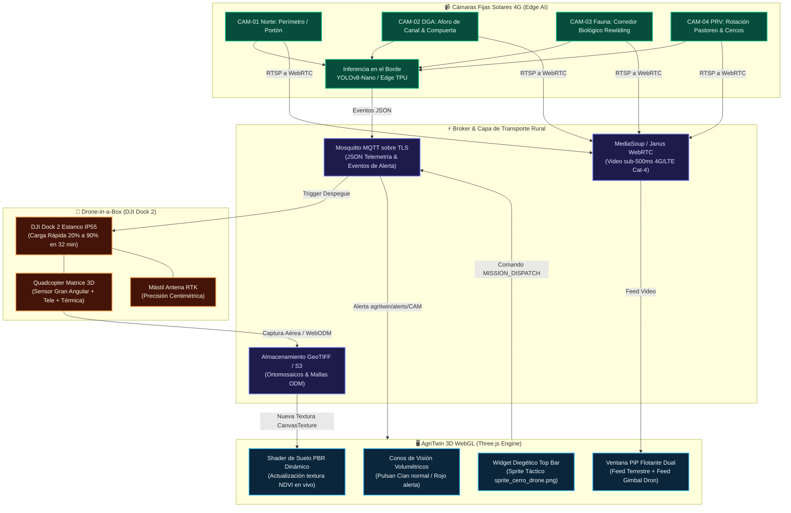
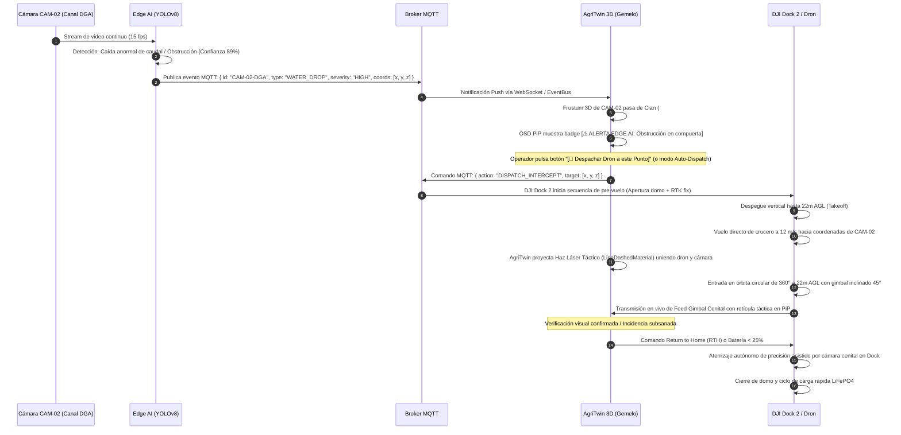

# 🚁 [[AGRITWIN_VISION_Y_DRONES_AUTONOMOS]] • Visión Computacional en el Borde & Estaciones Drone-in-a-Box

> **Definición de Producto**: Módulo ciberfísico y vertical de alta gama de [[Agritwin]] que converge una **red de cámaras fijas solares 4G con Edge AI** (postes perimetrales, aforadores DGA, monitoreo de pastoreo PRV) y **estaciones de drones autónomos Drone-in-a-Box** (estilo DJI Dock 2 / Matrice 3D). La orquestación es bidireccional y diegética: cualquier anomalía detectada en tierra despacha automáticamente el dron para intercepción, trazando conos de visión 3D (frustums) y actualizando texturas ortomosaicas en caliente sobre el gemelo digital WebGL.

---

## 🧭 1. Resumen Ejecutivo y Propuesta de Valor

Para **dueños de predios ausentes** (administración remota desde Santiago u otros países), viñas de exportación e inversionistas ESG, la supervisión de campo tradicional sufre de "ceguera espacial": las cámaras convencionales son silos aislados y los vuelos de dron requieren pilotos en terreno.

**AgriTwin Vision & Drones** transforma el gemelo digital en un centro de comando y control unificado (C2):
1. **Representación Diegética de 2 Clics:** El usuario inspecciona los postes de vigilancia como entidades 3D físicas, con conos volumétricos de cobertura y ventana flotante PiP (*Picture-in-Picture*) con streaming de ultra-baja latencia (<500ms).
2. **Orquestación Reactiva Inmediata:** Si una cámara detecta corte de cerco, colapso de caudal DGA o intrusión, el dron despega en **menos de 90 segundos** desde su hangar estanco y vuela en línea recta al punto de alerta.
3. **Fotogrametría Viva:** Los ortomosaicos multiespectrales (NDVI/RGB) capturados por el dron se proyectan sobre el terreno 3D en caliente sin recargar la sesión web.

---

## 🛠️ 2. Arquitectura de Integración Ciberfísica



---

## ⚡ 3. Algoritmo de Orquestación Reactiva (Cámara ➔ Dron)

La máquina de estados de misión reactiva implementada en `DroneMissionManager.js` opera de acuerdo a la siguiente secuencia de eventos:



---

## 👁️ 4. Representación Diegética en el Gemelo 3D

Para mantener el estándar gráfico inmersivo (inspirado en juegos de estrategia histórica y simulación como Age of Empires II y SimCity 4):

1. **Postes Físicos en 3D:** Cada cámara cuenta con un poste metálico con textura PBR, gabinete estanco IP65, domo PTZ y panel solar fotovoltaico inclinado a **33° hacia el norte**, coincidiendo con la latitud óptima del Maule.
2. **Conos Frustum Volumétricos:** Construidos mediante `THREE.ConeGeometry` con wireframe de ingeniería superpuesto y material semitransparente con blending aditivo. Responden en tiempo real al joystick PTZ del visor PiP.
3. **Visor PiP (Picture-in-Picture) de Doble Canal:**
   - **Canal 1 (`[📹 Feed Terrestre]`):** Visión directa desde el poste con HUD táctico (FPS, bitrate, latencia, inferencias YOLOv8).
   - **Canal 2 (`[🚁 Feed Gimbal Dron]`):** Visión aérea cenital estabilizada con horizonte artificial, altímetro digital y retícula de encuadre.
4. **Widget Diegético Flotante:** Anclado en la barra superior con el sprite histórico `assets/ui/sprite_cerro_drone.png`, indicando estado en vivo (`Hangar`, `Misión NDVI`, `Intercepción`), porcentaje de batería y botón de despegue con 1 clic.

---

## 🗺️ 5. Pipeline de Fotogrametría y Actualización en Caliente

Cuando el dron completa una misión de inspección sistemática (patrón en "grilla" sobre los cuarteles del Fundo Meniels):

1. Las imágenes georreferenciadas EXIF/XMP se descargan vía API REST en el servidor de fotogrametría local/nube (NodeODM).
2. Se procesan los índices ortomosaicos RGB y multiespectrales (NDVI = $\frac{NIR - Red}{NIR + Red}$).
3. El resultado se expone como un mosaico de azulejos (slippy map tiles) o textura plana PNG optimizada.
4. **Actualización sin Parpadeo en Three.js:**
   ```javascript
   const newTexture = new THREE.CanvasTexture(canvasOrtho);
   newTexture.wrapS = THREE.RepeatWrapping;
   newTexture.wrapT = THREE.RepeatWrapping;
   mapManager.groundCiv6Mat.map = newTexture;
   mapManager.groundCiv6Mat.needsUpdate = true;
   ```
   El agricultor ve cómo el mapa 3D renueva su vigor vegetal frente a sus ojos sin tener que recargar la página web.

---

## 📦 6. Plan de Despliegue Piloto y Hardware para el Maule (BOM Costo-Eficiente)

Para un predio piloto de 50 a 150 hectáreas en Parral, Retiro o Longaví:

| Ítem | Componente de Hardware | Conectividad / Energía | Función Clave | Costo Aprox (USD) |
| :--- | :--- | :--- | :--- | :--- |
| **1** | **Postes Solares PTZ 4G (x4)**<br/>Hikvision DS-2XS6A25G0-I/CH20S40 o Reolink 4G PTZ | Panel solar 40W + Batería LiFePO4 + SIM Entel IoT | Vigilancia perimetral, aforo DGA y control de potreros PRV | $380 - $650 c/u |
| **2** | **Estación Drone-in-a-Box**<br/>DJI Dock 2 + Dron Matrice 3D (RGB + Térmica) | Conexión eléctrica 220V (o kit solar 1.2 kW) + Enlace Starlink Mini | Misiones programadas de fotogrametría e intercepción reactiva en 90s | $12.000 - $16.000 |
| **3** | **Edge Gateway Central**<br/>NVIDIA Jetson Orin Nano 8GB / Raspberry Pi 5 | Gabinete estanco IP66 en caseta de riego con UPS | Inferencia YOLOv8 en tiempo real y transcodificación WebRTC | $350 - $600 |
| **4** | **Cámaras Trampa de Fauna (x2)**<br/>Módulos solares 4G con disparo PIR 0.2s | Baterías 18650 recargables (autonomía 6 meses) | Monitoreo de fauna nativa para créditos de biodiversidad ESG | $180 - $250 c/u |

---

## 💼 7. Modelo de Monetización y Packaging Comercial

* **Add-on SaaS "AgriTwin Sentinel":** $25.000 a $38.000 CLP/mes por cámara conectada (almacenamiento de video en la nube por 30 días, inferencias Edge AI ilimitadas y alertas críticas vía WhatsApp/SMS).
* **Servicio Drone HaaS (Hardware-as-a-Service):** 
  - Para predios que no desean comprar el DJI Dock 2: arriendo operativo mensual con mantención periódica de hélices y calibración de baterías.
  - Para predios con dron propio: add-on de software para despacho reactivo y procesamiento automatizado de ortomosaicos a $120.000 CLP/mes.
* **Pitch para Dueños Ausentes:** *"Supervise su campo desde cualquier lugar del mundo con la misma claridad que un videojuego de estrategia: si ocurre un incidente, su dron despega antes de que su capataz termine de encender la camioneta."*

---

## 🔗 Referencias Cruzadas en el Vault

* [[Agritwin]] — Gemelo digital biofísico 3D y simulador de predio.
* [[AGROTECH]] — Tesis y arquitectura fundacional de la empresa.
* [[STACK_TECNOLOGICO_ARQUITECTURA_AGRITWIN]] — Detalle técnico del motor WebGL, shaders y Three.js.
* [[Sensores y Hardware KioT]] — Nodos de suelo FDR y microclima LoRaWAN.
* [[DINAMICA_CLIMATICA_ESCENARIOS_CUENCA]] — Integración con cuenca regional y modelado de vientos Puelche.
