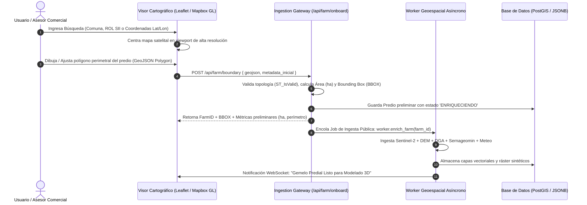
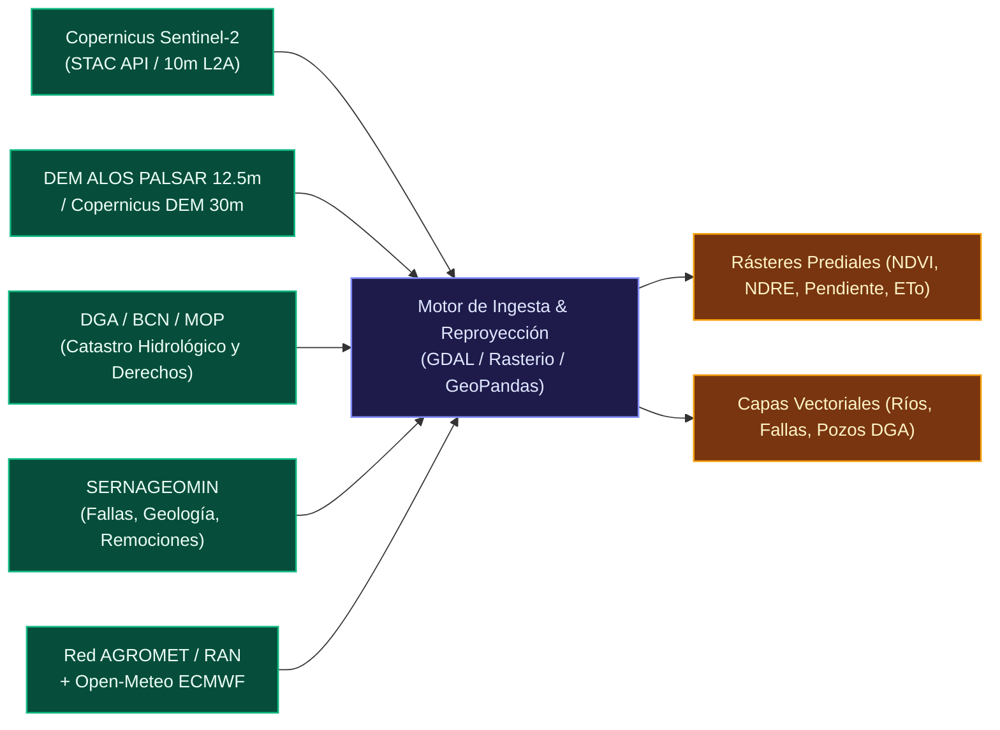

# 📡 [[ARQUITECTURA_INGESTA_DATOS_AGRITWIN|Especificación Técnica de Ingesta y Arquitectura de Datos de AgriTwin]]

> **Propósito**: Definir la arquitectura de ingesta, normalización y síntesis biofísica de datos para la generación del gemelo digital predial en Chile. Integra flujos de entrada interactivos de usuario, extracción desatendida de datos geoespaciales públicos de Chile, y el esquema JSON canónico de configuración predial privada.

---

## 🗺️ 1. Flujo de Entrada de Usuario (Onboarding Cartográfico)



### 1.1. Reglas Técnicas de Captura
1. **Geolocalización Base**: Proyección en coordenadas geográficas WGS84 (`EPSG:4326`), proyectadas internamente a UTM Huso 19S (`EPSG:32719`) para Chile continental para mediciones métricas precisas de área y distancias.
2. **Validación Topológica**:
   - Polígono cerrado sin auto-intersecciones (`ST_IsSimple`, `ST_IsValid`).
   - Umbral de área: mínimo 0.5 hectáreas (parcelas de agrado) hasta 2.500 hectáreas (fundos industriales).
3. **Cálculo de Bounding Box (BBOX)**: Representado como `[min_lon, min_lat, max_lon, max_lat]`, utilizado como máscara de corte (`clipping mask`) para todas las consultas a servicios WMS/WCS y STAC.

---

## 🛰️ 2. Capa Pública Automática (Chile)

El motor de enriquecimiento consulta automáticamente las siguientes fuentes abiertas sin intervención manual:



### 2.1. Pipeline Satelital Sentinel-2 (Copernicus L2A Surface Reflectance)
- **Frecuencia**: Paso orbital cada 5 días. Consulta a través de SpatioTemporal Asset Catalogs (STAC) o AWS Open Data / Microsoft Planetary Computer.
- **Filtro de Nubosidad**: Filtro de Scene Classification Layer (SCL) para descartar píxeles con nubes, sombras de nubes o nieve. Si la nubosidad sobre el predio supera el 20%, se consulta la escena previa disponible.
- **Índices Espectrales Calculados**:
  $$\text{NDVI} = \frac{B08 - B04}{B08 + B04} \quad (\text{Vigor vegetativo general})$$
  $$\text{NDRE} = \frac{B08 - B05}{B08 + B05} \quad (\text{Clorofila en canopia densa / estrés temprano})$$
  $$\text{NDWI} = \frac{B08 - B11}{B08 + B11} \quad (\text{Contenido de agua foliar / humedad superficial})$$

### 2.2. Topografía y Pendientes (DEM ALOS PALSAR / SRTM)
- Extracción de malla de elevación recortada por el BBOX predial.
- Generación de curvas de nivel a 1m o 5m de equidistancia.
- **Cálculo de Pendiente (Slope %)** y **Orientación (Aspect)** para modelar exposición solar y acumulación de aire frío en fondos de valle (factor clave en heladas primaverales).
- Cálculo de microcuencas de escorrentía superficial mediante algoritmo D8 (*Flow Direction* y *Flow Accumulation*).

### 2.3. Geología y Susceptibilidad de Remoción en Masa (SERNAGEOMIN)
- Capa de geología regional: tipo de roca/depósito (sedimentario aluvial, coluvial, volcánico).
- Catastro de fallas geológicas activas e inactivas.
- Mapa de susceptibilidad de remociones en masa (deslizamientos, flujos de detritos).

### 2.4. Hidrografía y Catastro DGA (Dirección General de Aguas)
- Red hidrográfica de esteros, canales de regadío y ríos principales (ID cuenca y subcuenca BCN).
- Cruce espacial con el Catastro Público de Aguas (CPA) de la DGA para identificar pozos y captaciones superficiales legalmente constituidas en un radio de 5 km.

### 2.5. Meteorología y Microclima (AGROMET / RAN + Open-Meteo)
- Localización de la estación AGROMET / INIA más cercana (ej. Estación Parral, Retiro o Longaví).
- Consulta horaria de: Temperatura ambiente, Humedad relativa, Velocidad y dirección de viento, Radiación solar global, Precipitación acumulada.
- Modelo predictivo a 7 días (ECMWF IFS / GFS) con cálculo automatizado de **Evapotranspiración de Referencia ($ET_o$)** según el estándar FAO-56 Penman-Monteith.

---

## 📝 3. Capa Privada Declarativa (JSON Schema de Configuración Predial)

Este esquema define la totalidad de las variables agronómicas, operativas, mecatrónicas y legales que el propietario o asesor ingresa para calibrar el Gemelo Digital.

```json
{
  "$schema": "https://json-schema.org/draft/2020-12/schema",
  "title": "AgriTwinFarmConfiguration",
  "description": "Esquema canónico de configuración predial privada para AgriTwin Chile",
  "type": "object",
  "required": [
    "predio_id",
    "identificacion",
    "geometria",
    "derechos_agua",
    "suelo",
    "cuarteles"
  ],
  "properties": {
    "predio_id": {
      "type": "string",
      "format": "uuid",
      "description": "Identificador único global del predio"
    },
    "identificacion": {
      "type": "object",
      "required": ["nombre_predio", "propietario", "rol_sii", "comuna", "region"],
      "properties": {
        "nombre_predio": { "type": "string" },
        "propietario": {
          "type": "object",
          "required": ["nombre_razon_social", "rut", "email_contacto", "telefono_whatsapp"],
          "properties": {
            "nombre_razon_social": { "type": "string" },
            "rut": { "type": "string" },
            "email_contacto": { "type": "string", "format": "email" },
            "telefono_whatsapp": { "type": "string" }
          }
        },
        "rol_sii": { "type": "string", "description": "Formato: XXXX-YY" },
        "comuna": { "type": "string" },
        "region": { "type": "string", "default": "Región del Maule" },
        "superficie_total_declarada_ha": { "type": "number", "minimum": 0.1 }
      }
    },
    "geometria": {
      "type": "object",
      "required": ["centroide", "poligono_geojson"],
      "properties": {
        "centroide": {
          "type": "object",
          "required": ["lat", "lon"],
          "properties": {
            "lat": { "type": "number" },
            "lon": { "type": "number" }
          }
        },
        "poligono_geojson": {
          "type": "object",
          "description": "GeoJSON Feature o Polygon en EPSG:4326"
        }
      }
    },
    "derechos_agua": {
      "type": "object",
      "required": ["fuentes_agua"],
      "properties": {
        "fuentes_agua": {
          "type": "array",
          "items": {
            "type": "object",
            "required": ["tipo", "caudal_nominal_lps"],
            "properties": {
              "id_fuente": { "type": "string" },
              "tipo": { 
                "type": "string", 
                "enum": ["pozo_profundo", "accion_canal_superficial", "vertiente", "rio", "embalse_comunitario"] 
              },
              "nombre_fuente": { "type": "string" },
              "caudal_nominal_lps": { "type": "number", "minimum": 0 },
              "acciones_canal_cuota": { "type": "number" },
              "numero_resolucion_dga": { "type": "string" },
              "inscripcion_cbr": {
                "type": "object",
                "properties": {
                  "fojas": { "type": "string" },
                  "numero": { "type": "string" },
                  "ano": { "type": "integer" },
                  "conservador": { "type": "string" }
                }
              },
              "profundidad_pozo_metros": { "type": "number" },
              "nivel_estatico_metros": { "type": "number" },
              "bomba_instalada_hp": { "type": "number" }
            }
          }
        },
        "acumuladores_tranques": {
          "type": "array",
          "items": {
            "type": "object",
            "required": ["id_tranque", "volumen_maximo_m3"],
            "properties": {
              "id_tranque": { "type": "string" },
              "nombre": { "type": "string" },
              "volumen_maximo_m3": { "type": "number" },
              "tipo_revestimiento": { 
                "type": "string", 
                "enum": ["tierra_compactada", "geomembrana_hdpe", "hormigon"] 
              },
              "sensor_nivel_instalado": { "type": "boolean", "default": false }
            }
          }
        }
      }
    },
    "suelo": {
      "type": "object",
      "required": ["textura_predominante"],
      "properties": {
        "textura_predominante": {
          "type": "string",
          "enum": ["arcilloso", "franco_arcilloso", "franco", "franco_arenoso", "arenoso", "trumao"]
        },
        "profundidad_efectiva_cm": { "type": "number", "default": 80 },
        "capacidad_de_campo_pct": { "type": "number" },
        "punto_marchitez_permanente_pct": { "type": "number" },
        "materia_organica_pct": { "type": "number" },
        "ph": { "type": "number", "minimum": 3.5, "maximum": 9.5 },
        "conductividad_electrica_ds_m": { "type": "number" },
        "analisis_laboratorio_adjunto": { "type": "string", "description": "URL o Hash del PDF" }
      }
    },
    "cuarteles": {
      "type": "array",
      "items": {
        "type": "object",
        "required": ["id_cuartel", "nombre", "especie", "variedad", "superficie_ha", "sistema_riego"],
        "properties": {
          "id_cuartel": { "type": "string" },
          "nombre": { "type": "string" },
          "especie": { 
            "type": "string",
            "enum": ["cerezo", "arandano", "avellano_europeo", "manzano", "vina_uva_mesa", "vina_vinifera", "olivo", "nogal", "maiz", "trigo", "pradera", "hortalizas", "nativo_conservacion"]
          },
          "variedad": { "type": "string" },
          "portainjerto": { "type": "string" },
          "ano_plantacion": { "type": "integer" },
          "superficie_ha": { "type": "number" },
          "marco_plantacion": {
            "type": "object",
            "properties": {
              "distancia_sobre_hilera_m": { "type": "number" },
              "distancia_entre_hileras_m": { "type": "number" },
              "densidad_plantas_ha": { "type": "integer" }
            }
          },
          "sistema_riego": {
            "type": "object",
            "required": ["tipo", "caudal_emisor_lph"],
            "properties": {
              "tipo": { "type": "string", "enum": ["goteo", "microaspersion", "aspersion", "surco", "inundacion", "secano"] },
              "lineas_por_hilera": { "type": "integer", "default": 1 },
              "distancia_emisores_m": { "type": "number" },
              "caudal_emisor_lph": { "type": "number" },
              "presion_operacion_bar": { "type": "number" }
            }
          },
          "poligono_cuartel_geojson": { "type": "object" }
        }
      }
    },
    "energia_e_infraestructura": {
      "type": "object",
      "properties": {
        "conexion_electrica": {
          "type": "string",
          "enum": ["red_trifasica", "red_monofasica", "off_grid_100_solar", "generador_diesel", "sin_electricidad"]
        },
        "paneles_solares": {
          "type": "object",
          "properties": {
            "instalados": { "type": "boolean", "default": false },
            "potencia_pico_kwp": { "type": "number" },
            "inversor_marca_modelo": { "type": "string" },
            "banco_baterias_kwh": { "type": "number" },
            "conectado_a_bomba_riego": { "type": "boolean" }
          }
        },
        "galpones_y_estructuras": {
          "type": "array",
          "items": {
            "type": "object",
            "properties": {
              "tipo": { "type": "string", "enum": ["galpon_maquinaria", "packing", "bodega_fitosanitarios", "caseta_riego", "vivienda"] },
              "superficie_m2": { "type": "number" },
              "coordenadas": { "type": "object" }
            }
          }
        }
      }
    },
    "animales_y_biodiversidad": {
      "type": "object",
      "properties": {
        "ganaderia_pastoreo": {
          "type": "array",
          "items": {
            "type": "object",
            "properties": {
              "especie": { "type": "string", "enum": ["bovino", "ovino", "equino", "caprino", "porcino", "aviar"] },
              "cabezas": { "type": "integer" },
              "tipo_manejo": { "type": "string", "enum": ["regenerativo_holistico", "rotacional", "continuo_tradicional"] }
            }
          }
        },
        "apicultura_colmenas": {
          "type": "object",
          "properties": {
            "total_colmenas": { "type": "integer", "default": 0 },
            "ubicacion_apiario": { "type": "object" }
          }
        },
        "corredores_biologicos_ha": { "type": "number", "default": 0 }
      }
    },
    "recursos_humanos": {
      "type": "object",
      "properties": {
        "trabajadores_permanentes": { "type": "integer", "default": 1 },
        "temporeros_pico_cosecha": { "type": "integer", "default": 0 },
        "administrador_nombre": { "type": "string" },
        "administrador_telefono": { "type": "string" }
      }
    },
    "seguridad_y_hardware_instalado": {
      "type": "object",
      "properties": {
        "camaras_seguridad": {
          "type": "array",
          "items": {
            "type": "object",
            "properties": {
              "id_camara": { "type": "string" },
              "tipo": { "type": "string", "enum": ["solar_4g_ptz", "solar_4g_fija", "wifi_ip", "cctv_cableada"] },
              "proveedor_instalador": { "type": "string", "default": "Luis Parral" },
              "ubicacion_coordenadas": { "type": "object" },
              "stream_rtsp_url": { "type": "string" }
            }
          }
        },
        "drones": {
          "type": "object",
          "properties": {
            "dispone_de_dron": { "type": "boolean", "default": false },
            "modelo": { "type": "string" },
            "frecuencia_vuelo": { "type": "string", "enum": ["semanal", "mensual", "estacional_cosecha", "por_demanda"] }
          }
        },
        "sensores_kiot_vinculados": {
          "type": "array",
          "items": {
            "type": "string",
            "description": "MAC address o DeviceID del hardware KioT ESP32"
          }
        }
      }
    }
  }
}
```

---

## ⚡ 4. Validación y Ejecución Técnica en el Gemelo Digital

1. **Persistencia**: El JSON configurado se almacena en PostgreSQL con extensión PostGIS (`farm_configurations` table con columna `config jsonb`).
2. **Generación del Terreno 3D**:
   - La malla base de Three.js / WebGL se deforma proceduralmente usando las elevaciones del DEM ALOS PALSAR.
   - Las texturas de los cuarteles se colorean y diferencian según las coordenadas de cada cuartel y los índices Sentinel-2 (NDVI actual vs. histórico).
   - Se instancian modelos 3D procedurales (árboles frutales según densidad y variedad, tranques con nivel de agua dinámico, paneles solares y caseta de riego).
3. **Disparo de Alertas**:
   - Si la humedad del suelo cae por debajo del Punto de Marchitez Permanente (PMP) declarado o inferido, se genera alerta de riego inmediato.
   - Si el pronóstico AGROMET predice temperatura $\le 0.5^\circ\text{C}$ con punto de rocío bajo, se activa el protocolo preventivo de helada 72 horas antes.
