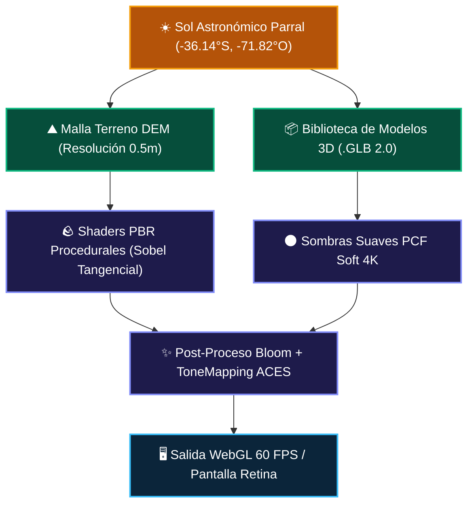
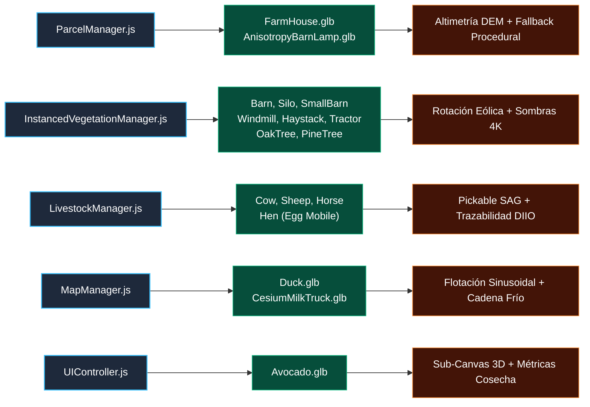

# 🎨 [[Arquitectura Visual del Motor 3D y Pipeline PBR de AgriTwin]]

> **Visión Técnica**: El motor gráfico de [[Agritwin]] fusiona la legibilidad táctica e interactividad isométrica de **Civilization VI** con el **hiperrealismo biofísico PBR (Physically Based Rendering)** de simuladores de precisión agronómica. Permite transicionar fluidamente desde la escala macro de cuenca hidrográfica y curvaturas de nivel hasta el micro-relieve táctil de un galpón rústico, la trazabilidad individual de un rebaño bovino o la inspección fenológica a nivel de fruto.

---

## 🏛️ 1. Motor Gráfico Base y Pipeline de Renderizado

* **Motor Principal**: **Three.js (r128)** montado sobre WebGL 2.0 nativo del navegador, ejecutado a 60 FPS con aceleración por hardware GPU.
* **Mapeo Tonal**: `THREE.ACESFilmicToneMapping` (exposición calibrada en 1.05) para replicar la respuesta de rango dinámico de cámaras cinematográficas profesionales.
* **Pipeline de Sombras**: `THREE.PCFSoftShadowMap` con mapas de sombra de 4096×4096 y sesgo anti-acné (`bias: -0.002`, `normalBias: 0.02`).
* **Post-Procesamiento**: `EffectComposer` con `RenderPass` y pase selectivo de floración atmosférica `UnrealBloomPass` para la dispersión de la luz solar en las copas de los árboles, destellos de agua y luminarias rurales.



---

## 🧱 2. Ecosistema de Texturas Procedurales PBR (0 KB en Red)

Para evitar descargas pesadas de cientos de megabytes de texturas rasterizadas externas, el subsistema `PBRArchitecturalMaterialFactory.js` sintetiza proceduralmente mapas PBR en memoria a resolución 1024×1024 mediante **operadores de convolución Sobel** que convierten mapas de altura (*heightfields*) generados matemáticamente en mapas de normales tangenciales:

| Material PBR | Mapas Generados | Características Visuales |
| :--- | :--- | :--- |
| **Ladrillo Histórico Artesanal** | Albedo, Normal Sobel, Roughness | Aparejo a soga (*running bond*), llagas de mortero hundidas (3-5 mm ópticos), porosidad arcillosa y tonalidades terracota heterogéneas. |
| **Tejas Curvas de Terracota** | Albedo, Normal Sobel, Roughness | Perfil acanalado francés/español con solape horizontal de hiladas y pátina de envejecimiento. |
| **Roble Oscuro Envejecido** | Albedo, Normal Sobel, Roughness | Vetas longitudinales profundas, grietas de secado y asperezas rústicas para vigas Tudor, postes y puertas. |
| **Mampostería de Piedra Cantera** | Albedo, Normal Sobel, Roughness | Bloques graníticos y basálticos irregulares labrados con mortero grisáceo para chimenea y fundaciones. |
| **Corteza Nativa (Quillay/Boldo)** | Albedo, Normal Sobel, Roughness | Fisuras verticales profundas que reaccionan dinámicamente a la luz rasante del amanecer y atardecer. |
| **Follaje Botánico** | Albedo, Normal Sobel, VertexColors | Normales suaves de racimos foliares que difunden la luz (*smooth shading*) eliminando el efecto facetado. |

---

## 📦 3. Biblioteca Local de Modelos 3D (.GLB) y Marco Legal

El gemelo digital incorpora un catálogo completo de 17 modelos tridimensionales en formato binario **glTF 2.0 (`.glb`)** almacenados localmente en `assets/models/`. Todos los assets provienen de repositorios abiertos oficiales (Poly by Google, Quaternius, Khronos Group, Three.js) y cuentan con **plena validez legal y comercial**:

| Modelo 3D | Archivo | Origen / Autor | Licencia | Rol en el Gemelo Digital |
| :--- | :--- | :--- | :--- | :--- |
| **Casa Patronal Principal** | `FarmHouse.glb` | Poly by Google | **CC-BY 3.0** | Administración central y casa patronal del fundo. Escala 0.24 (~6.0m de frente), anclada sobre el relieve DEM. |
| **Granero de Acopio Principal** | `Barn.glb` | Quaternius / Poly | **CC0 (Dominio Público)** | Galpón agroindustrial de secado y acopio techado. Capacidad 450 fardos / 30 toneladas. |
| **Galpón de Herramientas** | `SmallBarn.glb` | Quaternius | **CC0 (Dominio Público)** | Taller rústico de mantenimiento, soldadura solar y sala de bombas de riego. |
| **Silo Vertical de Granos** | `Silo.glb` | Quaternius | **CC0 (Dominio Público)** | Almacenamiento vertical de granos (avena y maíz rolado) para suplementación seca PRV. |
| **Molino de Viento Clásico** | `Windmill.glb` | Quaternius / Poly | **CC0 (Dominio Público)** | Bomba eólica tradicional de extracción en pozo profundo con rotación reactiva al viento. |
| **Parva / Fardos de Heno** | `Haystack.glb` | Quaternius | **CC0 (Dominio Público)** | Lotes de forraje seco (alfalfa, trébol, festuca) en la era del granero para contingencias invernales. |
| **Tractor Agrícola RTK** | `Tractor.glb` | Poly by Google | **CC-BY 3.0** | Maquinaria pesada de precisión 140 HP 4WD con piloto automático RTK ISOBUS en patio de faenas. |
| **Camión Cisterna Lácteo** | `CesiumMilkTruck.glb` | Khronos / Cesium | **CC-BY 4.0** | Transporte isotérmico de leche a 3.8°C en el patio logístico agroindustrial. |
| **Rebaño Bovino (Vaca)** | `Cow.glb` | Poly by Google | **CC-BY 3.0** | Ganadería regenerativa en Potrero P3. Trazabilidad SAG DIIO y pelajes dinámicos (Overo Colorado / Negro). |
| **Rebaño Ovino (Oveja)** | `Sheep.glb` | Poly by Google | **CC-BY 3.0** | Pastoreo selectivo ovino en Potrero P5. Lana merino y control biológico de malezas. |
| **Caballo Criollo Chileno** | `Horse.glb` | Three.js / Data Arts | **CC-BY / MIT** | Pastoreo libre y descompactación de suelo en Potrero P7 con capas alazán y zaino. |
| **Gallina de Pastoreo** | `Hen.glb` | Poly by Google | **CC-BY 3.0** | Aves en pastoreo directo alrededor del gallinero móvil (Egg Mobile) en Potrero P8. |
| **Ánade / Pato Silvestre** | `Duck.glb` | Sony / Khronos | **CC0 (Dominio Público)** | Fauna acuática flotante en el tranque de 18.500 m³ con balanceo sinusoidal continuo. |
| **Roble / Quillay Frondoso** | `OakTree.glb` | Quaternius / Poly | **CC0 (Dominio Público)** | Cortinas biológicas cortaviento, parque de la casa patronal y huertos de frutales. |
| **Pino Perimetral** | `PineTree.glb` | Quaternius | **CC0 (Dominio Público)** | Cortina cortavientos perimetral y barrera de retención hídrica en ladera. |
| **Farola de Forja Rural** | `AnisotropyBarnLamp.glb` | Khronos Group | **CC0 (Dominio Público)** | Luminaria rústica en el porche de la casa, sincronizada con el ciclo solar (encendido automático nocturno). |
| **Palta / Aguacate Hass** | `Avocado.glb` | Microsoft / Khronos | **CC-BY 4.0** | Visor fenológico interactivo 3D en el panel lateral de cultivos (materia seca 24.2%, calibre). |

### ⚖️ Certeza Jurídica y Licencias
1. **CC0 1.0 Universal (Dominio Público)**: Libre uso sin restricciones técnicas ni comerciales; no requiere regalías ni menciones obligatorias.
2. **CC-BY 3.0 / 4.0 (Creative Commons Atribución)**: Autorizado para explotación comercial y técnica. La exigencia legal de citar al autor queda satisfecha mediante esta documentación y la ficha técnica de la plataforma.
3. **Modelos "Unbranded"**: Todos los vehículos y maquinarias son diseños genéricos sin marcas comerciales protegidas ni logotipos registrados (ausencia de conflictos de propiedad industrial).

---

## 🛠️ 4. Arquitectura de Carga y Managers de Entidades

La integración de los modelos se realiza a través de un pipeline modular y desacoplado, donde cada manager de entidad asume una responsabilidad específica:



### 1. `ParcelManager.js` (Infraestructura Principal y Conectividad)
* **Casa Patronal Tudor (`FarmHouse.glb`)**:
  * Escala calibrada en `(0.24, 0.24, 0.24)`, reduciendo el modelo original de 25m a ~6m de cota real.
  * Anclaje altimétrico automático al terreno DEM mediante `mapManager.getTerrainElevation(x, z)`.
  * Propiedades de material PBR ajustadas en memoria: `roughness = 0.75`, `metalness = 0.05`.
  * Habilitación de `castShadow = true` y `receiveShadow = true`.
  * Registro en el sistema de selección interactiva mediante `mapManager.addPickable(child, entityData)`.
  * **Fallback Procedural**: Si el archivo falla o no hay conexión, se activa automáticamente `_buildProceduralHouse(houseGroup, entityData)` con arquitectura multicapa Tudor.

### 2. `InstancedVegetationManager.js` (Estructuras Agrícolas, Maquinaria y Arbolado)
* **Complejo de Edificaciones Rurales**:
  * `Barn.glb`: Escala `0.55`, rotación `-PI/12`, posicionado en `(-13.5, 10.5)`. Telemetría de humedad interior (42%) y temperatura (18.5°C).
  * `Silo.glb`: Escala `0.65`, posicionado en `(-18.2, 12.0)`. Monitoreo de nivel de almacenamiento (68% de capacidad).
  * `SmallBarn.glb`: Escala `0.50`, rotación `PI/6`, posicionado en `(-17.5, 6.2)`. Taller de soldadura solar y filtros de fertirriego.
  * `Windmill.glb`: Escala `3.2`, posicionado en `(-15.2, 2.8)`. **Animación dinámica reactiva al viento**: en `animateWind(time, windSpeed)` sus aspas rotan proporcionalmente a la velocidad del viento (`windmillModel.rotation.y += 0.008 * (windSpeed / 12.0)`).
  * `Haystack.glb`: Clones distribuidos en 3 lotes estratégicos (`Lote A`, `Lote B`, `Lote C`) con escalas entre `0.14` y `0.16` y datos bromatológicos (materia seca 88%, proteína cruda 16.4%).
* **Maquinaria Pesada**:
  * `Tractor.glb`: Escalamiento normalizado con caja delimitadora tridimensional (`BoundingBox.getSize() -> scale = 3.2 / maxDim`), posicionado en el centro logístico `(7.5, -11.0)` con ficha RTK ISOBUS.
* **Cortinas Biológicas y Arbolado Frondoso**:
  * `OakTree.glb`: 7 ejemplares de árboles nativos de gran porte (`Quillaja saponaria` / Roble) con escalas `0.25 - 0.32` en cortinas cortaviento y parque del granero, además de su uso en hileras de huerto frutal.
  * `PineTree.glb`: 6 coníferas perimetrales de protección (`Pinus radiata`) con escalas `2.6 - 3.2` sobre las líneas de faldeo.

### 3. `LivestockManager.js` (Ganadería Regenerativa PRV y Fauna Productiva)
* **Rebaños Interactivos en Potreros de Pastoreo Racional Voisin (PRV)**:
  * **Bovinos en Potrero P3 (`Cow.glb`)**: Escala `0.011`. Clonación individual con coloración adaptativa de pelaje (Overo Colorado / Clavel con tinte `#92400e`, `roughness: 0.7`). Cada ejemplar cuenta con caravana DIIO oficial del SAG, peso vivo, días en potrero y producción lechera.
  * **Ovinos en Potrero P5 (`Sheep.glb`)**: Escala `0.18`, `roughness: 0.85`. Rebaño de pastoreo selectivo y desmalezado biológico.
  * **Equinos en Potrero P7 (`Horse.glb`)**: Escala `0.0095`. Caballos criollos con tintes de capa alazán/zaino para descompactación de suelo.
  * **Avicultura Móvil en Potrero P8 (`Hen.glb`)**: Escala `0.0065`. 8 gallinas distribuidas en radio orbital alrededor del gallinero móvil (*Egg Mobile*) en pastoreo rotativo.
* **Trazabilidad y Selección Clickeable**:
  * Todos los animales registran sus mallas hijas en `mapManager.addPickable()`. Al hacer clic sobre cualquier ejemplar en el visor 3D, el panel lateral despliega su **Ficha Clínica y Productiva SAG**.
* **Resiliencia Procedural**:
  * En caso de error de red, el sistema conmuta sin fisuras a generadores geométricos nativos: `_spawnProceduralCows`, `_spawnProceduralSheep`, `_spawnProceduralHorses` y `_spawnProceduralChickens`.

### 4. `MapManager.js` (Dinámica Hídrica y Logística de Cuenca)
* **Tranque de Acumulación (18.500 m³)**:
  * Malla de agua física conformada sobre el relieve DEM (`MeshPhysicalMaterial`, rugosidad 0.04, metalness 0.05, opacidad 0.82 y tono `#0284c7`).
  * `Duck.glb`: Patos silvestres nadando con un algoritmo de flotabilidad armónica sinusoidal continua:
    $$y = \text{elevación}(x, z) + \sin(t \cdot 2.0) \cdot 0.035$$
* **Cadena de Frío Logística**:
  * `CesiumMilkTruck.glb`: Camión cisterna ubicado en el patio de maniobras, integrado a la telemetría de recolección de leche a 3.8°C.

### 5. `UIController.js` (Inspección Fenológica Frutal 3D)
* **Visor 3D en el Cajón de Cultivos**:
  * Al seleccionar un cuartel de paltos o frutales, se instancia un sub-escenario Three.js dedicado en un lienzo secundario (`#fruitPbrCanvas`).
  * Carga interactiva de `Avocado.glb` a escala `28`, con controles orbitales de rotación táctil y de ratón (`dx * 0.015`, `dy * 0.015`).
  * Muestra indicadores críticos de precosecha: **calibre comercial**, **materia seca (24.2%)** y **días proyectados a floración**.

---

## 🛡️ 5. Principio de Doble Vía: Tolerancia a Fallos y Modo Offline

Uno de los pilares de la arquitectura gráfica de AgriTwin es la **garantía de cero pantallas en blanco**:

```
                       [ Intento de Carga GLTF (.GLB) ]
                                       │
                    ┌──────────────────┴──────────────────┐
                    ▼                                     ▼
             [ Éxito de Red / Disco ]              [ Falla 404 / Offline ]
                    │                                     │
                    ▼                                     ▼
        [ Renderizado Modelo Real ]           [ Generador Procedural PBR ]
        (Geometría GLTF de precisión)        (Primitivas Three.js + Shaders Sobel)
                    │                                     │
                    └──────────────────┬──────────────────┘
                                       ▼
                         [ Render Activo en la Escena ]
```

Cada llamada a `gltfLoader.load()` dispone de un controlador de excepciones (`onError`) que dispara automáticamente el método procedural correspondiente (`_buildProceduralHouse`, `_spawnProceduralCows`, etc.), garantizando que la plataforma funcione al 100% incluso en condiciones de conectividad nula en sectores rurales aislados del Maule.

---

## ☀️ 6. Sistemas Atmosféricos e Iluminación Astronómica

* **Efemérides Solares Maule**:
  * La posición solar se computa analíticamente en tiempo real para las coordenadas del predio: **Latitud -36.14°S, Longitud -71.82°O (Parral, Chile)**.
* **Ciclos de Luz y Sombras Rasantes**:
  * **Amanecer / Ocaso**: Azimut bajo, sombras kilométricas de alta definición con tinte cálido dorado (`#fb923c`, 1.05 intensidad).
  * **Mediodía Cenital**: Luz solar natural fría (`#fffef5`, 1.45 intensidad).
  * **Noche Rural**: Luz lunar fría (`#1e293b`), acompañada por el encendido automático de la farola rústica `AnisotropyBarnLamp.glb` en el pórtico de la casa.
* **Niebla de Cuenca**: Densidad adaptativa que recrea la neblina matinal proveniente del río Longaví y el estero Colliguay.

---

## 📊 7. Métricas de Rendimiento y Consumo de Hardware

| Parámetro | Valor Medido | Estrategia de Optimización |
| :--- | :---: | :--- |
| **Fotogramas por Segundo (FPS)** | **60 FPS estables** | Límite vertical VSync con renderizado bajo demanda e interpolación. |
| **Peso Total de la Biblioteca 3D** | **~28.5 MB en disco** | Formato binario comprimido GLB 2.0; carga asíncrona diferida. |
| **Consumo de Memoria VRAM GPU** | **~280 MB** | Texturas generadas en memoria GPU (0 KB tráfico HTTP de mapas). |
| **Llamadas de Dibujado (Draw Calls)** | **Mínimas (InstancedMesh)** | Miles de matas de pasto, hileras de cultivo y árboles procesados en 1 batch GPU. |
| **Compatibilidad de Dispositivos** | **Navegadores & Mac Nativo** | Ejecutable en Chrome, Safari, Firefox y empaque desktop macOS. |

---

## 🌐 Fuentes Recomendadas para la Expansión de Modelos

Para incorporar nuevos activos 3D a la biblioteca de AgriTwin manteniendo el estándar legal y técnico:

1. **[Poly Haven](https://polyhaven.com/models)**: Activos rústicos (herramientas, rocas, madera) 100% bajo **CC0**.
2. **[Kenney.nl](https://kenney.nl/assets)**: Paquetes modulares agrícolas ultra-optimizados 100% bajo **CC0**.
3. **[Quaternius](https://quaternius.com/)**: Packs de animales animados, árboles y construcciones rurales 100% bajo **CC0**.
4. **[Sketchfab](https://sketchfab.com/feed)**: Maquinaria especializada y vehículos (filtrando por licencias **CC-BY** descargables).

---

*Documentos Relacionados*: [[Agritwin]] • [[Predio Meniels]] • [[STACK_TECNOLOGICO_ARQUITECTURA_AGRITWIN]] • [[METODOLOGIA_HIDROLOGICA_INCENDIOS_DEM]] • [[DINAMICA_CLIMATICA_ESCENARIOS_CUENCA]] • [[KioT Hardware]] • [[Permacultura]]
