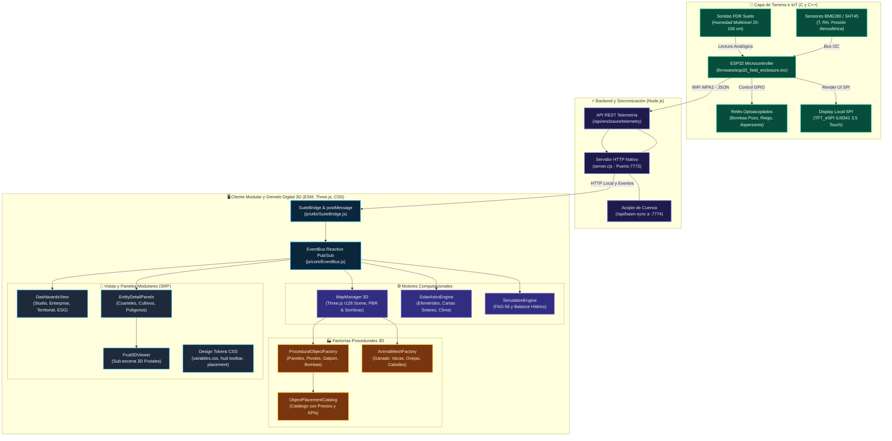
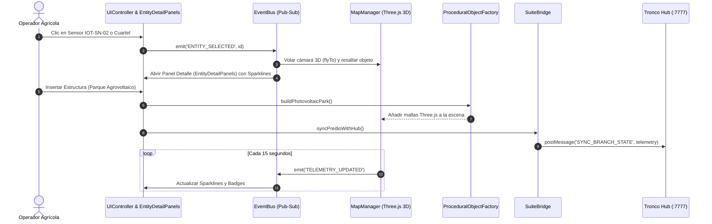

# 🌐 [[Agritwin]] • Gemelo Digital Biofísico 3D de Predios Agrícolas

> **Definición**: [[Agritwin]] es el producto insigne de [[AGROTECH]]. Es una plataforma mecatrónica y de simulación 3D que replica digitalmente fundos y parcelas agrícolas con precisión milimétrica y biofísica, integrando telemetría de campo, datos geoespaciales y observación satelital.

---

## 🛠️ Stack Tecnológico y Arquitectura Modular del Sistema

La arquitectura de AgriTwin es **full-stack, modular, desacoplada y orientada a eventos (SRP)**, integrando desde el silicio de microcontroladores de campo en C++ hasta renderizado fotorealista acelerado por GPU en el navegador mediante WebGL/GLSL, factorías Three.js dedicadas y wrappers nativos de escritorio.

### 🧭 1. Diagrama de Arquitectura Global (Modular v3.9.9)

---

### 💻 2. Lenguajes de Programación por Subsistema

| Subsistema / Módulo | Lenguaje Principal | Archivos de Referencia | Rol en AgriTwin |
| :--- | :--- | :--- | :--- |
| **Lógica de Cliente & UI** | **JavaScript (ES6+ / ESM)** | `js/app.js`, `js/ui/**/*.js`, `index.html` | Orquestación general, gestión del DOM, EventBus reactivo y vistas especializadas. |
| **Factorías Geométricas 3D** | **JavaScript (Three.js r128 API)** | `js/entities/factories/*.js` | Generación procedural de mallas PBR (paneles solares, tranques, ganado, invernaderos). |
| **Matemática Solar & Clima** | **JavaScript (Canvas 2D API)** | `js/utils/solar/SolarAstroEngine.js` | Algoritmos de posición solar astronómica (latitud -36.14°S), climogramas y mapas celestes. |
| **Renderizado Gráfico 3D** | **GLSL** (OpenGL Shading Language) | `js/map/BiophysicalTerrainShader.js` | Shaders de cálculo de normales Sobel procedurales, absorción lumínica en suelo y gradientes NDVI. |
| **Sistemas de Diseño CSS** | **CSS3 Moderno (Custom Properties)** | `css/variables.css`, `css/*.css` | Paleta unificada Obsidian Dark, layout responsivo, docks de campaña y efectos Glassmorphism. |
| **Servidor & APIs Locales** | **JavaScript (Node.js CommonJS)** | `server.cjs`, `test-ecosystem-sync.cjs` | Despacho ultraligero sin dependencias externas (`zero-npm`), acople de cuenca (:7774) y actuadores. |
| **Firmware Embebido IoT** | **C / C++ (Arduino Framework)** | `firmware/esp32_field_enclosure.ino` | Adquisición física analógica/I2C, visualización en display SPI TFT y disparo de relés industriales. |
| **Shell & Empaque macOS** | **Swift** & **Bash / Shell** | `set_icon.swift`, `launch-desktop.command` | Compilación de scripts nativos para asignación de iconos del Finder y lanzador de escritorio. |
| **Visor Desktop Integrado** | **TypeScript / TSX** | `desktop/AgroTwinDynamicViewer.tsx` | Contrato de tipado estricto para clientes desacoplados en suites mayores. |
| **Puente Tronco Suite Hub** | **JavaScript (postMessage API)** | `js/utils/SuiteBridge.js` | Canal bidireccional que conecta el Predio Twin con el Tronco Hub (Suite AgriTwin :7777). |

---

### ⚙️ 3. Flujo Reactivo de Eventos (EventBus & SuiteBridge)

---

## ⚡ 4. Integración Multifuente de Datos

El software integra de manera desacoplada:
1. **[[datos satelitales]]**: Pases multiespectrales cada 5 días de **Sentinel-2 L2A** (bandas B02, B04, B08, B11) y **Landsat 9** para calcular índices de vigor (`NDVI`), contenido foliar de agua (`NDWI`), índice de estrés hídrico (`CWSI`) y reflectancia superficial.
2. **[[datos climáticos]] y [[datos meteorológicos]]**: Red agroclimática de referencia (DGA / Agromet) y estaciones in situ vía `OpenMeteoForecastService.js`.
3. **[[geología]] y [[data del suelo]]**: Modelos de textura SoilGrids, curvas de retención hídrica y datos edafológicos del Maule.
4. **[[data in situ]] de [[sensores]]**: Redes LoRaWAN / WiFi de nodos [[KioT Hardware]] (sondas FDR multinivel a 20, 40, 60 y 100 cm, sensores de temperatura industrial DS18B20 y sensores de mojadura foliar).

---

## 🖥️ 5. Motor de Simulación y Capacidades

* **[[consola de monitoreo]] 3D**: Renderizado WebGL acelerado por GPU en Three.js con pipeline PBR, sombreado solar astronómico por hora del día, modelos 3D GLTF y texturas de alta resolución (Ver especificación en: [[ARQUITECTURA_VISUAL_MOTOR_3D_PBR]]).
* **Modelo Biofísico [[FAO-56 Penman-Monteith]]**: Balance cascada de humedad en 3 estratos de suelo activo desde el día 1, incluso antes de la instalación física de sondas.
* **Modelo Katabático Anti-Heladas**: Detección de drenaje de aire frío en laderas y hondonadas térmicas para pronosticar congelamiento de brotes con 72h de anticipación y disparar alertas urgentes por WhatsApp y activación de asperjadores.
* **Módulo Ciberfísico [[AGRITWIN_VISION_Y_DRONES_AUTONOMOS]]**: Convergencia de cámaras solares PTZ 4G con Edge AI (conos de visión Frustum 3D, streaming PiP y controles PTZ) y misiones de intercepción reactiva con Drone-in-a-Box (DJI Dock 2), actualizando ortomosaicos NDVI en caliente sobre la malla del terreno 3D.
* **Mapas de [[riesgo climático]]**: Análisis de recurrencia de sequías, heladas históricas y disponibilidad de napas a 10 años para compradores de parcelas.
* **Recomendaciones en tiempo real**: Guías agronómicas basadas en la [[Permacultura]] y la [[agroecología]].

---

## 🤝 6. Gobernanza y Repartición Justa

[[AgroTech]] y su producto [[AgriTwin]] se producen colaborativamente en equipo:
* Se reconoce expresamente la **autoría intelectual** de cada desarrollador, agrónomo, diseñador y técnico de campo.
* **Repartición justa de recursos y ganancias**: Basada en la colaboratividad, el valor aportado y métricas de producción transparente.
* El tiempo y energía invertida por cada miembro busca ser valorado y protegido bajo el principio de la [[Economía de los Hombros]].

---

## 🌾 Predios de Validación Activa
* **[[Predio Meniels]]** (Parral, Maule): 24.8 ha modeladas con 8 cuarteles, parque agrovoltaico, cámaras de vigilancia perimetral y sensores IOT-SN-01 a IOT-SN-06.
* **[[Fundo El Boldo]]** (Curicó, Maule): Monitoreo crítico de cerezos Lapins y arándanos con microaspersión antiheladas.

---
*Vínculos*: [[AGROTECH]] • [[AGRITWIN_VISION_Y_DRONES_AUTONOMOS]] • [[ARQUITECTURA_VISUAL_MOTOR_3D_PBR]] • [[STACK_TECNOLOGICO_ARQUITECTURA_AGRITWIN]] • [[KioT Hardware]] • [[RewildMapper]] • [[Pasaporte verde]] • [[Permacultura]]
