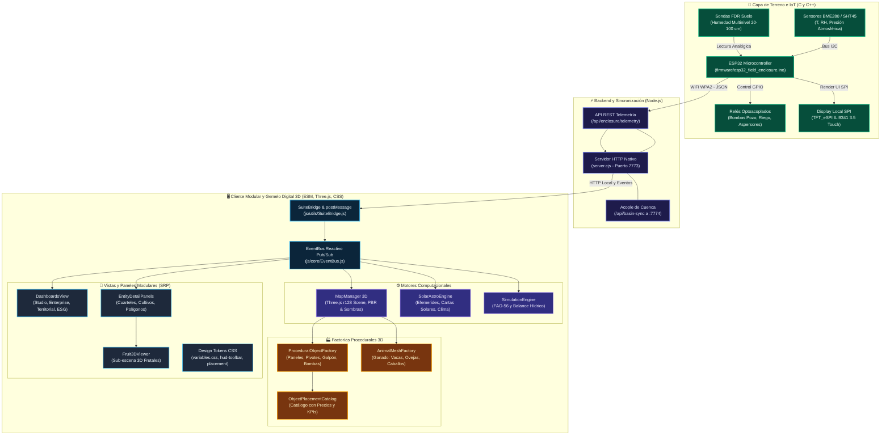
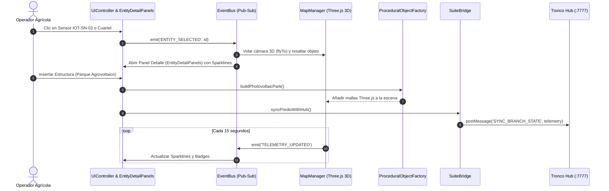

# 🛠️ [[STACK_TECNOLOGICO_ARQUITECTURA_AGRITWIN|Stack Tecnológico, Lenguajes y Arquitectura Modular de AgriTwin]]

> **Definición de Sistema**: [[Agritwin]] (Rama 1: *Predio Twin* de la suite [[AGROTECH]]) es una plataforma de gemelo digital agrícola biofísico de alta resolución. Su arquitectura es **full-stack, modular, desacoplada y orientada a eventos**, estructurada bajo el principio de responsabilidad única (SRP). Integra desde el silicio de microcontroladores de campo en C++ hasta renderizado fotorealista acelerado por GPU en el navegador mediante WebGL/GLSL, factorías procedurales de Three.js y vistas modulares de UI.

---

## 🧭 1. Diagrama de Arquitectura Global del Sistema

Flujo integral de datos entre el hardware de terreno, la capa de sincronización en servidor y la nueva arquitectura modular desacoplada del cliente:



---

## 🏛️ 2. Estructura Modular del Proyecto y Principio de Responsabilidad Única (SRP)

Tras la refactorización arquitectónica de la Versión 3.9.9, se descongestionaron los monolitos históricos, separando estrictamente la **lógica matemática**, la **generación geométrica**, el **catálogo de datos**, la **orquestación de red** y la **representación visual**:

```
agritwin/
├── css/
│   ├── variables.css          # ✨ Tokens maestros Obsidian Dark, radios, tipografía y semáforos
│   ├── hud-toolbar.css        # ✨ Barra inferior desplegable de herramientas 3D (4 grupos ergonómicos)
│   ├── placement-dock.css     # ✨ Dock AoE III de inserción de infraestructuras y trazados
│   ├── main.css               # Estilos principales de interfaz y layout
│   └── glassmorphism.css      # Filtros backdrop-blur y superficies translúcidas
│
├── js/
│   ├── app.js                 # Punto de entrada de la aplicación y ciclo de vida (AgriTwinApp)
│   ├── core/                  # Bus de eventos y gestores transversales
│   │   ├── EventBus.js        # Desacoplamiento Pub/Sub reactivo
│   │   └── ProjectManager.js  # Serialización / exportación de proyectos (.agritwin / GeoJSON)
│   │
│   ├── data/                  # ✨ Modelos de datos puros y configuraciones declarativas
│   │   ├── ObjectPlacementCatalog.js # 567 líneas con catálogo completo de objetos e infraestructuras
│   │   └── MauleSensorsConfig.js     # Configuración de nodos IoT Maule y estaciones del taller
│   │
│   ├── entities/
│   │   ├── factories/         # ✨ Factorías geométricas Three.js desacopladas
│   │   │   ├── ProceduralObjectFactory.js # Paneles solares, galpones, pivotes, tranques, pozos
│   │   │   └── AnimalMeshFactory.js       # Síntesis procedural de rebaño (vacas, ovejas, caballos)
│   │   ├── ObjectPlacementManager.js      # Controlador de interacción y trazado continuo (1.068 líneas)
│   │   └── LivestockManager.js            # Lógica de pastoreo PRV y semáforo forrajero (1.365 líneas)
│   │
│   ├── map/                   # Motor 3D Three.js y shaders de terreno
│   │   ├── MapManager.js      # Escena Three.js, cámaras orbitales, vuelo drone y post-processing
│   │   └── BiophysicalTerrainShader.js # Shaders GLSL para humedad, relieve y gradientes NDVI
│   │
│   ├── ui/                    # Interfaz gráfica y paneles desacoplados
│   │   ├── UIController.js    # Orquestador visual principal (reducido a 3.136 líneas)
│   │   ├── drawers/           # ✨ Vistas y tableros completos
│   │   │   └── DashboardsView.js     # Dashboards Studio, Enterprise, Territorial, ESG y Creator
│   │   ├── panels/            # ✨ Paneles de inspección flotantes
│   │   │   └── EntityDetailPanels.js # Inspección de cuarteles, cultivos, polígonos y objetos
│   │   └── components/        # ✨ Sub-componentes visuales reutilizables
│   │       └── Fruit3DViewer.js      # Visualizador interactivo 3D de frutas y fenología
│   │
│   └── utils/
│       ├── SuiteBridge.js     # ✨ Puente bidireccional postMessage y telemetría con el Hub
│       └── solar/             # ✨ Motor de matemática astronómica y bioclimática
│           └── SolarAstroEngine.js   # Efemérides solares, climogramas y mapas celestes en Canvas
│
└── docs/                      # Bóveda de documentación arquitectónica sincronizada con el Hub
    └── STACK_TECNOLOGICO_ARQUITECTURA_AGRITWIN.md
```

### Métricas Cuantitativas de Refactorización y Reducción de Monolitos

| Archivo / Módulo | Líneas Originales | Líneas Actuales | Reducción | Responsabilidad Extraída |
| :--- | :---: | :---: | :---: | :--- |
| **`UIController.js`** | 5.160 | 3.136 | **-39.2% (-2.024 lín)** | Extraído a `DashboardsView.js`, `EntityDetailPanels.js`, `Fruit3DViewer.js` y `SolarAstroEngine.js`. |
| **`ObjectPlacementManager.js`** | 2.488 | 1.068 | **-57.1% (-1.420 lín)** | Extraído a `ObjectPlacementCatalog.js`, `ProceduralObjectFactory.js` y `placement-dock.css`. |
| **`AgroWorkshopOverlay.js`** | 2.741 | 2.414 | **-11.9% (-327 lín)** | Extraído a `MauleSensorsConfig.js`. |
| **`LivestockManager.js`** | 1.561 | 1.365 | **-12.6% (-196 lín)** | Extraído a `AnimalMeshFactory.js`. |
| **`index.html`** | 2.310 | 1.933 | **-16.3% (-377 lín)** | 100% de estilos CSS embebidos extraídos a `hud-toolbar.css` y `placement-dock.css`; scripts inline derivados a `SuiteBridge.js`. |

---

## 💻 3. Lenguajes de Programación y Tecnologías por Subsistema

| Subsistema / Módulo | Lenguaje Principal | Archivos de Referencia | Rol en AgriTwin |
| :--- | :--- | :--- | :--- |
| **Lógica de Cliente & UI** | **JavaScript (ES6+ / ESM)** | `js/app.js`, `js/ui/**/*.js`, `index.html` | Orquestación general, gestión del DOM, EventBus reactivo y vistas especializadas. |
| **Factorías Geométricas 3D** | **JavaScript (Three.js r128 API)** | `js/entities/factories/*.js` | Generación procedural de mallas PBR (paneles solares, tranques, ganado, invernaderos). |
| **Matemática Solar & Clima** | **JavaScript (Canvas 2D API)** | `js/utils/solar/SolarAstroEngine.js` | Algoritmos de posición solar astronómica (latitud -36.14°S), climogramas y mapas estelares. |
| **Renderizado Gráfico 3D** | **GLSL** (OpenGL Shading Language) | `js/map/BiophysicalTerrainShader.js` | Shaders de cálculo de normales Sobel procedurales, absorción lumínica en suelo y gradientes NDVI. |
| **Sistemas de Diseño CSS** | **CSS3 Moderno (Custom Properties)** | `css/variables.css`, `css/*.css` | Paleta unificada Obsidian Dark, layout responsivo, docks de campaña y efectos Glassmorphism. |
| **Servidor & APIs Locales** | **JavaScript (Node.js CommonJS)** | `server.cjs`, `test-ecosystem-sync.cjs` | Despacho ultraligero sin dependencias externas (`zero-npm`), acople de cuenca (:7774) y actuadores. |
| **Firmware Embebido IoT** | **C / C++ (Arduino Framework)** | `firmware/esp32_field_enclosure.ino` | Adquisición física analógica/I2C, visualización en display SPI TFT y disparo de relés industriales. |
| **Shell & Empaque macOS** | **Swift** & **Bash / Shell** | `set_icon.swift`, `launch-desktop.command` | Compilación de scripts nativos para asignación de iconos del Finder y lanzador de escritorio. |
| **Visor Desktop Integrado** | **TypeScript / TSX** | `desktop/AgroTwinDynamicViewer.tsx` | Contrato de tipado estricto para clientes desacoplados en suites mayores. |
| **Puente Tronco Suite Hub** | **JavaScript (postMessage API)** | `js/utils/SuiteBridge.js` | Canal bidireccional que conecta el Predio Twin con el Tronco Hub (Suite AgriTwin :7777). |

---

## ⚙️ 4. Diagrama de Módulos y Flujo de Eventos (Frontend Reactivo)

El cliente utiliza el patrón desacoplado **Pub/Sub** a través de `EventBus.js` que sincroniza la escena 3D con la telemetría biofísica y los paneles de inspección:



---

## 🎨 5. Diseño Visual, Ergonomía y Reducción de Fatiga Cognitiva (UI/UX)

La versión 3.9.9 introduce mejoras directas en la experiencia de usuario basadas en tres principios rectores:

1. **Tokens Maestros Unificados (`css/variables.css`):**
   * **Superficies**: Obsidian Dark estandarizado (`--bg-primary: #0a0f1d`, `--panel-bg: rgba(15, 23, 42, 0.85)`).
   * **Tipografía**: Jerarquía fluida con `Plus Jakarta Sans` para encabezados y `JetBrains Mono` para datos numéricos y telemetría.
   * **Semáforos de Estado**: `--accent-emerald` (#10b981) para estado óptimo, `--accent-amber` (#f59e0b) para alertas hídricas, y `--accent-rose` (#ef4444) para riesgo de incendios/heladas.

2. **Divulgación Progresiva (Progressive Disclosure):**
   * **Barra de Herramientas 3D Ergonomizada**: Agrupada en 4 familias conceptuales con colapsado suave (`#btnToggleToolbar`):
     - **Vista & Terreno**: Satélite real, gemelo 3D, modo híbrido y control de exageración DEM.
     - **Cámaras & Navegación**: Presets de enfoque, vuelo drone con cámara suave (`C`), paseo a pie (`P`) y timelapse (`T`).
     - **Edición 3D & Dibujo**: Dock AoE III, pincel vectorial, elevación de relieve y trazado continuo.
     - **Monitoreo & Cuenca**: Capas de viento Windy, drenaje D8, cámaras solares con frustums 3D y telemetría de sensores.
   * **Microcopy Directo y Tooltips Sutiles**: Reemplazo de bloques de texto explicativos redundantes por etiquetas concisas y atajos de teclado visuales (`<kbd class="hud-key">`).

3. **Modales Desacoplados y Paneles Flotantes:**
   * La sub-escena interactiva de frutos 3D (`Fruit3DViewer.js`) y los paneles de inspección de cuarteles (`EntityDetailPanels.js`) operan como capas modulares independientes sin bloquear la escena principal.

---

## 🧪 6. Suite de Pruebas y Verificación de Calidad

El proyecto cuenta con validación continua multicapa para asegurar cero regresiones:

- **Verificación Sintáctica (AST)**: Comprobación estricta con `node --check` en el 100% de los módulos JavaScript (`UIController.js`, `SuiteBridge.js`, `ObjectPlacementCatalog.js`, `ProceduralObjectFactory.js`, etc.).
- **Sincronización Ecosistémica**: Script automatizado `node test-ecosystem-sync.cjs` que valida la coherencia de datos entre las 6 ramas (Predio, Mesa Vecinal, Cuenca, Invernadero, Establo, Excursión) y los 18 asesores IA consultivos con 0 fallos.
- **Suite End-to-End Automatizada (Playwright)**: Script `scratch/test_fixes_e2e.py` que comprueba:
  1. *Cámaras Visoras Inactivas por Defecto* (cero parpadeo o ruido de red al inicio).
  2. *Integridad de Mover Árboles* (raíz y copa unificadas bajo el mismo grupo Three.js al reposicionar).
  3. *Trazado Continuo e Inserción por Lote AoE III* (consolidación What-If de tramos continuos).
  4. *Modal Estratégico de Permacultura* (renderizado de KPIs y lienzos de gráficos).

---

## 🔗 7. Sincronización con el Tronco Hub (Suite AgriTwin)

Conforme al **Principio Árbol** (Axioma Estructural de la Suite):
- **Rama 1 (Predio Twin)** mantiene total soberanía local y funciona de forma autónoma en el puerto `7773`.
- La comunicación con el **Tronco Hub** (puerto `7777` / `7771`) se efectúa mediante `window.postMessage` estructurado gestionado por `SuiteBridge.js`:
  - `SYNC_BRANCH_STATE`: Emisión de telemetría de aforos DGA, niveles del tranque Keyline, biomasa forrajera y humedad de suelo FDR.
  - `setPredioDualMode`, `whatif`, `toggleYeomans`, `dossier`, `toggleWorkshop`: Recepción y ejecución de directivas maestras sin romper el aislamiento de marcos (*frames*).
- Esta documentación reside simultáneamente en `agritwin/docs/` y `../agritwin-hub/docs/`, garantizando que la Bóveda de Conocimiento (*Vault*) del Hub refleje con exactitud la arquitectura viva del gemelo.

---

## 🌳 8. Matriz de Datos: Lo Inmutable (Doctrina & Métodos) vs. Lo Particular (Expediente Predial)

El sistema opera bajo una distinción ontológica fundamental para garantizar que un nuevo usuario o un predio recién creado comprenda el funcionamiento sin verse contaminado por datos ajenos:

### A. Los Tres Niveles de Datos del Ecosistema

1. **Lo Inmutable (Doctrina, Métodos y Operación de la App - Permanente 100%):**
   * **Estratégico vs. Táctico:** Es la definición operacional del sistema. El nivel *Estratégico* rige la planificación estacional y anual (balances hídricos, curvas Keyline, rotación de 8 potreros, fijación de carbono). El nivel *Táctico* gobierna la maniobra inmediata 0-12h ante contingencias críticas (avance de fuego con viento Puelche en cuenca, heladas catabáticas en brotes, o crecidas fluviales). Esta distinción es universal e inalterable en cualquier predio.
   * **Algoritmo de Generación de Polígonos:** La técnica de intersección raycast sobre la malla DEM 3D, la proyección geodésica WGS84, el cálculo de hectáreas y la serialización canónica GeoJSON (DGA/SAG) es idéntica en toda la plataforma.
   * **Principio Árbol y las 6 Vertientes:** El Tronco Suite Hub como bus central y las 6 ramas desacopladas (`predio`, `vecinal`, `cuenca`, `establo`, `invernadero`, `excursion`).
   * **Los 18 Asesores Consultivos:** La ontología de los 18 especialistas (3 por rama) y sus modelos biofísicos de análisis (Edafólogo, Fisióloga Vegetal, Veterinario Holístico, Hidrólogo, etc.).

2. **Flujos Transversales (Permacultura Holística):**
   * La **Zonificación 0 a 5 de Bill Mollison** y la **Escala de Permanencia de P.A. Yeomans** atraviesan transversalmente las 6 ramas:
     * *Zona 0:* Casa Patronal / Tronco Hub (Predio).
     * *Zona 1:* Huerto biointensivo y biofábrica (Invernadero).
     * *Zona 2:* Frutales de alta densidad y gallinero móvil (Predio & Establo).
     * *Zona 3:* Praderas polifíticas y cereales de secano (Predio).
     * *Zona 4:* Pastoreo silvopastoril y fajas cortafuegos (Mesa Vecinal).
     * *Zona 5:* Reserva natural intangible, calicatas y rewilding (Excursión & Cuenca).
   * Los balances de carbono (t C/ha) y la captación pluvial interconectan a todos los módulos.

3. **Flujos Verticales (Jerarquía Biofísica de la Finca):**
   * **Predio ➔ Establo:** La oferta forrajera de los cuarteles del predio (kg MS/ha) determina verticalmente la carga animal (UGM) y los días de ocupación de los 8 potreros PRV del establo.
   * **Establo ➔ Invernadero / Predio:** Las excretas del rebaño alimentan la biofábrica del invernadero para la síntesis de Bokashi y supermagro, que luego se aplican como enmienda viva a los cuarteles del predio.

4. **Lo Particular (Instancia Específica del Predio Activo):**
   * Nace en modo semilla (bootstrap) para usuarios nuevos y está completamente poblado para el *Fundo Meniel*:
     * Los vértices y coordenadas exactas de los cuarteles trazados.
     * La cota, área y volumen del tranque particular (ej. 18.500 m³ en Meniel vs. 5.000 m³ o 0 m³ en un predio nuevo).
     * Los valores numéricos del plan estratégico y las lecturas vivas de los sensores KioT instalados.
     * Los dictámenes y tareas acordadas con los 18 asesores en la bitácora de campo.

### B. Portal de Acceso Alquímico (Arbor Tellurica Gate) & FarmProfileManager

El ingreso al sistema mantiene el grabado histórico del **Árbol Tellúrico** (`assets/ui/arbol_alquimico_splash.jpg`), pero sustituye la espera de carga por un selector activo:
* **Fundo Meniel (Demo Maestro):** Precargado con 8 cuarteles, 15 sondas FDR, parque solar 9.9 kWp, 18.5k m³ tranque y 18 asesores.
* **+ Registrar Nuevo Predio:** Asistente de inicio para nuevos agricultores que genera un expediente predial semilla en blanco listo para dibujar con el dock 3D o importar archivos GIS.
* **Header Dinámico:** Badge interactivo `#hubActiveProfileBadge` en el Hub para conmutar de predio en cualquier momento.

---

*Vínculos del Vault*: [[Agritwin]] • [[ARQUITECTURA_VISUAL_MOTOR_3D_PBR]] • [[AGROTECH]] • [[Sensores y Hardware KioT]] • [[Principio Árbol]] • [[FAO-56 Penman-Monteith]] • [[Doctrina Táctica C2]] • [[Permacultura]]

