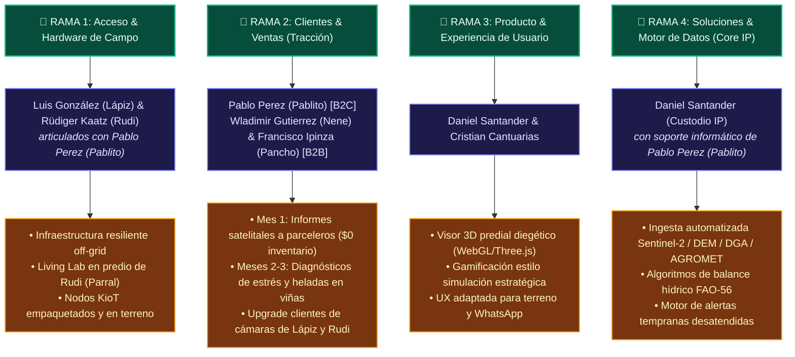

# 🏛️ [[Acuerdos_Equipo_Gobernanza|Acuerdos de Equipo, Gobernanza Corporativa y Protocolos Operativos]]

> **Marco Fundacional**: Este documento establece las reglas del juego, la distribución de responsabilidades, los esquemas de compensación mixta y la soberanía tecnológica de **Chile AgroTech SpA / AgriTwin**. Diseñado para garantizar la máxima transparencia, justicia distributiva y blindaje de la Propiedad Intelectual (IP) del Fundador.

---

## 👥 1. Nómina Oficial del Equipo y Estructura de Roles

| Nombre Oficial | Nombre de Confianza | Rol Formal en el Proyecto | Mecanismo de Vinculación y Retribución |
| :--- | :--- | :--- | :--- |
| **Daniel Santander Urrutia** | **Daniel** | **Fundador, Director Técnico & Arquitecto de Sistemas** | Titularidad exclusiva del 100% de la IP Matriz ("Black Box", algoritmos, pipelines). Licenciamiento comercial a la SpA. |
| **Cristian Cantuarias** | **Cantuarias** | **Lead Game Designer, Co-Diseñador UI/UX & Front-End 3D** | Acuerdo de Cesión de IP (*IP Assignment*) + Pool de Vesting por entregables validados de interfaz/simulación. |
| **Pablo Perez** | **Pablito** | **El Conector Operativo & Venta Directa B2C** | 30% por venta de Informes Spot + 25% Setup / 15% MRR + margen por paquetización y venta de kits IoT + soporte informático de pipelines. |
| **Luis González** | **Lápiz** | **Asesor Técnico Autónomo de Infraestructura Off-Grid** | Proveedor y asesor técnico autónomo: 100% margen mano de obra de montaje + margen sobre hardware + 10% MRR de clientes que sume al SaaS. |
| **Rüdiger Kaatz** | **Rudi** | **Asesor Técnico Autónomo Off-Grid & Living Lab Parral** | Asesor autónomo de ingeniería energética (baterías recicladas / LiFePO4 / anti-incendios) + comisión por captación de clientes e inversionistas extranjeros. |
| **Francisco Ipinza** | **Pancho** | **Fuerza Comercial B2B & Convenios Inmobiliarios** | Comisiones por cierre B2B (25% Setup + 15% MRR) + 30% por convenios de informes de parcelas + acceso al pool de vesting accionario SpA. |
| **Wladimir Gutierrez** | **Nene** | **Fuerza Comercial B2B & Estrategia Agroindustrial** | Comisiones por prospección de cuentas medianas/grandes (viñas, frutícolas, packings) + acceso al pool de vesting accionario SpA. |

---

## 🧭 2. Matriz de las 4 Ramas Operativas del Ecosistema

---

## 🛡️ 3. Régimen de Propiedad Intelectual y Gobernanza de Código

### A. Soberanía Absoluta de la IP Matriz
1. **Titularidad del Software**: La totalidad del código fuente de AgriTwin, motores de cálculo biofísico, shaders WebGL, modelos matemáticos, pipelines satelitales y marcas comerciales son de titularidad exclusiva de **Daniel Santander Urrutia** bajo la **Ley N° 17.336 de Propiedad Intelectual de Chile**.
2. **Licencia a Chile AgroTech SpA**: La SpA operativa recibe una **Licencia de Explotación Comercial No Exclusiva, Temporal y Condicionada**. Si la SpA entra en litigio, disolución o insolvencia, la licencia se revoca automáticamente y la IP permanece intacta en manos del Fundador.

### B. Protocolo de Desarrollo y Cesión de IP con Cristian Cantuarias
Dado que Cantuarias tiene acceso al repositorio para el desarrollo del frontend 3D y la gamificación, se establecen las siguientes reglas técnicas y jurídicas:
1. **Acuerdo de Cesión de IP (IP Assignment)**: Todos los componentes de interfaz, scripts, modelos 3D procedurales y assets diseñados por Cantuarias para AgriTwin son cedidos en su totalidad patrimonial a favor del Fundador / Matriz, a cambio de su participación en el **Pool de Vesting Accionario** de la SpA operativa.
2. **Control de Ramas en GitHub (`Git Flow`)**:
   - La rama `main` está protegida contra escritura directa.
   - Cantuarias trabaja en ramas dedicadas: `feature/ui-dashboard`, `feature/gamification-view`, `feature/diegic-controls`.
   - La integración a `main` se realiza exclusivamente mediante **Pull Requests (PR)** revisados y aprobados por Daniel Santander.

---

## ⚡ 4. Régimen de Asesoría Técnica Autónoma Off-Grid: Luis González & Rüdiger Kaatz

1. **Autonomía Profesional**: Ni Luis González (Lápiz) ni Rüdiger Kaatz (Rudi) son empleados dependientes. Operan como **Asesores Técnicos e Infraestructura Off-Grid Autónomos**.
2. **El "Living Lab / Centro Demostrativo Parral"**:
   - El predio de Rüdiger Kaatz en Parral se consagra como el centro oficial de pruebas y demostración tecnológica de AgroTech en la VII Región.
   - En él se valida en condiciones reales la integración de:
     * Bancos de baterías recicladas de alto rendimiento (LiFePO4 / Litio).
     * Sistemas autónomos de aspersión y defensa perimetral anti-incendios forestales.
     * Nodos de telemetría KioT y cámaras solares 4G de Luis González.
3. **Canal de Inversionistas y Clientes Expatriados**:
   - Rüdiger actúa como puente de confianza para comercializar estudios de resiliencia predial, sistemas anti-incendios y gemelos digitales con residentes y compradores extranjeros de alto patrimonio en la precordillera del Maule.

---

## 📈 5. Mecánica del Pool de Vesting para la SpA Operativa

Para los miembros del equipo que consoliden participación societaria en **Chile AgroTech SpA** (Cantuarias, Pablito, Nene, Pancho), rige la regla estándar:
- **Plazo Total de Vesting**: 4 años (48 meses).
- **Período de Cliff**: 1 año (12 meses). Cero acciones consolidadas durante los primeros 11 meses. Si alguien sale antes del mes 12, se retira con sus comisiones pagadas pero con **0% de acciones**.
- **Desbloqueo al Mes 12**: 25% del paquete de acciones asignado.
- **Desbloqueo Posterior (Meses 13 al 48)**: 2.08% mensual pro-rata sujeto a metas de tracción y permanencia efectiva.
