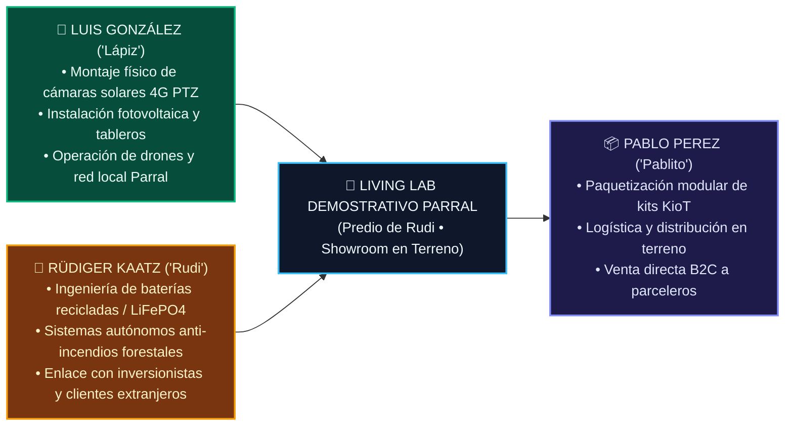

# 🚜 [[Ficha_Asesores_Tecnicos_OffGrid_Luis_Rudiger|Ficha Estratégica: Asesores Técnicos Off-Grid y Living Lab Parral]]

> **Marco de Alianza**: Definición de la alianza estratégica con **Luis González ("Lápiz")** y **Rüdiger Kaatz ("Rudi")**, profesionales autónomos y consolidados en la precordillera y valle de Parral, junto con la articulación operativa de **Pablo Perez ("Pablito")** para el empaque y despliegue de kits mecatrónicos.

---

## 👥 1. Perfil de los Asesores y Especialidades Técnicas

### A. Luis González ("Lápiz")
- **Base Territorial**: Parral, Retiro y Valle Central.
- **Competencias Clave**: Instalación de sistemas de videovigilancia solar 4G, tendidos eléctricos agrícolas, bombas de pozo profundo, canalizaciones y pilotaje de drones para inspección visual.
- **Relación con AgroTech**: Proveedor y contratista técnico preferente. Retiene el 100% de la utilidad por instalación física y margen comercial de hardware, más el 10% de royalty mensual de los predios que sume al SaaS.

### B. Rüdiger Kaatz ("Rudi")
- **Base Territorial**: Sector precordillerano de Parral (zona de alta vulnerabilidad a incendios y desconexión de red).
- **Competencias Clave**: 
  * Reacondicionamiento e ingeniería de módulos de baterías recicladas (alta densidad energética y bajo costo por kWh para sistemas 100% aislados).
  * Arquitectura de cortafuegos activos y sistemas de defensa perimetral anti-incendios con bombeo solar de alta presión y aspersores de impacto.
  * Conexión con comunidades de expatriados e inversionistas alemanes, suizos y europeos en el Maule que buscan comprar parcelas y exigen tecnología de primer nivel.
- **Relación con AgroTech**: Asesor técnico independiente en energía resiliente y canal de derivación comercial para clientes de alto patrimonio.

---

## 🏡 2. El "Living Lab" Demostrativo de Parral (Predio de Rudi)

Para que los agricultores e inversionistas no compren "humo", el predio de Rüdiger en Parral funciona como el **Centro de Demostración Oficial de AgroTech**:

1. **Infraestructura Instalada en Demostración**:
   - Banco de almacenamiento solar con baterías recicladas LiFePO4 alimentando el sistema sin conexión a la red de CGE.
   - Anillo de protección anti-incendios con sensor térmico que activa electroválvulas y aspersores perimetrales.
   - Estación microclimática KioT y cámara solar 4G instalada por Luis, sincronizada con el gemelo digital en tiempo real.
2. **Uso Comercial**:
   - Espacio de visitas técnicas guiadas para clientes B2B (viñedos, packings) y compradores de parcelas de agrado.
   - El cliente experimenta en vivo cómo el gemelo digital predice la temperatura, muestra el nivel de carga de las baterías y alerta ante anomalías.

---

## ⚡ 3. El Rol de Pablo Perez ("Pablito"): El Conector Operativo

Para que Luis y Rudi no se desgasten en labores administrativas o venta menuda:
- **Pablo Perez ("Pablito")** centraliza la logística:
  1. Recibe el hardware calibrado de Luis y los módulos de Rudi.
  2. Los empaqueta en cajas estancas IP66 con el código QR de vinculación instantánea de AgriTwin.
  3. Ejecuta la venta directa persona a persona en Parral, Linares y Cauquenes.
  4. Coordina la entrega técnica y ofrece el upgrade digital inmediatamente.
