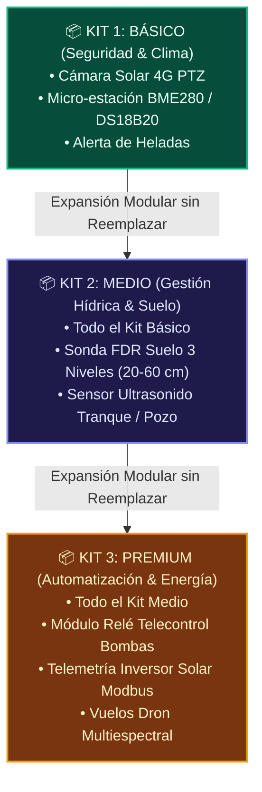
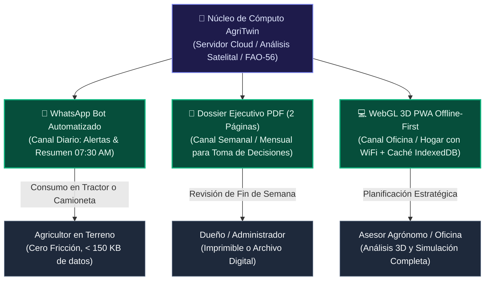
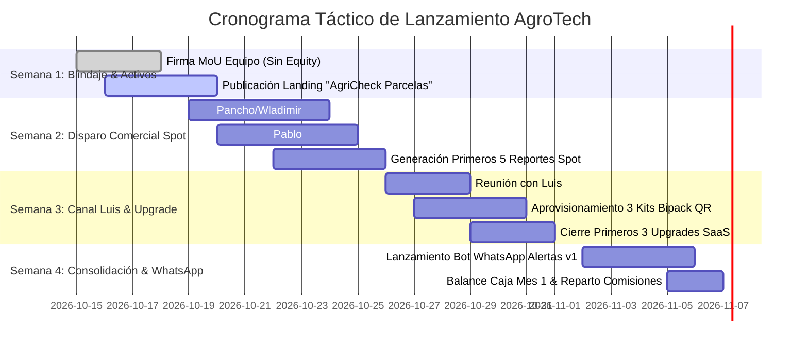

# 🚀 [[ESTRATEGIA_OPERATIVA_RESOLUCION_PREGUNTAS_CLAVE|Estrategia Operativa y Resolución de Preguntas Clave]]

> **Marco de Decisión**: Maximizar la velocidad al flujo de caja positivo (\$0 costo de inventario inicial para el Fundador), desacoplar la presencia física del Fundador en terreno delegando el montaje en Luis, y resolver la brecha de conectividad rural mediante una arquitectura de entrega de datos centrada en WhatsApp y reportabilidad asíncrona.

---

## 🧭 PREGUNTA 1: ¿Cuál es el producto de ruta más corta para el Mes 1?

### Análisis Comparativo de Opciones

| Variable | Opción A: Reportes Prediales de Riesgo Satelital para Parcelas | Opción B: Upgrade Digital a Clientes de Cámaras/Paneles de Luis |
| :--- | :--- | :--- |
| **Cliente Objetivo** | Compradores de parcelas de agrado (5.000 m²), loteos campestres e inversionistas en Maule/Parral/Linares. | Agricultores y fundos comerciales que ya son clientes de seguridad fotovoltaica de Luis en Parral y alrededores. |
| **Costo de Inventario** | **$0 CLP Absoluto**. 100% digital y software. | **$0 CLP para el Fundador**. El hardware ya fue vendido o lo gestiona Luis. |
| **Ticket Promedio** | **\$80.000 a \$180.000 CLP pago único** por informe predial. | **\$35.000 a \$50.000 CLP/mes recurrente (MRR)** por suscripción predial. |
| **Ciclo de Venta** | **Muy Corto (2 a 4 días)**. Dolor urgente: miedo a ser estafado con el agua o comprar una quebrada inundable antes de escriturar. | **Inmediato (1 a 5 días)**. La relación de confianza ya existe a través de Luis. |
| **Fuerza de Ventas** | **Pancho y Wladimir** (alianzas con corredores de propiedades, notarías y portales inmobiliarios) + **Pablo**. | **Luis** (visita de postventa o llamada a su cartera actual de clientes). |
| **Margen Bruto** | **~95%** (solo costo de cómputo del servidor). | **~85%** (descontando 10% de comisión recurrente de Luis). |

### 🎯 Veredicto y Táctica Ganadora: El "Doble Caballo de Troya" (Sincronización Mes 1)

No se debe elegir una en desmedro de la otra porque **no compiten, apuntan a dos segmentos distintos y se ejecutan por brazos comerciales diferentes**:

1. **Inyección Inmediata de Caja Líquida (Spot): Reportes de Parcela "AgriCheck"**
   - **Responsables**: Pancho, Wladimir y Pablo.
   - **Oferta**: *Dossier de Factibilidad Hídrica, Topográfica y Riesgo Climático de Parcela*.
   - **Entrega**: PDF de 8 páginas generado en menos de 30 minutos a partir del pipeline público (Sentinel-2, DEM ALOS PALSAR, DGA, Sernageomin).
   - **Meta Mes 1**: Cerrar 10 a 15 reportes en loteos de Parral, Retiro, Linares y Cauquenes.
   - **Ingreso Proyectado**: **\$1.200.000 a \$1.800.000 CLP netos en caja** en las primeras 4 semanas.
2. **Construcción de Base Recurrente (MRR): Upgrade Digital de Luis**
   - **Responsable**: Luis.
   - **Oferta**: *"Don Pedro, a su sistema de cámaras y paneles solares le activamos la inteligencia satelital de AgriTwin: alertas de heladas a su WhatsApp y mapa de salud de su huerto por \$35.000/mes"*.
   - **Meta Mes 1**: Convertir a 5 clientes actuales de Luis en suscriptores del plan básico.
   - **Ingreso Proyectado**: **\$175.000 a \$250.000 CLP/mes de MRR inicial**.

---

## 🛠️ PREGUNTA 2: Modularidad de Hardware Plug-and-Play (Delegación 100% en Luis)

Para garantizar que el Fundador **jamás tenga que viajar a Parral a tirar cables o soldar componentes**, la arquitectura de hardware se paquetiza en **3 Kits Modulares con Provisión Remota por Código QR**:

### Protocolo de Desacople del Fundador:
1. **Aprovisionamiento Centralizado Cero-Terreno**:
   - Cada caja/sensor sale configurado con su SIM Card M2M/IoT (Entel/Movistar multi-operador) y credenciales MQTT/HTTPS precargadas en fábrica/taller.
   - Cada nodo lleva adherido un **código QR único** con su identificador (`DEVICE_UUID`).
2. **Flujo de Montaje de Luis en 3 Pasos**:
   - **Paso 1**: Fijar mecánicamente la abrazadera al poste o estructura metálica (utilizando pernos estándar que Luis domina).
   - **Paso 2**: Conectar el conector estanco tipo aviación M12 o enchufe rápido impermeable (cero empalmes ni soldadura).
   - **Paso 3**: Abrir la app técnica de AgriTwin en su teléfono, escanear el QR del kit y seleccionar el predio del cliente en la lista desplegable.
   - El sistema emite un bip o mensaje confirmando: *"Nodo Vinculado Exitosamente al Predio San José"*.
3. **Mantenimiento y Garantía**:
   - Si un nodo falla, el sistema notifica en remoto por pérdida de latido (*heartbeat*). Luis lleva en su camioneta 1 unidad de reemplazo estándar. Sustituye la caja completa en 5 minutos y el nodo dañado se envía a revisión.

---

## 📱 PREGUNTA 3: Presentación de AgriTwin para Conectividad Restringida

El 70% de la actividad agrícola se desarrolla en zonas con 3G débil, Edge o sombra total de señal. Intentar forzar al agricultor a abrir un visor WebGL 3D en medio del cuartel genera frustración y abandono del producto.

La solución es una **Estrategia Tripartita de Consumo Asíncrono**:

### 1. El Canal Maestro: Bot de WhatsApp ("AgriTwin Alertas")
- **Mensajería Proactiva de Alta Síntesis (07:30 AM)**:
  > *"🌿 **Buenos días Don Juan - Fundo Los Maquis**  
  > 🌡️ **Temperatura nocturna**: Mínima 2.4°C a las 05:40 AM (Sin riesgo de helada).  
  > 💧 **Riego Recomendado Hoy**: 3.5 horas en Cuartel Cerezos Bing (Sonda a 40cm marca 22% VWC, entrando a estrés leve). Se sugiere activar bomba a las 23:30 hrs (tarifa valle).  
  > 🛰️ **Satélite Sentinel**: Nueva pasada detectó vigor estable en el 92% del predio.  
  > [Descargar Tarjeta Visual de Vigor (120 KB)]"*
- **Comandos de Voz y Texto**: El agricultor puede enviar una nota de voz o escribir: *"¿Cómo está el tranque?"*, y el bot responde en 3 segundos con el nivel de agua en metros y porcentaje de llenado.

### 2. Dossier Ejecutivo PDF Automatizado (Lectura de 3 Minutos)
- Despachado automáticamente los viernes a las 18:00 hrs.
- 2 páginas en formato horizontal de alta densidad informativa:
  * Página 1: Mapa térmico satelital del predio, balance hídrico acumulado de la semana y comparación de consumo eléctrico estimado vs. real.
  * Página 2: Semáforo de riesgo para los próximos 7 días (probabilidad de heladas, olas de calor y días óptimos para aplicación de agroquímicos según régimen de vientos).

### 3. Progressive Web App (PWA) Offline-First con IndexedDB
- Cuando el agricultor abre la plataforma en su casa u oficina con WiFi, el navegador descarga y sincroniza:
  * La malla 3D optimizada del terreno y límites de cuarteles.
  * Los últimos rásteres satelitales procesados.
  * El historial de telemetría de los últimos 15 días.
- En el campo, sin señal de internet, la PWA funciona al 100% de fluidez en modo consulta local. Si el usuario toma notas o registra una aplicación de fertilizante en el potrero, la acción se encola localmente y se sincroniza sola al reconectarse a internet.

---

## 📅 PLAN DE EJECUCIÓN INMEDIATO (SEMANAS 1 A 4)

