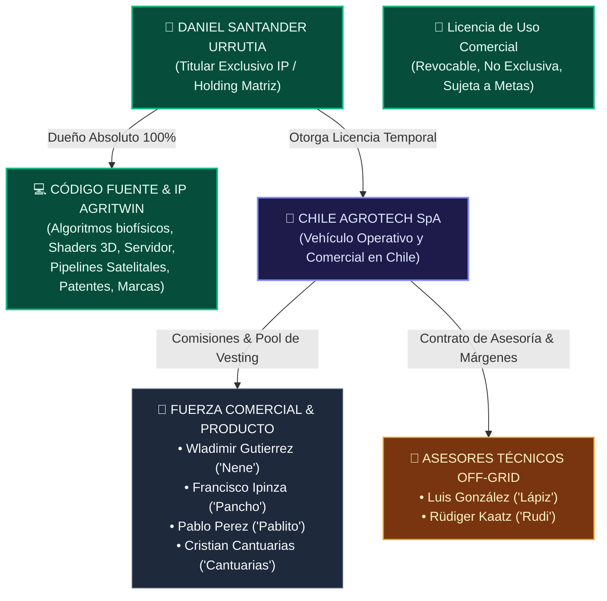

# ⚖️ [[GOBERNANZA_LEGAL_MOU_COMPENSACION|Modelo Legal, Blindaje de IP y Memorandum of Understanding (MoU)]]

> **Objetivo Estratégico**: Establecer una estructura societaria y contractual sólida en Chile que **proteja al 100% la Propiedad Intelectual (IP) del software y gemelo digital AgriTwin en favor del Fundador (Daniel Santander Urrutia)**, permitiendo al mismo tiempo una compensación altamente motivante, meritocrática y basada en tracción de caja para los colaboradores y asesores:
> - **Wladimir Gutierrez ("Nene")**
> - **Pablo Perez ("Pablito")**
> - **Francisco Ipinza ("Pancho")**
> - **Cristian Cantuarias ("Cantuarias")**
> - **Luis González ("Lápiz")**
> - **Rüdiger Kaatz ("Rudi")**

---

## 🏛️ 1. Arquitectura de Blindaje de Propiedad Intelectual (IP)



### Reglas Clave de Blindaje (Ley N° 17.336 de Propiedad Intelectual en Chile):
1. **Titularidad Original Intangible**: Todo el código de AgriTwin, motores de cálculo FAO-56, pipelines satelitales y shaders Three.js han sido creados previa y exclusivamente por el Fundador. La titularidad moral y patrimonial no ingresa al patrimonio societario compartido sin una escritura pública de cesión (la cual no se otorga).
2. **Licencia de Explotación Operativa**: La SpA Operativa (Chile AgroTech SpA) únicamente recibe una **Licencia de Uso y Comercialización de Software**, temporal y condicionada a la vigencia del pacto operativo. En caso de quiebra, disolución o conflicto societario, la licencia expira automáticamente y la IP regresa intacta al Fundador.
3. **Cesión de IP de Mejoras (Cantuarias y Colaboradores)**: Dado que Cristian Cantuarias tiene acceso al repositorio front-end, se estipula que toda adición, diseño UI, componente 3D procedural o shader desarrollado queda sujeto a un contrato expreso de **Cesión de Derechos de Autor (IP Assignment)** en favor del Fundador / Matriz, compensado mediante su participación en el Pool de Vesting de la SpA operativa.

---

## 💰 2. Esquema de Comisiones y Reparto por Roles

### A. Venta Directa B2C y Articulación de Kits: Pablo Perez ("Pablito")
- **30% de Comisión Directa** sobre cada Informe de Riesgo Satelital para compradores de parcelas ($80.000 a $150.000 CLP).
- **25% del Setup Fee + 15% del MRR** durante 12 meses por suscripciones agrícolas que cierre directamente.
- **Margen Comercial de Hardware**: Margen convenido por la paquetización, programación de códigos QR y entrega de kits KioT a clientes finales.
- **Participación Accionaria**: Elegible para el Pool de Vesting accionario SpA por soporte informático a los pipelines de datos y cumplimiento de metas de ventas.

### B. Cuentas B2B Agroindustriales: Wladimir Gutierrez ("Nene") y Francisco Ipinza ("Pancho")
- **25% del Setup Fee** en clientes agroindustriales (viñas, packings, frigoríficos, frutícolas).
- **15% del MRR** durante los primeros 12 meses de contrato percibido.
- **30% de Comisión** por convenios de informes satelitales cerrados con loteos e inmobiliarias rurales (Pancho).
- **Pool de Vesting SpA**: Consolidación de acciones en la SpA operativa a 4 años con 1 año de cliff, condicionada a metas de facturación anual acumulada.

### C. Asesoría Técnica Off-Grid: Luis González ("Lápiz") y Rüdiger Kaatz ("Rudi")
- **Luis González ("Lápiz")**:
  * 100% de la utilidad de mano de obra en montaje físico, postes, cableados y calibración de antenas.
  * Margen comercial de entre 15% y 25% sobre la reventa de hardware e insumos fotovoltaicos/cámaras.
  * 10% de Royalty Recurrente mensual sobre el MRR de los clientes de sus sistemas que migren al gemelo digital AgriTwin.
- **Rüdiger Kaatz ("Rudi")**:
  * Margen por integración de sistemas de baterías recicladas de alto rendimiento (LiFePO4) y sistemas anti-incendios.
  * Habilitación de su predio en Parral como **Living Lab / Centro Demostrativo Oficial**.
  * Comisión de captación sobre negocios cerrados con clientes e inversionistas extranjeros.

### D. Lead Game Designer & Front-End 3D: Cristian Cantuarias ("Cantuarias")
- **Esquema de Retribución Mixta**: Honorarios pactados por entregables validados de interfaz + participación formal en el Pool de Vesting accionario a 4 años con 1 año de cliff.
- **Gobernanza Git**: Trabajo en ramas `feature/ui` y fusión a `main` mediante Pull Request aprobado por Daniel Santander.

---

## 📄 3. Plantilla de Memorandum of Understanding (MoU) Interno

```markdown
# MEMORANDUM OF UNDERSTANDING (MoU) Y ACUERDO DE COLABORACIÓN ESTRATÉGICA

En Parral / Talca, República de Chile, a [Día] de [Mes] de 2026, entre:

1. **DANIEL EDUARDO SANTANDER URRUTIA**, chileno, cédula de identidad N° [RUT], domiciliado en [Domicilio], en adelante el **"FUNDADOR Y TITULAR DE IP"**; y
2. **[NOMBRE DEL INTEGRANTE: Wladimir Gutierrez / Pablo Perez / Francisco Ipinza / Cristian Cantuarias / Luis González / Rüdiger Kaatz]**, cédula de identidad N° [RUT], domiciliado en [Domicilio], en adelante el **"COLABORADOR / ASESOR"**;

Conjuntamente denominados las **"Partes"**, han convenido en celebrar el siguiente Memorandum de Entendimiento:

### PRIMERO: ANTECEDENTES Y TITULARIDAD DE IP
El Fundador es el creador, desarrollador y titular moral y patrimonial exclusivo de la plataforma tecnológica, gemelo digital, código fuente, algoritmos biofísicos y arquitectura mecatrónica denominada **AgriTwin / AgroTech** (Ley N° 17.336).
El presente acuerdo **NO transfiere, ni constituye promesa de cesión de derecho de copropiedad alguno sobre el software matriz** en favor del Colaborador. Cualquier mejora, diseño o desarrollo aportado queda plenamente radicado en la titularidad del Fundador (IP Assignment).

### SEGUNDO: ROL Y RESPONSABILIDADES ESPECÍFICAS
El Colaborador asume el rol de **[ROL ASIGNADO]**:
- [Detalle de metas comerciales, técnicas o de diseño según corresponda].

### TERCERO: ESQUEMA DE COMPENSACIÓN ECONÓMICA
1. **Comisiones de Venta**: [X]% del Setup Fee y [X]% del MRR percibido durante los primeros 12 meses de cada contrato cerrado.
2. **Informes Prediales Spot**: [30]% sobre el valor neto percibido por cada estudio de parcela comercializado.
3. **Instalaciones y Hardware (en caso de aplicar a Luis González)**: 100% del margen de mano de obra y [X]% sobre reventa de equipos.
4. **Pool de Vesting Accionario (en caso de aplicar a la SpA Operativa)**: Sujeto a un plazo de consolidación de cuatro (4) años con un (1) año de Cliff protector.

### CUARTO: CONFIDENCIALIDAD Y NO COMPETENCIA
El Colaborador se compromete a guardar estricta reserva de la información técnica, algoritmos, clientes y know-how por un plazo de 3 años, y a no desarrollar plataformas concurrentes de gemelo digital agrícola en la zona central de Chile.

### QUINTO: DOMICILIO Y JURISDICCIÓN
Las Partes fijan su domicilio en la ciudad de Talca / Parral y se someten a la competencia de sus Tribunales Ordinarios de Justicia.

___________________________________             ___________________________________
DANIEL EDUARDO SANTANDER URRUTIA                 [NOMBRE Y FIRMA DEL INTEGRANTE]
Fundador & Titular de IP                         Colaborador / Asesor
```
