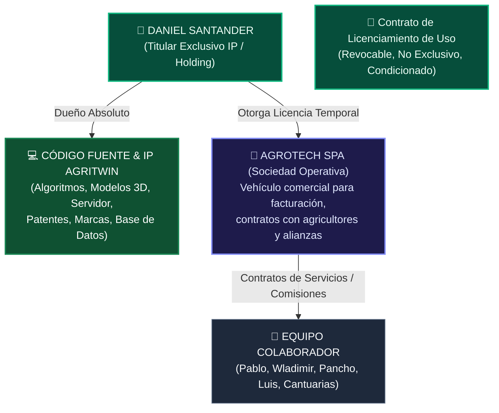

# ⚖️ [[GOBERNANZA_LEGAL_MOU_COMPENSACION|Modelo Legal, Blindaje de IP y Memorandum of Understanding (MoU)]]

> **Objetivo Estratégico**: Establecer una estructura societaria y contractual sólida en Chile que **proteja al 100% la Propiedad Intelectual (IP) del software y gemelo digital AgriTwin en favor del Fundador**, permitiendo al mismo tiempo una compensación altamente motivante, meritocrática y basada en tracción de caja para los colaboradores (Pablo, Wladimir, Pancho, Luis y Cantuarias), **sin ceder ni transferir equity inicial del software**.

---

## 🏛️ 1. Arquitectura de Blindaje de Propiedad Intelectual (IP)

El mayor riesgo de una startup tecnológica en fase temprana con colaboradores es la dilución prematura del código o reclamos laborales de autoría sobre el software. Para evitarlo de raíz, se implementa una **Estructura de Separación Patrimonial en 2 Capas**:



### Reglas Clave de Blindaje (Ley 17.336 de Propiedad Intelectual en Chile):
1. **Titularidad Original Intangible**: Todo el código de AgriTwin, motores de cálculo FAO-56, pipelines satelitales y shaders Three.js han sido creados previa y exclusivamente por el Fundador. La titularidad moral y patrimonial no ingresa al patrimonio societario compartido sin una escritura pública de cesión (la cual no se otorga).
2. **Licencia de Explotación Operativa**: La SpA Operativa (AgroTech SpA) únicamente recibe una **Licencia de Uso y Comercialización de Software**, temporal y condicionada al pago de un Royalty o a la vigencia del pacto operativo. En caso de quiebra, disolución o conflicto societario, la licencia expira automáticamente y la IP regresa intacta al Fundador.
3. **Cláusula de Cesión Automática de Mejoras**: Cualquier colaborador que proponga un script, configuración, prompt o diseño cede todos los derechos patrimoniales sobre dichas adiciones en favor del Fundador o la matriz de IP.

---

## 💰 2. Esquema de Comisiones y Reparto de Utilidades por Desempeño

El principio de justicia económica es: **Nadie asume costos de bolsillo, pero nadie cobra sin generar liquidez previa a la empresa**.

### A. Fuerza Comercial y Relacional: Pablo, Wladimir y Pancho
- **Canal de Ingreso**: Venta de suscripciones SaaS (Planes Básico, Pro, Enterprise) y Estudios Prediales de Parcela.
- **Estructura de Comisión Variable**:
  * **25% del Setup Fee Inicial** cobrado al agricultor o empresa al momento del onboarding.
  * **15% del Ingreso Recurrente Mensual (MRR)** facturado y percibido durante los primeros 12 meses de cada contrato cerrado por su gestión.
  * **30% de Comisión Directa** sobre la venta de *Reportes de Riesgo Predial Satelital para Parcelas* (\$80.000 a \$180.000 CLP).
  * **Cero Riesgo de Inventario**: No compran hardware ni adelantan capital de trabajo.

### B. Socio Operativo de Terreno y Hardware: Luis (Parral)
- **Canal de Ingreso**: Venta e instalación física de equipamiento en terreno (cámaras 4G, kits fotovoltaicos, drones, canalizaciones y sensores KioT).
- **Estructura de Reparto**:
  * **100% del Margen de Mano de Obra**: Los cobros por instalación física, subida a postes, calibración de antenas y tendido de cableado van íntegros a Luis.
  * **Margen de Intermediación de Hardware**: Margen pactado de entre **15% y 25%** sobre el precio mayorista de compra de equipos que Luis instale.
  * **Comisión de Referidos SaaS (Win-Win Recurrente)**: Por cada cliente de cámaras o paneles solares que Luis incorpore al Gemelo Digital AgriTwin, recibe un **10% del MRR mensual** de ese predio de por vida (mientras el cliente mantenga la suscripción activa).

### C. Diseño de Experiencia e Interacción: Cantuarias
- **Canal de Trabajo**: UI/UX de plataforma, diseño de tableros, gamificación del twin y adaptación de interfaces móviles.
- **Estructura de Retribución**:
  * **Honorarios por Hito / Entregable Específico**: Presupuestado y pagado contra entregables cerrados (sprints de diseño en Figma / componentes front-end validados) financiados con los primeros ingresos del flujo de caja.
  * **Phantom Equity (Opcional a Mediano Plazo)**: En lugar de acciones reales que diluyen el software, se puede pactar un *Pool de Participación en Beneficios Líquidos* (ej. 3% a 5% de las utilidades netas anuales de la SpA Operativa), sujeto a un vesting de 24 meses y cumplimiento de hitos de producto.

---

## 📄 3. Plantilla de Memorandum of Understanding (MoU) Interno

Esta plantilla está formulada para ser suscrita entre el Fundador y los colaboradores, garantizando alineamiento absoluto y cero ambigüedad jurídica.

```markdown
# MEMORANDUM OF UNDERSTANDING (MoU) Y ACUERDO DE COLABORACIÓN ESTRATÉGICA

En Parral / Talca, República de Chile, a [Día] de [Mes] de 2026, entre:

1. **DANIEL EDUARDO SANTANDER URRUTIA**, chileno, cédula de identidad N° [RUT], con domicilio en [Domicilio], en adelante el **"FUNDADOR Y TITULAR DE IP"**; y
2. **[NOMBRE DEL COLABORADOR]**, chileno, [profesión], cédula de identidad N° [RUT], domiciliado en [Domicilio], en adelante el **"COLABORADOR"**;

Conjuntamente denominados las **"Partes"**, han convenido en celebrar el siguiente Memorandum de Entendimiento (MoU):

### PRIMERO: ANTECEDENTES Y PROPÓSITO
El Fundador es el creador, desarrollador y titular exclusivo de la plataforma tecnológica, gemelo digital, código fuente, algoritmos biofísicos y arquitectura mecatrónica denominada **AgriTwin / AgroTech**.
Las Partes manifiestan su interés en colaborar de forma coordinada para acelerar la validación comercial, el despliegue territorial y la captación de clientes para los servicios y productos derivados de AgriTwin en el territorio chileno.

### SEGUNDO: PROPIEDAD INTELECTUAL INDEMNE Y RESERVADA
1. Las Partes reconocen y aceptan de manera expresa que la totalidad de la Propiedad Intelectual, Derechos de Autor (conforme a la Ley N° 17.336), marcas comerciales, secretos industriales, algoritmos, modelos matemáticos, arquitecturas de software, esquemas de bases de datos y metodologías vinculadas a **AgriTwin** y **AgroTech** son y continuarán siendo de **propiedad exclusiva e inalienable del FUNDADOR**.
2. El presente acuerdo **NO otorga, ni transfiere, ni constituye promesa de cesión de cuota social, acción, equity ni derecho de copropiedad alguno** sobre el software ni sobre ninguna de sus iteraciones pasadas, presentes o futuras en favor del Colaborador.
3. Cualquier aporte, sugerencia, retroalimentación, diseño, código accesorio o documentación técnica aportada por el Colaborador durante la vigencia de este acuerdo se entenderá plenamente cedida y radicada en la titularidad exclusiva del Fundador, sin derecho a indemnización ni reclamo posterior.

### TERCERO: ROL Y RESPONSABILIDADES ESPECÍFICAS
El Colaborador asume el rol de **[ROL: ej. Agente de Expansión Comercial / Especialista en Instalación de Hardware / Diseñador UX]**, comprometiéndose a:
- [Definir 3-4 entregables o focos de acción concretos según el rol].
- Promover activamente las soluciones de AgriTwin bajo estándares de transparencia, ética agronómica y veracidad técnica.

### CUARTO: ESQUEMA DE COMPENSACIÓN ECONÓMICA
Las Partes acuerdan que la compensación del Colaborador se regirá bajo el principio de resultado y flujo de caja efectivamente percibido por AgroTech SpA:
1. **Comisión por Venta de Suscripción**: [X]% del Setup Fee y [X]% del valor neto de suscripción recurrente mensual (MRR) percibido durante los primeros [12] meses del contrato cerrado directamente por el Colaborador.
2. **Comisión por Estudios/Reportes Spot**: [X]% sobre el valor neto facturado y percibido por cada Reporte de Riesgo Predial comercializado.
3. **Hardware e Instalaciones (en caso de aplicar)**: 100% del margen de mano de obra por montaje físico y [X]% sobre margen de intermediación de hardware.
4. **Condición de Pago**: Las liquidaciones de comisiones se efectuarán dentro de los primeros 5 días hábiles del mes siguiente al mes en que los fondos hayan sido transferidos y liberados en la cuenta bancaria de la empresa.

### QUINTO: CONFIDENCIALIDAD Y NO COMPETENCIA
1. El Colaborador se obliga a mantener la más estricta reserva y confidencialidad respecto de toda la información técnica, comercial, bases de datos, código fuente, esquemas JSON, listas de clientes y know-how a los que tenga acceso con ocasión del presente acuerdo.
2. Esta obligación se mantendrá vigente durante la vigencia de este acuerdo y por un período de tres (3) años posteriores a su terminación.
3. El Colaborador se compromete a no desarrollar, por cuenta propia o a través de terceros, software de gemelo digital, simuladores agronómicos o soluciones concurrentes que utilicen los métodos y aprendizajes derivados de AgriTwin en el territorio de la Región del Maule y la zona central de Chile mientras forme parte del equipo y por 12 meses tras su salida.

### SEXTO: VIGENCIA Y TÉRMINO
El presente MoU tendrá una duración de seis (6) meses renovables por mutuo acuerdo, pudiendo cualquiera de las Partes ponerle término anticipado mediante comunicación escrita con a lo menos quince (15) días corridos de anticipación, sin expresión de causa y sin que de ello se derive indemnización alguna, liquidándose únicamente las comisiones devengadas y efectivamente cobradas a la fecha de término.

### SÉPTIMO: DOMICILIO Y JURISDICCIÓN
Para todos los efectos legales derivados del presente instrumento, las Partes fijan su domicilio en la ciudad de Talca / Parral y se someten a la competencia de sus Tribunales Ordinarios de Justicia.

En comprobante de lo acordado, las Partes firman el presente instrumento en dos ejemplares de idéntico tenor y fecha.

___________________________________             ___________________________________
DANIEL EDUARDO SANTANDER URRUTIA                 [NOMBRE DEL COLABORADOR]
C.I. N° [RUT]                                    C.I. N° [RUT]
Fundador & Titular de IP                         Colaborador
```
