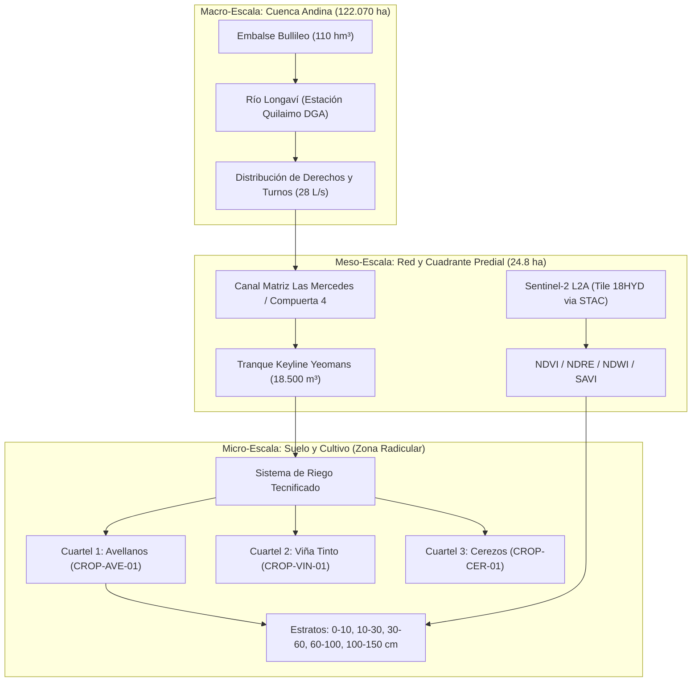

# Doctrina y Arquitectura Digital Twin: AgriTwin & Destination Earth

## AgriTwin Master Suite • Gemelo Digital Biofísico Multiescala
**Macro-Cuenca del Maule Sur • Río Longaví / Embalse Bullileo • Fundo Meniel (24.8 ha)**  
*Documento de Arquitectura Canónica, Formulación Matemática y Especificación de Motores Headless*  
*Versión:* 4.2.0 • *Fecha:* Octubre 2026 • *Estado:* Operativo en Producción (`#destine-core`)

---

## 1. Resumen Ejecutivo y Motivación

Inspirado en la iniciativa insignia de la Unión Europea **Destination Earth (DestinE)** —liderada por la ESA, ECMWF y EUMETSAT para modelar el sistema Tierra a escala kilométrica y en soporte a la adaptación climática—, AgriTwin evoluciona desde un visor cartográfico agronómico estático hacia un **Gemelo Digital Territorial Isomórfico y Multiescala**.

AgriTwin adopta cuatro principios vertebrales de DestinE adaptados al contexto agro-hidrológico de Chile central:
1. **Separación Estricta entre Telemetría y Simulación What-If:** La telemetría física en tiempo real refleja el estado vivo del activo; la simulación corre en ramas paralelas desacopladas sin sobreescribir datos crudos.
2. **Acople Dinámico Bidireccional Macro-Meso-Micro:** La disponibilidad hídrica a nivel de cuartel depende de la hidrología de cuenca alta (Río Longaví y Embalse Bullileo).
3. **Indexación Satelital Estandarizada STAC + COG:** Sustitución de simulaciones visuales por contratos de API estándar para consultar escenas multiespectrales de Sentinel-2 L2A con radiometría real.
4. **Cubo de Datos Espaciotemporal 4D y Cortes Polytope:** Indexación tensorial de variables biofísicas $(x, y, z, t)$ con operaciones de corte analítico de complejidad $O(1)$.

---

## 2. Tabla Comparativa: Antes vs. Después (Pillars de Transformación)

| Dimensión / Pilar | Estado Previo (v3.x) | Estado Actual (v4.2.0 - DestinE Doctrine) |
| :--- | :--- | :--- |
| **1. Motor Biofísico de Suelo** | Cálculos acoplados al DOM y templates HTML; funciones dispersas en UI scripts. | **`js/engines/soil-water-engine.js`**: Motor puro, headless, sin DOM, testeable en Node.js y navegador. Implementa FAO-56 dual/single, TAW, RAW, $K_s$ y asimilación Kalman. |
| **2. Acople Hidrológico de Cuenca** | Caudales fijos de DGA/Longaví y estado estático en `farm_ecosystem_master.json`. | **`js/engines/basin-hydrology-engine.js`**: Modelo dinámico acoplado de cuenca (Extremes DT), balance de masa del Embalse Bullileo ($110\text{ hm}^3$), recesión de caudales y reglas de prorrateo/turnos de derechos DGA (28 L/s). |
| **3. Acceso Satelital** | Simulación visual de índices espectrales mediante filtros CSS/hue sobre imágenes estáticas. | **`js/engines/stac-cog-client.js`**: Cliente STAC 1.0.0 (SpatioTemporal Asset Catalog) con BBOX nativo, peticiones HTTP Range sobre COGs y cálculo de reflectancia real BOA (NDVI, NDRE, NDWI, NDMI, SAVI, NBR). |
| **4. Estructura de Datos Multidimensional** | Arrays planos de telemetría y llamadas ad-hoc dispersas en gráficos. | **`js/engines/data-cube-engine.js`**: Tensor 4D estructurado ($5\text{ cuarteles} \times 5\text{ estratos} \times 7\text{ pasos} \times 7\text{ variables}$) con proyecciones ortogonales estilo Polytope ($O(1)$). |
| **5. Arquitectura What-If (Simulación vs Telemetría)** | Los escenarios modificaban directamente la telemetría viva visualizada en pantalla. | **Bifurcación estricta de estados**: La telemetría in-situ alimenta el estado inicial $t_0$, mientras que 4 ramas de pronóstico (`baseline`, `pump_failure`, `heatwave_puelche`, `deficit_rdi`) proyectan la evolución sin alterar el sensor físico. |
| **6. Forzamiento Meteorológico Dinámico** | Valores climáticos estáticos o prefijados en JSON local. | **Open-Meteo Dynamic Weather Forcing**: Ingesta continua de temperatura, humedad, viento y radiación a 7 días, calculando $ET_0$ Penman-Monteith dinámico por API. |
| **7. Servidor Consolidado (Single-Pane-of-Glass)** | API dispersa en scripts con endpoints de telemetría no acoplados a simulación. | **`server.cjs` unificado en Puerto 7777**: Endpoints canónicos REST `/api/simulation/*`, `/api/basin-sync`, `/api/sat/*`, `/api/cube/query` con interoperabilidad CJS/ESM. |
| **8. Interfaz Operacional de Mando** | Visualizador con sliders manuales sin correlación biofísica con la profundidad radicular. | **Telemetry Studio & Scrubber Biofísico**: Curvas de secado proyectadas contra Capacidad de Campo ($CC$) y Punto de Marchitez ($PMP$), sincronización instantánea de estratos radiculares (`0-10`, `30`, `60 cm`) con el scrubber temporal. |

---

## 3. Jerarquía Multiescala: Macro, Meso y Micro



---

## 4. Especificación Matemática de los Motores Biofísicos

### 4.1 Motor de Balance Hídrico de Suelo (`soil-water-engine.js`)
Implementa el estándar **FAO-56 Irrigation and Drainage Paper No. 56**:

1. **Capacidad de Almacenamiento de Agua Total ($TAW$):**
   $$TAW = 1000 \cdot (\theta_{FC} - \theta_{WP}) \cdot Z_r$$
   Donde $\theta_{FC}$ es la capacidad de campo, $\theta_{WP}$ es el punto de marchitez permanente y $Z_r$ es la profundidad efectiva radicular (m).
2. **Agua Fácilmente Aprovechable ($RAW$):**
   $$RAW = p \cdot TAW$$
   Donde $p$ es la fracción de agotamiento sin estrés del cultivo ($p \approx 0.50$).
3. **Balance Diario de Humedad del Perfil:**
   $$D_{r, t} = D_{r, t-1} - (P_t - RO_t) - I_t - CR_t + ET_{c, t} + DP_t$$
   Donde $P$ es precipitación, $RO$ es escorrentía superficial, $I$ es riego neto, $CR$ es ascenso capilar, $ET_c = K_c \cdot ET_0$ y $DP$ es drenaje profundo por percolación gravimétrica.
4. **Factor de Reducción por Estrés Hídrico ($K_s$):**
   $$K_s = \begin{cases} 
   1.0 & \text{si } D_{r, t} \le RAW \\ 
   \frac{TAW - D_{r, t}}{TAW - RAW} & \text{si } RAW < D_{r, t} \le TAW \\ 
   0.0 & \text{si } D_{r, t} > TAW 
   \end{cases}$$
5. **Asimilación de Observaciones (Filtro Nudging/Kalman):**
   $$\theta_{t}^+ = \theta_t^- + K \cdot (\theta_{\text{obs}, t} - \theta_t^-)$$
   Permite ajustar la trayectoria simulada ante lecturas reales de sensores in-situ.

---

### 4.2 Motor de Hidrología de Cuenca y Embalses (`basin-hydrology-engine.js`)
Modelación dinámica acoplada de cabecera:

1. **Balance de Masa del Embalse Bullileo ($V_{\text{res}}$):**
   $$\frac{dV_{\text{res}}}{dt} = Q_{\text{in}} - Q_{\text{out}} - E_{\text{evap}} - S_{\text{seep}}$$
   Capacidad nominal: $110.0\text{ hm}^3$. Umbral de alerta por sequía: $35.0\text{ hm}^3$.
2. **Recesión Hidrológica del Río Longaví (Maillet-Boussinesq):**
   $$Q_t = Q_0 \cdot e^{-\alpha t} + Q_{\text{base}}$$
3. **Distribución Legal de Derechos y Prorrateo DGA:**
   Si $Q_{\text{río}} < Q_{\text{adjudicado}}$, la tasa de entrega predial $\psi$ se reduce proporcionalmente:
   $$Q_{\text{entregado}} = \min\left(28.0\text{ L/s}, 28.0 \cdot \frac{Q_{\text{río}}}{Q_{\text{ecológico\_umbral}}}\right)$$

---

### 4.3 Cliente Satelital STAC y Reflectancia COG (`stac-cog-client.js`)
Consume metadatos de SpatioTemporal Asset Catalog y define las transformaciones espectrales BOA (*Bottom-Of-Atmosphere*):

$$\text{NDVI} = \frac{B08 - B04}{B08 + B04}, \quad \text{NDRE} = \frac{B08 - B05}{B08 + B05}$$
$$\text{NDWI} = \frac{B03 - B08}{B03 + B08}, \quad \text{NDMI} = \frac{B08 - B11}{B08 + B11}$$
$$\text{SAVI} = \frac{(B08 - B04) \cdot (1 + L)}{B08 + B04 + L} \quad (L = 0.5)$$

---

### 4.4 Tensor 4D y Motor de Cubo de Datos (`data-cube-engine.js`)
Estructura tensorial multidimensional:
$$\mathcal{C} \in \mathbb{R}^{5 \times 5 \times 7 \times 7}$$

Permite indexación inmediata sin barridos lineales:
- `slice({ time: 0, stratum: '30-60cm', variable: 'vwc' })` -> Matriz espacial predial.
- `slice({ paddock: 'CROP-AVE-01', variable: 'vwc' })` -> Matriz estratigráfica temporal.
- `slice({ paddock: 'CROP-VIN-01', stratum: '10-30cm', variable: 'ks' })` -> Vector temporal de estrés.

---

## 5. Especificación de Endpoints en `server.cjs` (Puerto 7777)

| Método | Endpoint | Parámetros | Descripción |
| :--- | :--- | :--- | :--- |
| `GET` | `/api/simulation/presets` | Ninguno | Retorna los presets de forzamiento meteorológico disponibles. |
| `GET` / `POST` | `/api/simulation/run` | `{ paddockId, days, scenario, initialVwc }` | Ejecuta simulación FAO-56 a 7 días en 4 ramas (`baseline`, `pump_failure`, `heatwave_puelche`, `deficit_rdi`). |
| `GET` | `/api/basin-sync` | Ninguno | Estado dinámico de cuenca: Embalse Bullileo, caudal Quilaimo y entrega efectiva de derechos DGA. |
| `GET` | `/api/sat/stac/passes` | `?limit=5` | Pases orbitales Sentinel-2 L2A sobre el BBOX de Fundo Meniel. |
| `GET` | `/api/sat/indices/summary` | Ninguno | Métricas espectrales radiométricas reales (NDVI, NDRE, NDWI, etc.). |
| `GET` / `POST` | `/api/cube/query` | `{ paddock, stratum, time, variable }` | Realiza cortes geométricos ortogonales estilo Polytope en el Tensor 4D. |
| `GET` | `/api/telemetry/summary` | Ninguno | Estado consolidado de sensores de campo, acoplado dinámicamente con DGA y piezómetros. |

---

## 6. Verificación y Reproducibilidad

Para verificar la integridad operativa de los motores y endpoints:

```bash
# 1. Comprobación de sintaxis de servidor y motores
node -c server.cjs
node -c js/engines/soil-water-engine.cjs
node -c js/engines/basin-hydrology-engine.cjs
node -c js/engines/stac-cog-client.cjs
node -c js/engines/data-cube-engine.cjs

# 2. Prueba de ejecución de simulación headless
node -e "
const SoilEngine = require('./js/engines/soil-water-engine.cjs');
const cap = SoilEngine.calculateHydraulicCapacity('franco_arcilloso', 'CROP-AVE-01');
const state = SoilEngine.createInitialState(24.5, cap);
const forcing = Array.from({ length: 7 }, (_, i) => ({ et0_mm_day: 4.8, precip_mm_day: 0, irrigation_mm_day: 3.5 }));
const sim = SoilEngine.simulateSeries(state, forcing, cap);
console.log('FAO-56 Steps OK:', sim.length, 'Final Ks:', sim[6].ks);
"
```
