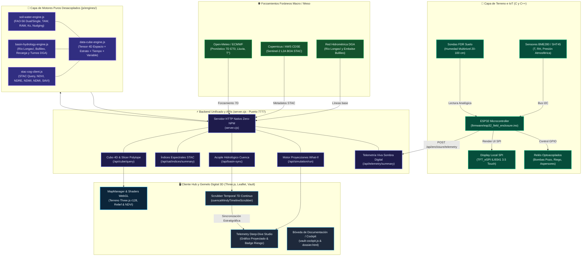
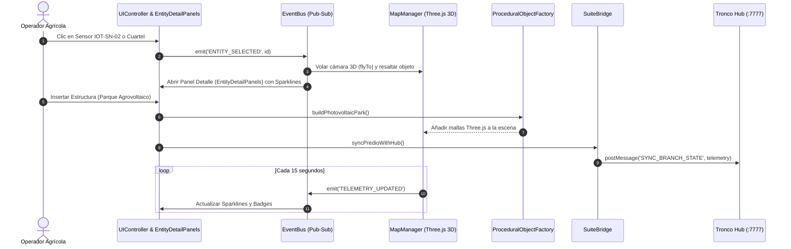

# 🛠️ [[STACK_TECNOLOGICO_ARQUITECTURA_AGRITWIN|Stack Tecnológico, Lenguajes y Arquitectura Modular de AgriTwin]]

> **Definición de Sistema**: [[Agritwin]] (Suite [[AGROTECH]]) es una plataforma de **Gemelo Digital Agrícola Biofísico Multiescala** de alta resolución. Su arquitectura es **full-stack, modular, desacoplada y orientada a eventos**, estructurada bajo el principio de responsabilidad única (SRP) e inspirada en los estándares de **Destination Earth (DestinE)**. Integra desde el silicio de microcontroladores de campo en C++ hasta renderizado fotorealista acelerado por GPU en Three.js/WebGL/GLSL, catálogos abiertos de teledetección STAC (Sentinel-2), tensores espaciotemporales 4D (Polytope/Zarr) y motores biofísicos deterministas de balance hídrico (FAO-56) y cuenca fluvial.

---

## 🧭 1. Diagrama de Arquitectura Global del Sistema (Estándar DestinE v4.2.0)

Flujo integral de datos entre el hardware de terreno, los forzamientos foráneos de macro-cuenca/satélite, los motores biofísicos desacoplados y la interfaz reactiva:



---

## 🏛️ 2. Estructura Modular del Proyecto y Principio de Responsabilidad Única (SRP)

En la **Versión 4.2.0 (Doctrina Destination Earth)**, la suite separa estrictamente la **lógica matemática determinista**, la **teledetección satelital**, la **hidrología fluvial**, la **generación geométrica 3D**, el **catálogo de datos**, la **orquestación de red** y la **representación visual**:

```
agritwin/
├── js/
│   ├── engines/               # 🧠 NUEVO: Capa de Motores Puros Desacoplados (Zero-DOM, Isomórficos)
│   │   ├── soil-water-engine.js        # Motor FAO-56 continuo: balance hídrico, TAW/RAW, estrés Ks, drenaje y nudging
│   │   ├── basin-hydrology-engine.js   # Motor de cuenca Extremes DT: Río Longaví, Embalse Bullileo y turnos DGA
│   │   ├── stac-cog-client.js          # Lector STAC Sentinel-2 con cálculo radiométrico (NDVI, NDRE, NDWI, NDMI, SAVI)
│   │   └── data-cube-engine.js         # Tensor 4D espaciotemporal y cortador geométrico estilo Polytope (O(1))
│   │
│   ├── hub/                   # 🖥️ Módulos de Interfaz y Lógica del Hub Maestro (Puerto 7777)
│   │   ├── geo-layers.js               # Capas SIG Leaflet, viento Windy y sincronización de Scrubber temporal 7D
│   │   ├── vault-cockpit.js            # Telemetry Studio, gráficos interactivos studioSoilChart y catálogo Vault
│   │   ├── cerro-cuenca.js             # Modelación de cuenca, sombras orográficas y visualización territorial
│   │   ├── ecosystem-advisors.js       # Asesores IA consultivos y escenarios de debate biofísico
│   │   └── hub-navigation.js           # Navegación entre vistas (Predio, Cuenca, Mesa, Telemetría, Bóveda)
│   │
│   ├── core/                  # Bus de eventos y gestores transversales
│   │   ├── EventBus.js        # Desacoplamiento Pub/Sub reactivo
│   │   └── ProjectManager.js  # Serialización / exportación de proyectos (.agritwin / GeoJSON)
│   │
│   ├── entities/              # Factorías geométricas Three.js desacopladas
│   │   ├── factories/ProceduralObjectFactory.js # Paneles solares, galpones, pivotes, tranques, pozos
│   │   └── ObjectPlacementManager.js            # Controlador de interacción y trazado continuo
│   │
│   └── map/                   # Motor 3D Three.js y shaders de terreno
│       ├── MapManager.js      # Escena Three.js, cámaras orbitales, vuelo drone y post-processing
│       └── BiophysicalTerrainShader.js # Shaders GLSL para humedad, relieve y gradientes NDVI
│
├── server.cjs                 # ⚡ Servidor HTTP Nativo con APIs de Simulación, Satélite STAC y Cubos 4D
├── dossier.html               # 📄 Whitepaper de Teledetección y Auditoría Comparativa vs. 12 Referentes
├── cache_tiles/               # 🗺️ Mosaicos de mapas base cacheados offline
└── docs/                      # 📚 Bóveda Canónica de Documentación (Vault)
    ├── STACK_TECNOLOGICO_ARQUITECTURA_AGRITWIN.md
    ├── METODOLOGIA_HIDROLOGICA_INCENDIOS_DEM.md
    ├── ENFOQUE_TACTICO_C2_RIESGO_CUENCA.md
    └── ARQUITECTURA_DIGITAL_TWIN_DESTINE.md
```

### Especificación de Responsabilidades de los 4 Motores (`js/engines/`)

| Motor | Archivo | Responsabilidad Única (SRP) | Algoritmos / Estándares |
| :--- | :--- | :--- | :--- |
| **Balance Hídrico Suelo** | `soil-water-engine.js` | Simular la dinámica de agua en la zona radicular paso a paso. | FAO-56 Dual/Single Crop Coefficient, Curvas Van Genuchten, $K_s$, percolación profunda y asimilación (*Nudging*). |
| **Hidrología Fluvial** | `basin-hydrology-engine.js` | Propagación de caudales aguas arriba $\rightarrow$ aguas abajo. | Hidrograma de recesión andina, balance volumétrico Embalse Bullileo ($110\text{ hm}^3$) y regla legal de turnos DGA ($28\text{ L/s}$). |
| **Teledetección STAC** | `stac-cog-client.js` | Extracción de metadatos satelitales y cálculo radiométrico real. | STAC API 1.0.0, BOA Surface Reflectance Sentinel-2 L2A (B02-B12), NDVI, NDRE, NDWI, NDMI, SAVI, NBR. |
| **Tensor 4D Espaciotemporal** | `data-cube-engine.js` | Unificar Satélite, Suelo y Cuenca en un tensor de 4 dimensiones. | Cubo multidimensional estilo Zarr/Polytope con corte geométrico (*slicing*) en $O(1)$ para mapas y matrices. |

---

## 💻 3. Lenguajes de Programación y Tecnologías por Subsistema

| Subsistema / Módulo | Lenguaje Principal | Archivos de Referencia | Rol en AgriTwin v4.2.0 |
| :--- | :--- | :--- | :--- |
| **Motores Biofísicos Puros** | **JavaScript Isomórfico (CJS / ESM / IIFE)** | `js/engines/*.js` y `*.cjs` | Núcleo matemático sin dependencias. Corre indistintamente en Node.js o navegador. |
| **Tensor 4D & Slicing** | **JavaScript (Arrays multidimensionales)** | `js/engines/data-cube-engine.js` | Motor de corte geométrico $O(1)$ para consultas espaciotemporales estilo Polytope de ECMWF. |
| **Catálogo Satelital Abierto** | **STAC API / GeoJSON** | `js/engines/stac-cog-client.js` | Consultas estandarizadas a repositorios abiertos (Earth Search, Copernicus CDSE, Planetary Computer). |
| **Lógica de Cliente & UI** | **JavaScript (ES6+ / ESM)** | `js/hub/*.js`, `index.html` | Orquestación visual, manipulación reactiva del DOM, Leaflet y Chart.js. |
| **Factorías Geométricas 3D** | **JavaScript (Three.js r128 API)** | `js/entities/factories/*.js` | Generación procedural de mallas PBR (paneles solares, tranques, ganado, invernaderos). |
| **Renderizado Gráfico 3D** | **GLSL** (OpenGL Shading Language) | `js/map/BiophysicalTerrainShader.js` | Shaders de cálculo de normales Sobel procedurales, absorción lumínica en suelo y gradientes NDVI. |
| **Servidor & APIs Locales** | **JavaScript (Node.js CommonJS)** | `server.cjs` | Despacho ultraligero sin dependencias externas (`zero-npm`), forzamiento climático 7D Open-Meteo y APIs de simulación. |
| **Firmware Embebido IoT** | **C / C++ (Arduino Framework)** | `firmware/esp32_field_enclosure.ino` | Adquisición física analógica/I2C, visualización en display SPI TFT y disparo de relés industriales. |

---

## ⚙️ 4. Diagrama de Módulos y Flujo de Eventos (Frontend Reactivo)

El cliente utiliza el patrón desacoplado **Pub/Sub** a través de `EventBus.js` que sincroniza la escena 3D con la telemetría biofísica y los paneles de inspección:



---

## 🎨 5. Diseño Visual, Ergonomía y Reducción de Fatiga Cognitiva (UI/UX)

La versión 3.9.9 introduce mejoras directas en la experiencia de usuario basadas en tres principios rectores:

1. **Tokens Maestros Unificados (`css/variables.css`):**
   * **Superficies**: Obsidian Dark estandarizado (`--bg-primary: #0a0f1d`, `--panel-bg: rgba(15, 23, 42, 0.85)`).
   * **Tipografía**: Jerarquía fluida con `Plus Jakarta Sans` para encabezados y `JetBrains Mono` para datos numéricos y telemetría.
   * **Semáforos de Estado**: `--accent-emerald` (#10b981) para estado óptimo, `--accent-amber` (#f59e0b) para alertas hídricas, y `--accent-rose` (#ef4444) para riesgo de incendios/heladas.

2. **Divulgación Progresiva (Progressive Disclosure):**
   * **Barra de Herramientas 3D Ergonomizada**: Agrupada en 4 familias conceptuales con colapsado suave (`#btnToggleToolbar`):
     - **Vista & Terreno**: Satélite real, gemelo 3D, modo híbrido y control de exageración DEM.
     - **Cámaras & Navegación**: Presets de enfoque, vuelo drone con cámara suave (`C`), paseo a pie (`P`) y timelapse (`T`).
     - **Edición 3D & Dibujo**: Dock AoE III, pincel vectorial, elevación de relieve y trazado continuo.
     - **Monitoreo & Cuenca**: Capas de viento Windy, drenaje D8, cámaras solares con frustums 3D y telemetría de sensores.
   * **Microcopy Directo y Tooltips Sutiles**: Reemplazo de bloques de texto explicativos redundantes por etiquetas concisas y atajos de teclado visuales (`<kbd class="hud-key">`).

3. **Modales Desacoplados y Paneles Flotantes:**
   * La sub-escena interactiva de frutos 3D (`Fruit3DViewer.js`) y los paneles de inspección de cuarteles (`EntityDetailPanels.js`) operan como capas modulares independientes sin bloquear la escena principal.

---

## 🧪 6. Suite de Pruebas y Verificación de Calidad

El proyecto cuenta con validación continua multicapa para asegurar cero regresiones:

- **Verificación Sintáctica (AST)**: Comprobación estricta con `node --check` en el 100% de los módulos JavaScript (`UIController.js`, `SuiteBridge.js`, `ObjectPlacementCatalog.js`, `ProceduralObjectFactory.js`, etc.).
- **Sincronización Ecosistémica**: Script automatizado `node test-ecosystem-sync.cjs` que valida la coherencia de datos entre las 6 ramas (Predio, Mesa Vecinal, Cuenca, Invernadero, Establo, Excursión) y los 18 asesores IA consultivos con 0 fallos.
- **Suite End-to-End Automatizada (Playwright)**: Script `scratch/test_fixes_e2e.py` que comprueba:
  1. *Cámaras Visoras Inactivas por Defecto* (cero parpadeo o ruido de red al inicio).
  2. *Integridad de Mover Árboles* (raíz y copa unificadas bajo el mismo grupo Three.js al reposicionar).
  3. *Trazado Continuo e Inserción por Lote AoE III* (consolidación What-If de tramos continuos).
  4. *Modal Estratégico de Permacultura* (renderizado de KPIs y lienzos de gráficos).

---

## 🔗 7. Sincronización con el Tronco Hub (Suite AgriTwin)

Conforme al **Principio Árbol** (Axioma Estructural de la Suite):
- **Rama 1 (Predio Twin)** mantiene total soberanía local y funciona de forma autónoma en el puerto `7773`.
- La comunicación con el **Tronco Hub** (puerto `7777` / `7771`) se efectúa mediante `window.postMessage` estructurado gestionado por `SuiteBridge.js`:
  - `SYNC_BRANCH_STATE`: Emisión de telemetría de aforos DGA, niveles del tranque Keyline, biomasa forrajera y humedad de suelo FDR.
  - `setPredioDualMode`, `whatif`, `toggleYeomans`, `dossier`, `toggleWorkshop`: Recepción y ejecución de directivas maestras sin romper el aislamiento de marcos (*frames*).
- Esta documentación reside simultáneamente en `agritwin/docs/` y `../agritwin-hub/docs/`, garantizando que la Bóveda de Conocimiento (*Vault*) del Hub refleje con exactitud la arquitectura viva del gemelo.

---

## 🌳 8. Matriz de Datos: Lo Inmutable (Doctrina & Métodos) vs. Lo Particular (Expediente Predial)

El sistema opera bajo una distinción ontológica fundamental para garantizar que un nuevo usuario o un predio recién creado comprenda el funcionamiento sin verse contaminado por datos ajenos:

### A. Los Tres Niveles de Datos del Ecosistema

1. **Lo Inmutable (Doctrina, Métodos y Operación de la App - Permanente 100%):**
   * **Estratégico vs. Táctico:** Es la definición operacional del sistema. El nivel *Estratégico* rige la planificación estacional y anual (balances hídricos, curvas Keyline, rotación de 8 potreros, fijación de carbono). El nivel *Táctico* gobierna la maniobra inmediata 0-12h ante contingencias críticas (avance de fuego con viento Puelche en cuenca, heladas catabáticas en brotes, o crecidas fluviales). Esta distinción es universal e inalterable en cualquier predio.
   * **Algoritmo de Generación de Polígonos:** La técnica de intersección raycast sobre la malla DEM 3D, la proyección geodésica WGS84, el cálculo de hectáreas y la serialización canónica GeoJSON (DGA/SAG) es idéntica en toda la plataforma.
   * **Principio Árbol y las 6 Vertientes:** El Tronco Suite Hub como bus central y las 6 ramas desacopladas (`predio`, `vecinal`, `cuenca`, `establo`, `invernadero`, `excursion`).
   * **Los 18 Asesores Consultivos:** La ontología de los 18 especialistas (3 por rama) y sus modelos biofísicos de análisis (Edafólogo, Fisióloga Vegetal, Veterinario Holístico, Hidrólogo, etc.).

2. **Flujos Transversales (Permacultura Holística):**
   * La **Zonificación 0 a 5 de Bill Mollison** y la **Escala de Permanencia de P.A. Yeomans** atraviesan transversalmente las 6 ramas:
     * *Zona 0:* Casa Patronal / Tronco Hub (Predio).
     * *Zona 1:* Huerto biointensivo y biofábrica (Invernadero).
     * *Zona 2:* Frutales de alta densidad y gallinero móvil (Predio & Establo).
     * *Zona 3:* Praderas polifíticas y cereales de secano (Predio).
     * *Zona 4:* Pastoreo silvopastoril y fajas cortafuegos (Mesa Vecinal).
     * *Zona 5:* Reserva natural intangible, calicatas y rewilding (Excursión & Cuenca).
   * Los balances de carbono (t C/ha) y la captación pluvial interconectan a todos los módulos.

3. **Flujos Verticales (Jerarquía Biofísica de la Finca):**
   * **Predio ➔ Establo:** La oferta forrajera de los cuarteles del predio (kg MS/ha) determina verticalmente la carga animal (UGM) y los días de ocupación de los 8 potreros PRV del establo.
   * **Establo ➔ Invernadero / Predio:** Las excretas del rebaño alimentan la biofábrica del invernadero para la síntesis de Bokashi y supermagro, que luego se aplican como enmienda viva a los cuarteles del predio.

4. **Lo Particular (Instancia Específica del Predio Activo):**
   * Nace en modo semilla (bootstrap) para usuarios nuevos y está completamente poblado para el *Fundo Meniel*:
     * Los vértices y coordenadas exactas de los cuarteles trazados.
     * La cota, área y volumen del tranque particular (ej. 18.500 m³ en Meniel vs. 5.000 m³ o 0 m³ en un predio nuevo).
     * Los valores numéricos del plan estratégico y las lecturas vivas de los sensores KioT instalados.
     * Los dictámenes y tareas acordadas con los 18 asesores en la bitácora de campo.

### B. Portal de Acceso Alquímico (Arbor Tellurica Gate) & FarmProfileManager

El ingreso al sistema mantiene el grabado histórico del **Árbol Tellúrico** (`assets/ui/arbol_alquimico_splash.jpg`), pero sustituye la espera de carga por un selector activo:
* **Fundo Meniel (Demo Maestro):** Precargado con 8 cuarteles, 15 sondas FDR, parque solar 9.9 kWp, 18.5k m³ tranque y 18 asesores.
* **+ Registrar Nuevo Predio:** Asistente de inicio para nuevos agricultores que genera un expediente predial semilla en blanco listo para dibujar con el dock 3D o importar archivos GIS.
* **Header Dinámico:** Badge interactivo `#hubActiveProfileBadge` en el Hub para conmutar de predio en cualquier momento.

---

*Vínculos del Vault*: [[Agritwin]] • [[ARQUITECTURA_VISUAL_MOTOR_3D_PBR]] • [[AGROTECH]] • [[Sensores y Hardware KioT]] • [[Principio Árbol]] • [[FAO-56 Penman-Monteith]] • [[Doctrina Táctica C2]] • [[Permacultura]]

