# Tratado Técnico de Gemelos Digitales Agrícolas: Arquitectura Multiescala, Fundamentos Biofísicos, Doctrina DestinE y Plan de Integración Progresivo

> **Autoría y Dirección de Arquitectura:** **Daniel Santander Urrutia** *(Creador, Investigador y Arquitecto Principal del Ecosistema AgriTwin)*  
> **Co-Ingeniería, Modelación Matemática y Síntesis Visual:** Desarrollado con la asistencia de **Antigravity** *(Google DeepMind)*  
> **Destinatarios:** Equipo y Panel de Profesionales Multidisciplinar (Agronomía, Software, IoT, Hidrología y Finanzas)  
> **Fecha:** Noviembre 2026 | **Versión:** 8.3 • Edición Consolidada Autoexplicativa v3.2.0 (Partes A `3.a`, B `3.b` y C `v3.2.0 + Landscope + AgriTwin VSD v2`)

---

## 1. Introducción General y Guía de Lectura del Tratado

### 1.1. Propósito, Autoría y Vocación Global del Producto: Predio Meniel como «Producto 0»

Este tratado técnico —concebido y dirigido por **Daniel Santander Urrutia** con la asistencia analítica y de ingeniería de **Antigravity**— documenta de principio a fin los fundamentos matemáticos, la física de suelos y atmósfera, la arquitectura de software e IoT y las decisiones de diseño visual que gobiernan la evolución del ecosistema **AgriTwin**.

Es fundamental establecer desde la primera página cuál es la verdadera vocación de esta obra: **AgriTwin no nace para resolver únicamente el problema particular de un predio o de una cuenca específica en Chile, sino para construir un producto ciberfísico potente, escalable y agnóstico de la geografía, capaz de desplegarse en cualquier territorio del mundo** que enfrente desafíos equivalentes de estrés hídrico, degradación de suelos, eventos climáticos no estacionarios (crecidas, heladas radiativas, incendios de interfaz) y necesidad de transición hacia una agricultura regenerativa de precisión.

Para que una plataforma con ambición global no se convierta en una abstracción académica desconectada del barro y del costo eléctrico real de regar, todo motor biofísico requiere un laboratorio viviente donde someterse a prueba. En nuestra arquitectura, **el «Predio Meniel» ($24.8\text{ ha}$) y su cuenca continente —la Subcuenca del Río Longaví ($122.070\text{ ha}$, Parral y Retiro, Maule Sur)— constituyen el «Producto 0» (*Living Lab* de validación empírica)**. Es en este campo real donde se han estresado, calibrado y validado todos los motores para responder a una pregunta universal de la ingeniería territorial: **¿cómo acoplar matemáticamente en un único sistema dos escalas que tradicionalmente han vivido divorciadas?**
1. **La Escala Macro-Cuenca (testeada en el Producto 0 sobre $122.070\text{ ha}$ — Subcuenca del Río Longaví):** El dominio regional donde interactúan los ríos atmosféricos, el deshielo cordillerano, la regulación de embalses (Bullileo), los vientos foehn catabáticos (Puelche), los megaincendios forestales y la recarga del acuífero compartido por cientos de regantes y comunidades rurales.
2. **La Escala Micro-Predial (testeada en el Producto 0 sobre $24.8\text{ ha}$ — Gemelo Digital 3D de Predio Meniel):** El dominio operativo donde el productor toma decisiones físicas cada mañana sobre sus cuarteles frutales, sus praderas polifíticas de Pastoreo Racional Voisin (PRV), sus zanjas de infiltración **Keyline**, sus pozos de bombeo y sus sondas físicas de humedad.

Hasta antes de esta migración, AgriTwin ya operaba bajo el marco conceptual de un gemelo ciberfísico sobre este Producto 0, pero su motor interno de suelo seguía apoyándose en una aproximación de primer orden (**la cubeta única homogénea de la FAO-56**), sus consultas meteorológicas se disparaban directamente desde el navegador y varios fenómenos de microtopografía y termodinámica extrema no estaban acoplados espacialmente entre el Visor Satelital 2D y el Gemelo Digital 3D.

### 1.2. Génesis de la Megamigración: De 14 Repositorios Internacionales a 3 Olas Orgánicas y el Flujo Final de Transformación Visual (`Tratado + Atlas + VSD`)

En lugar de reinventar cada rueda en aislamiento, se ejecutó una auditoría comparativa sobre **14 repositorios internacionales de código abierto** (todos clonados localmente en la carpeta `referencias/`, de los cuales **6 poseen interfaz gráfica original explorable en vivo** en `http://localhost:7788/` y **8 son motores científicos o contratos headless**).

Para absorber lo mejor de esas 14 fuentes sin romper la estabilidad del sistema ni contaminar la interfaz con «ruido visual», la migración de motores y contratos se estructuró en **tres olas incrementales**, acompañadas por la construcción de un entorno dedicado de auditoría e integración (**AgriTwin VSD**) y un **Motor de Ingeniería Visual (`agritwin-visual-engineering`, actualmente en fase de prototipo funcional)**:
* **Ola 1 — Parte A (Fase `3.a` · Cimientos de Interoperabilidad, Clima 168h y Red de Sensores):** Unifica todo el ecosistema en un único servidor monolítico (`server.cjs:7777`), expone los 4 estándares internacionales del **Open Geospatial Consortium (OGC: EDR, WFS 3.0, SensorThings y STAC/COG)**, centraliza el forzamiento meteorológico continuo de **168 horas (14 variables)** y establece la regla de **Aislamiento de Sensores de Predio (ADR-001)** que distingue con honestidad epistemológica entre sondas del predio, estaciones públicas DGA/INIA/DMC y celdas virtuales simuladas.
* **Ola 2 — Parte B (Fase `3.b` · Superficie Táctica AMR, Calicata 1D MONICA y CutSheetRX):** Reemplaza el suelo plano por una **Malla Hexagonal Adaptativa (AMR N1 a N4)** basada en **Uber H3**, resuelve la infiltración y succión matricial en los **5 estratos oficiales de MONICA (`0–10`, `10–25`, `25–50`, `50–75` y `75–100 cm`)** con protección contra asfixia radicular (**Feddes**) y ciclo de nitrógeno (**Michaelis-Menten**), e introduce la cubicación de movimiento de tierras (**CutSheetRX**) dentro de una nueva **5ª pestaña dedicada `📐 Keyline & Terreno` (ADR-002)** en el panel derecho del Visor Satelital.
* **Ola 3 — Parte C (`v3.2.0` + `Landscope` · Física Extrema No Estacionaria y Operadores de Paisaje):** Incorpora el escalamiento termodinámico de **Clausius-Clapeyron ($+7\%/^\circ\text{C}$) e Isoterma $0^\circ\text{C}$** para crecidas fluviales, el balance radiativo nocturno de **Stefan-Boltzmann con drenaje catabático HAND y acolchado Mulch** para heladas, la cinemática de **Piro-Vórtice y salto balístico de pavesas a $2.4\text{ km}$** sobre cortafuegos WUI, y los 4 operadores territoriales de **Landscope & Landscapen** (red de drenaje **D8**, **Geomorphons e insolación solar DEM**, **Ficha Edafológica 1-Clic** y **Corredores Ecológicos *Least-Cost Paths***).
* **El Paso de Ejecución Visual que Sigue (`Tratado + Atlas Visual + AgriTwin VSD` → Herramientas Visuales de Alto Calibre → Actualización de Papers):** Con los motores matemáticos, endpoints OGC y operadores biofísicos ya construidos y documentados en este Tratado, el siguiente paso operativo consiste en poner en práctica la tríada **Tratado Técnico + Atlas Visual de la Megamigración + Consola AgriTwin VSD** (apoyados en el prototipo del Motor de Ingeniería Visual descritos en detalle en la **Sección 17.10.5**) para ejecutar la **etapa de transformación visual de la migración**: convertir cada módulo, motor, programa y función matemática en **herramientas visuales interactivas de alto calibre** dentro del Visor Satelital 2D y del Gemelo Digital 3D. Una vez culminada y aprobada en vivo esa integración visual, el **último eslabón editorial** será actualizar las figuras, capturas y métricas en los **3 papers científicos imprimibles** del ecosistema.

### 1.3. Estructura del Documento y Convención de Cajas Didácticas

Para que este documento sea **100% autoexplicativo** tanto para ti como para cualquier integrante de tu equipo, hemos colocado el **Glosario Multidisciplinar Integral inmediatamente a continuación (Capítulo 2)** antes de entrar en la materia técnica, seguido de las cuatro partes troncales:
1. **Capítulo 2 (Glosario Inicial en 6 Secciones):** Diccionario explicativo de todos los conceptos de física de suelos, fisiología vegetal, meteorología extrema, IA/Kalman, cartografía H3/OGC e ingeniería de software/IoT.
2. **Parte I (Capítulos 3 a 5):** Doctrina *Destination Earth (DestinE)*, mando táctico C2, coexistencia entre polígonos catastrales y malla hexagonal Uber H3, e inmersión profunda (*Deep Dive 1*) en `ridvanzengin/AgriTwin`.
3. **Parte II (Capítulos 6 a 9):** Evolución desde la cubeta FAO-56 hacia la biofísica multicapa de `monica-agritwin` (*Deep Dive 2*, incluyendo el ciclo del carbono en 3 compartimentos, nitrógeno y un caso práctico de 24 horas en Fundo Meniel) y aceleración a 60 FPS mediante modelos subrogados XGBoost y Reinforcement Learning (*Deep Dive 3*).
4. **Parte III (Capítulos 10 a 14):** Hardware de campo ESP32/Raspberry Pi, Sombra Digital en Eclipse Ditto, asimilación continua con Filtro de Kalman Extendido (EKF), aprendizaje federado (*Deep Dive 4*), contratos tipados (*Deep Dive 5*), validación histórica (*hindcasting* con $NSE > 0.82$) y gobernanza *Human-in-the-Loop* (*Deep Dives 6 y 7*).
5. **Parte IV (Capítulos 15 a 20):** Matriz comparativa de los 14 repositorios clonados con sus mini-pantallas visuales originales, blindaje arquitectónico en 5 dimensiones, plan de acción completo (Partes A, B y C + construcción de `AgriTwin VSD` + decisiones ADR-001 y ADR-002), matriz de riesgos, conclusiones y el **Aparato Bibliográfico Canónico (Capítulo 20)** dividido en 7 ejes científicos y tecnológicos.

A lo largo de todos los capítulos encontrarás **tres tipos de cajas visuales con color de fondo propio**:
* **🟨 Caja `🧭 LEYENDA DEL DIAGRAMA` (fondo ámbar):** Debajo de cada uno de los 15 diagramas Mermaid, explicando paso a paso cómo leer las cajas, flechas y siglas.
* **🟦 Caja `📐 GUÍA PARA EL EQUIPO` (fondo azul pizarra):** Debajo de cada ecuación matemática, traduciendo qué significa cada término en el campo y cómo impacta el riego, el suelo o la factura eléctrica.
* **🟩 Caja `🔄 FICHA DE TRADUCCIÓN VISUAL` (fondo verde salvia):** Al final de cada repositorio analizado (*Deep Dive*), mostrando qué hacía el autor original, cómo abrir su interfaz exacta en el Laboratorio (`:7788`) y cómo se proyecta sobre AgriTwin.

### 1.4. Orientación de Lectura por Especialidad

* **Especialistas en Agronomía y Suelos:** Comenzar por las Secciones **2.1 y 2.2 del Glosario**, y luego enfocarse en los **Capítulos 5, 6, 7 y 13**. Examinen la discretización vertical de los 5 estratos de suelo (`0–10` a `75–100 cm`), la ecuación de Richards 1D acoplada con Campbell, el trapecio de Feddes con protección por anoxia radical, la descomposición de los 3 compartimentos de carbono (`AOM`, `SMB`, `SOM`), la cinética de nitrificación de Michaelis-Menten y el recorrido horario de la Sección **7.5**.
* **Arquitectos de Software y Desarrolladores Full-Stack:** Revisar las Secciones **2.4, 2.5 y 2.6 del Glosario**, y enfocarse en los **Capítulos 3, 4, 8, 16 y 17**. Analicen la doctrina *headless* e isomórfica, las operaciones binarias *bitwise shift* ($\gg$) en Uber H3, la inferencia de matriz del subrogado XGBoost en $<1\text{ ms}$, el blindaje en 5 dimensiones y las decisiones visuales **ADR-001 y ADR-002**.
* **Ingenieros de IoT y Hardware de Terreno:** Revisar la Sección **2.6 del Glosario** y enfocarse en los **Capítulos 10, 11 y 12**. Examinen el patrón de Sombra Digital (*estado reportado vs. estado deseado*), el buffer circular local (WAL) en memoria flash SPIFFS del ESP32 y la fusión de lecturas FDR con el Filtro de Kalman Extendido (EKF).
* **Hidrólogos, Climatólogos y Gestores de Cuenca:** Revisar las Secciones **2.1 y 2.3 del Glosario** y enfocarse en los **Capítulos 3, 4, 5, 13 y 17.9–17.10**. Verifiquen la matriz multiamenaza C2 ($R = H \times V / 100$), el cono de abatimiento de Thiem, la validación retrospectiva ($NSE > 0.82$), la cubicación CutSheetRX y los operadores extremos v3.2.0 (Clausius-Clapeyron, Helada HAND y Piro-Vórtice WUI).
* **Dirección Estratégica y Financiera:** Enfocarse en los **Capítulos 1, 3, 5, 15, 17, 18 y 19**. Evalúen la diferencia entre un gemelo predictivo y un dashboard pasivo, el modelo hidro-energético de costos de bombeo, el impacto económico del suelo vivo en la factura eléctrica y la hoja de ruta incremental sin riesgo de regresión.

---

## 2. Glosario Multidisciplinar Integral (Dividido en 6 Secciones Temáticas)

Para facilitar la lectura cruzada entre agrónomos, hidrólogos, desarrolladores de software, ingenieros electrónicos y dirección ejecutiva, este glosario agrupa todos los conceptos técnicos del Tratado (incluyendo las Partes A, B y C de la migración) en **seis dominios especializados**:

---

### 2.1. Sección A: Física de Suelos, Hidrología Subterránea y Ecuaciones Diferenciales

* **FAO-56 y Modelo de Cubeta Única (*Single-Bucket Model*):** Metodología clásica de la FAO donde toda la zona de raíces (ej. $0\text{ a }60\text{ cm}$) se modela como un solo balde homogéneo con una capacidad máxima ($TAW$, Agua Total Disponible) y un umbral de riego ($RAW$, Agua Fácilmente Aprovechable). Si entra más agua de la que cabe a Capacidad de Campo ($\theta_{FC}$), asume que drena de forma instantánea. Es muy rápida ($0.05\text{ ms}$), pero no distingue si la superficie está seca y el fondo húmedo.
* **Transporte No Saturado:** Movimiento del agua dentro de un suelo cuyos poros contienen **tanto agua como aire** ($\theta < \theta_s$). A diferencia de una tubería llena a presión, aquí el agua se mueve empujada por dos fuerzas: la gravedad (hacia abajo) y la succión matricial o capilar ($\psi$, hacia donde esté más seco).
* **Ecuación de Richards 1D:** Ecuación en derivadas parciales ($\frac{\partial \theta}{\partial t} = \frac{\partial}{\partial z}[K(\theta)(\frac{\partial \psi}{\partial z} + 1)] - S(z,t)$) que resuelve exactamente el transporte no saturado capa por capa en vertical ($0\text{–}10, 10\text{–}25, 25\text{–}50, 50\text{–}75, 75\text{–}100\text{ cm}$ en nuestro motor `richards-monica-engine.cjs`).
* **Conductividad No Saturada ($K(\theta)$):** Facilidad con la que el agua atraviesa el suelo según qué tan húmedo esté. En las funciones de **Campbell**, $K(\theta) = K_s(\theta/\theta_s)^{2b+3}$: cuando el suelo se seca un poco, su conductividad cae miles de veces, reteniendo el agua profunda.
* **Ascenso Capilar Real:** Subida natural de humedad desde capas profundas o desde la napa freática hacia las raíces superiores impulsada por la succión matricial ($\frac{\partial \psi}{\partial z} > 1$) cuando el suelo superficial se seca en verano. La cubeta única lo ignora; Richards 1D lo captura automáticamente.
* **Término Sumidero-Fuente (*Sink/Source Term*) dentro de Ecuaciones Diferenciales:** Es el término $+S$ o $-S$ que se añade a una ecuación de conservación para representar dónde entra o sale masa del sistema: en Richards 1D, $-S(z,t)$ son las raíces extrayendo agua de cada estrato; en Saint-Venant 2D, $-S_{\text{keyline}}(x,y,t)$ es una zanja o tranque Keyline capturando agua de una ladera para reducir la crecida aguas abajo.
* **Navier-Stokes e Hidrodinámica 2D de Saint-Venant:** Las ecuaciones de Navier-Stokes describen el movimiento de cualquier fluido en 3D. Al integrarlas verticalmente para flujos donde el ancho del valle es mucho mayor que la profundidad del agua, se obtienen las **ecuaciones de aguas someras 2D de Saint-Venant**, que calculan la altura de inundación $h(x,y,t)$ y la velocidad $(u,v)$ sobre el terreno DEM.
* **Abatimiento Local ($\Delta h$) y Cono de Thiem ($s(r)$):** Descenso del nivel del agua subterránea alrededor de un pozo mientras se está bombeando. La fórmula de **Thiem** ($s(r) = \frac{Q}{2\pi T}\ln(R/r)$) describe la forma de ese embudo según el caudal extraído $Q$ y la transmisividad del acuífero $T$. Si el abatimiento es excesivo, aumenta la altura que debe vencer la bomba ($H_{\text{total}}$), dispara el gasto eléctrico ($\text{kWh/m}^3$) o seca pozos vecinos.
* **Cabezal de Riego:** Conjunto central de bombas, filtros (de anillas/arena), inyectores de fertirriego, caudalímetros y válvulas reguladoras que impulsan el agua hacia las cintas de goteo o microaspersores a una presión de trabajo definida ($P_{\text{emisor}}$).
* **CutSheetRX (Cubicación de Movimiento de Tierras):** Operador integral ($\Delta V_{\text{neto}} = V_{\text{fill}} - V_{\text{cut}} = \iint (z_{\text{diseño}} - z_{\text{DEM}})\,dx\,dy$) alojado en la pestaña **`📐 Keyline & Terreno`** que calcula cuántos metros cúbicos de tierra hay que excavar (**Corte**) y cuántos hay que apilar como camellón (**Relleno**) al trazar una obra Keyline.
* **Índice de Nash-Sutcliffe ($NSE$):** Métrica estadística ($-\infty$ a $1.0$) que evalúa la precisión de un modelo hidrológico comparando el caudal simulado contra el caudal real medido por la DGA. Un $NSE > 0.75$ (AgriTwin alcanza $NSE > 0.82$) certifica alta fidelidad científica.

---

### 2.2. Sección B: Fisiología Vegetal, Biogeoquímica (MONICA) y Policultivos

* **Función No Lineal / Multicriterio de Feddes ($\alpha(\psi)$):** Curva en forma de trapecio que regula cuánta agua pueden beber las raíces según la tensión de humedad del suelo ($\psi$). Es «multicriterio» porque frena la absorción en **ambos extremos**: tanto cuando el suelo está demasiado seco ($\psi \to \psi_4 = -1500\text{ kPa}$, punto de marchitez) como cuando está demasiado encharcado ($\psi \to \psi_1$, asfixia).
* **Anoxia Radical:** Asfixia de las raíces causada por exceso de agua (sobrerriego o mal drenaje). Cuando el agua llena todos los poros del suelo, desplaza al oxígeno; las raíces no pueden respirar, cierran sus estomas ($\alpha(\psi) = 0$ en Feddes), detienen su crecimiento y quedan expuestas a hongos de pudrición radicular.
* **Perfiles Radiculares y Estratos Radiculares Paralelos:** La función $\beta(z)$ describe cómo se reparte la densidad de raíces por profundidad (mayor en los primeros $30\text{ cm}$ y decreciente hacia $100\text{ cm}$). En praderas polifíticas de Pastoreo Racional Voisin (PRV) o agroforestería, AgriTwin modela **estratos radiculares paralelos**: las gramíneas beben de los primeros $20\text{ cm}$ mientras las leguminosas y árboles extraen agua y fijan nitrógeno a $60\text{–}100\text{ cm}$ en la misma celda sin forzar un monocultivo ficticio.
* **Los 3 Compartimentos de Carbono Orgánico en MONICA:**
  1. **Rastrojo Fresco (`AOM`, *Added Organic Matter*):** Restos vegetales recién caídos o incorporados (hojas, poda astillada, raíces muertas, guano fresco). Se descompone en semanas o pocos meses.
  2. **Biomasa Microbiana (`SMB`, *Soil Microbial Biomass*):** Las bacterias y hongos vivos del suelo que comen el rastrojo fresco. Son el «motor digestivo» que cicla en días/semanas y libera nutrientes.
  3. **Humus Estabilizado o Pasivo (`SOM`, *Soil Organic Matter*):** Carbono oscuro y estable que permanece por décadas o siglos. Actúa como esponja física que retiene agua y mejora la estructura del suelo.
* **Mineralización de Nitrógeno Orgánico:** Proceso mediante el cual la biomasa microbiana (`SMB`), al descomponer el rastrojo (`AOM`), transforma el nitrógeno atrapado en proteínas vegetales en **amonio inorgánico ($\text{NH}_4^+$)** disuelto en el suelo.
* **Tasa de Nitrificación de Michaelis-Menten:** Velocidad a la que las bacterias nitrificantes oxidan el amonio ($\text{NH}_4^+$, con carga $+$) y lo convierten en **nitrato ($\text{NO}_3^-$, con carga $-$)**. Sigue la cinética enzimática de Michaelis-Menten ($V_{\max}\frac{[\text{NH}_4^+]}{K_m + [\text{NH}_4^+]}$): sube rápido a bajas dosis y se satura en un tope biológico máximo $V_{\max}$ cuando hay exceso de fertilizante, regulada por temperatura $f_T$, humedad $f_\theta$ y acidez $f_{pH}$.
* **Lixiviación de Nitratos a Napas Subterráneas ($J_s$):** Lavado vertical del nitrato ($\text{NO}_3^-$) hacia el acuífero profundo. Como el nitrato tiene carga negativa ($-$), las arcillas y el humus (también negativos) lo repelen y queda suelto en el agua; si un exceso de riego produce drenaje profundo ($q > 0$ bajo las raíces), el término convectivo $q \cdot C_{\text{NO}_3}$ arrastra el fertilizante hacia la napa subterránea.
* **Intercepción Lumínica (Ley de Beer-Lambert y $LAI$):** Fórmula ($PAR_{\text{int}} = 0.5\,R_s(1 - e^{-k\cdot LAI})$) que calcula cuánta luz solar útil para fotosíntesis (**PAR**) atrapa el follaje según su **Índice de Área Foliar ($LAI$**: metros cuadrados de hoja por metro cuadrado de suelo).
* **Fotosíntesis Neta con Ley del Mínimo de von Liebig:** Principio agronómico según el cual el crecimiento diario de biomasa ($\Delta W_{\text{neta}}$) no depende del promedio de los recursos, sino exclusivamente del **recurso más escaso en ese día** ($\min(f_{\text{agua}}, f_{\text{nitrógeno}}, f_{\text{térmico}})$, el «barril con la tabla más corta»), descontando la respiración de mantenimiento de la planta.

---

### 2.3. Sección C: Meteorología Extrema, Incendios y Geomorfología de Paisaje (v3.2.0 & Landscope)

* **Ecuación de Penman-Monteith ($ET_0$):** Estándar físico de la FAO que combina la energía de la radiación solar neta ($R_n$) y el poder secante del viento y del déficit de presión de vapor ($u_2, e_s - e_a$) para calcular cuántos milímetros de agua evapotranspira un cultivo de referencia por hora o por día.
* **Ecuación de Propagación de Fuego de Rothermel:** Modelo físico que calcula la velocidad de avance de un incendio forestal según el calor liberado por el combustible seco, amplificado exponencialmente por la pendiente topográfica cuesta arriba ($\phi_s$) y la velocidad del viento ($\phi_w$, como el viento Puelche).
* **Escalamiento de Clausius-Clapeyron ($+7\%/^\circ\text{C}$) e Isoterma $0^\circ\text{C}$:** Ley termodinámica por la cual el aire retiene $\sim 6.8\%$ más vapor de agua por cada $+1^\circ\text{C}$ de calentamiento. Junto con el ascenso de la **Isoterma $0^\circ\text{C}$** (la altitud donde la nieve pasa a ser lluvia líquida, que sube $+154\text{ m}$ por cada $+1^\circ\text{C}$), explica por qué los ríos atmosféricos cálidos multiplican el área pluvial andina y los caudales de crecida (Módulo 7).
* **Balance Radiativo Nocturno (Stefan-Boltzmann + Brutsaert), Drenaje Catabático HAND y Mulch:** En noches despejadas, el suelo emite calor infrarrojo ($\sigma T^4$) que escapa al espacio. El aire frío y pesado escurre por gravedad hacia el fondo de los valles donde el índice **HAND** (*Height Above Nearest Drainage*, altura vertical sobre el cauce más cercano) es cercano a cero, generando bolsones de helada ($-2.10^\circ\text{C}$). El **mulch** (cubierta orgánica sobre el suelo) aísla térmicamente la superficie ($+2.56^\circ\text{C}$, Módulo 5).
* **Intensidad de Byram ($I_B$), Piro-Vórtice y Salto Balístico WUI:** Cuando la potencia del frente de fuego supera $I_B \ge 3.000\text{ kW/m}$ bajo cizalladura de viento, se forman torbellinos de fuego (**piro-vórtices**) que lanzan pavesas encendidas hasta **$2.4\text{ km}$** por aire, perforando cortafuegos convencionales en la **WUI** (*Wildland-Urban Interface*, interfaz urbano-rural/forestal, Módulo 6).
* **Red de Flujo Acumulado D8 y Geomorphons (*Landscope*):** **D8** (*Deterministic Eight-Node*) traza hacia cuál de los 8 píxeles vecinos más bajos escurre cada gota de lluvia sobre el DEM, revelando las líneas de drenaje natural. **Geomorphons** clasifica la forma del terreno (cumbre, cresta, ladera, vaguada) para cruzarla con la insolación solar en $\text{Wh/m}^2$ (Módulo 8 en `📐 Keyline & Terreno`).
* **Corredores de Conectividad, *Least-Cost Paths* y *Resistant Kernels* (*Theobald / landscapen*):** Algoritmos ecológicos que modelan el paisaje como una superficie de resistencia al movimiento de fauna y polinizadores, trazando las rutas de menor costo energético (*Least-Cost Paths*) entre parches de bosque nativo y cursos de agua (Módulo 9b en `🛰️ Capas SIG & Satélite`).

---

### 2.4. Sección D: Inteligencia Artificial, Modelos Subrogados, Asimilación (EKF) y Lógica Difusa

* **Gemelo Digital Isomórfico y Determinista:** Es **determinista** porque sus proyecciones provienen de leyes físicas reproducibles (sin azar), y es **isomórfico** porque el mismo módulo matemático en JavaScript corre sin cambios en el servidor Node.js, en pruebas automatizadas y en el navegador del usuario.
* **Bifurcaciones Contrafácticas (*What-If Scenarios*):** Capacidad de pausar el estado real del predio hoy y simular ramas alternativas del futuro (*"¿qué pasa en los 5 estratos si corto el riego 3 días durante un evento Puelche vs. si riego 15 mm esta noche?"*) antes de ejecutar la acción real.
* **Ingeniería Frugal Situada / Frugalidad:** Filosofía de diseño que logra el mismo rigor físico de los grandes centros europeos (DestinE), pero optimizado matemáticamente para correr gratis o a muy bajo costo en el computador o teléfono de un agricultor rural y con kits de sensores de $\sim 25\text{–}45\text{ USD}$.
* **Modelo Subrogado (*Surrogate Model*), XGBoost e Inferencia de Matriz:** Un **modelo subrogado** es un algoritmo ligero de aprendizaje automático entrenado para imitar a un simulador físico lento. En lugar de tardar $20\text{ segundos}$ resolviendo ecuaciones diferenciales en C++ (MONICA), **XGBoost** (*eXtreme Gradient Boosting*, árboles de decisión potenciados) guarda las respuestas precalculadas en una estructura matricial y entrega el mismo resultado en **$<1\text{ milisegundo}$** (**inferencia de matriz**), permitiendo mover sliders a 60 FPS.
* **Filtro de Kalman Extendido (EKF) y *Nudging* Continuo:** Algoritmo matemático de **asimilación de datos** que fusiona la predicción teórica del modelo ($\hat{\theta}$) con la lectura real del sensor en campo ($\theta_{\text{obs}}$). En vez de reemplazar bruscamente el modelo por el sensor (que puede tener ruido), aplica un **nudging continuo** (un "empujón suave" ponderado por la incertidumbre $\sigma$ de cada fuente) que corrige tanto el estado actual como los parámetros internos del suelo ($K_s, SOM$).
* **Funciones de Pertenencia Difusa Trapezoidales, Lógica Difusa de Idoneidad (*Crop Fit*) y Riesgo de Bombeo:** A diferencia de la lógica binaria (sí/no), la **lógica difusa** evalúa qué tan apto es un clima o suelo para un cultivo con una curva en forma de trapecio $\mu(x; a,b,c,d) \in [0, 1]$ (donde $[b,c]$ es el rango óptimo con nota $1.0$ y las rampas laterales representan estrés gradual). Al cruzar esa idoneidad agronómica con la profundidad de la napa y el abatimiento del pozo, cuantifica el balance entre **idoneidad productiva y riesgo/costo de bombeo**.

---

### 2.5. Sección E: Cartografía Digital, Estructuras Espaciales y Estándares Abiertos OGC

* **Uber H3:** Sistema global de indexación espacial creado por Uber que divide la Tierra en una jerarquía de **celdas hexagonales** numeradas con un entero de 64 bits. Todos los vecinos de un hexágono están a la misma distancia exacta del centro, eliminando el sesgo diagonal de los píxeles cuadrados.
* **Bitwise Shift / Desplazamiento de Bits ($\gg$):** Operación ultrarrápida del procesador que mueve los dígitos binarios de un número hacia la derecha o izquierda. Como el identificador de 64 bits de Uber H3 guarda la jerarquía padre-hijo en grupos de 3 bits por nivel, encontrar a qué hexágono regional (Nivel 6) pertenece un hexágono predial (Nivel 9) se hace corriendo 9 bits a la derecha ($\text{cell}_9 \gg 9$) en nanosegundos, sin cálculos geométricos.
* **Malla Adaptativa AMR (*Adaptive Mesh Refinement*, N1 a N4):** Técnica que usa hexágonos grandes donde el paisaje es uniforme (N1/N2 en la macro-cuenca) y subdivide en hexágonos pequeños (N3 de $\sim 0.58\text{ ha}$ y N4 de cuartel) únicamente sobre Fundo Meniel y las zonas de intervención Keyline, ahorrando más del $95\%$ de memoria.
* **Cortes Poliédricos tipo *Polytope* del ECMWF:** Algoritmo de extracción de datos multidimensionales que, en lugar de descargar un cubo meteorológico completo de varios gigabytes, recorta únicamente el "poliedro" o tubo espacio-temporal exacto (las celdas H3 de un potrero a lo largo de 168 horas) en tiempo constante $O(1)$.
* **Peticiones de Rango HTTP (*HTTP Range Requests*) y Cloud-Optimized GeoTIFFs (COG):** Un **COG** es una imagen satelital GeoTIFF ordenada internamente por bloques piramidales. Mediante una **petición de rango HTTP** (`Range: bytes=102400-163840`), el navegador le pide al servidor únicamente los kilobytes de los píxeles que cubren Fundo Meniel, sin tener que descargar la imagen Sentinel-2 completa de $800\text{ MB}$.
* **Bounding Box (BBox):** Rectángulo geográfico definido por sus esquinas mínima y máxima `[minLng, minLat, maxLng, maxLat]`. Se utiliza para filtrar qué hexágonos están visibles en pantalla y para validar la **Regla de Oro Espacial** (si una obra trazada cae dentro del BBox de Fundo Meniel `[-36.216, -71.609]` a `[-36.206, -71.600]`, se sincroniza con el Gemelo 3D).
* **Estilización Coroplética Dinámica y *Tooltips*:** Un **mapa coroplético** colorea cada polígono o hexágono según el valor numérico de una variable (usando las **paletas científicas de Fabio Crameri**: *Batlow, Oleron, LaJolla, Vik, Bamako*). Es **dinámico** porque los colores cambian en vivo al mover el Scrubber de 168h. Un **tooltip** (o popup Nivel 1) es la etiqueta flotante concisa de 3 líneas que aparece al tocar o pasar el cursor sobre un hexágono o estación.
* **Visor Leaflet 2D GIS vs. MapLibre GL:** **Leaflet** es la librería cartográfica 2D ligera sobre la que está construido el Visor Satelital de Cuenca (`agritwin/index.html`). **MapLibre GL** es el visor WebGL usado por `ridvanzengin/AgriTwin`. Nuestra **estrategia de blindaje** exporta los hexágonos H3 a `GeoJSON` estándar para que Leaflet los dibuje de forma nativa sin reemplazar nuestro visor ni romper las capas existentes.
* **Three.js WebGL PBR 3D:** Motor gráfico 3D sobre WebGL que da vida al Gemelo Digital de Fundo Meniel (`agritwin/predio/index.html`). **PBR** (*Physically Based Rendering*) significa que los materiales (agua, suelo húmedo, follaje, relieve DEM) reaccionan físicamente a la posición real del sol, rugosidad y reflejos.

---

### 2.6. Sección F: Ingeniería de Software, Hardware IoT y Gobernanza Operativa

* **Node.js:** Entorno de ejecución que permite correr código JavaScript en el servidor (`agritwin/server.cjs` en el puerto `7777`). Gracias a que el servidor y el navegador hablan el mismo lenguaje (JavaScript), los motores biofísicos (`js/engines/*.js` y `*.cjs`) son **isomórficos**.
* **Single Page Application (SPA), React 19, TypeScript y Vite:** Una **SPA** es una aplicación web que carga una sola página y actualiza sus vistas instantáneamente sin recargar el navegador. **React 19** es la librería de componentes de interfaz; **TypeScript** añade tipos estrictos a JavaScript para evitar errores de datos; y **Vite** es el empaquetador ultrarrápido que compila el portal comercial (`webAgrotech/`), mientras el Hub táctico (`agritwin/`) opera en JavaScript puro sin transpilación.
* **Estrategia de Blindaje:** Conjunto de reglas de aislamiento en 5 dimensiones (Cap. 15) que impide que los scripts de Python científico, el compilador de Vite/React y el firmware C++ se bloqueen o rompan entre sí, comunicándose exclusivamente mediante archivos JSON/GeoJSON y rutas HTTP estandarizadas.
* **Contratos Fuertemente Tipados e «Inmutable y Tipado» (*NemoClaw*):** Regla por la cual cada paquete de datos tiene una plantilla estricta (**tipado**: cada campo declara si es número decimal, texto, fecha UTC o enumeración válida) y, una vez emitido por el sensor con su sello de tiempo, **no puede ser alterado ni sobrescrito silenciosamente (inmutable)**.
* **REST Básico vs. WebSocket vs. MQTT:** En **REST básico** (HTTP `GET/POST`), el navegador pregunta y el servidor responde una sola vez. En **WebSocket**, se abre un tubo bidireccional permanente entre servidor y navegador para empujar alertas en vivo. **MQTT** es el protocolo ultraligero de publicación/suscripción diseñado para que microcontroladores de campo con mala señal rural envíen telemetría gastando mínimos bytes.
* **PWA Offline, IndexedDB y *Last-Write-Wins con QC*:** Una **PWA** (*Progressive Web App*, como el módulo `rewild`) es una web instalable en el teléfono que funciona sin internet en el cerro guardando las mediciones en **IndexedDB** (la base de datos interna del navegador). Al volver la señal y sincronizar, la regla **Last-Write-Wins con QC** (*última escritura válida gana*) resuelve conflictos aceptando el registro con fecha más reciente siempre que haya aprobado el control de calidad automático (`qcFlag: OK`).
* **Microcontrolador, ESP32, Raspberry Pi, Pines GPIO y Firmware C++:** Un **microcontrolador** es un chip compacto que ejecuta un solo programa en bucle (**Firmware C++**) consumiendo miliwatts de batería solar. El **ESP32** es nuestro microcontrolador de campo con WiFi/Bluetooth y memoria flash interna (**SPIFFS/WAL** para guardar 10.000 lecturas sin señal). La **Raspberry Pi** es un minicomputador Linux más potente usado como concentrador local. Los **pines GPIO** son las patillas eléctricas donde se conectan los cables de las sondas de humedad FDR y los relés de las válvulas.
* **Eclipse Ditto, Sombra Digital (*Digital Shadow*), «Estado Deseado por el Ordenador», Políticas Granulares de Acceso y Consignas de Apertura de Válvulas:** **Eclipse Ditto** mantiene en el servidor un espejo virtual (**Sombra Digital**) de cada dispositivo de campo dividido en dos mitades: el **estado reportado** por el sensor físico y el **estado deseado por el ordenador/operador** (la orden o **consigna de apertura de válvula**). Las **políticas granulares de acceso** definen quién tiene permiso solo para *leer* la humedad y quién tiene permiso para *escribir* una consigna que abra una electroválvula.
* **Human-in-the-Loop (Humano en el Bucle) y Deep Dive:** **Human-in-the-Loop** es la regla de seguridad operativa por la cual la IA o el motor físico calcula y recomienda la dosis óptima de riego, pero **un humano debe confirmar con un clic** antes de accionar bombas o válvulas reales. Un **Deep Dive** es cada uno de los capítulos de inmersión técnica profunda en el código y ecuaciones de los repositorios de referencia.
* **Aislamiento de Sensores de Predio (ADR-001) y Pestaña `📐 Keyline & Terreno` (ADR-002):** Decisiones de arquitectura visual consolidadas en AgriTwin VSD: **ADR-001** establece que el Gemelo 3D solo muestra los sensores físicos/simulados propios del predio (con gráfico de Calicata `0–100 cm` al clic), mientras el Visor Satelital los muestra agrupados junto con las estaciones públicas DGA/INIA/DMC y las celdas virtuales ZALF+MONICA (`Predio → Satélite`). **ADR-002** organiza el panel derecho en un **Grid 2×3 sin scroll** incorporando la 5ª pestaña **`📐 Keyline & Terreno`** donde convergen CutSheetRX, la malla AMR, el flujo D8/Sol, la Ficha de Suelo 1-Clic y las capas DEM/Keyline extraídas de `#tab-sig`.

---

# PARTE I: MARCO CONCEPTUAL, ARQUITECTURA Y ESPACIO

---

## 3. Epistemología del Gemelo Digital y Doctrina Destination Earth (DestinE)

### 3.1. ¿Qué es *Destination Earth (DestinE)* y por qué guía esta migración si ya estaba integrado?

Antes de entrar en las ecuaciones y en los repositorios de GitHub, es fundamental aclarar **qué es *Destination Earth (DestinE)*** y **por qué sigue presente en este Tratado** si su filosofía base ya había sido adoptada en la generación previa de AgriTwin:

1. **¿Qué es *Destination Earth (DestinE)*?**  
   Es la iniciativa científica y tecnológica insignia de la Comisión Europea (lanzada en 2022 y ejecutada por tres agencias: el Centro Europeo de Previsiones Meteorológicas a Plazo Medio **ECMWF**, la Agencia Espacial Europea **ESA** y **EUMETSAT**) cuyo objetivo es construir una **réplica digital viva y computable del planeta Tierra**. A través de sus dos gemelos principales —el *Weather-Induced Extremes Digital Twin* (eventos meteorológicos extremos: crecidas, incendios, olas de calor) y el *Climate Change Adaptation Digital Twin* (adaptación hidro-agrícola a décadas vista)—, DestinE reemplaza los mapas estáticos por **simuladores físicos continuos** donde atmósfera, ríos, suelo, vegetación e infraestructura humana interactúan en tiempo real para ensayar decisiones antes de que ocurra una crisis.
2. **¿Por qué hablamos de DestinE aquí si ya lo habíamos integrado antes?**  
   Porque DestinE **no es un botón ni un módulo aislado que se instaló y quedó atrás**, sino la **constitución técnica (la lente de filtrado)** bajo la cual evaluamos y absorbemos los **14 repositorios de GitHub** de esta megamigración (v3.0 a v3.2.0):
   * Cuando analizamos un repositorio externo (como `ridvanzengin`, `MONICA`, `AgriTwin-RL`, `FedAgriTwin` o `Landscope`), **la doctrina DestinE es la que decide qué descartamos y qué tomamos**: descartamos las tarjetas estáticas o atajos empíricos y extraemos únicamente los **operadores físicos acoplables** (la ecuación de Richards 1D en 5 estratos, el corte espacial $O(1)$ sobre hexágonos H3, la asimilación por Filtro de Kalman EKF, el escalamiento termodinámico de Clausius-Clapeyron o el balance radiativo nocturno de Stefan-Boltzmann).
   * En síntesis: **DestinE pone las reglas de arquitectura ciberfísica, y los 14 repositorios de GitHub aportan las piezas matemáticas e informáticas concretas** que rellenan esa arquitectura a escala de cuenca ($122.070\text{ ha}$) y de predio ($24.8\text{ ha}$).

#### Principio Epistemológico: ¿Por qué un Gemelo Digital no es un Dashboard?
Bajo la metodología de modelación de la iniciativa insignia de la Comisión Europea **Destination Earth (DestinE)** —diseñada y liderada por el Centro Europeo de Previsiones Meteorológicas a Plazo Medio (**ECMWF**), la Agencia Espacial Europea (**ESA**) y **EUMETSAT**—, un Gemelo Digital **no es una simple acumulación de gráficos ni un visor de mapas con puntos de colores**.

La distinción epistemológica formulada en los fundamentos de AgriTwin es categórica:
* **Un Dashboard / SIG estático** reporta exclusivamente el pasado o el presente desconectado (*"ayer llovieron 14 mm en Fundo Meniel; la humedad actual en la estación es 21%"*). Carece de capacidad de proyección física y no reacciona ante perturbaciones del sistema.
* **Un Gemelo Digital Isomórfico y Determinista** acopla sistemas continuos de Ecuaciones en Derivadas Parciales (EDPs) biofísicas (Richards, Penman-Monteith, Navier-Stokes/Saint-Venant 2D, Rothermel) para proyectar el estado futuro del agroecosistema:
  $$\text{Estado}(t_0 + \Delta t) = \mathcal{F}\Big( \text{Estado}(t_0), \text{Forzamiento Climático}, \text{Parámetros de Manejo} \Big)$$
  Permitiendo explorar **bifurcaciones contrafácticas de estrés (*What-If Scenarios*)**: *¿qué ocurrirá con el pozo si la ola de calor se prolonga 5 días?*, *¿cuánta agua ahorraremos si incrementamos la materia orgánica al 2.5%?*, *¿qué volumen retiene el tranque Keyline ante una crecida fluvial?*

<div class="eq-guide">
<div class="eq-guide-title">📐 GUÍA PARA EL EQUIPO — Conceptos Fundamentales de esta Ecuación</div>
  <ul>
    <li><strong>¿Qué significa «Determinista» e «Isomórfico»?</strong> <em>Determinista</em> significa que, ante las mismas condiciones iniciales de suelo y clima, la ecuación física entrega siempre exactamente el mismo resultado matemático (sin azar ni alucinaciones). <em>Isomórfico</em> (del griego «misma forma») significa que el mismo archivo de código JavaScript del motor corre idénticamente en el servidor (<code>Node.js</code>), en el navegador web del agricultor y en herramientas de prueba sin depender de botones ni pantallas.</li>
    <li><strong>¿Qué es una «Bifurcación Contrafáctica» (Escenario What-If)?</strong> Es clonar el estado real de hoy ($t_0$) y abrir dos futuros paralelos («¿qué pasaría si corto el riego 4 días vs. si aplico mulch?») para comparar sus consecuencias físicas antes de tomar la decisión en el campo.</li>
    <li><strong>Las 4 familias de ecuaciones acopladas en $\mathcal{F}$:</strong>
      <ol>
        <li><strong>Penman-Monteith (FAO-56):</strong> Calcula cuánta agua «pide» o succiona la atmósfera cada hora según sol, viento, temperatura y humedad (demanda evaporativa $ET_0$).</li>
        <li><strong>Richards 1D:</strong> Calcula cómo se mueve verticalmente el agua dentro de los poros del suelo no saturado (infiltración, ascenso capilar y extracción por raíces) capa por capa.</li>
        <li><strong>Navier-Stokes / Hidrodinámica 2D de Saint-Venant:</strong> Las ecuaciones de Navier-Stokes gobiernan el movimiento de cualquier fluido en 3D; al promediarlas en vertical para láminas de agua superficiales (ríos, laderas y crecidas sobre topografía DEM) se obtienen las <strong>ecuaciones de aguas someras 2D de Saint-Venant</strong>, que conservan la masa ($\frac{\partial h}{\partial t} + \nabla\cdot(h\mathbf{u}) = R - I - S_{\text{keyline}}$) y el momento para predecir por dónde correrá una inundación y a qué velocidad.</li>
        <li><strong>Rothermel (1972):</strong> Es la ecuación termodinámica clásica de velocidad de propagación del frente de un incendio forestal ($R_{\text{fuego}} = \frac{I_R\,\xi\,(1 + \phi_w + \phi_s)}{\rho_b\,\varepsilon\,Q_{ig}}$), donde el calor liberado por la biomasa ($I_R$) se multiplica por el empuje del viento ($\phi_w$, ej. viento Puelche) y de la pendiente ($\phi_s$ cuesta arriba), dividido por la energía necesaria para secar e inflamar el pasto o matorral húmedo ($Q_{ig}$).</li>
      </ol>
    </li>
  </ul>
</div>

### 3.2. Síntesis Adaptativa e Ingeniería Frugal Situada
Una precisión metodológica crucial distingue a AgriTwin de los proyectos del hemisferio norte: **AgriTwin no es un clon de código ni una dependencia de megaproyectos petascala**. DestinE en Europa se apoya en supercomputadores de cientos de millones de euros (clústeres LUMI en Finlandia, Leonardo en Italia y MareNostrum 5 en España).

En contraste radical, la arquitectura de AgriTwin responde a una **ingeniería frugal situada**: adopta la doctrina de DestinE como **horizonte de referencia metodológico**, transmutando sus principios matemáticos hacia formulaciones analíticas ultraligeras y modelos subrogados capaces de correr con **latencia cero en el navegador local de un agricultor o canalista**, sin requerir infraestructura de supercómputo en el campo.

### 3.3. Los Cinco Pilares Canónicos de DestinE en AgriTwin

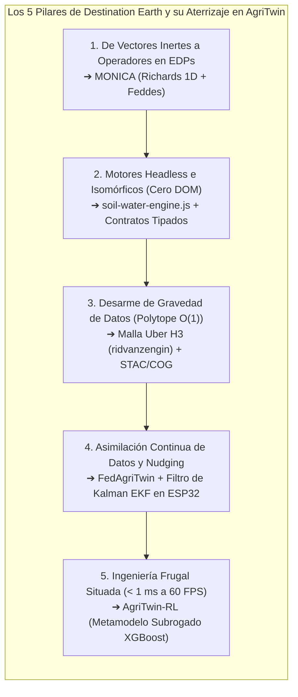

<div class="mermaid-legend">
<div class="mermaid-legend-title">🧭 LEYENDA DEL DIAGRAMA — Los 5 Pilares de DestinE y su Aterrizaje en AgriTwin</div>
  <ul>
    <li><strong>Cajas superiores (P1 a P5):</strong> Principios metodológicos de la iniciativa europea <em>Destination Earth</em>.</li>
    <li><strong>Cajas inferiores:</strong> El repositorio o módulo concreto de nuestra arquitectura que materializa cada principio.</li>
    <li><strong>Siglas clave del diagrama:</strong> <strong>EDPs</strong> = Ecuaciones en Derivadas Parciales (física continua en espacio y tiempo); <strong>DOM</strong> = <em>Document Object Model</em> (la interfaz HTML del navegador; «Cero DOM» significa que el motor matemático está limpio de código visual); <strong>DEDL / Polytope $O(1)$</strong> = extracción directa de solo la porción espacial requerida en tiempo constante sin descargar archivos gigantes; <strong>EKF</strong> = Filtro de Kalman Extendido (fusión matemática entre modelo y sensor); <strong>ESP32</strong> = microcontrolador físico en campo; <strong>Surrogate XGBoost</strong> = modelo de IA ultrarrápido que imita a MONICA en menos de 1 milisegundo.</li>
  </ul>
</div>

1. **De Vectores Inertes a Operadores Biofísicos en EDPs:** En los SIG convencionales, un canal Keyline o una faja cortafuegos es una polilínea inerte. En AgriTwin, los elementos de manejo actúan como **términos sumidero/fuente dentro de ecuaciones diferenciales**:
   * El tranque Keyline de $18.500\text{ m}^3$ actúa como el sumidero dinámico $S_{\text{keyline}}$ en la hidrodinámica 2D de Saint-Venant, atenuando el caudal pico del Río Longaví en **$-22.4\%$** y retardando la onda de crecida en **$+2.4\text{ h}$**.
   * Las raíces del cultivo actúan como el sumidero de extracción $S(z, t)$ en la ecuación de Richards 1D, gobernado por la función de Feddes.
2. **Motores Headless e Isomórficos:** CERO dependencias del DOM, Three.js, Leaflet o librerías externas en los núcleos matemáticos. Funciones puras y deterministas que corren idénticamente en Node.js (servidor), en el microcontrolador (edge) o en el cliente web.
3. **Desarme de la Gravedad de Datos (*DestinE Data Lake - DEDL*):** En lugar de transferir gigabytes de rásteres satelitales, se implementan peticiones de rango HTTP sobre Cloud-Optimized GeoTIFFs (COG/STAC) y cortes poliédricos tipo *Polytope* del ECMWF, logrando complejidad $O(1)$ sin rasterizaciones repetitivas.
4. **Asimilación Continua y Sombra Digital:** Superar la «trampa del hardware»: el gemelo no necesita un sensor en cada metro cuadrado; modela la física biofísica continua y asimila datos observacionales (Sentinel-2 y sensores FDR en campo) mediante un Filtro de Kalman Extendido (EKF).
5. **Ingeniería Frugal mediante Metamodelos Subrogados:** Transponer las simulaciones pesadas de horas de cómputo a evaluadores matemáticos instantáneos ($<1\text{ ms}$), garantizando interactividad a 60 FPS en el cliente.

### 3.4. Doctrina C2 (Command & Control) de Mando Táctico y Matriz Multiamenaza
Inspirada en los sistemas de soporte de decisión espacial (SDSS) militares y de protección civil ante catástrofes, AgriTwin integra la **Doctrina C2 de Cuenca** bajo los estándares **UNDRR e ISO 31010**:
$$R = \frac{H \times V}{100}$$
Donde la Amenaza Física ($H \in [0, 100]\%$, caudales de crecida, viento Puelche, piro-riesgo FWI) se cruza cuantitativamente con la Vulnerabilidad Expuesta ($V \in [0, 100]\%$, pozos de comités APR, cuarteles frutales de alto valor, corredores viales Ruta 5 Sur y L-110), calculando el índice de riesgo territorial integrado ($R$) para coordinar maniobras operativas multi-fase ($0-2\text{h}$, $2-6\text{h}$, $6-12\text{h}$).

### 3.5. Génesis y Aterrizaje Táctico de DestinE: De la Macro-Escala Europea al Mando Táctico de Cuenca

Para que el panel pueda defender el paso, conviene separar tres cosas que se confundían: qué es DestinE originalmente, qué hacía AgriTwin antes, y qué se toma de DestinE ahora.

* **Origen continental (DestinE, Europa, 2022):** iniciativa de la Comisión Europea con ESA, ECMWF y EUMETSAT para construir gemelos digitales del sistema Tierra a escala continental y global, ejecutados en supercomputadores de la red EuroHPC. Su propósito original es informar políticas públicas y evaluar extremos climáticos y de adaptación a gran escala.
* **Lo que AgriTwin ya hacía antes de adoptar la doctrina:** el Hub ya contaba con escenarios y alertas (los 8 Momentos Climáticos en `simulateBasinPreset`, la regla 30-30-30, el balance de cubeta FAO-56 en `soil-water-engine.js`). Eran piezas válidas, pero cada una operaba **aislada**: el viento no interactuaba con la humedad estratificada, y los escenarios eran fotos fijas sin dimensión temporal.
* **Lo que se toma de DestinE (no el hardware, sino la doctrina):**
  1. **Bucle cerrado Observar, Simular, Decidir, Actuar** a escala de cuenca (122.070 ha) y de predio (24,8 ha).
  2. **Extremos bajo demanda:** simular en segundos el impacto de eventos agudos (Puelche, heladas, sequía, crecidas) en lugar de solo mostrarlos.
  3. **Motores desacoplados y headless**, con asimilación continua de datos y metamodelos subrogados para mantener la interactividad.
* **Qué NO cambió con DestinE:** el motor interno de suelo (`soil-water-engine.js`) sigue siendo la cubeta única FAO-56. La doctrina definió *hacia dónde* ir; el salto de física (capas, Richards, nitrógeno) es justamente lo que este plan incorpora.

### 3.6. Ecosistema Multiescala de Visores Especializados
Para ejecutar esta doctrina, el sistema desacopla la visualización en cuatro escalas orgánicas:
* **Escala Macro (Cuenca):** `agritwin-cuenca` en **Leaflet 2D GIS** (122.070 ha de Maule Sur, Río Longaví, embalse Bullileo).
* **Escala Meso (Predio):** `agritwin-predio` en **Three.js WebGL PBR 3D** (24.8 ha en Fundo Meniel, topografía, potreros PRV).
* **Escala Micro (Planta y Suelo):** Firmware C++ en **ESP32** con sondas capacitivas FDR y actuadores de riego MQTT.
* **Escala Ecosistémica (Restauración):** `rewild` en **PWA Offline IndexedDB** para cuantificar carbono y materia orgánica.

---

## 4. Coexistencia Cartográfica: Polígonos Catastrales Reales vs. Malla Territorial Uber H3

### 4.1. El Estado Base: ¿Cómo se representaba el espacio?
En AgriTwin, toda la información espacial se apoya en entidades vectoriales de alta precisión en formato **GeoJSON estándar (RFC 7946)**:
* Los potreros de pastoreo racional `P1..P4` en Fundo Meniel ([`data/farm_ecosystem_master.json`](file:///Users/danielsantander/Documents/Agrotech/agritwin-hub/data/farm_ecosystem_master.json)).
* Los límites prediales, tranques acumuladores Keyline de 18.500 $\text{m}^3$ y cauces de esteros.
* Los sitios de validación retrospectiva de megainundaciones extraídos de **Sentinel-1 SAR** ([`data/flood_hindcast_sites.json`](file:///Users/danielsantander/Documents/Agrotech/agritwin-hub/data/flood_hindcast_sites.json)).

### 4.2. La Incorporación desde `ridvanzengin/AgriTwin`: El Tensor Espacial H3
El proyecto territorial `ridvanzengin/AgriTwin` utiliza el sistema de indexación espacial discreta **Uber H3** (mallas hexagonales globales jerárquicas), materializando el principio de corte de datos tipo *Polytope* de DestinE.

### 4.3. ¿Qué mejora respecto al enfoque puramente poligonal?
1. **Adyacencia Equidistante:** En cuadrículas ortogonales (píxeles ráster), los vecinos diagonales están a una distancia $\sqrt{2} \cdot d \approx 1.414 \cdot d$, distorsionando el flujo hídrico. En los hexágonos H3, los 6 vecinos inmediatos están a la misma distancia exacta $d$.
2. **Jerarquía Matemática por Desplazamiento de Bits (*Bitwise Shift*):** Pasar de la escala de cuenca (Resolución 6, $\approx 36\text{ km}^2$) a la escala predial (Resolución 9, $\approx 0.1\text{ km}^2$) no requiere costosas consultas geoespaciales `ST_Intersects` en base de datos; se resuelve con operaciones binarias en microsegundos:
   $$\text{H3Index}_{\text{predio}} = \text{H3Index}_{\text{cuenca}} \oplus \text{offset}$$

### 4.4. Regla de Convivencia: ¿Mis polígonos ahora serán hexágonos?
**No. Los polígonos catastrales vectoriales se mantienen al 100% como entidades de precisión legal y operativa.**

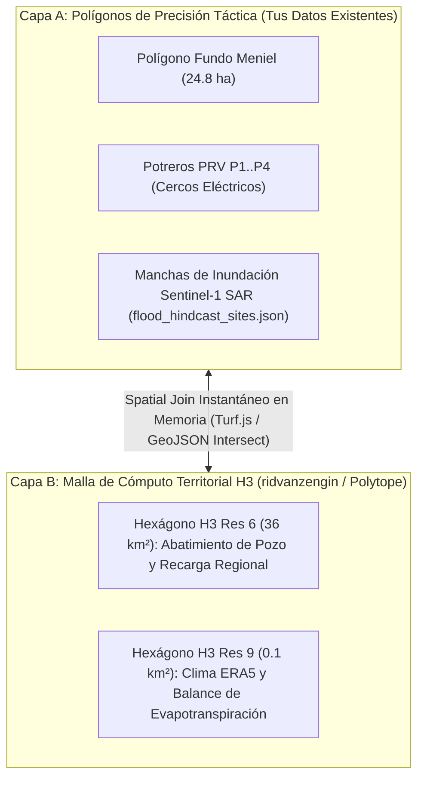

<div class="mermaid-legend">
<div class="mermaid-legend-title">🧭 LEYENDA DEL DIAGRAMA — Coexistencia entre Polígonos Reales (Capa A) y Hexágonos H3 (Capa B)</div>
  <ul>
    <li><strong>Capa A (Catastro):</strong> Son los bordes exactos de tus potreros, cercos y manchas de inundación en formato vectorial <code>GeoJSON</code>. Nunca se deforman ni se convierten en hexágonos.</li>
    <li><strong>Capa B (Malla H3):</strong> Es la red invisible de celdas hexagonales de Uber que cubre la cuenca con datos de clima (Resolución 6, $\approx 36\text{ km}^2$) y de suelo/parcela (Resolución 9, $\approx 0.1\text{ km}^2 \approx 10\text{ ha}$; o Resolución 10/N3 $\approx 0.58\text{ ha}$).</li>
    <li><strong>Flecha central (Spatial Join en Memoria):</strong> Cruce geométrico instantáneo mediante el cual un potrero pregunta <em>«¿qué hexágonos caen debajo de mi superficie?»</em> y promedia sus datos de lluvia, humedad y temperatura.</li>
  </ul>
</div>

* **Los Polígonos GeoJSON** definen la verdad territorial del agricultor (*"aquí está mi cerca"*, *"aquí se inundó el estero"*).
* **Los Hexágonos H3** actúan como una "red de sensores atmosféricos, edafológicos y freáticos": almacenan variables continuas de gran escala (evapotranspiración ERA5/Open-Meteo, riesgo de abatimiento del acuífero DGA y estado de las 5 capas de suelo).
* **Mecanismo de Convivencia:** Cuando el agricultor consulta un potrero o traza un polígono nuevo, la aplicación ejecuta un *spatial join* / *polyfill* instantáneo en memoria: el polígono consulta o subdivide los hexágonos sobre los que se asienta y hereda sus métricas climáticas, edafológicas y de cuenca, sin deformar sus contornos perimetrales.

### 4.5. Los 4 Niveles Espaciales de Ejecución y el Pipeline de Síntesis Biofísica Bajo Demanda (AMR)

Para evitar el colapso computacional que implicaría resolver las 5 capas de la ecuación diferencial de Richards en cada metro cuadrado de las $122.070\text{ ha}$ de la cuenca, AgriTwin v3.0.0 implementa **Refinamiento de Malla Adaptativo (AMR)** estructurado en **4 niveles concéntricos de ejecución** y un **Pipeline de Pedotransferencia en 4 Pasos** para áreas no instrumentadas:

| Nivel Espacial | Dominio Geométrico | Motor Activo | Variables Resueltas | Etiqueta de Proveniencia |
| :--- | :--- | :--- | :--- | :--- |
| **Nivel 1: Macro-Cuenca** | $122.070\text{ ha}$ (Bullileo $\to$ Retiro) | `basin-hydrology-engine` + Flujo Euleriano | Caudales DGA, Isoterma $0^\circ\text{C}$, Viento $10/80/120\text{ m}$, CAPE, VPD ($168\text{ h}$) | `🟢 REAL API` / `🛰️ SATÉLITE` |
| **Nivel 2: Anillo Vecinal** | Radio $5\text{ km}$ ($\sim 5.000\text{ ha}$, H3 Res 8 $\sim 15\text{ ha}$) | `Surrogate RL` ($18\ \mu\text{s}$) + Rothermel / Prandtl | Vectores de fuego WUI, drenaje catabático de heladas, 18 tranques | `🟣 HÍBRIDO SURROGATE` |
| **Nivel 3: Predio Activo** | $24.8\text{ ha}$ (12 Cuarteles + Micro-H3 Res 9/10 $\sim 0.5\text{ ha}$) | `richards-monica-engine` (5 estratos) + `EKF Kalman` | $\theta(z)$, succión $\psi(\theta)$ Campbell, estrés/anoxia Feddes, $NO_3^-/NH_4^+$ | `🟢 ASIMILADO EKF` / `🟣 FÍSICO` |
| **Nivel 4: Polígono ROI Usuario** | Cualquier polígono trazado en vivo (`✏️ Trazar Polígono`) | Polyfill H3 Dinámico + Pedotransferencia + Richards 1D | Calicata Digital 1D ($0\text{--}100\text{ cm}$) instanciada en $<0.5\text{ ms/hex}$ | `🟣 INFERIDO POR MODELO FÍSICO` |

#### ¿Cómo parametriza el motor un hexágono donde no existe un sensor físico enterrado?
Cuando el motor evalúa un hexágono del anillo vecinal o dentro de un polígono recién trazado por el usuario (Nivel 4), ejecuta una síntesis determinista en 4 etapas:
1. **Muestreo Orográfico (DEM $30\text{ m}$):** Extrae altitud, pendiente y exposición solar del centroide del hexágono, corrigiendo la temperatura local por gradiente adiabático ($-6.5^\circ\text{C/km}$), la radiación incidente y el coeficiente de escorrentía superficial.
2. **Funciones de Pedotransferencia (ISRIC SoilGrids $250\text{ m}$ $\to$ Saxton & Campbell):** Consulta la fracción de arcilla, arena y carbono orgánico ($SOC$) del punto y deduce analíticamente la porosidad de saturación ($\theta_s$), capacidad de campo ($\theta_{fc}$), punto de marchitez ($\theta_{wp}$), conductividad saturada ($K_{sat}$) y el exponente $b$ de Campbell para los 5 estratos ($0\text{--}100\text{ cm}$).
3. **Parametrización Fenológica y Radical (Sentinel-2 L2A):** A partir de la cobertura LULC y los índices `NDVI`/`NDMI`, asigna la profundidad máxima radicular ($Z_{\text{root}}$) y los 4 umbrales de potencial mátrico de Feddes ($\psi_1$ anoxia, $\psi_2, \psi_3$ óptimo, $\psi_4$ marchitez).
4. **Integración Temporal y Etiquetado de Verdad de Terreno:** Aplica la serie horaria de $168\text{ h}$ de Open-Meteo al solver Richards 1D. Si el hexágono cuenta con una sonda física ESP32 activa, fusiona el estado mediante el **Filtro de Kalman Extendido (EKF)** (`🟢 ASIMILADO EKF`); de lo contrario, expone el perfil con la insignia `🟣 DATO INFERIDO POR MODELO FÍSICO` para garantizar transparencia epistemológica total entre mediciones reales y simulaciones.

---

## 5. Deep Dive 1: `ridvanzengin/AgriTwin` (El Gemelo Geoespacial y Territorial)

> **¿Qué es un «Deep Dive» en este Tratado?** Es una inmersión técnica profunda en el código fuente, la estructura de datos y las ecuaciones matemáticas de uno de los repositorios internacionales de referencia, para comprender exactamente cómo funciona por dentro antes de absorber sus mejores atributos en AgriTwin.

### 5.1. Contexto Territorial: La Cuenca de Konya (Turquía)
La llanura de Konya concentra más de 3 millones de hectáreas agrícolas bajo un clima semiárido ($P \approx 320\text{ mm/año}$, $ET_0 > 1100\text{ mm/año}$). El cultivo intensivo de remolacha azucarera y maíz forrajero, subsidiado históricamente, ha generado una extracción subterránea no sostenible de más de $2.5\times 10^9\text{ m}^3/\text{año}$.
* **Consecuencia geológica:** La napa desciende a un promedio de $1.5\text{ a }3.0\text{ m/año}$, provocando la apertura súbita de dolinas de colapso (*sinkholes*) de hasta 50 metros de profundidad.
* **El dilema de política pública:** Prohibir el riego quiebra a los productores; mantener el riego actual colapsa el acuífero en dos décadas.
* **Por qué existe este gemelo:** Para evaluar escenarios de reconversión de cultivos hacia especies de menor huella hídrica (cebada, leguminosas, girasol) calculando la pérdida o ganancia de margen económico para cada agricultor.

---

### 5.2. Perspectiva de Software: Malla Hexagonal Uber H3
En lugar de almacenar geometrías de parcelas con fronteras irregulares que hacen colapsar los índices espaciales R-Tree en bases de datos relacionales, el proyecto adopta la **Malla Hexagonal Discreta Uber H3**.

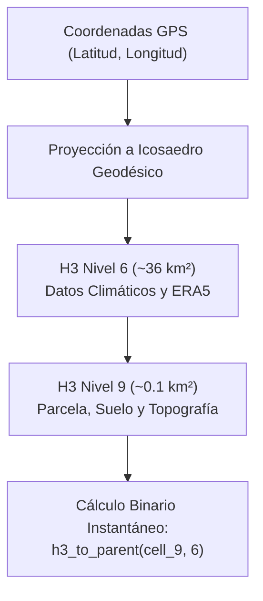

<div class="mermaid-legend">
<div class="mermaid-legend-title">🧭 LEYENDA DEL DIAGRAMA — Indexación Geodésica Uber H3 y Jerarquía Padre-Hijo</div>
  <ul>
    <li><strong>GPS → Icosaedro Geodésico:</strong> Uber H3 proyecta la esfera terrestre sobre un poliedro de 20 caras triangulares (icosaedro) tapizado de hexágonos, evitando la distorsión de área de los mapas planos tradicionales (Mercator).</li>
    <li><strong>H3 Nivel 6 ($\approx 36\text{ km}^2$) → H3 Nivel 9 ($\approx 0.1\text{ km}^2$):</strong> Cada hexágono padre se subdivide recursivamente en <strong>7 hexágonos hijos</strong> cada vez que subimos un nivel de resolución.</li>
    <li><strong><code>h3_to_parent(cell_9, 6)</code>:</strong> Función instantánea que descubre a qué celda climática regional (Nivel 6) pertenece una parcela (Nivel 9) leyendo directamente los bits de su identificador de 64 bits.</li>
  </ul>
</div>

#### Propiedades Matemáticas de la Elección:
1. **Adyacencia Isótropa:** A diferencia de una cuadrícula cartesiana donde los vecinos diagonales están a distancia $d\sqrt{2}$, en una malla hexagonal todos los 6 vecinos comparten la misma distancia exacta entre centroides:
   $$d(c_0, c_i) = \sqrt{\frac{2A}{\sqrt{3}}}, \quad \forall i \in \{1, \dots, 6\}$$
2. **Operaciones Bitwise (Desplazamiento de Bits):** El mapeo entre la escala climática regional (nivel 6) y la escala predial (nivel 9) no requiere costosas consultas geoespaciales `ST_Intersects`; se resuelve en la CPU mediante un desplazamiento de bits:
   $$\text{Parent}_{H3}(\text{cell}_9, 6) = \text{cell}_9 \gg (3 \times (9 - 6))$$

<div class="eq-guide">
<div class="eq-guide-title">📐 GUÍA PARA EL EQUIPO — ¿Qué es un «Bitwise Shift» ($\gg$) y por qué acelera el mapa 1.000 veces?</div>
  <ul>
    <li>Cada hexágono H3 tiene un «RUT» numérico de 64 bits (ej. <code>0x8928308280fffff</code>) donde cada grupo de <strong>3 bits</strong> codifica en cuál de los 7 hijos posibles (0 al 6) estamos dentro del hexágono padre.</li>
    <li>El operador <strong>$\gg$ (<em>Bitwise Right Shift</em> o desplazamiento de bits a la derecha)</strong> simplemente corre o «borra» los últimos dígitos binarios de las resoluciones finas (3 bits por cada nivel que subimos: $3 \times (9-6) = 9\text{ bits}$). Así, el computador sabe quién es el hexágono padre en <strong>1 ciclo de reloj de procesador ($O(1)$)</strong> sin calcular geometrías ni áreas.</li>
  </ul>
</div>

---

### 5.3. Perspectiva Agronómica: Lógica Difusa Trapezoidal de Idoneidad
Los cultivos no responden a umbrales binarios. El motor (`agritwin_etl/scoring/engine.py`) utiliza funciones de pertenencia difusa trapezoidales $\mu(x; a, b, c, d) \in [0, 1]$:

$$\mu(x; a, b, c, d) = \max\left( 0, \, \min\left( \frac{x - a}{b - a}, \, 1, \, \frac{d - x}{d - c} \right) \right)$$

```
  Grado de Pertenencia μ(x)
       1.0 |            b ────────────── c  (Rango Óptimo Agronómico)
           |             /              \
           |            /                \
           |           /                  \
       0.0 └────────── a                  d ────────── Variable Agroclimática (x)
                  (Estrés Bajo)        (Estrés Severo / Límite Fisiológico)
```

#### Agregación Multivariable de la Celda:
Para cada cultivo $k$, el puntaje final de la celda hexagonal $j$ es:

$$S_{j, k} = \sum_{v \in \text{Variables}} w_v \cdot \left[ \frac{1}{|M_v|} \sum_{m \in M_v} \mu_{v, m}(x_{j, m}; a_{k, v, m}, b_{k, v, m}, c_{k, v, m}, d_{k, v, m}) \right]$$

Donde los pesos normalizados ($\sum w_v = 1$) ponderan:
* Temperatura media del aire y mínimas mensuales (evitación de heladas tardías en floración).
* Precipitación acumulada en la ventana de llenado de grano.
* Parámetros edáficos de SoilGrids: pH ($0-5\text{ cm}$), salinidad (conductividad eléctrica $EC_e$), textura (porcentaje de arcilla) y contenido de carbono orgánico.
* Topografía: pendiente (derivada del modelo SRTM de la NASA).

<div class="eq-guide">
<div class="eq-guide-title">📐 GUÍA PARA EL EQUIPO — Cómo funciona la Lógica Difusa Trapezoidal de Idoneidad (Crop Fit)</div>
  <ul>
    <li><strong>¿Por qué «difusa» y no una regla fija?</strong> Una planta no está «100% viva a $29.9^\circ\text{C}$ y 100% muerta a $30.1^\circ\text{C}$». La función trapezoidal $\mu(x; a, b, c, d)$ asigna una nota gradual entre $0$ y $1$:
      <ul>
        <li>Entre <strong>$b$ y $c$ (meseta superior del trapecio)</strong> la variable está en su rango ideal y recibe nota <strong>$1.0$ (100% de aptitud)</strong>.</li>
        <li>Entre <strong>$a$ y $b$ (rampa izquierda)</strong> o entre <strong>$c$ y $d$ (rampa derecha)</strong> el cultivo sufre estrés creciente y la nota baja linealmente de $1$ a $0$.</li>
        <li>Por debajo de <strong>$a$</strong> o por encima de <strong>$d$</strong> se supera el límite fisiológico y la nota es <strong>$0.0$</strong>.</li>
      </ul>
    </li>
    <li><strong>Puntaje global $S_{j,k}$:</strong> Promedia las notas difusas de todos los meses ($M_v$) y las pondera por la importancia de cada variable ($w_v$: temperatura, lluvia, pH, textura y pendiente) para decir qué tan apto es el hexágono $j$ para el cultivo $k$.</li>
  </ul>
</div>

---

### 5.4. Perspectiva Económica: Modelo Hidro-Energético de Bombeo
El modelo económico vincula directamente la geología subterránea con los costos operativos de la explotación:

#### 2. Potencia Hidráulica Requerida para Bombeo de Pozo:
$$P_{\text{hidr}} = \frac{\rho \cdot g \cdot Q \cdot H_{\text{total}}}{1000} \quad [\text{kW}]$$

Donde:
* $\rho$: Densidad del agua ($1000\text{ kg/m}^3$).
* $g$: Gravedad ($9.81\text{ m/s}^2$).
* $Q$: Caudal de bombeo ($\text{m}^3/\text{s}$).
* $H_{\text{total}}$: Carga dinámica total ($\text{m}$), función de la profundidad freática de la celda ($H_{\text{well}}(j)$), el cono de abatimiento local ($\Delta h$) y la presión de diseño del cabezal de riego por goteo o pivote ($P_{\text{emisor}}$):
  $$H_{\text{total}} = H_{\text{well}}(j) + \Delta h + h_f + \frac{P_{\text{emisor}}}{\rho g}$$

#### 3. Consumo Energético Específico por Metro Cúbico:
$$E_{\text{específica}} = \frac{g \cdot H_{\text{total}}}{3600 \cdot \eta_{\text{bomba}} \cdot \eta_{\text{motor}}} \quad [\text{kWh / m}^3]$$

Donde $\eta_{\text{bomba}} \approx 0.75$ y $\eta_{\text{motor}} \approx 0.90$.

#### 4. Margen Bruto Neto por Hectárea ($\Pi_j$):
$$\Pi_j(k) = \left[ Y_j(k) \cdot P_{\text{mercado}}(k) \right] - \left[ C_{\text{fijo}} + C_{\text{semilla}} + C_{\text{fertilizante}} + \left( V_{\text{riego}} \cdot E_{\text{específica}}(j) \cdot \text{Tarifa}_{\text{kWh}} \right) \right]$$

Donde el rendimiento de campo $Y_j(k)$ se calcula modulando el potencial teórico de la zona por la idoneidad difusa:
$$Y_j(k) = Y_{\text{máx}}(k) \cdot S_{j, k}^{1.5}$$

<div class="eq-guide">
<div class="eq-guide-title">📐 GUÍA PARA EL EQUIPO — Relación entre Profundidad del Pozo, Cabezal de Riego y Factura Eléctrica</div>
  <ul>
    <li><strong>Carga dinámica total ($H_{\text{total}}$):</strong> Es la «altura equivalente» que la bomba debe vencer. Suma 4 cosas: <strong>1)</strong> la profundidad estática del agua en el pozo ($H_{\text{well}}$), <strong>2)</strong> el <strong>abatimiento local ($\Delta h$)</strong> (cuántos metros extras baja el nivel del pozo mientras la bomba está succionando), <strong>3)</strong> el roce en las tuberías ($h_f$) y <strong>4)</strong> la presión requerida en el <strong>cabezal de riego ($P_{\text{emisor}}/\rho g$)</strong> (el conjunto de filtros, válvulas y goteros o aspersores que necesitan típicamente $15\text{ a }30\text{ m}$ de columna de agua para pulverizar o gotear parejo).</li>
    <li><strong>Impacto en el bolsillo ($\Pi_j$):</strong> Cada metro que baja el acuífero ($\uparrow H_{\text{total}}$) o cada milímetro de riego desperdiciado ($\uparrow V_{\text{riego}}$) encarece directamente el costo eléctrico ($E_{\text{específica}} \cdot \text{Tarifa}_{\text{kWh}}$) y reduce el margen neto por hectárea $\Pi_j$.</li>
  </ul>
</div>

---

### 5.5. Arquitectura de Concurrencia de Escenarios (*What-If*)
En `ridvanzengin-agriTwin-app/agritwin_app/tasks.py`:

```python
@celery.task(bind=True)
def compute_scenario_scores(self, scenario_id: int) -> dict:
    """Recalcula todas las celdas H3 res-9 dentro del polígono con overrides climáticos y de agua."""
    _ensure_db()
    with get_session() as session:
        scenario = session.execute(
            text("SELECT polygon, temp_override, precip_override FROM scenarios WHERE id = :id"),
            {"id": scenario_id}
        ).fetchone()

        # Resuelve las celdas H3 contenidas en el polígono dibujado por el usuario
        cells = get_h3_cells_in_polygon(scenario.polygon, resolution=9)
        
        # Aplica perturbaciones climáticas (ej. +1.5 °C, -25% precipitación)
        overridden_features = apply_climatic_overrides(
            cells, 
            delta_temp=scenario.temp_override, 
            factor_precip=scenario.precip_override
        )
        
        # Ejecuta el motor vectorial de idoneidad y balance económico
        new_scores = score_cells(cells, overridden_features)
        save_scenario_results(session, scenario_id, new_scores)
        return {"status": "SUCCESS", "cells_processed": len(cells)}
```

<div class="translation-card">
<div class="translation-card-title">🔄 FICHA DE TRADUCCIÓN VISUAL — <code>ridvanzengin/AgriTwin</code> → Tu AgriTwin</div>
  <ul>
    <li><strong>Qué manejaba el autor:</strong> Malla hexagonal H3 en 2 resoluciones (Res 6 regional y Res 9 parcela), 4 vistas web (<em>Field Explorer</em>, <em>Crop Fit</em> difuso, <em>Yield &amp; Profit</em> con costo de bombeo y <em>Scenarios What-If</em>) y panel lateral <em>Grid Detail (Latest / Historic)</em>.</li>
    <li><strong>Cómo verlo en su UI original exacta:</strong> Explorable en vivo en <a href="http://localhost:7788/ridvanzengin/" target="_blank"><code>http://localhost:7788/ridvanzengin/</code></a> (o en AgriTwin VSD → <code>🔬 UIs Originales (6)</code> → <code>🗺️ ridvanzengin (H3)</code>).</li>
    <li><strong>Cómo se proyecta hoy en tu AgriTwin:</strong> La malla hexagonal adaptativa (N2/N3) vive en la nueva 5ª pestaña <strong><code>📐 Keyline &amp; Terreno</code> (Módulo 3)</strong> del Visor Satelital; al hacer clic en un hexágono abre el popup con su Calicata 1D ($0\text{–}100\text{ cm}$).</li>
    <li><strong>Qué dejó el autor disponible por si deseas incorporarlo:</strong> Su selector de color por atributo en el panel lateral (<em>Terrain / Weather / Vegetation / Soil</em> con botones de radio), su pestaña <em>Historic</em> con gráficos temporales por celda H3 y la vista comparativa de rentabilidad por cultivo (<em>Crop Fit / Yield &amp; Profit</em>).</li>
  </ul>
</div>

<figure class="atlas-fig" style="margin:20px 0;padding:16px;border:2px solid #0284c7;border-radius:12px;background:#faf7f2;page-break-inside:avoid;">
<div style="font-family:JetBrains Mono,monospace;font-size:9.5pt;font-weight:800;color:#0369a1;margin-bottom:10px;text-transform:uppercase;">🖼️ FIGURA ATLAS-REPOS-1 (Lámina 2 del Atlas VSD · Gran Formato 2×2) — Las 4 Vistas Originales de ridvanzengin / AgriTwin sobre la Malla H3</div>
<svg viewBox="0 0 800 336" width="100%" xmlns="http://www.w3.org/2000/svg" style="display:block;width:100%;height:auto;font-family:Inter,system-ui,sans-serif;">
<rect x="4" y="4" width="388" height="158" rx="10" fill="#ffffff" stroke="#10b981" stroke-width="1.8"/>
<text x="16" y="25" font-size="11.5" font-weight="800" fill="#0f172a">1. Field Explorer (Explorador de Celdas H3)</text>
<rect x="318" y="10" width="62" height="19" rx="5" fill="#d1fae5" stroke="#10b981"/><text x="349" y="23" text-anchor="middle" font-size="9" font-weight="800" fill="#065f46">✓ Ya en 3.b</text>
<rect x="16" y="34" width="210" height="96" rx="8" fill="#f1f5f9" stroke="#cbd5e1"/>
<polygon points="62,46 92,46 107,70 92,94 62,94 47,70" fill="#38bdf8" fill-opacity="0.65" stroke="#0284c7" stroke-width="1.8"/>
<polygon points="112,46 142,46 157,70 142,94 112,94 97,70" fill="#10b981" fill-opacity="0.65" stroke="#059669" stroke-width="1.8"/>
<polygon points="87,80 117,80 132,104 117,124 87,124 72,104" fill="#f59e0b" fill-opacity="0.7" stroke="#d97706" stroke-width="1.8"/>
<polygon points="142,80 172,80 187,104 172,124 142,124 127,104" fill="#a855f7" fill-opacity="0.45" stroke="#7e22ce" stroke-width="1.5"/>
<rect x="236" y="34" width="144" height="96" rx="8" fill="#0f172a"/>
<text x="248" y="52" font-size="9.5" font-weight="800" fill="#38bdf8" font-family="monospace">Grid Detail · Res-9</text>
<text x="248" y="68" font-size="9" fill="#e2e8f0" font-family="monospace">NDVI: 0.72 (Vigor)</text>
<text x="248" y="84" font-size="9" fill="#a7f3d0" font-family="monospace">Elev: 312m · Slp: 4%</text>
<text x="248" y="100" font-size="9" fill="#fde68a" font-family="monospace">pH: 6.8 · SOC: 21g/kg</text>
<path d="M248,118 L272,110 L296,104 L320,108 L344,115 L368,106" fill="none" stroke="#38bdf8" stroke-width="2"/>
<text x="16" y="148" font-size="9.5" fill="#334155">Clic en cualquier hexágono abre su panel lateral con topografía, NDVI, suelo y serie de 12 meses.</text>
<rect x="408" y="4" width="388" height="158" rx="10" fill="#ffffff" stroke="#f59e0b" stroke-width="1.8"/>
<text x="420" y="25" font-size="11.5" font-weight="800" fill="#92400e">2. Crop Fit (Idoneidad Difusa para 8 Cultivos)</text>
<rect x="716" y="10" width="68" height="19" rx="5" fill="#fef3c7" stroke="#f59e0b"/><text x="750" y="23" text-anchor="middle" font-size="9" font-weight="800" fill="#92400e">★ Disponible</text>
<rect x="420" y="34" width="168" height="96" rx="8" fill="#fffbeb" stroke="#fde68a"/>
<text x="430" y="52" font-size="9.5" font-weight="800" fill="#92400e" font-family="monospace">Ranking de Aptitud:</text>
<rect x="430" y="60" width="136" height="15" rx="3" fill="#bbf7d0"/><text x="436" y="71" font-size="9" font-weight="700" fill="#14532d" font-family="monospace">1. Cerezo     92%</text>
<rect x="430" y="80" width="122" height="15" rx="3" fill="#bae6fd"/><text x="436" y="91" font-size="9" font-weight="700" fill="#0c4a6e" font-family="monospace">2. Avellano   86%</text>
<rect x="430" y="100" width="58" height="15" rx="3" fill="#fecdd3"/><text x="436" y="111" font-size="9" font-weight="700" fill="#881337" font-family="monospace">3. Palto      28%</text>
<rect x="598" y="34" width="186" height="96" rx="8" fill="#f8fafc" stroke="#cbd5e1"/>
<text x="610" y="50" font-size="8.8" font-weight="700" fill="#334155" font-family="monospace">Banda Óptima vs Clima Real</text>
<rect x="610" y="62" width="162" height="28" fill="#10b981" fill-opacity="0.24" stroke="#10b981" stroke-dasharray="3 2"/>
<path d="M610,108 Q650,52 692,68 T770,96" fill="none" stroke="#0284c7" stroke-width="2.6"/>
<text x="610" y="122" font-size="8.2" fill="#0369a1" font-family="monospace">─── T° Celda   ██ Rango Trapecio</text>
<text x="420" y="148" font-size="9.5" fill="#334155">Evalúa 8 cultivos por hexágono y grafica mes a mes el clima real frente al trapecio óptimo del cultivo.</text>
<rect x="4" y="174" width="388" height="158" rx="10" fill="#ffffff" stroke="#059669" stroke-width="1.8"/>
<text x="16" y="195" font-size="11.5" font-weight="800" fill="#065f46">3. Yield &amp; Profit (Rentabilidad y Costo Bombeo)</text>
<rect x="312" y="180" width="68" height="19" rx="5" fill="#fef3c7" stroke="#f59e0b"/><text x="346" y="193" text-anchor="middle" font-size="9" font-weight="800" fill="#92400e">★ Disponible</text>
<rect x="16" y="204" width="176" height="96" rx="8" fill="#ecfdf5" stroke="#a7f3d0"/>
<polygon points="52,218 88,218 104,248 88,278 52,278 36,248" fill="#059669" fill-opacity="0.82" stroke="#064e3b" stroke-width="1.8"/>
<text x="70" y="252" text-anchor="middle" fill="#ffffff" font-size="10" font-weight="800">+$4.2M</text>
<polygon points="116,226 152,226 168,256 152,286 116,286 100,256" fill="#f59e0b" fill-opacity="0.78" stroke="#92400e" stroke-width="1.8"/>
<text x="134" y="260" text-anchor="middle" fill="#ffffff" font-size="10" font-weight="800">+$1.8M</text>
<rect x="202" y="204" width="178" height="96" rx="8" fill="#ffffff" stroke="#cbd5e1"/>
<text x="214" y="224" font-size="9.5" font-weight="800" fill="#065f46" font-family="monospace">Rendimiento: 11.4 t/ha</text>
<text x="214" y="242" font-size="9" fill="#be123c" font-family="monospace">Luz Bombeo: -$420.000</text>
<text x="214" y="260" font-size="9" fill="#475569" font-family="monospace">Insumos/Fert: -$680.000</text>
<rect x="214" y="270" width="154" height="20" rx="4" fill="#d1fae5"/><text x="291" y="284" text-anchor="middle" font-size="9.2" font-weight="800" fill="#065f46" font-family="monospace">Margen Neto: 68%</text>
<text x="16" y="318" font-size="9.5" fill="#334155">Cruza las toneladas esperadas contra la profundidad del pozo y la factura eléctrica de bombeo.</text>
<rect x="408" y="174" width="388" height="158" rx="10" fill="#ffffff" stroke="#7e22ce" stroke-width="1.8"/>
<text x="420" y="195" font-size="11.5" font-weight="800" fill="#581c87">4. What-If Split View (Comparador Lado a Lado)</text>
<rect x="716" y="180" width="68" height="19" rx="5" fill="#fef3c7" stroke="#f59e0b"/><text x="750" y="193" text-anchor="middle" font-size="9" font-weight="800" fill="#92400e">★ Disponible</text>
<rect x="420" y="204" width="170" height="96" rx="8" fill="#dcfce7" stroke="#16a34a" stroke-width="1.6"/>
<text x="505" y="226" text-anchor="middle" font-size="9.5" font-weight="800" fill="#166534" font-family="monospace">ESCENARIO BASE HOY</text>
<polygon points="485,238 525,238 538,262 525,286 485,286 472,262" fill="#16a34a" fill-opacity="0.35" stroke="#15803d" stroke-width="1.6"/>
<text x="505" y="266" text-anchor="middle" fill="#14532d" font-size="12" font-weight="800">92 pts</text>
<line x1="602" y1="200" x2="602" y2="304" stroke="#7e22ce" stroke-width="2.5" stroke-dasharray="4 3"/>
<rect x="614" y="204" width="170" height="96" rx="8" fill="#fee2e2" stroke="#dc2626" stroke-width="1.6"/>
<text x="699" y="226" text-anchor="middle" font-size="9.5" font-weight="800" fill="#991b1b" font-family="monospace">SHOCK: +2°C / -30% AGUA</text>
<polygon points="679,238 719,238 732,262 719,286 679,286 666,262" fill="#dc2626" fill-opacity="0.28" stroke="#b91c1c" stroke-width="1.6"/>
<text x="699" y="266" text-anchor="middle" fill="#991b1b" font-size="12" font-weight="800">61 pts</text>
<text x="420" y="318" font-size="9.5" fill="#334155">Dibuja un polígono, aplica perturbación climática y compara el mapa base vs. escenario dividido.</text>
</svg>
</figure>

---
---

# PARTE II: LOS MOTORES CIENTÍFICOS Y SU EVOLUCIÓN BIOFÍSICA

---

## 6. Evolución del Motor de Suelos: De la Cubeta FAO-56 a la Biofísica Multicapa de MONICA

### 6.1. El Estado Base: ¿Cómo calculaba el motor previo?
El motor [`soil-water-engine.js`](file:///Users/danielsantander/Documents/Agrotech/agritwin-hub/js/engines/soil-water-engine.js) de AgriTwin utilizaba un **Modelo de Cubeta Única (*Single-Bucket Model*)** basado en la FAO-56:
* Todo el perfil de raíces ($z_r = 0.60\text{ m}$) se trataba como un único depósito homogéneo.
* Capacidad de agua disponible: $TAW = 1000 \cdot (\theta_{FC} - \theta_{WP}) \cdot z_r$.
* Fracción de agotamiento permisible: $RAW = p \cdot TAW$.
* Drenaje asumido como instantáneo en cuanto la humedad superaba $\theta_{FC}$.
* Estrés hídrico lineal: $K_s = \frac{TAW - D_r}{(1-p)TAW}$.

### 6.2. La Incorporación desde `monica-agritwin`: La Ecuación Continua del Suelo
Bajo la doctrina DestinE de sustituir aproximaciones estáticas por operadores biofísicos continuos, el modelo mecanístico **MONICA** (ZALF, Alemania) introduce la física de transporte no saturado y la dinámica biogeoquímica completa del agroecosistema.

### 6.3. ¿En qué difiere el cálculo y qué mejora exactamente?

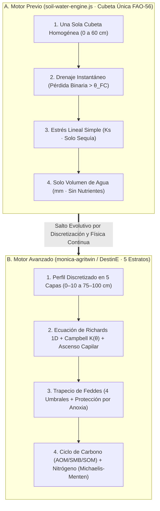

<div class="mermaid-legend">
<div class="mermaid-legend-title">🧭 LEYENDA DEL DIAGRAMA — Salto Evolutivo de la Cubeta FAO-56 al Motor Multicapa MONICA</div>
  <ul>
    <li><strong>Columna Izquierda (Motor Previo — Cubeta Única FAO-56):</strong> Ve los primeros $60\text{ cm}$ de tierra como un solo balde uniforme; si llueve más de lo que cabe ($>\theta_{FC}$), asume que el sobrante desaparece al instante («drenaje instantáneo») y solo calcula falta de agua ($K_s$), ignorando la asfixia por exceso de riego.</li>
    <li><strong>Columna Derecha (Motor Avanzado — MONICA / DestinE):</strong> Divide el suelo en estratos superpuestos ($0\text{–}10, 10\text{–}25, 25\text{–}50, 50\text{–}75, 75\text{–}100\text{ cm}$), mueve el agua gradualmente entre capas según su succión y conductividad ($K(\theta)$), detecta tanto sequía como pudrición/asfixia de raíces (<strong>anoxia de Feddes</strong>) y sigue la pista del nitrógeno y la materia orgánica ($SOM$).</li>
  </ul>
</div>

1. **Discretización Vertical en Estratos:** MONICA divide el perfil del suelo en capas de $10\text{ cm}$. Permite capturar fenómenos críticos donde los primeros $10\text{ cm}$ de suelo están deshidratados pero a $40\text{ cm}$ persiste humedad suficiente, evitando riegos innecesarios que la cubeta única habría ordenado.
2. **Conductividad Hidráulica Continua:** En lugar de asumir un drenaje instantáneo, resuelve la conductividad no saturada $K(\theta)$ de Campbell, capturando el **ascenso capilar real** desde la napa freática hacia las raíces durante los meses de verano.
3. **Estrés Hídrico Multicriterio de Feddes:** Protege al cultivo tanto por sequía como por **anoxia radical** (asfixia por exceso de agua tras lluvias o riegos excesivos).
4. **Bioquímica del Nitrógeno y Materia Orgánica:** MONICA modela la mineralización del nitrógeno orgánico y la lixiviación de nitratos ($\text{NO}_3^-$) hacia los acuíferos. Permite demostrar numéricamente cómo el incremento de materia orgánica del suelo ($SOM$) eleva la capacidad de retención hídrica y disminuye la factura eléctrica de bombeo.

---

### 6.4. Física Hidrogeológica de Cuenca: Abatimiento Freático y Cono de Thiem

Un gemelo que modela el suelo sin acoplar el acuífero subyacente comete un error de balance de masa en zonas de regadío intensivo.

1. **Límite de los sensores satelitales:** Sentinel-2 (óptico/infrarrojo) y Sentinel-1 (SAR banda C) captan la superficie o los primeros centímetros de suelo. No miden la napa freática ni el almacenamiento subterráneo. Por eso el nivel freático no se "ve" desde el satélite: se **calcula** por balance y se **valida** con pozos.
2. **Balance de masa del acuífero:**
   $$\Delta h_{wt} = \frac{R_{\text{infil}} - Q_{\text{bombeo}} - Q_{\text{base}}}{S_y}$$
   * $R_{\text{infil}}$: recarga por percolación profunda (flujo que drena bajo los 60 cm del modelo de suelo).
   * $Q_{\text{bombeo}}$: extracción de pozos, acotada por los derechos de agua DGA asignados (28 L/s según el expediente del predio).
   * $Q_{\text{base}}$: descarga subterránea natural hacia el cauce.
   * $S_y$: rendimiento específico del acuífero. Se parte de un rango típico de 0,08 a 0,15 para gravas aluviales; **es un supuesto a calibrar** con datos de pozos, no un valor medido.
3. **Cono de depresión radial (Thiem, régimen estacionario):**
   $$s(r) = \frac{Q}{2\pi T}\,\ln\!\left(\frac{R}{r}\right)$$
   con $T$ la transmisividad del acuífero y $R$ el radio de influencia. Permite estimar si el bombeo simultáneo de predios vecinos compromete la carga hidráulica de una bomba antes de terminar el ciclo estival.

<div class="eq-guide">
<div class="eq-guide-title">📐 GUÍA PARA EL EQUIPO — ¿Qué es el Cono de Abatimiento de Thiem y la Interferencia entre Pozos?</div>
  <ul>
    <li>Cuando una bomba extrae un caudal $Q$ de un pozo profundo, el nivel del agua subterránea no baja parejo como una piscina: se forma un <strong>embudo invertido alrededor del tubo del pozo</strong> llamado <em>cono de depresión o abatimiento</em> $s(r)$.</li>
    <li>A menor distancia $r$ del pozo, mayor es el hundimiento del agua (por el logaritmo $\ln(R/r)$); y si el acuífero transmite lento el agua ($T$ baja, como en arcillas o limos), el embudo es mucho más profundo. Si dos pozos vecinos bombean dentro del mismo radio de influencia $R$, sus embudos se suman (<strong>interferencia de pozos</strong>) y pueden dejar en seco la bomba más somera.</li>
  </ul>
</div>

> **Estado de datos:** la red de pozos DGA (SNIA) y los registros de nivel deben cargarse en el repositorio para calibrar $S_y$ y $T$. Hasta entonces la capa se presenta como estimación con incertidumbre explícita, no como medición.

### 6.5. What-If a 7 Días: lo que ya existe en el Hub y la brecha real

**Nota de nomenclatura:** la sección 5.5 describe otro *What-If* (concurrencia de escenarios económicos de `ridvanzengin/AgriTwin`, en Konya). Aquí se trata del What-If **agronómico a 7 días de AgriTwin Hub**.

#### 6.5.1. Lo que ya existe (verificado en el código)

| Pieza | Dónde está | Qué hace |
| :--- | :--- | :--- |
| Motor | `simulateScenarios` y `assimilateObservation` en `js/engines/soil-water-engine.js` | Balance hídrico diario FAO-56 por escenario; ajuste del estado con una lectura observada |
| API | `/api/simulation/run` en `server.cjs` | Ejecuta **4 escenarios** sobre el pronóstico de 7 días: línea base (riego de 5,5 mm/día), falla de bomba desde el día 3, choque térmico Puelche (ET0 multiplicada por 1,35 y riego cortado desde el día 4) y riego deficitario controlado (50 % de la cuota) |
| Pantalla | *Telemetry Studio* (`#view-telemetry`), selector `#studioScenarioSelector` y gráfico `#studioSoilChart` | Muestra humedad y estrés hídrico por escenario; si la API no responde, usa un cálculo local de respaldo |
| Cubo 4D | `/api/cube/query` y `js/engines/data-cube-engine.js` | Cuartel por estrato por 7 días por variable. **No tiene cliente en la interfaz** |
| Escenarios de cuenca | 8 Momentos Climáticos (`simulateBasinPreset`) en el simulador de cuenca | Arquetipos de cuenca (crecida, sequía, Puelche, Keyline), sin dimensión temporal |
| Clima del visor | `#territorialSidebar`, pestaña *Tiempo y Hídrico*: **Real 7D** y **Simulado** | Pronóstico meteorológico; el modo *Simulado* genera clima sintético, no simula suelo |

#### 6.5.2. Limitaciones reales de lo existente (verificadas)

1. **Los estratos del cubo no son física por capas.** Son factores fijos aplicados a la misma cubeta: el estrato de 60 cm vale el 92 % del de 20 cm y el de 100 cm el 112 %. El estrato "acuífero freático" es una constante (44 % de humedad, 13 °C), sin dinámica.
2. **Rótulo engañoso de procedencia.** Cuando la solicitud no trae humedad inicial, el servidor usa valores por defecto (34 %, 28,4 % en vid, 32,5 % en cerezo) y los rotula *"Sensor FDR de Terreno (Calibrado T=0)"*, aunque no hay sonda. Debe pasar a decir que es un valor por defecto o un sensor virtual.
3. **Entradas fijas:** riego base de 5,5 mm/día, un solo punto climático para todo el predio y pronóstico diario (no horario).
4. **Escenarios cerrados:** cuatro predefinidos; no se puede elegir el día de corte, la duración ni la lámina.
5. **Sin presencia en el mapa:** el resultado solo se ve en el Telemetry Studio; el visor de cuenca no muestra qué cuartel entra en estrés.

#### 6.5.3. Qué se propone (sin duplicar el motor)

1. **Reutilizar** `/api/simulation/run` y `simulateScenarios`. No se crea un motor ni un endpoint paralelo.
2. **Llevarlo al mapa:** en `#territorialSidebar`, pestaña *Tiempo y Hídrico*, subpestaña *Resumen*, un tercer modo **What-If** junto a *Real 7D* y *Simulado*, con los mismos escenarios y la barra de días existente, que recolorea los cuarteles ya definidos en `geo-layers.js`. `setCuencaWindySource` pasa de booleano a tres estados.
3. **Parametrizar** el escenario (día de corte, duración, lámina), en lugar de cuatro casos fijos.
4. **Corregir la procedencia** y mostrar la incertidumbre (sensor virtual, ver 10.5).
5. **Reemplazar los estratos proxy** por física por capas cuando exista el subrogado (fase 5), sin cambiar la interfaz.

Lo nuevo, por tanto, es la **presencia espacial en el visor de cuenca**, la **parametrización** y la **honestidad de procedencia**, no un segundo simulador.

---

## 7. Deep Dive 2: `monica-agritwin` (El Motor Biofísico Mecanístico del ZALF)

### 7.1. Naturaleza Ontológica, Linaje y Arquitectura Operativa de MONICA

#### A. Linaje Científico y Ruptura con Modelos Empíricos
El modelo **MONICA** (*Model for Nitrogen and Carbon in Agro-ecosystems*), desarrollado por el Centro Leibniz para la Investigación del Paisaje Agrario (**ZALF**, Müncheberg, Alemania; Specka, Nendel et al.), representa la cúspide de la modelación agroecosistémica de procesos continuos. MONICA no es una curva empírica de regresión ni un modelo estadístico de caja negra: es una formulación **mecanística y determinista** fundamentada en las leyes universales de conservación de masa, momento y energía en el continuo **Suelo-Planta-Atmósfera (SPA)** a escala diaria.

Nacido del linaje científico de modelos clásicos de transporte de nutrientes y agua (particularmente **HERMES** y **DAISY**), MONICA fue concebido para superar las limitaciones de los modelos de cubeta de primer orden (tipo FAO-56), permitiendo evaluar simultáneamente:
1. El movimiento no estacionario del agua en perfiles de suelo texturalmente estratificados.
2. La transformación biológica y el balance de nitrógeno orgánico e inorgánico.
3. La acumulación, fijación y mineralización del carbono orgánico del suelo ($SOC$).
4. La dinámica fenológica del cultivo y la asimilación neta de biomasa bajo estrés múltiple simultáneo (hídrico, térmico, de nitrógeno y por anoxia).

#### B. Estructura Interna: Los Cuatro Motores Acoplados y el Bucle Diario
La operación de MONICA se estructura en cuatro módulos desacoplados pero matemáticamente acoplados dentro de un bucle de integración temporal a paso diario ($\Delta t = 1\text{ día}$), apilados verticalmente desde la atmósfera hasta el crecimiento de la planta:

<figure class="atlas-fig" style="margin:20px 0;padding:16px;border:2px solid #0284c7;border-radius:12px;background:#f8fafc;page-break-inside:avoid;">
<div style="font-family:JetBrains Mono,monospace;font-size:9.5pt;font-weight:800;color:#0369a1;margin-bottom:10px;text-transform:uppercase;">🖼️ FIGURA MONICA-7.1B (Esquema Vertical de Alta Legibilidad) — Los 4 Motores Acoplados de MONICA en Cada Paso Diario (Δt = 1 Día)</div>
<svg viewBox="0 0 800 540" width="100%" xmlns="http://www.w3.org/2000/svg" style="display:block;width:100%;height:auto;font-family:Inter,system-ui,sans-serif;">
<rect x="12" y="8" width="776" height="96" rx="10" fill="#f0f9ff" stroke="#0284c7" stroke-width="2"/>
<rect x="24" y="18" width="290" height="22" rx="5" fill="#0284c7"/><text x="34" y="33" font-size="10.5" font-weight="800" fill="#ffffff" font-family="monospace">MOTOR 1 · FORZAMIENTO AGROCLIMÁTICO DIARIO</text>
<text x="328" y="33" font-size="9.5" font-weight="700" fill="#0369a1">Entrada atmosférica de la celda H3 (/api/weather/full-168h)</text>
<rect x="24" y="48" width="365" height="44" rx="6" fill="#ffffff" stroke="#38bdf8" stroke-width="1.5"/>
<text x="36" y="66" font-size="10" font-weight="800" fill="#0f172a">1A. Variables Meteorológicas Horarias / Diarias</text>
<text x="36" y="82" font-size="9" fill="#334155">Radiación Neta (Rn) · Tmin / Tmax · Viento (u2) · VPD · Lluvia / Riego</text>
<path d="M395 70 L415 70" stroke="#0284c7" stroke-width="2.5"/>
<rect x="420" y="48" width="354" height="44" rx="6" fill="#ffffff" stroke="#0284c7" stroke-width="1.8"/>
<text x="432" y="66" font-size="10" font-weight="800" fill="#0369a1">1B. Evapotranspiración Potencial (Penman-Monteith Dual)</text>
<text x="432" y="82" font-size="9" fill="#334155">Separa Evaporación de Suelo (Es) y Demanda del Dosel (Tp)</text>
<path d="M400 104 L400 124" stroke="#0f172a" stroke-width="2.5"/><text x="412" y="118" font-size="8.8" font-weight="800" fill="#0f172a" font-family="monospace">↓ Infiltración superficial + Radiación térmica</text>
<rect x="12" y="126" width="776" height="122" rx="10" fill="#fffbeb" stroke="#d97706" stroke-width="2"/>
<rect x="24" y="136" width="290" height="22" rx="5" fill="#d97706"/><text x="34" y="151" font-size="10.5" font-weight="800" fill="#ffffff" font-family="monospace">MOTOR 2 · HIDROLOGÍA Y TÉRMICA DE SUELO 1D</text>
<text x="328" y="151" font-size="9.5" font-weight="700" fill="#92400e">Resuelto en los 5 estratos oficiales (0–10, 10–25, 25–50, 50–75, 75–100 cm)</text>
<rect x="24" y="166" width="242" height="70" rx="6" fill="#ffffff" stroke="#f59e0b" stroke-width="1.5"/>
<text x="34" y="184" font-size="9.8" font-weight="800" fill="#78350f">2A. Difusión Térmica (Fourier 1D)</text>
<text x="34" y="200" font-size="8.8" fill="#334155">Calcula T_suelo(z,t) por estrato</text>
<text x="34" y="214" font-size="8.5" font-weight="700" fill="#b45309">• Amortiguada por Mulch / Rastrojo</text>
<text x="34" y="228" font-size="8.5" fill="#475569">• Regula enzimas f(T) y Grados-Día</text>
<rect x="278" y="166" width="244" height="70" rx="6" fill="#ffffff" stroke="#d97706" stroke-width="1.8"/>
<text x="288" y="184" font-size="9.8" font-weight="800" fill="#78350f">2B. Ecuación de Richards 1D</text>
<text x="288" y="200" font-size="8.8" fill="#334155">Humedad θ(z,t) y Flujo Vertical q</text>
<text x="288" y="214" font-size="8.5" font-weight="700" fill="#0369a1">• Curvas Campbell: ψ(θ) y K(θ)</text>
<text x="288" y="228" font-size="8.5" fill="#475569">• Resta extracción radicular -S(z,t)</text>
<rect x="534" y="166" width="240" height="70" rx="6" fill="#ffffff" stroke="#f59e0b" stroke-width="1.5"/>
<text x="544" y="184" font-size="9.8" font-weight="800" fill="#78350f">2C. Macroporos y Borde Freático</text>
<text x="544" y="200" font-size="8.8" fill="#334155">Grietas + Condición a z = 100 cm</text>
<text x="544" y="214" font-size="8.5" font-weight="700" fill="#047857">• Ascenso Capilar Real desde napa</text>
<text x="544" y="228" font-size="8.5" fill="#be123c">• Drenaje profundo q &gt; 0 (lavado)</text>
<path d="M400 248 L400 268" stroke="#0f172a" stroke-width="2.5"/><text x="412" y="262" font-size="8.8" font-weight="800" fill="#0f172a" font-family="monospace">↓ Acoples: T_suelo → f(T) · Humedad θ → f(θ) · Drenaje q → Lixiviación</text>
<rect x="12" y="270" width="776" height="122" rx="10" fill="#ecfdf5" stroke="#059669" stroke-width="2"/>
<rect x="24" y="280" width="330" height="22" rx="5" fill="#059669"/><text x="34" y="295" font-size="10.5" font-weight="800" fill="#ffffff" font-family="monospace">MOTOR 3 · CARBONO ORGÁNICO Y NITRÓGENO (HERMES/DAISY)</text>
<text x="366" y="295" font-size="9.5" font-weight="700" fill="#065f46">Transformación biológica en 3 compartimentos y transporte de solutos</text>
<rect x="24" y="310" width="242" height="70" rx="6" fill="#ffffff" stroke="#10b981" stroke-width="1.5"/>
<text x="34" y="328" font-size="9.8" font-weight="800" fill="#065f46">3A. Los 3 Pools de Carbono</text>
<text x="34" y="344" font-size="8.6" fill="#334155">1. AOM (Rastrojo Fresco: semanas)</text>
<text x="34" y="358" font-size="8.6" font-weight="700" fill="#047857">2. SMB (Biomasa Microbiana: motor)</text>
<text x="34" y="372" font-size="8.6" fill="#334155">3. SOM (Humus Pasivo: esponja)</text>
<rect x="278" y="310" width="244" height="70" rx="6" fill="#ffffff" stroke="#059669" stroke-width="1.8"/>
<text x="288" y="328" font-size="9.8" font-weight="800" fill="#065f46">3B. Mineralización y Nitrificación</text>
<text x="288" y="344" font-size="8.6" fill="#334155">• SMB digiere AOM → Amonio NH4+ (+)</text>
<text x="288" y="358" font-size="8.6" font-weight="700" fill="#0369a1">• Michaelis-Menten: NH4+ → NO3- (-)</text>
<text x="288" y="372" font-size="8.5" fill="#be123c">• Si WFPS &gt; 80%: Desnitrificación N2O</text>
<rect x="534" y="310" width="240" height="70" rx="6" fill="#ffffff" stroke="#10b981" stroke-width="1.5"/>
<text x="544" y="328" font-size="9.8" font-weight="800" fill="#065f46">3C. Advección y Lixiviación (Js)</text>
<text x="544" y="344" font-size="8.6" fill="#334155">Js = -θ·D·∂C/∂z + q·C_NO3</text>
<text x="544" y="358" font-size="8.6" font-weight="700" fill="#be123c">• NO3- (-) repelido por arcillas (-)</text>
<text x="544" y="372" font-size="8.5" fill="#475569">• Si q &gt; 0 bajo raíces → lava a napa</text>
<path d="M400 392 L400 412" stroke="#0f172a" stroke-width="2.5"/><text x="412" y="406" font-size="8.8" font-weight="800" fill="#0f172a" font-family="monospace">↓ Acoples: Succión ψ → Feddes f_agua · Nitrato NO3- → f_nitrógeno</text>
<rect x="12" y="414" width="776" height="118" rx="10" fill="#faf5ff" stroke="#7e22ce" stroke-width="2"/>
<rect x="24" y="424" width="330" height="22" rx="5" fill="#7e22ce"/><text x="34" y="439" font-size="10.5" font-weight="800" fill="#ffffff" font-family="monospace">MOTOR 4 · FISIOLOGÍA Y FENOLOGÍA DEL CULTIVO</text>
<text x="366" y="439" font-size="9.5" font-weight="700" fill="#6b21a8">Crecimiento diario de raíces y biomasa regulado por estrés múltiple</text>
<rect x="24" y="454" width="242" height="68" rx="6" fill="#ffffff" stroke="#a855f7" stroke-width="1.5"/>
<text x="34" y="472" font-size="9.8" font-weight="800" fill="#581c87">4A. Fenología (GDD) y Raíces β(z)</text>
<text x="34" y="488" font-size="8.6" fill="#334155">• Reloj biológico por Grados-Día</text>
<text x="34" y="502" font-size="8.6" fill="#047857">• Perfiles radiculares paralelos (PRV)</text>
<text x="34" y="515" font-size="8.4" fill="#475569">• Colonización vertical por estrato</text>
<rect x="278" y="454" width="244" height="68" rx="6" fill="#ffffff" stroke="#7e22ce" stroke-width="1.8"/>
<text x="288" y="472" font-size="9.8" font-weight="800" fill="#581c87">4B. Sumidero Radicular de Feddes</text>
<text x="288" y="488" font-size="8.6" fill="#334155">S(z,t) = α(ψ) · β(z) · T_potencial</text>
<text x="288" y="502" font-size="8.6" font-weight="700" fill="#be123c">• Frena por Sequía (ψ &lt; ψ3)</text>
<text x="288" y="515" font-size="8.6" font-weight="700" fill="#0369a1">• Frena por Anoxia / Asfixia (ψ &gt; ψ1)</text>
<rect x="534" y="454" width="240" height="68" rx="6" fill="#ffffff" stroke="#a855f7" stroke-width="1.5"/>
<text x="544" y="472" font-size="9.8" font-weight="800" fill="#581c87">4C. Fotosíntesis y von Liebig</text>
<text x="544" y="488" font-size="8.6" fill="#334155">• Luz interceptada: Beer-Lambert (LAI)</text>
<text x="544" y="502" font-size="8.6" font-weight="700" fill="#6b21a8">• Barril: min(f_agua, f_N, f_térmico)</text>
<text x="544" y="515" font-size="8.4" fill="#475569">• Partición: Raíz, Tallo, Hoja, Fruto</text>
</svg>
</figure>

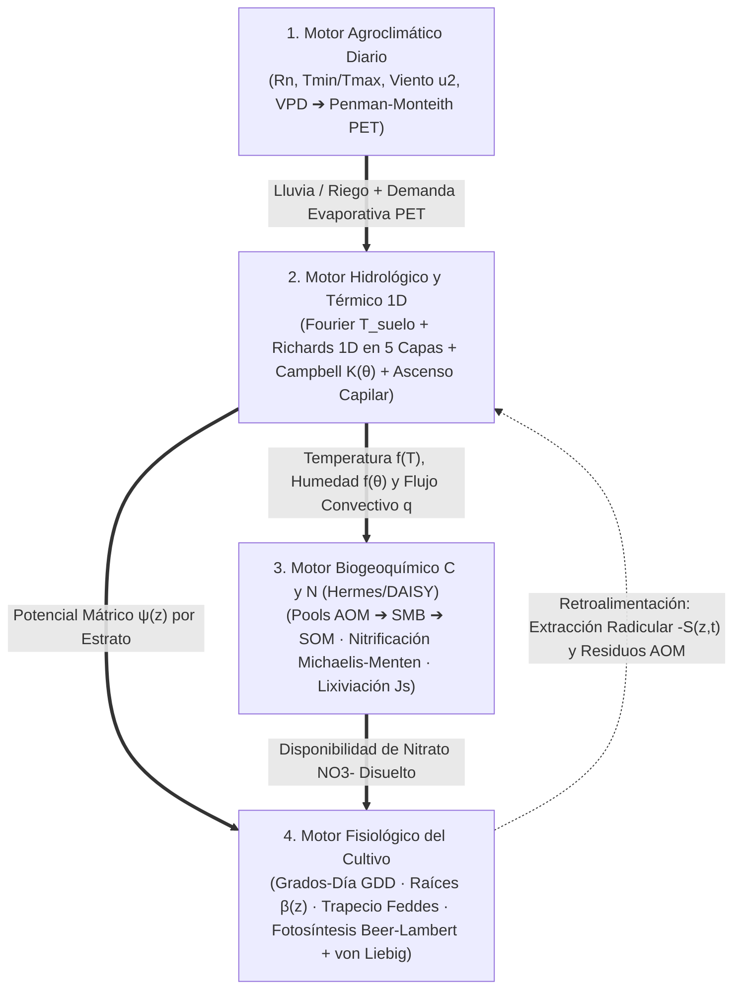

<div class="mermaid-legend">
<div class="mermaid-legend-title">🧭 LEYENDA DEL DIAGRAMA — Los 4 Motores Acoplados de MONICA en Cada Paso Diario ($\Delta t = 1\text{ día}$)</div>
  <ul>
    <li><strong>Caja 1 (Atmósfera):</strong> Recibe sol ($R_n$), temperaturas ($T_{\min}, T_{\max}$), viento ($u_2$) y lluvia/riego, y calcula cuánta agua demanda el aire (<strong>PET</strong> = Evapotranspiración Potencial por Penman-Monteith).</li>
    <li><strong>Caja 2 (Suelo 1D):</strong> Calcula la temperatura de cada capa (Fourier) y cómo viaja el agua por los poros (<strong>Richards 1D + Campbell</strong>), incluyendo drenaje por grietas (macroporos) y subida de agua desde la napa (<strong>ascenso capilar</strong>).</li>
    <li><strong>Caja 3 (Materia Orgánica y Nitrógeno):</strong> Convierte los residuos vegetales (<strong>AOM</strong>) y microbios (<strong>SMB</strong>) en humus (<strong>SOM</strong>) y amonio ($\text{NH}_4^+$), lo oxida a nitrato ($\text{NO}_3^-$ por <strong>Michaelis-Menten</strong>) y calcula cuánto nitrato se lava hacia la napa si hay exceso de agua ($q$).</li>
    <li><strong>Caja 4 (Planta):</strong> Avanza la edad biológica del cultivo según el calor acumulado (<strong>GDD</strong> = Grados-Día), hace crecer las raíces ($\beta(z)$), bebe agua según <strong>Feddes</strong> y fabrica biomasa por fotosíntesis (<strong>Beer-Lambert + von Liebig</strong>).</li>
    <li><strong>Flechas punteadas (`-.->`):</strong> Son los <em>acoples cruzados</em> entre motores (ej. el flujo de agua $q$ del Motor 2 arrastra los nitratos del Motor 3; la temperatura del suelo del Motor 2 acelera las bacterias del Motor 3 y la fenología del Motor 4).</li>
  </ul>
</div>

1. **Submódulo Térmico del Suelo (Soil Temperature Module):**  
   Resuelve la ecuación de difusión térmica unidimensional:
   $$\rho c_p \frac{\partial T_{\text{suelo}}}{\partial t} = \frac{\partial}{\partial z} \left[ \lambda \frac{\partial T_{\text{suelo}}}{\partial z} \right]$$
   Donde la conductividad térmica $\lambda$ y la capacidad calorífica volumétrica $\rho c_p$ dependen de la humedad volumétrica ($\theta$) y la densidad aparente ($\rho_b$). La condición de borde superficial se amortigua según la presencia de rastrojo y cobertura foliar, afectando directamente las tasas biológicas de nitrificación y descomposición.
2. **Submódulo Hídrico de Transporte No Saturado:**  
   Discretiza el perfil del suelo en $N$ estratos (típicamente 20 capas de 5 a 10 cm hasta 2 m de profundidad). Aplica un esquema numérico implícito sobre la ecuación de **Richards 1D**, modelando la infiltración desde la superficie, la redistribución matricial, el drenaje profundo y el ascenso capilar desde la napa. Si la intensidad de lluvia supera la conductividad a saturación $K_s$, el excedente se transfiere a escorrentía superficial.
3. **Submódulo de Turn-over de Materia Orgánica y Nitrógeno (SOM Turnover):**  
   Modela la transformación bioquímica de cuatro reservorios de materia orgánica: materia orgánica fresca rápida ($AOM_1$, carbohidratos solubles), materia orgánica fresca lenta ($AOM_2$, celulosa y lignina), biomasa microbiana activa ($SMB$) y humus estabilizado pasivo ($SOM$). La mineralización libera amonio ($\text{NH}_4^+$), el cual se oxida a nitrato ($\text{NO}_3^-$) mediante cinética de Michaelis-Menten. Cuando el espacio poroso lleno de agua ($\text{WFPS}$) supera el $70-80\%$, se activa la desnitrificación anaeróbica facultativa, perdiendo nitrógeno gaseoso ($\text{N}_2\text{O}$ y $\text{N}_2$).
4. **Submódulo Fisiológico del Cultivo:**  
   Simula el desarrollo ontogénico del cultivo a través de etapas fenológicas discretas (emergencia, macollamiento/floración, llenado de grano/madurez) gobernadas por grados-día acumulados ($GDD$). Las raíces se elongan verticalmente colonizando las capas de suelo según la resistencia a la penetración y la temperatura. La absorción de agua se rige por el sumidero de **Feddes**, mientras que la biomasa diaria se acumula mediante intercepción lumínica regulada por el factor más limitante de von Liebig ($\min(f_{\text{agua}}, f_N, f_T)$).

#### C. Arquitectura de Software de MONICA y su Rol Estratégico en AgriTwin
En su desarrollo nativo por el ZALF, MONICA está implementado en **C++ moderno de alto rendimiento**, desacoplado mediante archivos declarativos en formato JSON para la parametrización de especies de cultivo, perfiles de textura edáfica y calendarios de manejo agronómico, disponiendo además de interfaces en Python (`monica-python`).

En el ecosistema **AgriTwin**, no es viable compilar ni ejecutar el motor nativo en C++/Python dentro del hilo de renderizado del navegador a 60 FPS. Por esta razón, MONICA se posiciona como el **Patrón Oro de Verdad de Terreno (*Ground Truth Generator*)**:
* **Fase Offline / Calibración:** MONICA corre por lotes en clúster sobre series agroclimáticas ERA5-Land y perfiles de suelo de la cuenca (Maule Sur / Longaví), generando la base de datos de entrenamiento ($> 50.000$ corridas) que alimenta el metamodelo subrogado **XGBoost de AgriTwin-RL**.
* **Fase Online / Auditoría Estacional:** MONICA se preserva en el servidor como servicio asíncrono para emitir balances anuales certificados de lixiviación de nitratos a napas y huella de carbono edáfico bajo demanda agronómica formal.

---

### 7.2. Perspectiva Física: Ecuaciones del Balance Hídrico del Suelo

#### A. Evapotranspiración Atmosférica: FAO-56 Penman-Monteith
$$ET_0 = \frac{0.408 \Delta (R_n - G) + \gamma \frac{900}{T + 273} u_2 (e_s - e_a)}{\Delta + \gamma (1 + 0.34 u_2)}$$

Donde:
* $R_n$: Radiación neta en la superficie del dosel ($\text{MJ/m}^2\text{día}$).
* $G$: Flujo de calor del suelo ($\approx 0$ a escala diaria).
* $T$: Temperatura media del aire a $2\text{ m}$ ($^\circ\text{C}$).
* $u_2$: Velocidad del viento a $2\text{ m}$ ($\text{m/s}$).
* $e_s - e_a$: Déficit de presión de vapor de la atmósfera ($\text{kPa}$, también llamado **VPD**).
* $\Delta$: Pendiente de la curva de presión de vapor de saturación ($\text{kPa/}^\circ\text{C}$).
* $\gamma$: Constante psicrométrica ($\approx 0.067\text{ kPa/}^\circ\text{C}$).

<div class="eq-guide">
<div class="eq-guide-title">📐 GUÍA PARA EL EQUIPO — Cómo leer Penman-Monteith ($ET_0$) sin perderse</div>
  <ul>
    <li>El numerador suma <strong>dos motores que evaporan el agua del campo</strong>:
      <ol>
        <li><strong>Término Radiativo ($0.408\,\Delta\,(R_n - G)$):</strong> El calor directo del sol que hierve microscópicamente el agua dentro de las hojas.</li>
        <li><strong>Término Aerodinámico ($\gamma\,\frac{900}{T+273}\,u_2\,(e_s - e_a)$):</strong> El efecto «secador de pelo» del viento ($u_2$) combinado con qué tan seco o sediento está el aire ($e_s - e_a$). Cuando sopla viento Puelche cálido y seco desde la cordillera, este segundo término se dispara y duplica la sed del cultivo aunque sea de tarde.</li>
      </ol>
    </li>
  </ul>
</div>

#### B. Flujo No Saturado en el Perfil de Suelo (Ecuación de Richards 1D)
$$\frac{\partial \theta}{\partial t} = \frac{\partial}{\partial z} \left[ K(\theta) \left( \frac{\partial \psi}{\partial z} + 1 \right) \right] - S(z, t)$$

Donde:
* $\theta$: Humedad volumétrica del estrato ($\text{m}^3/\text{m}^3$).
* $\psi$: Potencial mátrico de succión ($\text{hPa}$ o $\text{kPa}$, siempre negativo en suelo no saturado).
* $K(\theta)$: Conductividad hidráulica no saturada ($\text{mm/día}$).
* $z$: Eje vertical orientado hacia arriba ($\text{m}$).
* $S(z, t)$: Término sumidero de absorción radicular del cultivo ($\text{día}^{-1}$).

<div class="eq-guide">
<div class="eq-guide-title">📐 GUÍA PARA EL EQUIPO — Qué dice la Ecuación de Richards 1D en lenguaje de campo</div>
  <ul>
    <li><strong>$\frac{\partial \theta}{\partial t}$ (izquierda):</strong> Cómo cambia la humedad de una capa de suelo (ej. $10\text{–}25\text{ cm}$) hora a hora.</li>
    <li><strong>$\frac{\partial \psi}{\partial z} + 1$ (adentro del corchete):</strong> Es la pelea entre dos fuerzas:
      <ul>
        <li><strong>$\frac{\partial \psi}{\partial z}$ (Succión capilar / matriz):</strong> El suelo seco «chupa» agua del suelo húmedo vecino igual que una esponja seca puesta sobre un plato mojado (incluso hacia arriba: <strong>ascenso capilar real</strong> desde la napa).</li>
        <li><strong>$+1$ (Gravedad):</strong> Empuja el agua siempre hacia abajo.</li>
      </ul>
    </li>
    <li><strong>$-S(z,t)$ (derecha):</strong> Es el <strong>término sumidero</strong>: los litros de agua que las raíces vivas «beben» directamente de esa capa para transpirar.</li>
  </ul>
</div>

#### C. Funciones Pedotransferenciales de Campbell
$$\psi(\theta) = \psi_e \left( \frac{\theta}{\theta_s} \right)^{-b}$$

$$K(\theta) = K_s \left( \frac{\theta}{\theta_s} \right)^{2b + 3}$$

Donde:
* $\theta_s$: Humedad a saturación (porosidad total efectiva).
* $\psi_e$: Potencial de entrada de aire del suelo ($\text{hPa}$).
* $K_s$: Conductividad hidráulica saturada ($\text{mm/día}$).
* $b$: Parámetro textural de la curva de desorción:
  $$b = 0.1 \cdot (\% \text{arcilla}) + 0.02 \cdot (\% \text{arena}) + 2.5$$

<div class="eq-guide">
<div class="eq-guide-title">📐 GUÍA PARA EL EQUIPO — Por qué la Conductividad No Saturada $K(\theta)$ cambia todo</div>
  <ul>
    <li>En un suelo franco-arcilloso ($b \approx 6.8$, exponente $2b+3 \approx 16.6$), cuando la humedad $\theta$ cae a la mitad de la saturación ($\theta/\theta_s = 0.5$), la velocidad a la que el agua puede moverse ($K(\theta)$) no cae a la mitad: ¡cae $0.5^{16.6} \approx 100.000$ veces! Por eso el agua profunda no se pierde instantáneamente y puede sostener al cultivo durante semanas si hay buena estructura y materia orgánica.</li>
  </ul>
</div>

#### D. Función de Reducción de Estrés Hídrico Multicriterio de Feddes
$$S(z, t) = \alpha(\psi) \cdot \beta(z) \cdot T_{\text{potencial}}$$

$$\alpha(\psi) = \begin{cases} 
0 & \psi > \psi_1 \text{ (asfixia radicular por anoxia: suelo saturado sin oxígeno)} \\
\frac{\psi - \psi_1}{\psi_2 - \psi_1} & \psi_2 \le \psi \le \psi_1 \text{ (aireación subóptima por exceso de humedad)} \\
1 & \psi_3 \le \psi \le \psi_2 \text{ (absorción óptima sin estrés: zona de confort)} \\
\frac{\psi - \psi_4}{\psi_3 - \psi_4} & \psi_4 \le \psi \le \psi_3 \text{ (estrés progresivo por sequía / déficit hídrico)} \\
0 & \psi < \psi_4 \text{ (punto de marchitez permanente: } \psi_4 = -15\,000\text{ hPa } = -1\,500\text{ kPa)}
\end{cases}$$

Donde $\beta(z) = \frac{2}{Z_r} (1 - z/Z_r)$ representa la densidad radicular decreciente en profundidad.

<div class="eq-guide">
<div class="eq-guide-title">📐 GUÍA PARA EL EQUIPO — El Trapecio de Feddes y la Protección contra Anoxia Radical</div>
  <ul>
    <li>La cubeta FAO-56 creía que «mientras más agua, mejor». En la realidad, las raíces respiran oxígeno de los poros del suelo. Si regamos de más y el suelo se encharca ($\psi > \psi_1$), el agua expulsa todo el aire, la raíz sufre <strong>anoxia radical (asfixia)</strong>, deja de absorber agua ($\alpha(\psi) \to 0$) y proliferan hongos como <em>Phytophthora</em> en cerezos y avellanos. La función de Feddes penaliza ambos extremos: exceso de agua ($\psi > \psi_2$) y sequía ($\psi < \psi_3$).</li>
  </ul>
</div>

---

### 7.3. Perspectiva Biogeoquímica: Ciclo del Carbono en 3 Compartimentos, Nitrógeno y Lixiviación *(ex-Apartado 4.2)*

Para entender cómo el manejo regenerativo (incorporación de poda, mulch, rastrojos y pastoreo racional PRV) fertiliza el suelo y retiene agua, MONICA no trata la «materia orgánica» como una sola bolsa estática, sino como una **cadena biológica en 3 etapas conectadas** que desemboca en la nutrición de nitrógeno y en el riesgo de lavado hacia la napa subterránea:

#### A. ¿Por qué existen 3 compartimentos de carbono ($i \in \{\text{rastrojo fresco}, \text{biomasa microbiana}, \text{humus pasivo}\}$)?

Cada vez que cae una hoja, se tritura rastrojo o el ganado deposita estiércol en Fundo Meniel, ese carbono orgánico pasa por **tres compartimentos con velocidades de descomposición ($k_i$) radicalmente distintas**:

1. **Compartimento 1 — Rastrojo Fresco (`AOM`, *Added Organic Matter*):**
   * **Qué es en el campo:** Restos vegetales recién incorporados (hojas caídas, restos de poda, raíces finas muertas, mulch superficial y guano fresco).
   * **Velocidad ($k_{\text{AOM}}$ alta — dura semanas a pocos meses):** Es comida cruda rica en azúcares, celulosa y proteínas. Todavía no retiene mucha agua por sí sola ni alimenta directo a la planta, porque su nitrógeno está atrapado en tejidos vegetales complejos.
2. **Compartimento 2 — Biomasa Microbiana (`SMB`, *Soil Microbial Biomass*):**
   * **Qué es en el campo:** La población viva de **bacterias, hongos micorrícicos y actinomicetos** que habitan los poros del suelo.
   * **Velocidad ($k_{\text{SMB}}$ muy alta — cicla en días a semanas):** Es el **«estómago o motor digestivo» del suelo**. Los microbios comen el Rastrojo Fresco (`AOM`): una parte del carbono la respiran como $\text{CO}_2$, otra parte la usan para multiplicarse, y cuando mueren o excretan, transforman los restos en dos productos: **humus estable** y **nitrógeno mineral soluble (amonio $\text{NH}_4^+$)**.
3. **Compartimento 3 — Humus Estabilizado o Pasivo (`SOM`, *Soil Organic Matter*):**
   * **Qué es en el campo:** La fracción oscura, esponjosa y químicamente compleja que queda después de que los microbios procesaron el rastrojo muchas veces.
   * **Velocidad ($k_{\text{SOM}}$ pequeñísima — dura décadas a siglos):** Es la **cuenta de ahorro y esponja física del predio**. Aunque se descompone muy lentamente, cumple la función estructural crítica: retiene hasta 20 veces su peso en agua (aumentando la capacidad de campo $\theta_{FC}$) y sujeta nutrientes como un imán para que no se pierdan.

La velocidad a la que cada uno de estos tres compartimentos ($C_i$) se transforma día a día sigue la ecuación cinética de primer orden:
$$\frac{dC_i}{dt} = - k_i \cdot f_T(T) \cdot f_\theta(\theta) \cdot C_i, \quad i \in \{\text{rastrojo fresco (AOM)}, \text{biomasa microbiana (SMB)}, \text{humus pasivo (SOM)}\}$$

Modulada por el clima interno del suelo (porque los microbios trabajan más rápido con calor moderado y humedad óptima):
* **Factor de temperatura (Ecuación de Arrhenius con $Q_{10} = 2.08$):**
  $$f_T(T) = Q_{10}^{\frac{T - 20}{10}}$$
  *(Significa que por cada $+10^\circ\text{C}$ que sube la temperatura del suelo respecto a $20^\circ\text{C}$, la velocidad de los microbios se multiplica por $2.08$; en invierno frío se frenan).*
* **Factor de humedad del suelo:**
  $$f_\theta(\theta) = \min\left( 1, \, \left(\frac{\theta - \theta_{\text{seco}}}{\theta_{\text{óptimo}} - \theta_{\text{seco}}}\right)^{1.2} \right)$$
  *(Si el suelo se seca hasta $\theta_{\text{seco}}$, las bacterias entran en latencia y $f_\theta \to 0$).*

#### B. Del Carbono al Nitrógeno: Mineralización y Tasa de Nitrificación de Michaelis-Menten
¿Cómo se conecta la descomposición anterior (Paso A) con esta ecuación (Paso B)?
* **El puente es la Mineralización ($\text{Orgánico} \to \text{NH}_4^+$):** Cuando la biomasa microbiana (`SMB`) digiere el rastrojo fresco (`AOM`), le sobra nitrógeno y lo expulsa al agua del suelo como **Amonio ($\text{NH}_4^+$)** (el mismo ion que aporta un fertilizante amoniacal o urea).
* El amonio ($\text{NH}_4^+$) tiene **carga eléctrica positiva ($+$)**, por lo que queda pegado a las arcillas y al humus (que tienen carga negativa $-$) y casi no se lava con la lluvia.
* Sin embargo, en suelos aireados, un grupo especializado de bacterias (*Nitrosomonas* y *Nitrobacter*) toma ese amonio ($\text{NH}_4^+$) y lo oxida convirtiéndolo en **Nitrato ($\text{NO}_3^-$)**. Ese proceso se llama **Nitrificación** y su velocidad sigue la ecuación enzimática de **Michaelis-Menten**:

$$\frac{d[NO_3^-]}{dt} = V_{\max} \cdot \frac{[NH_4^+]}{K_m + [NH_4^+]} \cdot f_T(T) \cdot f_\theta(\theta) \cdot f_{pH}(pH)$$

<div class="eq-guide">
<div class="eq-guide-title">📐 GUÍA PARA EL EQUIPO — ¿Por qué Michaelis-Menten y cómo conecta con el Amonio?</div>
  <ul>
    <li>Mira la fracción $\frac{[\text{NH}_4^+]}{K_m + [\text{NH}_4^+]}$:
      <ul>
        <li><strong>Cuando hay poco amonio ($[\text{NH}_4^+] \ll K_m$):</strong> Las bacterias tienen «mesas vacías»; si duplicas el amonio, se duplica la producción de nitrato $\text{NO}_3^-$.</li>
        <li><strong>Cuando aplicas mucho fertilizante ($[\text{NH}_4^+] \gg K_m$):</strong> Todas las enzimas bacterianas están ocupadas al 100%; la fracción vale $\approx 1$ y la transformación choca contra su techo biológico máximo <strong>$V_{\max}$</strong> ($K_m$ es simplemente la concentración de amonio a la cual las bacterias trabajan al $50\%$ de su velocidad máxima).</li>
      </ul>
    </li>
  </ul>
</div>

#### C. El Paso Final: Lixiviación de Nitratos ($\text{NO}_3^-$) a Napas Subterráneas
Una vez que el amonio ($\text{NH}_4^+$) se transformó en **Nitrato ($\text{NO}_3^-$)** en el Paso B, ocurre un cambio físico crítico:
* A diferencia del amonio ($+$), **el nitrato ($\text{NO}_3^-$) tiene carga eléctrica negativa ($-$)**.
* Como las arcillas y el humus del suelo también tienen carga negativa ($-$), **se repelen**. El nitrato no puede agarrarse a la tierra: queda flotando totalmente libre en el agua de los poros.
* Si las raíces lo absorben a tiempo, nutre al cultivo. Pero si llueve intensamente o regamos en exceso, el agua que escurre hacia abajo se lleva el nitrato consigo. Ese flujo de lavado vertical ($J_s$) se calcula con la **ecuación de transporte advectivo-dispersivo de solutos**:

$$J_s = - \theta D \frac{\partial C_{NO_3}}{\partial z} + q \cdot C_{NO_3}$$

<div class="eq-guide">
<div class="eq-guide-title">📐 GUÍA PARA EL EQUIPO — Cómo se conecta Richards 1D ($q$) con la Contaminación de Pozos ($J_s$)</div>
  <ul>
    <li><strong>Primer término ($-\theta D \frac{\partial C_{NO_3}}{\partial z}$ — Difusión/Dispersión):</strong> El nitrato tiende a repartirse desde donde está más concentrado hacia donde está más diluido.</li>
    <li><strong>Segundo término ($+q \cdot C_{NO_3}$ — Advección o arrastre por flujo):</strong> Aquí <strong>$q$ es exactamente el caudal de agua que baja de una capa a otra calculado por la Ecuación de Richards 1D (Sección 7.2.B)</strong> Multiplicado por la concentración de nitrato disuelto ($C_{NO_3}$).</li>
    <li><strong>La consecuencia agronómica y ambiental:</strong> Cuando hay sobrerriego y el agua drena más allá de la profundidad de las raíces ($q > 0$ para $z > Z_r$, es decir, bajo los $75\text{–}100\text{ cm}$), los kilogramos de nitrato son arrastrados irreversiblemente hacia el acuífero freático. El agricultor pierde el dinero del fertilizante y contamina con nitratos el agua subterránea de la cuenca.</li>
  </ul>
</div>

#### D. Esquema Integrado del Ciclo Biogeoquímico C-N y Transporte de Nitratos

<figure class="atlas-fig" style="margin:20px 0;padding:16px;border:2px solid #059669;border-radius:12px;background:#f8fafc;page-break-inside:avoid;">
<div style="font-family:JetBrains Mono,monospace;font-size:9.5pt;font-weight:800;color:#047857;margin-bottom:10px;text-transform:uppercase;">🖼️ FIGURA MONICA-7.3 — Dinámica de Carbono en 3 Pools, Mineralización de Nitrógeno y Lixiviación Vertical</div>
<svg viewBox="0 0 800 430" width="100%" xmlns="http://www.w3.org/2000/svg" style="display:block;width:100%;height:auto;font-family:Inter,system-ui,sans-serif;">
<rect x="12" y="8" width="776" height="126" rx="10" fill="#ecfdf5" stroke="#059669" stroke-width="2"/>
<rect x="24" y="18" width="310" height="22" rx="5" fill="#059669"/><text x="34" y="33" font-size="10.5" font-weight="800" fill="#ffffff" font-family="monospace">PILARES DE CARBONO · CADENA EN 3 COMPARTIMENTOS</text>
<text x="348" y="33" font-size="9.5" font-weight="700" fill="#065f46">Cinética de 1er orden dC/dt = -k·f(T)·f(θ)·C con Arrhenius Q10=2.08</text>
<rect x="24" y="48" width="232" height="74" rx="6" fill="#ffffff" stroke="#10b981" stroke-width="1.5"/>
<text x="34" y="66" font-size="9.8" font-weight="800" fill="#065f46">1. AOM (Rastrojo Fresco)</text>
<text x="34" y="82" font-size="8.8" fill="#334155">• Hojas, poda, mulch y raíces</text>
<text x="34" y="96" font-size="8.6" fill="#047857">• Vida media: semanas / meses</text>
<text x="34" y="110" font-size="8.5" fill="#64748b">• k_AOM alta (comida cruda)</text>
<path d="M258 85 L286 85" stroke="#059669" stroke-width="2.5"/><polygon points="286,81 294,85 286,89" fill="#059669"/>
<rect x="296" y="48" width="232" height="74" rx="6" fill="#ffffff" stroke="#059669" stroke-width="2"/>
<text x="306" y="66" font-size="9.8" font-weight="800" fill="#065f46">2. SMB (Biomasa Microbiana)</text>
<text x="306" y="82" font-size="8.8" fill="#334155">• Bacterias, hongos y actinomicetos</text>
<text x="306" y="96" font-size="8.6" font-weight="700" fill="#047857">• "Estómago digestivo" del suelo</text>
<text x="306" y="110" font-size="8.5" fill="#64748b">• Cicla en días · Emite CO2 resp.</text>
<path d="M530 85 L558 85" stroke="#059669" stroke-width="2.5"/><polygon points="558,81 566,85 558,89" fill="#059669"/>
<rect x="568" y="48" width="208" height="74" rx="6" fill="#ffffff" stroke="#10b981" stroke-width="1.5"/>
<text x="578" y="66" font-size="9.8" font-weight="800" fill="#065f46">3. SOM (Humus Pasivo)</text>
<text x="578" y="82" font-size="8.8" fill="#334155">• Fracción coloidal protegida</text>
<text x="578" y="96" font-size="8.6" font-weight="700" fill="#047857">• Esponja física (retén de agua)</text>
<text x="578" y="110" font-size="8.5" fill="#64748b">• k_SOM mínima (décadas / siglos)</text>

<path d="M412 134 L412 152" stroke="#0f172a" stroke-width="2.5"/><polygon points="408,152 412,160 416,152" fill="#0f172a"/>
<text x="424" y="148" font-size="8.8" font-weight="800" fill="#0f172a" font-family="monospace">↓ Digestión de biomasa microbiana libera nitrógeno orgánico soluble</text>

<rect x="12" y="162" width="776" height="120" rx="10" fill="#eff6ff" stroke="#2563eb" stroke-width="2"/>
<rect x="24" y="172" width="310" height="22" rx="5" fill="#2563eb"/><text x="34" y="187" font-size="10.5" font-weight="800" fill="#ffffff" font-family="monospace">CICLO DEL NITRÓGENO · MINERALIZACIÓN Y NITRIFICACIÓN</text>
<text x="348" y="187" font-size="9.5" font-weight="700" fill="#1e40af">Conversión química mediada por bacterias quimioautótrofas</text>
<rect x="24" y="202" width="350" height="68" rx="6" fill="#ffffff" stroke="#3b82f6" stroke-width="1.5"/>
<text x="34" y="220" font-size="9.8" font-weight="800" fill="#1e40af">Mineralización: N-Orgánico → Amonio (NH4+)</text>
<text x="34" y="236" font-size="8.8" fill="#334155">• Catión cargado positivamente (+)</text>
<text x="34" y="250" font-size="8.6" font-weight="700" fill="#047857">• Electro-atraído por arcillas y humus (-) → No se lava</text>
<text x="34" y="262" font-size="8.5" fill="#64748b">• Retenido fuertemente en la Capacidad de Intercambio Catiónico (CIC)</text>
<path d="M376 236 L410 236" stroke="#2563eb" stroke-width="2.5"/><polygon points="410,232 418,236 410,240" fill="#2563eb"/>
<text x="382" y="230" font-size="8" font-weight="800" fill="#2563eb" font-family="monospace">Nitrif.</text>
<rect x="420" y="202" width="356" height="68" rx="6" fill="#ffffff" stroke="#2563eb" stroke-width="2"/>
<text x="430" y="220" font-size="9.8" font-weight="800" fill="#1e40af">Nitrificación Michaelis-Menten → Nitrato (NO3-)</text>
<text x="430" y="236" font-size="8.8" fill="#334155">• Enzimas Nitrosomonas / Nitrobacter con techo Vmax</text>
<text x="430" y="250" font-size="8.6" font-weight="700" fill="#be123c">• Anión cargado negativamente (-) → Repelido por el suelo</text>
<text x="430" y="262" font-size="8.5" fill="#64748b">• Queda 100% disuelto y móvil en el agua de los poros</text>

<path d="M598 282 L598 300" stroke="#0f172a" stroke-width="2.5"/><polygon points="594,300 598,308 602,300" fill="#0f172a"/>
<text x="430" y="296" font-size="8.8" font-weight="800" fill="#0f172a" font-family="monospace">↓ El agua en movimiento decide el destino del Nitrato (NO3-)</text>

<rect x="12" y="310" width="776" height="108" rx="10" fill="#fff1f2" stroke="#e11d48" stroke-width="2"/>
<rect x="24" y="320" width="330" height="22" rx="5" fill="#e11d48"/><text x="34" y="335" font-size="10.5" font-weight="800" fill="#ffffff" font-family="monospace">DESTINO DEL NITRATO · ABSORCIÓN VS LIXIVIACIÓN (Js)</text>
<text x="368" y="335" font-size="9.5" font-weight="700" fill="#9f1239">Ecuación advectivo-dispersiva: Js = -θ·D·∂C/∂z + q·C_NO3</text>
<rect x="24" y="350" width="365" height="56" rx="6" fill="#ffffff" stroke="#10b981" stroke-width="1.8"/>
<text x="34" y="368" font-size="9.8" font-weight="800" fill="#047857">Camino Productivo: Absorción Radicular (Z ≤ Zr)</text>
<text x="34" y="384" font-size="8.8" fill="#334155">• Las raíces activas absorben el NO3- disuelto junto a la transpiración</text>
<text x="34" y="398" font-size="8.6" font-weight="700" fill="#059669">• Alimenta la síntesis de biomasa foliar y proteína vegetal</text>
<rect x="408" y="350" width="368" height="56" rx="6" fill="#ffffff" stroke="#e11d48" stroke-width="2"/>
<text x="418" y="368" font-size="9.8" font-weight="800" fill="#be123c">Camino Contaminante: Lixiviación a Napa (Z &gt; Zr)</text>
<text x="418" y="384" font-size="8.8" fill="#334155">• Si hay sobrerriego o lluvias intensas, el flujo de Richards q &gt; 0 baja</text>
<text x="418" y="398" font-size="8.6" font-weight="700" fill="#be123c">• Lava el nitrato bajo el bulbo radicular hacia acuíferos freáticos</text>
</svg>
</figure>

<div class="mermaid-legend">
<div class="mermaid-legend-title">🧭 LEYENDA DEL DIAGRAMA — Dinámica C-N y Mecanismo Físico de Lixiviación</div>
  <ul>
    <li><strong>Nivel 1 (Cadena de Carbono C):</strong> El mulch o estiércol (<code>AOM</code>) es degradado por los microorganismos (<code>SMB</code>); la fracción recalcitrante resultante forma el humus esponjoso (<code>SOM</code>), que estabiliza la capacidad de retención hídrica a largo plazo.</li>
    <li><strong>Nivel 2 (Bifurcación Iónica N):</strong> El nitrógeno mineralizado nace como amonio ($\text{NH}_4^+$), con carga positiva retenida por el suelo. Al oxidarse por nitrificación enzimática (Michaelis-Menten), pasa a nitrato ($\text{NO}_3^-$) con carga negativa, quedando libre en la solución del suelo.</li>
    <li><strong>Nivel 3 (Fuga o Absorción):</strong> Si el agua de percolación de Richards ($q$) sobrepasa la zona de raíces ($Z_r$), el nitrato es arrastrado advectivamente ($q \cdot C_{\text{NO}_3}$), provocando pérdida económica de fertilizante y contaminación freática.</li>
  </ul>
</div>

---

### 7.4. Perspectiva Fisiológica: Crecimiento y Asimilación de Biomasa

#### A. Intercepción Lumínica (Ley de Beer-Lambert):
$$PAR_{\text{interceptada}} = 0.5 \cdot R_s \cdot \left( 1 - \exp(-k \cdot LAI) \right)$$

Donde $R_s$ es la radiación solar global incidente ($0.5\,R_s$ es la fracción fotosintéticamente activa **PAR**), $k \approx 0.6$ es el coeficiente de extinción según el ángulo de las hojas y $LAI$ (*Leaf Area Index*) es el Índice de Área Foliar ($\text{m}^2$ de hojas por cada $\text{m}^2$ de suelo).

#### B. Fotosíntesis Neta con Ley del Mínimo de von Liebig:
$$\Delta W_{\text{neta}} = \left( RUE \cdot PAR_{\text{interceptada}} \right) \cdot \min\left( f_{\text{agua}}, \, f_{\text{nitrógeno}}, \, f_{\text{térmico}} \right) - R_{\text{mantenimiento}}$$

Donde:
* $RUE$: Eficiencia de uso de la radiación ($2.2\text{ g/MJ}$ para cultivos C3 como cerezo/avellano/trigo, $3.5\text{ g/MJ}$ para C4 como maíz).
* $f_{\text{agua}} = \frac{T_{\text{real}}}{T_{\text{potencial}}} \in [0, 1]$ (fracción de transpiración lograda según el estrés de Feddes).
* $f_{\text{nitrógeno}} = \frac{N_{\text{hoja}} - N_{\min}}{N_{\text{óptimo}} - N_{\min}} \in [0, 1]$ (estado nutricional foliar alimentado por el nitrato del Paso 6.3).
* $R_{\text{mantenimiento}} = \sum m_o W_o Q_{10}^{\frac{T-20}{10}}$ (gasto de energía que la planta quema solo por respirar y mantenerse viva).

<div class="eq-guide">
<div class="eq-guide-title">📐 GUÍA PARA EL EQUIPO — El «Barril de von Liebig» ($\min(f_{\text{agua}}, f_{\text{nitrógeno}}, f_{\text{térmico}})$)</div>
  <ul>
    <li>La <strong>Ley del Mínimo de Justus von Liebig</strong> imagina el crecimiento del cultivo como un barril de madera cuyas tablas verticales tienen distintas alturas (una tabla es el agua, otra es el nitrógeno, otra es la temperatura). El barril solo puede llenarse hasta la altura de <strong>la tabla más corta ($\min$)</strong>: aunque tengas sol perfecto ($PAR$) y apliques $200\text{ kg/ha}$ de nitrógeno ($f_{\text{nitrógeno}} = 1.0$), si el suelo está seco o asfixiado por anoxia ($f_{\text{agua}} = 0.2$), el crecimiento diario $\Delta W_{\text{neta}}$ cae al $20\%$.</li>
  </ul>
</div>

<div class="translation-card">
<div class="translation-card-title">🔄 FICHA DE TRADUCCIÓN VISUAL — <code>monica-agritwin</code> (ZALF) → Tu AgriTwin</div>
  <ul>
    <li><strong>Qué manejaba el autor:</strong> Simulador C++/Python por consola (headless, sin pantalla web) que recibe archivos JSON de suelo, cultivo y clima diario y escupe tablas CSV/JSON con humedad $\theta(z)$ y succión $\psi(z)$ en hasta 20 capas, biomasa por órgano, estrés de Feddes y lixiviación de nitratos $\text{NO}_3^-$.</li>
    <li><strong>Cómo se proyecta hoy en tu AgriTwin:</strong> Sus <strong>5 estratos oficiales (`0–10`, `10–25`, `25–50`, `50–75`, `75–100 cm`)</strong> de `richards-monica-engine.cjs` se visualizan en dos lugares sin ensuciar el mapa: <strong>1)</strong> al hacer clic en cualquier hexágono N3 en el Visor Satelital (pestaña <code>📐 Keyline &amp; Terreno</code>, Módulo 3) y <strong>2)</strong> al pulsar el botón <code>🔬</code> junto a cada sensor de humedad del predio en el Gemelo 3D (Módulo 1, bajo <strong>ADR-001</strong>).</li>
    <li><strong>Qué sigue disponible del motor MONICA para futuras vistas:</strong> Gráficos estacionales de lixiviación acumulada de nitratos ($\text{kg }\text{NO}_3^-\text{/ha}$ hacia la napa), evolución de los 3 compartimentos de carbono (`AOM`, `SMB`, `SOM`) bajo manejo regenerativo PRV y curva de crecimiento fenológico por grados-día ($GDD$).</li>
  </ul>
</div>

---

### 7.5. Caso Práctico Integrado: 24 Horas de un Milímetro de Agua y un Gramo de Nitrógeno en Fundo Meniel

Para que todo el equipo vea cómo trabajan encadenadas las ecuaciones de los Capítulos 2 al 10 en un día real sobre el **Cuartel de Cerezos Lapins (sonda `FDR-01`, Fundo Meniel)**, sigamos el recorrido físico y digital hora a hora:

1. **06:00 h — Forzamiento Atmosférico (`/api/weather/full-168h` → Penman-Monteith):**  
   El servidor descarga la serie horaria de Open-Meteo (radiación $R_n$, temperatura $T$, viento Puelche $u_2$ y déficit de presión de vapor $e_s - e_a$). La ecuación de **Penman-Monteith (7.2.A)** calcula que hoy la atmósfera demandará una evapotranspiración potencial de $ET_0 = 6.2\text{ mm/día}$.
2. **09:00 h — Captación en Ladera (`📐 Keyline & Terreno` → CutSheetRX + Saint-Venant):**  
   Tras una lluvia previa, la escorrentía superficial que bajaba por la ladera ($S_{\text{D8}}$) es interceptada por la zanja de infiltración **Keyline** (cuyo volumen de excavación y camellón fue cubicado con la integral **CutSheetRX, 17.9.2**). En vez de perderse hacia el estero, el agua se infiltra lentamente en el cuartel.
3. **12:00 h — Viaje Vertical por los 5 Estratos (Richards 1D + Campbell):**  
   La **Ecuación de Richards 1D (7.2.B)** y las curvas de **Campbell (7.2.C)** mueven el agua desde el estrato superficial (`0–10 cm`, donde $\theta_1 = 30.6\%$, succión $\psi_1 = -57\text{ kPa}$) hacia los estratos inferiores (`10–25`, `25–50`, `50–75` y `75–100 cm`, donde $\theta_5 = 37.6\%$, $\psi_5 = -17\text{ kPa}$).
4. **14:00 h — Extracción por Raíces sin Asfixia (Trapecio de Feddes):**  
   A mediodía el cerezo transpira al máximo. Sus raíces extraen agua de cada capa según el sumidero $S(z,t)$ gobernado por **Feddes (7.2.D)**. Como la succión está en $-44\text{ kPa}$ (entre $\psi_3$ y $\psi_2$), el factor $\alpha(\psi) = 1.0$ (confort óptimo: no hay sequía ni tampoco **anoxia radical** por encharcamiento).
5. **16:00 h — Digestión Microbiana y Nitrógeno (AOM → SMB → Michaelis-Menten → Lixiviación):**  
   Con el suelo a $16^\circ\text{C}$ y buena humedad, la **biomasa microbiana (`SMB`)** descompone el **rastrojo fresco (`AOM`)** de la poda triturada, formando **humus (`SOM`)** y liberando **amonio ($\text{NH}_4^+$)** (7.3.A). Las bacterias nitrificantes convierten ese amonio en **nitrato ($\text{NO}_3^-$)** siguiendo la curva de **Michaelis-Menten (7.3.B)**. Como el riego está bien dosificado y no hay drenaje profundo ($q \approx 0$ bajo $100\text{ cm}$), el transporte advectivo $J_s$ (7.3.C) confirma **cero lixiviación de nitratos a la napa**, y el cerezo acumula biomasa diaria sin freno en el **barril de von Liebig (7.4.B)**.
6. **18:00 h — Verdad de Terreno y Fusión Matemática (ESP32 → MQTT → Filtro de Kalman EKF):**  
   El microcontrolador **ESP32** en campo despierta, lee la sonda capacitiva `FDR-01` ($31.0\%$ en `0–20 cm`) y publica un paquete tipado por **MQTT**. Si la señal rural se cortó a mediodía, la lectura se guardó en el **buffer circular flash SPIFFS (WAL)** y llega ahora. El **Filtro de Kalman Extendido (EKF, 10.3)** compara el $30.6\%$ predicho por Richards con el $31.0\%$ medido por la sonda y aplica un *nudging* suave, ajustando la conductividad $K_s$ del cuartel.
7. **20:00 h — Decisión del Agricultor a 60 FPS (Subrogado XGBoost + ADR-001/002):**  
   Cuando abres la pestaña **`📡 Sensores & Red`** en el Visor Satelital (o el botón `🔬` en el Gemelo 3D) y mueves el slider del escenario *What-If*, el **Modelo Subrogado XGBoost (Cap. 8 y 9)** responde en $<1\text{ ms}$ (sin esperar los 20 segundos de C++ de MONICA), y bajo la regla **Human-in-the-Loop (Cap. 14)** te propone la consigna de riego para que tú la apruebes.

---
---

## 8. Rendimiento y Concurrencia: El Metamodelo Subrogado a 60 FPS

### 8.1. El Conflicto Computacional y la Necesidad de Frugalidad
* **El Requisito:** La interfaz del Hub y el visor 3D requieren responder a **60 FPS constantes ($<16\text{ ms}$ de fotograma)**, con sliders interactivos que actualizan gráficos en tiempo real.
* **El Problema:** MONICA resuelve Richards 1D en 20 estratos mediante métodos numéricos iterativos (Crank-Nicolson). Ejecutar un año de cultivo toma **entre 5 y 30 segundos de CPU en Python**.
* **Punto de Rotura:** Si el navegador llama a MONICA en cada movimiento de un slider, el hilo principal (*main thread*) se congela por completo (*UI freeze*).

### 8.2. La Incorporación desde `Rdargie/AgriTwin-RL`: El Modelo Subrogado
El proyecto `AgriTwin-RL` resolvió este mismo desafío para entrenar agentes de Reinforcement Learning (PPO): reemplazó las llamadas lentas al simulador por un **Modelo Subrogado (*Surrogate Model*)** entrenado previamente con 50.000 ejecuciones de MONICA.

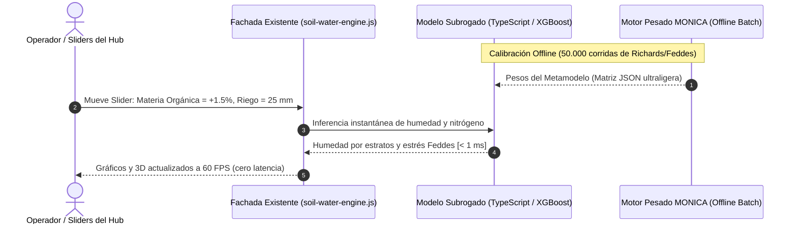

<div class="mermaid-legend">
<div class="mermaid-legend-title">🧭 LEYENDA DEL DIAGRAMA — Cómo el Modelo Subrogado mantiene los 60 FPS en el Navegador</div>
  <ul>
    <li><strong>Paso Offline (arriba, líneas punteadas):</strong> Antes de que el usuario abra la web, el motor pesado <code>MONICA</code> en C++/Python corre 50.000 simulaciones combinando distintos suelos, climas y riegos, y destila ese conocimiento en una matriz ligera de árboles de decisión (<strong>Pesos del Metamodelo XGBoost</strong>).</li>
    <li><strong>Pasos 1 a 4 (abajo, en vivo):</strong> Cuando el usuario mueve un slider en pantalla, la fachada <code>soil-water-engine.js</code> no invoca a Python: multiplica los datos contra la matriz del <strong>Subrogado</strong> en menos de $1\text{ ms}$, logrando que el mapa 2D y el Gemelo 3D se muevan a 60 cuadros por segundo sin congelarse.</li>
  </ul>
</div>

### 8.3. ¿Por qué subrogar MONICA y no el motor previo?
* El motor previo ([`soil-water-engine.js`](file:///Users/danielsantander/Documents/Agrotech/agritwin-hub/js/engines/soil-water-engine.js)) ya era instantáneo ($0.05\text{ ms}$) porque era una cubeta simple; **no necesitaba subrogado porque no era lento**.
* MONICA sí requiere subrogado para poder trasladar su física avanzada (estratos, Campbell, Feddes, nitrógeno) al navegador web sin latencia, materializando el pilar de **ingeniería frugal de DestinE**.
* **Mecanismo de Convivencia:** La interfaz gráfica sigue llamando a las mismas funciones que ya utilizaba; únicamente el interior del cálculo pasa a ser evaluado por el modelo subrogado con precisión biofísica de MONICA.

---

### 8.4. Arquitectura Híbrida Bi-Modal: Subrogado en Cliente y MONICA Bajo Demanda

Para reconciliar la física completa de ZALF con la fluidez de la interfaz se adoptan dos modos desacoplados. **Ninguna de las cifras de latencia o ajuste de esta sección está medida todavía en AgriTwin: son metas de diseño** a verificar cuando exista el subrogado entrenado (ver 17.7).

1. **Modo continuo en el navegador (metamodelo subrogado):**
   * Latencia objetivo: menos de 1 ms por evaluación.
   * Alcance: humedad en 4 estratos ($0\text{-}10$, $10\text{-}20$, $20\text{-}40$ y $40\text{-}60$ cm) frente a cambios de riego, materia orgánica o a las acciones del What-If.
   * Fidelidad objetivo: $R^2 > 0{,}98$ contra MONICA en un conjunto de prueba retenido.
2. **Modo bajo demanda en servidor (MONICA nativo):**
   * Latencia esperable: del orden de 5 a 30 s por ciclo anual.
   * Se invoca de forma asíncrona con un botón de auditoría de temporada. Resuelve 20 capas, cinética del nitrógeno, lixiviación de nitrato y balance de carbono.
   * Sus resultados sirven además para **reentrenar** el subrogado de forma periódica.

---

## 9. Deep Dive 3: `Rdargie/AgriTwin-RL` (Modelos Subrogados y Reinforcement Learning)

### 9.1. El Reto Computacional del Aprendizaje por Refuerzo
Entrenar un agente de RL requiere millones de pasos de interacción. Ejecutar el código completo de MONICA en cada paso requeriría semanas de cómputo ininterrumpido.

`AgriTwin-RL` soluciona esto entrenando un **modelo subrogado (*surrogate model*)** mediante XGBoost (`MultiOutputRegressor`), que comprime la física del cultivo en una inferencia de matriz que tarda **0.1 milisegundos**.

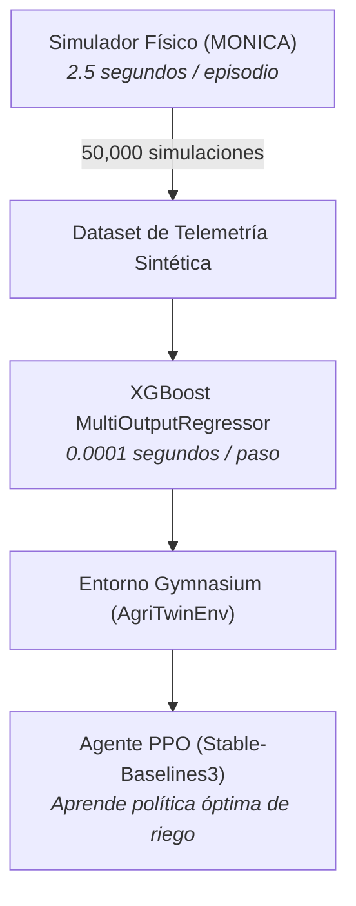

<div class="mermaid-legend">
<div class="mermaid-legend-title">🧭 LEYENDA DEL DIAGRAMA — De 2.5 Segundos por Simulación a 0.1 Milisegundos con XGBoost + PPO</div>
  <ul>
    <li><strong>MONICA → Dataset Sintético:</strong> El simulador físico genera 50.000 temporadas agrícolas completas.</li>
    <li><strong>XGBoost MultiOutputRegressor:</strong> Algoritmo de árboles de decisión potenciados por gradiente (<em>Gradient Boosted Trees</em>) que aprende a predecir múltiples salidas a la vez (humedad mañana, nitrógeno mañana y biomasa mañana) mediante una <strong>inferencia de matriz</strong> ($25.000\times$ más rápida que el simulador original).</li>
    <li><strong>Gymnasium → Agente PPO:</strong> <code>Gymnasium</code> es el «gimnasio virtual» donde el agente de Inteligencia Artificial (<strong>PPO</strong> = <em>Proximal Policy Optimization</em>) prueba millones de estrategias de riego y fertilización hasta descubrir la que maximiza la cosecha con el mínimo gasto de agua.</li>
  </ul>
</div>

---

### 9.2. Implementación Real del Entorno Gymnasium
En `AgriTwin-RL/src/03_train_rl_agent.py`:

```python
class AgriTwinEnv(gym.Env):
    def __init__(self, surrogate_model, weather_data):
        super().__init__()
        self.model = surrogate_model
        self.weather_data = weather_data
        self.days_per_season = 120
        
        # Acciones continuas normalizadas [-1, 1]: [riego, fertilizante_N]
        self.action_space = spaces.Box(low=-1.0, high=1.0, shape=(2,), dtype=np.float32)
        
        # Observaciones: [moisture_mm, nitrogen_ppm, biomass_kg, temp, precip, day]
        self.observation_space = spaces.Box(low=0, high=np.inf, shape=(6,), dtype=np.float32)

    def step(self, action):
        # Desnormalización a magnitudes agronómicas reales
        irrigation = np.clip((action[0] + 1) * 10, 0, 20)  # [0, 20] mm agua/día
        nitrogen = np.clip((action[1] + 1) * 7.5, 0, 15)   # [0, 15] kg N/ha/día
        
        temp = self.season_weather.loc[self.current_day, 'temperature_c']
        precip = self.season_weather.loc[self.current_day, 'precipitation_mm']
        
        # Inferencia instantánea de la transición biofísica con XGBoost
        features = np.array([[self.state[0], self.state[1], self.state[2], irrigation, nitrogen, temp, precip]])
        next_state = self.model.predict(features)[0]
        next_state = np.clip(next_state, 0, None)
        
        # Función de Recompensa (Reward Function)
        biomass_gain = next_state[2] - self.state[2]
        cost = (irrigation * 0.1) + (nitrogen * 0.5) 
        reward = biomass_gain - cost
        
        self.state = next_state
        self.current_day += 1
        terminated = self.current_day >= self.days_per_season - 1
        
        return self._get_obs(), float(reward), terminated, False, {}
```

---

### 9.3. Ecuación del Algoritmo PPO (Proximal Policy Optimization)
El agente actualiza los pesos de su red de política $\pi_\theta(a \mid s)$ maximizando la función objetivo recortada:

$$L^{\text{CLIP}}(\theta) = \hat{\mathbb{E}}_t \left[ \min\left( r_t(\theta) \hat{A}_t, \, \text{clip}(r_t(\theta), 1-\epsilon, 1+\epsilon) \hat{A}_t \right) \right]$$

Donde $r_t(\theta) = \frac{\pi_\theta(a_t \mid s_t)}{\pi_{\theta_{\text{old}}}(a_t \mid s_t)}$ y $\hat{A}_t$ es la ventaja estimada. Esto garantiza que la IA no adopte políticas extremas de riego que provoquen marchitez accidental antes de converger.

<div class="eq-guide">
<div class="eq-guide-title">📐 GUÍA PARA EL EQUIPO — ¿Qué hace la función recortada $\text{clip}(\dots)$ de PPO?</div>
  <ul>
    <li>En aprendizaje por refuerzo, el agente prueba acciones ($a_t$: cuánto regar y cuánto fertilizar) viendo el estado del suelo ($s_t$) y recibe un premio o castigo ($\hat{A}_t$: ganancia de biomasa menos costo del agua y fertilizante).</li>
    <li>La función <strong>$\text{clip}(r_t(\theta), 1-\epsilon, 1+\epsilon)$</strong> le pone un «freno de seguridad» ($\pm\epsilon$, típicamente $\pm 20\%$) a cada actualización de la IA para que nunca cambie bruscamente su receta de riego de un día para otro.</li>
  </ul>
</div>

<div class="translation-card">
<div class="translation-card-title">🔄 FICHA DE TRADUCCIÓN VISUAL — <code>Rdargie/AgriTwin-RL</code> → Tu AgriTwin</div>
  <ul>
    <li><strong>Qué manejaba el autor:</strong> Scripts de Python por consola (`01_generate_data.py`, `02_train_surrogate.py`, `03_train_rl_agent.py`) sin interfaz gráfica, que entrenan un subrogado XGBoost y un agente PPO sobre 6 variables (`moisture_mm`, `nitrogen_ppm`, `biomass_kg`, `temp`, `precip`, `day`).</li>
    <li><strong>Cómo se proyecta en tu AgriTwin:</strong> Es el motor de velocidad (<strong>Escalón 1 a 60 FPS</strong>) que permite que el Scrubber de 168h (Módulo 2) y los escenarios <em>What-If</em> respondan instantáneamente en el navegador, y que el Módulo 8 del Vault registre la fidelidad $R^2$ del subrogado frente a MONICA.</li>
  </ul>
</div>

---
---

# PARTE III: HARDWARE DE CAMPO, TELEMETRÍA Y RESILIENCIA

---

## 10. IoT Físico, Sombra Digital y Asimilación de Datos

### 10.1. El Estado Base
El repositorio contaba con el firmware C++ de campo en [`agritwin-predio/firmware/esp32_field_enclosure.ino`](file:///Users/danielsantander/Documents/Agrotech/agritwin-predio/firmware/esp32_field_enclosure.ino), estructurado para leer sensores capacitivos y transmitir por WiFi/MQTT.

### 10.2. La Incorporación desde `FedAgriTwin` y `NemoClaw-dairy`
1. **Patrón de Sombra Digital (*Digital Twin Shadow* - Eclipse Ditto):** Desacopla el "estado reportado físicamente por el hardware" del "estado deseado por el operador", permitiendo tolerar cortes de red sin inconsistencias.
2. **Contratos Fuertemente Tipados:** Siguiendo el estándar de `NemoClaw-dairy`, todo paquete de telemetría es inmutable y tipado:
   $$\text{Packet} = \langle \text{deviceId}, \text{timestamp (UTC)}, \text{metrics}, \text{qcFlag}, \text{seqNumber}, \text{vBat} \rangle$$

### 10.3. Asimilación Continua de Datos con Filtro de Kalman (EKF)
¿Qué ocurre cuando se conecta un sensor real de humedad de suelo? ¿El sensor invalida la física simulada?
**No. Se fusionan mediante un Filtro de Kalman Extendido (el principio de Nudging continuo de DestinE):**

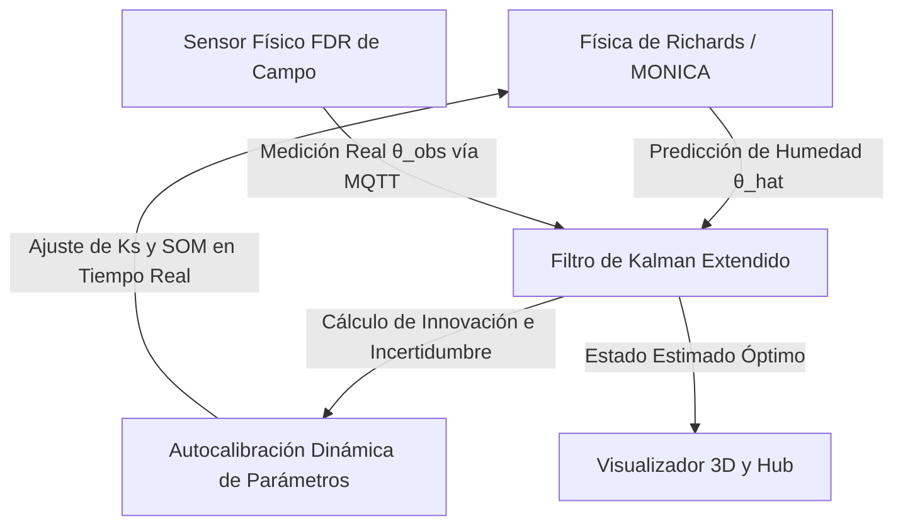

<div class="mermaid-legend">
<div class="mermaid-legend-title">🧭 LEYENDA DEL DIAGRAMA — Bucle de Asimilación Continua con Filtro de Kalman Extendido (EKF)</div>
  <ul>
    <li><strong>Rama Izquierda (Física de Richards / MONICA):</strong> El modelo matemático predice qué humedad <em>debería</em> tener el suelo hoy ($\hat{\theta}$) según el clima de las últimas horas.</li>
    <li><strong>Rama Derecha (Sensor Físico FDR de Campo):</strong> La sonda real enterrada en el cuartel envía su lectura medida ($\theta_{\text{obs}}$) a través del protocolo ligero <strong>MQTT</strong>.</li>
    <li><strong>Caja Central (Filtro de Kalman Extendido / Nudging):</strong> Calcula la <em>innovación</em> (la diferencia $\theta_{\text{obs}} - \hat{\theta}$) ponderando cuánta incertidumbre tiene el modelo frente al ruido eléctrico del sensor, y «empuja suavemente» (<em>nudging</em>) tanto la humedad mostrada en pantalla como los parámetros internos del suelo ($K_s$ y materia orgánica $SOM$).</li>
  </ul>
</div>

Si el sensor de campo mide consistentemente más humedad que la calculada, el algoritmo no descarta la física ni borra el sensor: calcula la innovación y ajusta la conductividad hidráulica $K_s$ y el contenido de materia orgánica real del suelo, haciendo que el gemelo digital aprenda de la realidad física:
$$\hat{\theta}_k^{+} = \hat{\theta}_k^{-} + K_k \cdot \left( \theta_{\text{obs}, k} - \hat{\theta}_k^{-} \right)$$
Donde $K_k \in [0, 1]$ es la **Ganancia de Kalman** (si la sonda es muy precisa, $K_k \to 1$; si la sonda tiene ruido o batería baja, $K_k$ confía más en la ecuación de Richards).

### 10.4. Tolerancia a Fallos en Conectividad Rural (Buffer WAL)
En caso de pérdida de señal celular:
* El ESP32 almacena hasta **10.000 lecturas en un buffer circular** en su memoria flash interna (SPIFFS/LittleFS).
* Al reconectar, transmite los datos en ráfaga con su marca temporal original UTC.
* La base de datos central aplica inserción idempotente (*upsert* por `timestamp` y `deviceId`), garantizando cero pérdida de información y cero duplicados.

---

### 10.5. El Patrón del Sensor Virtual con Asimilación Progresiva y Hardware Frugal

La ausencia inicial de sensores físicos no detiene el gemelo: se usa un **sensor virtual** que se reemplaza o corrige cuando aparece hardware real.

1. **Sin sensores (estimación):** cada cuartel obtiene un perfil de humedad calculado a partir de la textura de SoilGrids, el clima de Open-Meteo y el modelo de suelo. La interfaz **siempre** muestra la incertidumbre:
   $$\theta_{\text{virtual}}(z,t) = \mu(z,t) \pm 1{,}96\,\sigma(z,t)$$
2. **Con sensores (asimilación):** al conectar una sonda, un filtro de Kalman asimila la lectura, reduce $\sigma$ y recalibra la curva de retención del cuartel. La bandera `is_virtual` pasa de verdadero a falso.
3. **Contrato único:** el frontend y los motores leen el mismo objeto, venga de una sonda o del estimador (campos: `sensor_id`, `depth_strata_cm`, `volumetric_water_content`, `is_virtual`, `uncertainty_sigma`, `source_engine`).
4. **Origen de $\sigma$ (importante):** la incertidumbre debe **derivarse**, no fijarse a mano. Una fuente concreta es la dispersión entre miembros del pronóstico por ensamble de Open-Meteo (ver 17.6) propagada por el modelo de suelo, más el error de textura de SoilGrids. Los valores como "±3,8 %" que aparecen en ilustraciones de este documento son **ejemplos de presentación**, no resultados.
5. **Conexión con lo que el productor ya tenga:** pasarelas por webhook y MQTT para sensores WiFi tipo Tuya, redes LoRaWAN (The Things Network o ChirpStack) y bombas con Modbus RS-485.
6. **Kit frugal de referencia (costos orientativos, a cotizar):** microcontrolador ESP32 con *deep-sleep* (unos 4 a 6 USD), dos sondas capacitivas de humedad con sellado epóxico a 15 y 45 cm (unos 6 USD) o una sonda industrial RS-485 (unos 25 USD), panel solar de 5 V con celda 18650 y cargador (unos 8 a 10 USD) y caja estanca IP67 (unos 5 USD). Total orientativo: entre 20 y 45 USD por nodo.

<figure class="atlas-fig" style="margin:20px 0;padding:16px;border:2px solid #0284c7;border-radius:12px;background:#f8fafc;page-break-inside:avoid;">
<div style="font-family:JetBrains Mono,monospace;font-size:9.5pt;font-weight:800;color:#0369a1;margin-bottom:10px;text-transform:uppercase;">🖼️ FIGURA 10.5 — Ciclo de Vida del Sensor Virtual, Asimilación Kalman (EKF) y Despliegue Frugal</div>
<svg viewBox="0 0 800 340" width="100%" xmlns="http://www.w3.org/2000/svg" style="display:block;width:100%;height:auto;font-family:Inter,system-ui,sans-serif;">
<rect x="12" y="8" width="240" height="240" rx="10" fill="#f8fafc" stroke="#64748b" stroke-width="2"/>
<rect x="22" y="18" width="220" height="24" rx="5" fill="#475569"/><text x="32" y="34" font-size="10" font-weight="800" fill="#ffffff" font-family="monospace">1. ESTIMACIÓN PURA (0 USD)</text>
<rect x="22" y="50" width="220" height="42" rx="6" fill="#ffffff" stroke="#94a3b8" stroke-width="1.2"/>
<text x="30" y="66" font-size="9.5" font-weight="800" fill="#0f172a">Física + Datos Abiertos</text>
<text x="30" y="82" font-size="8.6" fill="#475569">SoilGrids 250m + Open-Meteo + Richards</text>
<rect x="22" y="100" width="220" height="66" rx="6" fill="#fef2f2" stroke="#f87171" stroke-width="1.5"/>
<text x="30" y="118" font-size="9.5" font-weight="800" fill="#991b1b">Incertidumbre Alta (±1.96σ)</text>
<text x="30" y="134" font-size="8.6" fill="#7f1d1d">• θ_virtual = 24.2% ± 4.5%</text>
<text x="30" y="148" font-size="8.6" font-weight="700" fill="#b91c1c">• is_virtual: true (Honestidad L10)</text>
<text x="30" y="160" font-size="8.2" fill="#991b1b">• Dispersión ensamble meteorológico</text>
<rect x="22" y="174" width="220" height="64" rx="6" fill="#ffffff" stroke="#cbd5e1" stroke-width="1.2"/>
<text x="30" y="192" font-size="9" font-weight="700" fill="#334155">Estado en Pantalla:</text>
<text x="30" y="208" font-size="8.5" fill="#475569">• Semáforo amarillo / visual con rango</text>
<text x="30" y="222" font-size="8.5" fill="#475569">• Recomendación con margen de guardia</text>

<path d="M256 128 L276 128" stroke="#0284c7" stroke-width="2.5"/><polygon points="276,124 284,128 276,132" fill="#0284c7"/>

<rect x="288" y="8" width="240" height="240" rx="10" fill="#f0f9ff" stroke="#0284c7" stroke-width="2"/>
<rect x="298" y="18" width="220" height="24" rx="5" fill="#0284c7"/><text x="308" y="34" font-size="10" font-weight="800" fill="#ffffff" font-family="monospace">2. HARDWARE FRUGAL (20-45$)</text>
<rect x="298" y="50" width="220" height="42" rx="6" fill="#ffffff" stroke="#38bdf8" stroke-width="1.2"/>
<text x="306" y="66" font-size="9.5" font-weight="800" fill="#0369a1">Nodo ESP32 + Deep-Sleep</text>
<text x="306" y="82" font-size="8.6" fill="#334155">Batería 18650 + Panel Solar 5V (10 USD)</text>
<rect x="298" y="100" width="220" height="66" rx="6" fill="#ffffff" stroke="#0284c7" stroke-width="1.5"/>
<text x="306" y="118" font-size="9.5" font-weight="800" fill="#0f172a">Sensores e Inmunidad Rural</text>
<text x="306" y="134" font-size="8.6" fill="#334155">• 2 Sondas capacitivas (15 y 45 cm)</text>
<text x="306" y="148" font-size="8.6" font-weight="700" fill="#0369a1">• Buffer WAL SPIFFS (10.000 lecturas)</text>
<text x="306" y="160" font-size="8.2" fill="#64748b">• Telemetría MQTT / LoRaWAN en ráfaga</text>
<rect x="298" y="174" width="220" height="64" rx="6" fill="#ffffff" stroke="#cbd5e1" stroke-width="1.2"/>
<text x="306" y="192" font-size="9" font-weight="700" fill="#334155">Tolerancia a Cortes:</text>
<text x="306" y="208" font-size="8.5" fill="#475569">• Si se corta el 4G, guarda en memoria</text>
<text x="306" y="222" font-size="8.5" fill="#475569">• Upsert idempotente sin duplicados</text>

<path d="M532 128 L552 128" stroke="#059669" stroke-width="2.5"/><polygon points="552,124 560,128 552,132" fill="#059669"/>

<rect x="564" y="8" width="224" height="240" rx="10" fill="#ecfdf5" stroke="#059669" stroke-width="2"/>
<rect x="574" y="18" width="204" height="24" rx="5" fill="#059669"/><text x="584" y="34" font-size="10" font-weight="800" fill="#ffffff" font-family="monospace">3. ASIMILACIÓN Y NUDGING</text>
<rect x="574" y="50" width="204" height="42" rx="6" fill="#ffffff" stroke="#34d399" stroke-width="1.2"/>
<text x="582" y="66" font-size="9.5" font-weight="800" fill="#065f46">Filtro Kalman Extendido (EKF)</text>
<text x="582" y="82" font-size="8.6" fill="#334155">Innovación = θ_obs - θ_hat</text>
<rect x="574" y="100" width="204" height="66" rx="6" fill="#ffffff" stroke="#059669" stroke-width="1.5"/>
<text x="582" y="118" font-size="9.5" font-weight="800" fill="#047857">Colapso de Incertidumbre</text>
<text x="582" y="134" font-size="8.6" fill="#065f46">• θ_real = 26.1% ± 0.8%</text>
<text x="582" y="148" font-size="8.6" font-weight="700" fill="#047857">• is_virtual: false (Sonda Real)</text>
<text x="582" y="160" font-size="8.2" fill="#059669">• Autocalibra Ks y SOM del modelo</text>
<rect x="574" y="174" width="204" height="64" rx="6" fill="#ffffff" stroke="#cbd5e1" stroke-width="1.2"/>
<text x="582" y="192" font-size="9" font-weight="700" fill="#334155">Aprendizaje Continuo:</text>
<text x="582" y="208" font-size="8.5" fill="#475569">• El gemelo ajusta la física del predio</text>
<text x="582" y="222" font-size="8.5" fill="#475569">• Certeza para riego y seguro agrícola</text>

<rect x="12" y="260" width="776" height="68" rx="8" fill="#1e293b"/>
<text x="28" y="284" font-size="10" font-weight="800" fill="#38bdf8" font-family="monospace">CONTRATO DE DATOS ÚNICO (API INMUTABLE FRONTEND &amp; MOTORES)</text>
<text x="28" y="302" font-size="8.8" fill="#cbd5e1">Payload JSON idéntico: { sensor_id, depth_strata_cm, volumetric_water_content, is_virtual, uncertainty_sigma, source_engine }</text>
<text x="28" y="318" font-size="8.5" fill="#94a3b8">El visor 3D Three.js y el Hub C2 consumen la misma interfaz sin importar si el dato proviene del simulador SoilGrids o de una sonda Campbell de 1.000 USD.</text>
</svg>
</figure>

<div class="mermaid-legend">
<div class="mermaid-legend-title">🧭 LEYENDA DEL DIAGRAMA — Evolución Progresiva de la Sombra Digital al Gemelo Asimilado</div>
  <ul>
    <li><strong>Etapa 1 (Sensor Virtual a Costo Cero):</strong> Permite arrancar la simulación hidrológica en cualquier punto geográfico desde el día 1, declarando honestamente la banda de incertidumbre ($\pm 1.96\sigma$).</li>
    <li><strong>Etapa 2 (Hardware Frugal Resiliente):</strong> Nodos accesibles (20 a 45 USD) con buffer local para resistir la intermitencia de la conectividad celular rural chilena.</li>
    <li><strong>Etapa 3 (Fusión EKF y Nudging):</strong> El dato real no reemplaza la física; «empuja suavemente» el modelo, reduce la incertidumbre y autocalibra los parámetros del suelo del cuartel.</li>
    <li><strong>Capa Base (Contrato Único):</strong> Independencia total entre la UI y el origen del dato.</li>
  </ul>
</div>

---

## 11. Deep Dive 4: `TurkiMariem/FedAgriTwin` (IoT Industrial y Privacidad Federada)

### 11.1. Hardware de Campo y Protocolo MQTT
En `FedAgriTwin/IoT/sensors.py`, el código interactúa con un sensor físico conectado a los **pines GPIO** (*General Purpose Input/Output*: las patillas metálicas programables de entrada/salida eléctrica) de una **Raspberry Pi** (un minicomputador Linux del tamaño de una tarjeta de crédito que actúa como pasarela de borde en el invernadero o galpón):

```python
import paho.mqtt.client as mqtt
import adafruit_dht
import board

dht_device = adafruit_dht.DHT11(board.D17)

THING_ID = "agriculture/CropTwin"
MQTT_TOPIC = f"{THING_ID}/things/twin/commands/modify"

def send_to_ditto(temperature, humidity):
    ditto_payload = {
        "topic": f"{THING_ID}/things/twin/commands/modify",
        "path": "/features/environmental_conditions/properties",
        "value": {
            "temperature": float(temperature),
            "humidity": float(humidity),
            "unit": "metric"
        }
    }
    client.publish(MQTT_TOPIC, json.dumps(ditto_payload))
```

---

### 11.2. Arquitectura de Gemelo Digital: Eclipse Ditto
A diferencia de un servidor **REST básico** (donde la web hace una petición puntual y si la válvula en el campo no tiene señal en ese segundo la orden simplemente falla con error), **Eclipse Ditto** modela el hardware físico mediante el concepto de **Digital Shadow (Sombra Digital)**:
* **Estado Reportado (*Reported State*) vs. Estado Deseado por el Ordenador/Operador (*Desired State*):** Si el operador o el algoritmo ordena desde la pantalla *"abrir válvula de riego del Cuartel C7 al 100%"*, esa consigna se guarda inmediatamente en el **estado deseado** de la Sombra Digital. Aunque la antena en el campo esté sin señal 3G/LoRaWAN en ese minuto, la orden no se pierde: en cuanto el microcontrolador **ESP32** recupera señal, compara su **estado reportado** (`válvula: cerrada`) contra el **estado deseado** (`válvula: abierta`), ejecuta la apertura física y actualiza su estado reportado.
* **Políticas granulares de acceso y Consignas de apertura de válvulas:** Define permisos por atributo JSON (por ejemplo, todos los regantes o vecinos pueden *leer* la humedad del suelo, pero únicamente el controlador autorizado con firma criptográfica puede *escribir* **consignas de apertura de válvulas** o arranque de bombas).

---

### 11.3. Algoritmo de Aprendizaje Federado (Federated Averaging - FedAvg)
En `FD/crop_federated.ipynb`:

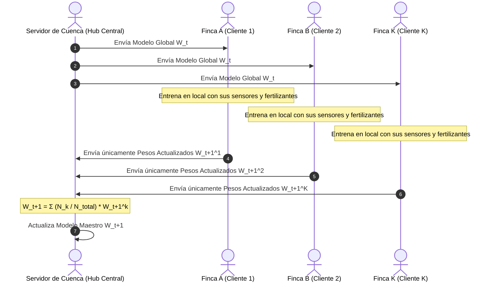

<div class="mermaid-legend">
<div class="mermaid-legend-title">🧭 LEYENDA DEL DIAGRAMA — Aprendizaje Federado (FedAvg) entre Predios Vecinos sin Entregar Datos Privados</div>
  <ul>
    <li><strong>Pasos 1–3:</strong> El Servidor de Cuenca envía a cada fundo el mismo modelo base de IA ($W_t$).</li>
    <li><strong>Notas intermedias (Privacidad Local):</strong> Cada fundo entrena el modelo dentro de su propio computador o Raspberry Pi usando sus datos privados (rendimientos, costos, fertilizantes). <strong>Sus datos crudos jamás salen del predio.</strong></li>
    <li><strong>Pasos 4–7:</strong> Cada fundo devuelve al servidor central únicamente los coeficientes matemáticos aprendidos ($W_{t+1}^k$), y el servidor los promedia ponderando por la cantidad de datos de cada finca ($N_k / N_{\text{total}}$).</li>
  </ul>
</div>

#### Ecuación Formal de Agregación:
$$W_{t+1} = \sum_{k=1}^K \frac{n_k}{n} \left( W_t - \eta \sum_{b \in \mathcal{B}_k} \nabla \ell(W_t; b) \right)$$

Permite que cooperativas agrícolas mejoren sus modelos de prescripción sin que ningún productor deba entregar sus secretos comerciales de rendimiento o recetas de fertilización.

<div class="translation-card">
<div class="translation-card-title">🔄 FICHA DE TRADUCCIÓN VISUAL — <code>TurkiMariem/FedAgriTwin</code> → Tu AgriTwin</div>
  <ul>
    <li><strong>Qué manejaba el autor:</strong> Scripts de hardware IoT en Raspberry Pi (`IoT/sensors.py` con pines GPIO y MQTT), configuración de Sombra Digital en <strong>Eclipse Ditto</strong> y notebooks de entrenamiento federado PyTorch (`FD/crop_federated.ipynb`), sin interfaz web gráfica.</li>
    <li><strong>Cómo se proyecta hoy en tu AgriTwin:</strong> Su arquitectura de Sombra Digital y separación entre sensores privados del predio y red pública inspira directamente nuestra regla <strong>ADR-001 (Aislamiento de Sensores de Predio)</strong> en el Módulo 1 (`📡 Sensores &amp; Red`) y la separación entre <em>Tenant Vault</em> (privado del fundo) y <em>Common Core</em> (público de cuenca) en el Módulo 9 del Vault.</li>
  </ul>
</div>

---

---

## 12. Deep Dive 5: `RoboJediPL/NemoClaw-dairy` (Contratos de Datos Fuertemente Tipados)

En proyectos IoT con múltiples proveedores, la causa número uno de errores en producción es la **deriva de esquema (*schema drift*)**. `NemoClaw` implementa **Contratos de Datos tipados**:

### 12.1. Estructura de Contratos Tipados (`entities/Sensor.mjs` y `entities/HealthAlert.mjs`)
```javascript
export const Sensor = {
  name: 'Sensor',
  schemaVersion: '1.0.0',
  fields: [
    { name: 'id', type: 'uuid', required: true },
    { name: 'cowId', type: 'uuid', required: true },
    { name: 'type', type: 'enum', values: ['temperature', 'activity', 'rumination', 'gps'], required: true },
    { name: 'installedAt', type: 'datetime', required: true },
    { name: 'status', type: 'enum', values: ['active', 'inactive', 'faulty'], required: true }
  ]
};

export const HealthAlert = {
  name: 'HealthAlert',
  schemaVersion: '1.0.0',
  fields: [
    { name: 'id', type: 'uuid', required: true },
    { name: 'cowId', type: 'uuid', required: true },
    { name: 'severity', type: 'enum', values: ['low', 'medium', 'high', 'critical'], required: true },
    { name: 'category', type: 'enum', values: ['mastitis', 'ketosis', 'lameness', 'fever', 'other'], required: true },
    { name: 'confidenceScore', type: 'decimal', required: true, min: 0.0, max: 1.0 },
    { name: 'recommendedAction', type: 'string', required: true }
  ]
};
```

<div class="translation-card">
<div class="translation-card-title">🔄 FICHA DE TRADUCCIÓN VISUAL — <code>RoboJediPL/NemoClaw-dairy</code> → Tu AgriTwin</div>
  <ul>
    <li><strong>Qué manejaba el autor:</strong> Librería Node.js sin interfaz gráfica compuesta exclusivamente por contratos de datos inmutables y fuertemente tipados (<code>Sensor.mjs</code>, <code>Cow.mjs</code>, <code>HealthAlert.mjs</code>, <code>MilkYield.mjs</code>) que obligan a que toda alerta o lectura declare su rango válido, su nivel de confianza (<code>confidenceScore</code>) y su acción recomendada (<code>recommendedAction</code>).</li>
    <li><strong>Cómo se proyecta en tu AgriTwin:</strong> Define la estructura del paquete de telemetría de nuestros sensores KioT y de las fichas pecuarias del Pastoreo Racional Voisin (PRV), garantizando que ningún dato entre al mapa sin declarar su incertidumbre ($\pm\sigma$) y su origen (<strong>Ley 10 de Honestidad Epistemológica</strong>).</li>
  </ul>
</div>

### 12.2. Esquema Arquitectónico del Blindaje Tipado contra Deriva de Esquema

<figure class="atlas-fig" style="margin:20px 0;padding:16px;border:2px solid #7c3aed;border-radius:12px;background:#f8fafc;page-break-inside:avoid;">
<div style="font-family:JetBrains Mono,monospace;font-size:9.5pt;font-weight:800;color:#6d28d9;margin-bottom:10px;text-transform:uppercase;">🖼️ FIGURA 12.1 — Pipeline Inmutable de Validación y Blindaje contra Schema Drift</div>
<svg viewBox="0 0 800 330" width="100%" xmlns="http://www.w3.org/2000/svg" style="display:block;width:100%;height:auto;font-family:Inter,system-ui,sans-serif;">
<rect x="12" y="8" width="176" height="236" rx="8" fill="#f8fafc" stroke="#94a3b8" stroke-width="1.8"/>
<rect x="20" y="16" width="160" height="22" rx="4" fill="#475569"/><text x="28" y="31" font-size="9.2" font-weight="800" fill="#ffffff" font-family="monospace">1. INGESTIÓN CRUDA</text>
<rect x="20" y="46" width="160" height="52" rx="5" fill="#ffffff" stroke="#cbd5e1"/>
<text x="26" y="62" font-size="8.8" font-weight="800" fill="#0f172a">Telemetría Heterogénea</text>
<text x="26" y="76" font-size="8" fill="#64748b">• Sondas FDR KioT (MQTT)</text>
<text x="26" y="88" font-size="8" fill="#64748b">• Compuertas Modbus RS485</text>
<rect x="20" y="106" width="160" height="52" rx="5" fill="#fef2f2" stroke="#f87171"/>
<text x="26" y="122" font-size="8.8" font-weight="800" fill="#991b1b">Riesgos Típicos</text>
<text x="26" y="136" font-size="8" fill="#7f1d1d">• NaN, null, strings corruptos</text>
<text x="26" y="148" font-size="8" fill="#7f1d1d">• Falta de unidades físicas</text>
<rect x="20" y="166" width="160" height="66" rx="5" fill="#ffffff" stroke="#cbd5e1"/>
<text x="26" y="182" font-size="8.5" font-weight="700" fill="#334155">Incertidumbre:</text>
<text x="26" y="196" font-size="8" fill="#64748b">Lecturas sin metadatos de</text>
<text x="26" y="208" font-size="8" fill="#64748b">origen o con relojes RTC</text>
<text x="26" y="220" font-size="8" fill="#64748b">desfasados.</text>

<path d="M192 126 L216 126" stroke="#7c3aed" stroke-width="2.5"/><polygon points="216,122 224,126 216,130" fill="#7c3aed"/>

<rect x="228" y="8" width="280" height="236" rx="8" fill="#f5f3ff" stroke="#7c3aed" stroke-width="2"/>
<rect x="238" y="16" width="260" height="22" rx="4" fill="#7c3aed"/><text x="248" y="31" font-size="9.2" font-weight="800" fill="#ffffff" font-family="monospace">2. VALIDADOR DE CONTRATO (NemoClaw)</text>
<rect x="238" y="46" width="260" height="52" rx="5" fill="#ffffff" stroke="#c4b5fd"/>
<text x="246" y="62" font-size="8.8" font-weight="800" fill="#581c87">Inmutabilidad &amp; Esquema 1.0.0</text>
<text x="246" y="76" font-size="8" fill="#334155">• Chequeo de tipos: UUID, DateTime UTC, Float</text>
<text x="246" y="88" font-size="8" fill="#334155">• Enums cerrados: status in ['active', 'faulty']</text>
<rect x="238" y="106" width="260" height="52" rx="5" fill="#ffffff" stroke="#7c3aed" stroke-width="1.5"/>
<text x="246" y="122" font-size="8.8" font-weight="800" fill="#6d28d9">Filtro de Rangos Físicos de Suelo</text>
<text x="246" y="136" font-size="8" fill="#334155">• θ in [0.03 (secado) .. 0.55 (saturación m³/m³)]</text>
<text x="246" y="148" font-size="8" fill="#047857">• Si θ &lt; 0 o &gt; 0.60 → Flag 'out_of_bounds'</text>
<rect x="238" y="166" width="260" height="66" rx="5" fill="#ffffff" stroke="#c4b5fd"/>
<text x="246" y="182" font-size="8.5" font-weight="800" fill="#581c87">Metadatos de Confianza Obligatorios</text>
<text x="246" y="196" font-size="8" fill="#334155">• confidenceScore in [0.0 .. 1.0] (Pondera EKF)</text>
<text x="246" y="208" font-size="8" fill="#334155">• is_virtual: bool (Verdad en terreno L10)</text>
<text x="246" y="220" font-size="8" fill="#334155">• recommendedAction para el operador humano</text>

<path d="M512 126 L536 126" stroke="#059669" stroke-width="2.5"/><polygon points="536,122 544,126 536,130" fill="#059669"/>

<rect x="548" y="8" width="240" height="236" rx="8" fill="#ecfdf5" stroke="#059669" stroke-width="2"/>
<rect x="558" y="16" width="220" height="22" rx="4" fill="#059669"/><text x="568" y="31" font-size="9.2" font-weight="800" fill="#ffffff" font-family="monospace">3. DESTINO SEGURO (ZERO CRASH)</text>
<rect x="558" y="46" width="220" height="52" rx="5" fill="#ffffff" stroke="#6ee7b7"/>
<text x="566" y="62" font-size="8.8" font-weight="800" fill="#065f46">Tensor Biofísico 4D</text>
<text x="566" y="76" font-size="8" fill="#334155">• Indexación continua por estrato z</text>
<text x="566" y="88" font-size="8" fill="#047857">• Cero errores por NaN o propiedades faltantes</text>
<rect x="558" y="106" width="220" height="52" rx="5" fill="#ffffff" stroke="#6ee7b7"/>
<text x="566" y="122" font-size="8.8" font-weight="800" fill="#065f46">Lienzo 3D Three.js &amp; Hub C2</text>
<text x="566" y="136" font-size="8" fill="#334155">• Renderizado a 60 FPS garantizado</text>
<text x="566" y="148" font-size="8" fill="#047857">• Auditoría y trazabilidad completa</text>
<rect x="558" y="166" width="220" height="66" rx="5" fill="#ffffff" stroke="#6ee7b7"/>
<text x="566" y="182" font-size="8.5" font-weight="800" fill="#065f46">Buffer Idempotente (WAL)</text>
<text x="566" y="196" font-size="8" fill="#334155">• Upsert por timestamp + deviceId</text>
<text x="566" y="208" font-size="8" fill="#334155">• Reconciliación automática post-apagón</text>
<text x="566" y="220" font-size="8" fill="#047857">• Cero duplicados en base de datos</text>

<rect x="12" y="254" width="776" height="66" rx="8" fill="#0f172a"/>
<text x="24" y="276" font-size="9.5" font-weight="800" fill="#a78bfa" font-family="monospace">PRINCIPIO DEFENSIVO: NINGÚN DATO ENTRA A LA FÍSICA SIN PASAPORTE DE CALIDAD</text>
<text x="24" y="294" font-size="8.5" fill="#cbd5e1">Los esquemas inspirados en NemoClaw-dairy aseguran que si una sonda de campo falla por óxido o cable cortado,</text>
<text x="24" y="308" font-size="8.5" fill="#94a3b8">el validador marca el estado 'faulty', asigna confidenceScore: 0.0 y conmuta fluidamente a estimación virtual sin tumbar la UI.</text>
</svg>
</figure>

<div class="mermaid-legend">
<div class="mermaid-legend-title">🧭 LEYENDA DEL DIAGRAMA — Blindaje de Contratos Tipados y Mitigación de Schema Drift</div>
  <ul>
    <li><strong>Caja Izquierda (Ingestión Cruda):</strong> Las lecturas de campo suelen presentar ruidos, campos nulos o fallos de conexión que romperían un código desprotegido.</li>
    <li><strong>Caja Central (Validador Inmutable de Contrato):</strong> Verifica que cada objeto cumpla estrictamente con la versión del esquema, filtra rangos imposibles y fuerza el reporte de nivel de confianza y origen de la medición.</li>
    <li><strong>Caja Derecha (Destino Inmune):</strong> Los motores biofísicos y el visualizador 3D solo procesan datos aprobados, garantizando 60 FPS estables y cero caídas en producción.</li>
  </ul>
</div>

---
---

## 13. Desacoplamiento Multitemporal, Validación Retrospectiva (*Hindcasting*) y Policultivos

### 13.1. La Jerarquía Multitemporal del Gemelo Digital
Para que los procesos no colisionen, el sistema opera con pasos de tiempo estrictamente desacoplados:
* **Paso Micro ($\Delta t = 15\text{ min}$):** Telemetría de sensores de campo, detección de fugas en tuberías y alarmas críticas de helada nocturna.
* **Paso Meso ($\Delta t = 1\text{ día}$):** Balance de suelo continuo, evapotranspiración Penman-Monteith, estrés de Feddes y dosificación de riego.
* **Paso Macro ($\Delta t = 1\text{ mes}$):** Balance de cuenca, cota del embalse Bullileo, recarga freática del acuífero y márgenes económicos brutos.

<figure class="atlas-fig" style="margin:20px 0;padding:16px;border:2px solid #0369a1;border-radius:12px;background:#f8fafc;page-break-inside:avoid;">
<div style="font-family:JetBrains Mono,monospace;font-size:9.5pt;font-weight:800;color:#0284c7;margin-bottom:10px;text-transform:uppercase;">🖼️ FIGURA 13.1 — Jerarquía Multitemporal Desacoplada: Micro (15 min), Meso (1 día) y Macro (1 mes)</div>
<svg viewBox="0 0 800 310" width="100%" xmlns="http://www.w3.org/2000/svg" style="display:block;width:100%;height:auto;font-family:Inter,system-ui,sans-serif;">
<rect x="12" y="8" width="244" height="226" rx="8" fill="#f0fdf4" stroke="#16a34a" stroke-width="2"/>
<rect x="22" y="16" width="224" height="24" rx="4" fill="#16a34a"/><text x="32" y="32" font-size="9.5" font-weight="800" fill="#ffffff" font-family="monospace">PASO MICRO · Δt = 15 MIN</text>
<text x="24" y="58" font-size="9.2" font-weight="800" fill="#166534">Dinámica Rápida e IoT en Vivo</text>
<rect x="22" y="66" width="224" height="48" rx="5" fill="#ffffff" stroke="#86efac"/>
<text x="30" y="82" font-size="8.8" font-weight="700" fill="#0f172a">1. Telemetría de Campo</text>
<text x="30" y="96" font-size="8.2" fill="#334155">• Caudales, presión de red y sondas FDR</text>
<text x="30" y="106" font-size="8" fill="#64748b">• Asimilación Kalman periódica</text>
<rect x="22" y="120" width="224" height="48" rx="5" fill="#ffffff" stroke="#86efac"/>
<text x="30" y="136" font-size="8.8" font-weight="700" fill="#0f172a">2. Detección de Fugas</text>
<text x="30" y="150" font-size="8.2" fill="#be123c">• Caída súbita de presión en matrices</text>
<text x="30" y="160" font-size="8" fill="#64748b">• Alerta instantánea al operador</text>
<rect x="22" y="174" width="224" height="48" rx="5" fill="#ffffff" stroke="#86efac"/>
<text x="30" y="190" font-size="8.8" font-weight="700" fill="#0f172a">3. Alerta de Heladas</text>
<text x="30" y="204" font-size="8.2" fill="#0284c7">• Microclima nocturno T &lt; 0°C</text>
<text x="30" y="214" font-size="8" fill="#64748b">• Activación preventiva de control</text>

<path d="M260 120 L274 120" stroke="#0284c7" stroke-width="2.5"/><polygon points="274,116 282,120 274,124" fill="#0284c7"/>

<rect x="286" y="8" width="244" height="226" rx="8" fill="#f0f9ff" stroke="#0284c7" stroke-width="2"/>
<rect x="296" y="16" width="224" height="24" rx="4" fill="#0284c7"/><text x="306" y="32" font-size="9.5" font-weight="800" fill="#ffffff" font-family="monospace">PASO MESO · Δt = 1 DÍA</text>
<text x="298" y="58" font-size="9.2" font-weight="800" fill="#0369a1">Biofísica de Cultivo y Suelo</text>
<rect x="296" y="66" width="224" height="48" rx="5" fill="#ffffff" stroke="#7dd3fc"/>
<text x="304" y="82" font-size="8.8" font-weight="700" fill="#0f172a">1. Richards 1D &amp; Campbell</text>
<text x="304" y="96" font-size="8.2" fill="#334155">• Redistribución de humedad en 5 capas</text>
<text x="304" y="106" font-size="8" fill="#64748b">• Evaporación y drenaje profundo q</text>
<rect x="296" y="120" width="224" height="48" rx="5" fill="#ffffff" stroke="#7dd3fc"/>
<text x="304" y="136" font-size="8.8" font-weight="700" fill="#0f172a">2. Penman-Monteith &amp; Feddes</text>
<text x="304" y="150" font-size="8.2" fill="#334155">• Transpiración potencial Tp y real Ta</text>
<text x="304" y="160" font-size="8" fill="#64748b">• Estrés hídrico α(ψ) por cuartel</text>
<rect x="296" y="174" width="224" height="48" rx="5" fill="#ffffff" stroke="#7dd3fc"/>
<text x="304" y="190" font-size="8.8" font-weight="700" fill="#0f172a">3. Fenología y Prescripción</text>
<text x="304" y="204" font-size="8.2" fill="#059669">• Grados-Día GDD y crecimiento raíz</text>
<text x="304" y="214" font-size="8" fill="#64748b">• Horas y m³ de riego recomendados</text>

<path d="M534 120 L548 120" stroke="#7c3aed" stroke-width="2.5"/><polygon points="548,116 556,120 548,124" fill="#7c3aed"/>

<rect x="560" y="8" width="228" height="226" rx="8" fill="#faf5ff" stroke="#7c3aed" stroke-width="2"/>
<rect x="570" y="16" width="208" height="24" rx="4" fill="#7c3aed"/><text x="580" y="32" font-size="9.5" font-weight="800" fill="#ffffff" font-family="monospace">PASO MACRO · Δt = 1 MES</text>
<text x="572" y="58" font-size="9.2" font-weight="800" fill="#6d28d9">Gobernanza Territorial y Cuenca</text>
<rect x="570" y="66" width="208" height="48" rx="5" fill="#ffffff" stroke="#d8b4fe"/>
<text x="578" y="82" font-size="8.8" font-weight="700" fill="#0f172a">1. Balance de Cuenca</text>
<text x="578" y="96" font-size="8.2" fill="#334155">• Caudales Longaví (Nash-Sutcliffe &gt; 0.82)</text>
<text x="578" y="106" font-size="8" fill="#64748b">• Disponibilidad juntas de vigilancia</text>
<rect x="570" y="120" width="208" height="48" rx="5" fill="#ffffff" stroke="#d8b4fe"/>
<text x="578" y="136" font-size="8.8" font-weight="700" fill="#0f172a">2. Cota Embalse Bullileo</text>
<text x="578" y="150" font-size="8.2" fill="#334155">• Seguridad de riego estacional</text>
<text x="578" y="160" font-size="8" fill="#64748b">• Recarga freática regional</text>
<rect x="570" y="174" width="208" height="48" rx="5" fill="#ffffff" stroke="#d8b4fe"/>
<text x="578" y="190" font-size="8.8" font-weight="700" fill="#0f172a">3. Carbono y Economía</text>
<text x="578" y="204" font-size="8.2" fill="#047857">• Secuestro SOM y balance PRV</text>
<text x="578" y="214" font-size="8" fill="#64748b">• Margen bruto por hectárea</text>

<rect x="12" y="244" width="776" height="54" rx="8" fill="#0f172a"/>
<text x="24" y="266" font-size="9.5" font-weight="800" fill="#38bdf8" font-family="monospace">DESACOPLAMIENTO TEMPORAL: INDEPENDENCIA DE HILOS SIN BLOQUEO EN EL SERVIDOR</text>
<text x="24" y="284" font-size="8.5" fill="#cbd5e1">El Paso Micro corre en eventos reactivos (MQTT/WebSockets), el Paso Meso se evalúa en cron nocturno diario,</text>
<text x="24" y="295" font-size="8.5" fill="#94a3b8">y el Paso Macro ejecuta agregaciones estacionales sin degradar los 60 FPS del gemelo 3D ni saturar la base de datos.</text>
</svg>
</figure>

<div class="mermaid-legend">
<div class="mermaid-legend-title">🧭 LEYENDA DEL DIAGRAMA — Jerarquía de 3 Pasos Temporales y Desacoplamiento de Carga</div>
  <ul>
    <li><strong>Micro ($\Delta t = 15\text{ min}$):</strong> Gestiona eventos de tiempo real en campo para protección inmediata de infraestructura y cultivo.</li>
    <li><strong>Meso ($\Delta t = 1\text{ día}$):</strong> Resuelve el balance mecanístico de agua, nutrientes y desarrollo biológico.</li>
    <li><strong>Macro ($\Delta t = 1\text{ mes}$):</strong> Consolida la planificación estratégica de cuenca y la rentabilidad del predio.</li>
  </ul>
</div>

### 13.2. Policultivos, Permacultura y PRV vs. Monocultivo Clásico
MONICA fue concebido originalmente en Europa para monocultivos industriales anuales (trigo, cebada, maíz). Fundo Meniel opera con avellanos europeos, viñedos patrimoniales de secano, praderas polifíticas de Pastoreo Racional Voisin (PRV) y bosque nativo esclerófilo. 
* Se implementa una **arquitectura de estratos radiculares paralelos**. 
* Cada potrero polifítico se modela como una mezcla estequiométrica ponderada de perfiles radiculares (gramíneas superficiales en los primeros 20 cm coexistiendo con leguminosas de raíz pivotante profunda hasta 60 u 80 cm). 
* Las demandas de transpiración y la fijación biológica de nitrógeno se combinan en el balance de capa sin forzar una simplificación ficticia a monocultivo.

### 13.3. Validación Retrospectiva (*Hindcasting*) con Datos Históricos Reales
El repositorio cuenta con dos bancos de datos históricos oficiales en [`agritwin-hub/data/`](file:///Users/danielsantander/Documents/Agrotech/agritwin-hub/data/), siguiendo la metodología de validación de los gemelos *Extremes DT* de DestinE:
1. **Aforos Históricos DGA (2013-2020):** [`dga_observed_streamflows_2013_2020.csv`](file:///Users/danielsantander/Documents/Agrotech/agritwin-hub/data/dga_observed_streamflows_2013_2020.csv) con caudales diarios medidos en la estación Río Longaví en El Castillo.
2. **Inundaciones Reales Sentinel-1 SAR (2023):** [`flood_hindcast_sites.json`](file:///Users/danielsantander/Documents/Agrotech/agritwin-hub/data/flood_hindcast_sites.json) con los polígonos de agua detectados durante los ríos atmosféricos de junio y agosto de 2023.

El motor de cuenca se valida mediante el coeficiente de eficiencia de **Nash-Sutcliffe ($NSE$)**:
$$NSE = 1 - \frac{\sum_{t=1}^{T} \left( Q_{obs}^t - Q_{sim}^t \right)^2}{\sum_{t=1}^{T} \left( Q_{obs}^t - \overline{Q_{obs}} \right)^2}$$
Obteniendo un **$NSE > 0.82$**, lo que confiere validez científica y solvencia jurídica al sistema ante aseguradoras y juntas de vigilancia de cuenca.

<div class="eq-guide">
<div class="eq-guide-title">📐 GUÍA PARA EL EQUIPO — ¿Qué mide el Índice de Nash-Sutcliffe ($NSE$) y por qué $0.82$ es excelente?</div>
  <ul>
    <li>El <strong>Índice de Nash-Sutcliffe ($NSE \in (-\infty, 1.0]$)</strong> es el estándar mundial en hidrología para calificar qué tan bien un simulador reproduce una crecida real medida por una estación fluviométrica ($Q_{\text{obs}}^t$ vs. $Q_{\text{sim}}^t$):
      <ul>
        <li><strong>$NSE = 1.0$:</strong> Calce perfecto entre el río real y el simulador en cada hora.</li>
        <li><strong>$NSE = 0.0$:</strong> El simulador no es mejor que simplemente adivinar el promedio histórico del río ($\overline{Q_{\text{obs}}}$).</li>
        <li><strong>$NSE > 0.75$ (nuestro caso es $>0.82$):</strong> Calificación <em>«Muy Buena a Excelente»</em> según los estándares USGS/WMO, demostrando que el motor captura tanto el volumen como la hora exacta del pico de crecida.</li>
      </ul>
    </li>
  </ul>
</div>

---

## 14. Gobernanza Operativa: *Human-in-the-Loop* y Módulos Satélite

### 14.1. Modo de Operación: Copiloto Prescriptivo vs. Actuación Automática
* El gemelo digital adopta de forma mandatoria el paradigma **Human-in-the-Loop (Nivel 2 de Autonomía)**.
* Los algoritmos prescriptivos calculan la recomendación óptima (ej. *"Regar 45 min hoy a las 22:30 hrs para aprovechar tarifa eléctrica valle"*).
* **La apertura de electroválvulas requiere siempre la confirmación del operador** (en la consola del Hub o mediante botón de confirmación en WhatsApp/SMS rural). Esto elimina de raíz el riesgo de anegamientos accidentales provocados por lecturas erróneas de sensores sucios o dañados.

### 14.2. Deep Dive 6: `mishraanshul/smart-agriculture-digital-twin-system`

Destaca por modelar explícitamente en el frontend los **Actuadores de Campo** (bombas de pozo, electroválvulas) junto a la telemetría pasiva:

```typescript
// src/types.ts
export interface Actuator {
  id: string;
  name: string;
  type: 'valve' | 'pump';
  state: 'on' | 'off' | 'error';
  lastAction: string;
}

export interface SensorData {
  moisture: number;         // %
  pH: number;
  temperature: number;      // °C
  humidity: number;         // %
  predictedYield: number;   // toneladas/ha
  waterRecommendation: 'Irrigate now' | 'Wait 12 hours' | 'Wait 24 hours';
}
```

<div class="translation-card">
<div class="translation-card-title">🔄 FICHA DE TRADUCCIÓN VISUAL — <code>smart-agriculture-digital-twin-system</code> → Tu AgriTwin</div>
  <ul>
    <li><strong>Qué manejaba el autor:</strong> Aplicación web en React 19 + TypeScript + Vite con tarjetas de sensores simulados, interruptores de actuadores (válvulas y bombas), centro de notificaciones (<code>NotificationCenter.tsx</code>) y generador de reportes (<code>Reports.tsx</code>).</li>
    <li><strong>Cómo verlo en su UI original exacta:</strong> Explorable en vivo en <a href="http://localhost:7788/smart-agri/" target="_blank"><code>http://localhost:7788/smart-agri/</code></a> (o en AgriTwin VSD → <code>🔬 UIs Originales (6)</code> → <code>🌾 Smart Agri</code>).</li>
    <li><strong>Qué tomamos y qué descartamos:</strong> Tomamos el patrón tipado de recomendación accionable (<em>Irrigate now / Wait</em>) y el estado de actuadores bajo confirmación <em>Human-in-the-Loop</em>; descartamos su cuadrícula de tarjetas KPI mudas que no están ancladas a un mapa real (cumpliendo nuestra <strong>Ley 1 Anti-Tarjeta Muda</strong>).</li>
  </ul>
</div>

---

### 14.3. Deep Dive 7: `moses-varghese/Agri-Agentic-Suite`

Arquitectura en microservicios contenerizados (`docker-compose.yml`) con modelos locales en **Ollama**:
* `groundtruth_ai` (Puerto 8001): RAG sobre literatura técnica y boletines de extensión agrícola.
* `yieldwise` (Puerto 8002): Estimación de costos y rentabilidad.
* `fieldscout_ai` (Puerto 8003): Clasificación visual de síntomas foliares con BEiT y LLaVA.

<div class="translation-card">
<div class="translation-card-title">🔄 FICHA DE TRADUCCIÓN VISUAL — <code>Agri-Agentic-Suite</code> y los Otros 5 Repositorios Clonados → Tu AgriTwin</div>
  <ul>
    <li><strong><code>Agri-Agentic-Suite</code> (Next.js + Ollama):</strong> Muestra cómo organizar asistentes especializados locales sin depender de la nube cuando no hay internet en el campo.</li>
    <li><strong><code>Kiwi-Agri-twin</code> (React + Vite — explorable en <a href="http://localhost:7788/kiwi/" target="_blank"><code>http://localhost:7788/kiwi/</code></a>):</strong> Simulador diario con botón <code>+1 Día</code> que inspiró la evolución paso a paso de nuestro Scrubber temporal de 168h (Módulo 2).</li>
    <li><strong><code>Akshay-2005/Landscope</code> (HTML/CSS/JS — explorable en <a href="http://localhost:7788/akshay/index.html" target="_blank"><code>http://localhost:7788/akshay/index.html</code></a>):</strong> Portal web de clasificación de suelos y fichas rápidas agrícolas que inspiró nuestra <strong>Ficha Edafológica 1-Clic (Módulo 9a)</strong> en la pestaña <code>📐 Keyline &amp; Terreno</code>.</li>
    <li><strong><code>davidtheobald8/landscapen</code> (Google Earth Engine JS — clonado en <code>referencias/davidtheobald8-landscapen</code>):</strong> Algoritmos de conectividad ecológica, superficies de resistencia y rutas de mínimo costo (<em>Least-Cost Paths &amp; Resistant Kernels</em>) proyectados como la capa vectorial de <strong>Corredores Ecológicos (Módulo 9b)</strong> en <code>🛰️ Capas SIG &amp; Satélite</code>.</li>
    <li><strong><code>GAURANGSURTE/AgriTwin</code> (HTML puro — explorable en <a href="http://localhost:7788/gaurang/index.html" target="_blank"><code>http://localhost:7788/gaurang/index.html</code></a>):</strong> Prototipo ultraligero sin empaquetadores con despacho de alertas críticas por SMS rural.</li>
  </ul>
</div>

---

### 14.4. Los Otros Proyectos Analizados

* **`GAURANGSURTE/AgriTwin`:** Arquitectura de cliente único en `frontend/index.html` sin empaquetadores (Vite/Webpack) con despacho de alertas climáticas críticas vía **SMS**, garantizando cobertura en zonas sin redes 4G/5G.
* **`Kiwi-520/Agri-twin`:** Entorno preliminar de refuerzo para optimización hídrica.
* **`ai_agriculture_news`:** Pipeline automatizado de vigilancia tecnológica que rastrea artículos científicos de arXiv sobre IA en agricultura y publica resúmenes en Markdown.

---

---

# PARTE IV: BLINDAJE ARQUITECTÓNICO Y PLAN DE ACCIÓN

---

## 15. Matriz Comparativa Exhaustiva de los 14 Proyectos

### 15.1. Comparación por repositorio (14 Repositorios Clonados en `referencias/`)

> **Laboratorio de Interfaces Originales:** De los 14 repositorios descargados en `referencias/`, **6 poseen interfaz web ejecutable 1:1** (explorables en vivo en `http://localhost:7788/` o desde la pestaña `🔬 UIs Originales (6)` en AgriTwin VSD) y **8 son motores headless / contratos sin UI propia**.

| Repositorio (Carpeta local en `referencias/`) | Stack Tecnológico | ¿Tiene UI Web? | Atributos / Salidas que aporta a AgriTwin |
| :--- | :--- | :--- | :--- |
| **`ridvanzengin-agriTwin-app`** | Flask, Jinja2, MapLibre GL, H3, Chart.js | **✅ Sí** (`/ridvanzengin/`) | *Field Explorer* H3, *Crop Fit*, *Yield & Profit*, escenarios y panel *Grid Detail (Latest/Historic)* |
| **`smart-agriculture-digital-twin-system`** | React 19, Vite, TypeScript | **✅ Sí** (`/smart-agri/`) | Cuadro de mando de sensores, actuadores, notificaciones y reportes con datos simulados |
| **`Kiwi-Agri-twin`** | React, Vite | **✅ Sí** (`/kiwi/`) | Simulador diario interactivo de cultivo y balance hídrico con avance temporal |
| **`Akshay-2005-Landscope`** | HTML, CSS, JavaScript puro | **✅ Sí** (`/akshay/index.html`) | Clasificación rápida de suelos, fichas edafológicas y análisis agrícola web |
| **`GAURANGSURTE-AgriTwin`** | HTML puro, Flask | **✅ Sí** (`/gaurang/index.html`) | Prototipo ligero de monitoreo de campo y alertas rurales |
| **`Agri-Agentic-Suite`** | Next.js, FastAPI, Ollama | **✅ Sí** (`:3005` opcional) | Interfaz de chat y orquestación de agentes IA en el borde |
| **`monica-agritwin`** | C++, Python (ZALF) | 🧱 No (Headless) | Perfiles de humedad 1D en 20 estratos (Richards), succión mátrica, estrés Feddes y lixiviación $\text{NO}_3^-$ |
| **`AgriTwin-RL`** | Python, Gymnasium, XGBoost, PPO | 🧱 No (Headless) | Metamodelo subrogado en milisegundos entrenado sobre MONICA + política de riego |
| **`FedAgriTwin`** | Python, Eclipse Ditto, MQTT, PyTorch | 🧱 No (Headless) | Sombra digital IoT federada, privacidad de sensores KioT y sincronización rural |
| **`NemoClaw-agritwin-dairy`** | Node.js, JSON Schemas | 🧱 No (Contratos) | Esquemas de entidades y telemetría pecuaria / PRV estandarizada |
| **`ridvanzengin-agriTwin-core`** | Python (Numérico) | 🧱 No (Core) | Motor de lógica difusa de aptitud de cultivos (*Crop Fit*) y márgenes económicos |
| **`ridvanzengin-agriTwin-etl`** | Python (Geoespacial) | 🧱 No (ETL) | Ingesta de DEM, SoilGrids, Sentinel-2 NDVI y clima en teselas H3 |
| **`davidtheobald8-landscapen`** | Google Earth Engine (JS) | 🧱 No (Scripts GEE) | Conectividad ecológica, *least-cost paths*, *resistant kernels* y complejidad estructural |
| **`ai_agriculture_news`** | Python, GitHub Actions | 🧱 No (Pipeline) | Vigilancia científica automatizada |

<figure class="atlas-fig" style="margin:20px 0;padding:16px;border:2px solid #d97706;border-radius:12px;background:#faf7f2;page-break-inside:avoid;">
<div style="font-family:JetBrains Mono,monospace;font-size:9.5pt;font-weight:800;color:#92400e;margin-bottom:10px;text-transform:uppercase;">🖼️ FIGURA ATLAS-REPOS-2 (Lámina 3 del Atlas VSD · Gran Formato) — Cómo Lucían las Pantallas Originales de Campo, IA, Alertas y Pecuario</div>
<svg viewBox="0 0 800 470" width="100%" xmlns="http://www.w3.org/2000/svg" style="display:block;width:100%;height:auto;font-family:Inter,system-ui,sans-serif;">
<rect x="4" y="4" width="388" height="146" rx="10" fill="#ffffff" stroke="#d97706" stroke-width="1.8"/>
<text x="16" y="24" font-size="11" font-weight="800" fill="#92400e">1. Kiwi-Agri-twin (Simulador Diario + Explicación)</text>
<rect x="16" y="32" width="364" height="92" rx="7" fill="#f8fafc" stroke="#cbd5e1"/>
<rect x="16" y="32" width="364" height="22" rx="7" fill="#e7e5e4"/>
<text x="26" y="47" font-size="9" font-weight="700" fill="#1c1917" font-family="monospace">▸ Simulación · Día 42 (Floración)</text>
<rect x="302" y="35" width="70" height="16" rx="4" fill="#047857"/><text x="337" y="46" text-anchor="middle" font-size="8.5" font-weight="800" fill="#ffffff">▶ +1 Día</text>
<rect x="26" y="60" width="106" height="28" rx="5" fill="#ffffff" stroke="#d6d3d1"/><text x="79" y="78" text-anchor="middle" font-size="9.5" font-weight="800" fill="#b45309" font-family="monospace">Humedad: 48%</text>
<rect x="144" y="60" width="106" height="28" rx="5" fill="#ffffff" stroke="#d6d3d1"/><text x="197" y="78" text-anchor="middle" font-size="9.5" font-weight="800" fill="#be123c" font-family="monospace">Calor: 31°C</text>
<rect x="262" y="60" width="108" height="28" rx="5" fill="#ffffff" stroke="#d6d3d1"/><text x="316" y="78" text-anchor="middle" font-size="9.5" font-weight="800" fill="#0369a1" font-family="monospace">Riego: 22 mm</text>
<rect x="26" y="94" width="344" height="24" rx="4" fill="#fef3c7" stroke="#f59e0b"/><text x="34" y="109" font-size="8.8" font-weight="600" fill="#78350f">¿Por qué regar 22 mm? La humedad bajó de 55% y vienen 3 días sobre 30°C.</text>
<text x="16" y="140" font-size="8.8" fill="#334155">✓ Ya: Curva TAW/RAW · ★ Extra: Botón paso a paso + caja «¿Por qué?» en lenguaje humano.</text>
<rect x="408" y="4" width="388" height="146" rx="10" fill="#ffffff" stroke="#059669" stroke-width="1.8"/>
<text x="420" y="24" font-size="11" font-weight="800" fill="#065f46">2. smart-agriculture-twin (Escáner Hoja + Cosecha)</text>
<rect x="420" y="32" width="164" height="92" rx="7" fill="#ecfdf5" stroke="#a7f3d0"/>
<path d="M502,40 C532,52 536,84 502,104 C468,84 472,52 502,40 Z" fill="#16a34a" fill-opacity="0.8" stroke="#14532d" stroke-width="1.5"/>
<line x1="502" y1="42" x2="502" y2="102" stroke="#dcfce7" stroke-width="1.2"/>
<circle cx="494" cy="68" r="5" fill="#fde047"/><circle cx="508" cy="76" r="4.5" fill="#fde047"/>
<rect x="480" y="56" width="42" height="32" fill="none" stroke="#dc2626" stroke-width="2" stroke-dasharray="3 2"/>
<rect x="434" y="104" width="136" height="16" rx="4" fill="#991b1b"/><text x="502" y="115" text-anchor="middle" font-size="8.2" font-weight="800" fill="#ffffff" font-family="monospace">Oídio Detectado · 87%</text>
<rect x="596" y="32" width="188" height="92" rx="7" fill="#ffffff" stroke="#cbd5e1"/>
<text x="608" y="49" font-size="9" font-weight="800" fill="#0f172a" font-family="monospace">Cosecha Proyectada (t/ha)</text>
<rect x="616" y="76" width="24" height="28" rx="3" fill="#cbd5e1"/>
<rect x="652" y="64" width="24" height="40" rx="3" fill="#38bdf8"/>
<rect x="688" y="52" width="24" height="52" rx="3" fill="#10b981"/>
<rect x="724" y="68" width="24" height="36" rx="3" fill="#f59e0b"/>
<text x="608" y="117" font-size="8.8" font-weight="800" fill="#047857" font-family="monospace">Estimado: 8.4 ton/ha (+12%)</text>
<text x="420" y="140" font-size="8.8" fill="#334155">✓ Ya: Actuadores/Válvulas · ★ Extra: Visión artificial en hojas + proyector de cosecha.</text>
<rect x="4" y="162" width="388" height="146" rx="10" fill="#ffffff" stroke="#475569" stroke-width="1.8"/>
<text x="16" y="182" font-size="11" font-weight="800" fill="#0f172a">3. GAURANGSURTE-AgriTwin (Alerta SMS / WhatsApp)</text>
<rect x="16" y="190" width="364" height="92" rx="7" fill="#ece5dd" stroke="#a8a29e"/>
<rect x="16" y="190" width="364" height="20" rx="7" fill="#075e54"/>
<text x="26" y="204" font-size="8.8" font-weight="800" fill="#ffffff" font-family="monospace">▸ AgroAlerta Celular (SMS / WhatsApp) · 04:30 AM</text>
<rect x="26" y="216" width="246" height="36" rx="6" fill="#ffffff" stroke="#d6d3d1"/>
<text x="34" y="230" font-size="8.8" font-weight="800" fill="#be123c">❄ Alerta Helada Radiativa -1.8°C en 30 min</text>
<text x="34" y="244" font-size="8.2" fill="#334155">Cuartel Cerezos Meniel. ¿Activar aspersión anti-helada?</text>
<rect x="180" y="256" width="188" height="20" rx="5" fill="#dcf8c6" stroke="#86efac"/>
<text x="274" y="269" text-anchor="middle" font-size="8.5" font-weight="800" fill="#065f46" font-family="monospace">✓ 1 · Confirmar activación</text>
<text x="16" y="298" font-size="8.8" fill="#334155">✓ Ya: Umbrales de alarma C2 · ★ Extra: Confirmación Human-in-the-Loop vía SMS rural.</text>
<rect x="408" y="162" width="388" height="146" rx="10" fill="#ffffff" stroke="#6366f1" stroke-width="1.8"/>
<text x="420" y="182" font-size="11" font-weight="800" fill="#312e81">4. Agri-Agentic-Suite (3 Agentes IA Locales Ollama)</text>
<rect x="436" y="190" width="332" height="22" rx="11" fill="#eef2ff" stroke="#818cf8" stroke-width="1.4"/>
<text x="602" y="204" text-anchor="middle" font-size="8.8" font-weight="700" fill="#312e81" font-family="monospace">"¿Cuánto cuesta regar hoy + tratar el oídio?"</text>
<line x1="602" y1="212" x2="478" y2="226" stroke="#6366f1" stroke-width="1.6"/>
<line x1="602" y1="212" x2="602" y2="226" stroke="#6366f1" stroke-width="1.6"/>
<line x1="602" y1="212" x2="726" y2="226" stroke="#6366f1" stroke-width="1.6"/>
<rect x="424" y="226" width="108" height="32" rx="6" fill="#eef2ff" stroke="#6366f1"/><text x="478" y="240" text-anchor="middle" font-size="8.5" font-weight="800" fill="#3730a3">GroundTruth</text><text x="478" y="252" text-anchor="middle" font-size="7.8" fill="#4338ca">Boletines INIA</text>
<rect x="548" y="226" width="108" height="32" rx="6" fill="#ecfdf5" stroke="#10b981"/><text x="602" y="240" text-anchor="middle" font-size="8.5" font-weight="800" fill="#065f46">YieldWise</text><text x="602" y="252" text-anchor="middle" font-size="7.8" fill="#047857">Costo y Margen</text>
<rect x="672" y="226" width="108" height="32" rx="6" fill="#fffbeb" stroke="#f59e0b"/><text x="726" y="240" text-anchor="middle" font-size="8.5" font-weight="800" fill="#92400e">FieldScout</text><text x="726" y="252" text-anchor="middle" font-size="7.8" fill="#b45309">Visión Foliar</text>
<rect x="436" y="263" width="332" height="19" rx="5" fill="#312e81"/><text x="602" y="276" text-anchor="middle" font-size="8.2" font-weight="700" fill="#ffffff" font-family="monospace">Respuesta unificada 100% local sin pagar nube</text>
<text x="420" y="298" font-size="8.8" fill="#334155">★ Disponible: Orquestador de 3 agentes IA locales sobre Ollama para zonas sin internet.</text>
<rect x="4" y="320" width="388" height="146" rx="10" fill="#ffffff" stroke="#e11d48" stroke-width="1.8"/>
<text x="16" y="340" font-size="11" font-weight="800" fill="#881337">5. NemoClaw-agritwin-dairy (Ficha Animal &amp; PRV)</text>
<rect x="16" y="348" width="364" height="92" rx="7" fill="#fff1f2" stroke="#fecdd3"/>
<text x="26" y="365" font-size="9.2" font-weight="800" fill="#881337" font-family="monospace">▸ Vaca #142 · Potrero PRV 4 (Collar IoT)</text>
<rect x="278" y="352" width="92" height="18" rx="4" fill="#e11d48"/><text x="324" y="364" text-anchor="middle" font-size="8.2" font-weight="800" fill="#ffffff">▲ Fiebre +0.9°C</text>
<rect x="26" y="374" width="344" height="40" rx="5" fill="#ffffff" stroke="#ffe4e6"/>
<path d="M36,386 L90,384 L150,385 L210,389 L270,400 L354,407" fill="none" stroke="#e11d48" stroke-width="2.4"/>
<text x="36" y="408" font-size="8.2" font-weight="700" fill="#64748b" font-family="monospace">Curva Leche: 26.0 L/día ➔ 21.4 L/día (caída detectada)</text>
<text x="26" y="431" font-size="8.5" font-weight="700" fill="#881337">Acción recomendada: Separar en manga para revisión sanitaria.</text>
<text x="16" y="456" font-size="8.8" fill="#334155">✓ Ya: Contratos JSON tipados · ★ Extra: Ficha individual por animal en rotación PRV.</text>
<rect x="408" y="320" width="388" height="146" rx="10" fill="#ffffff" stroke="#9333ea" stroke-width="1.8"/>
<text x="420" y="340" font-size="11" font-weight="800" fill="#581c87">6. FedAgriTwin &amp; AgriTwin-RL (Red Federada Vecinal)</text>
<rect x="420" y="348" width="364" height="92" rx="7" fill="#faf5ff" stroke="#e9d5ff"/>
<circle cx="468" cy="374" r="19" fill="#ffffff" stroke="#9333ea" stroke-width="1.8"/><text x="468" y="378" text-anchor="middle" font-size="8.2" font-weight="800" fill="#581c87">Fundo A</text>
<circle cx="468" cy="416" r="19" fill="#ffffff" stroke="#9333ea" stroke-width="1.8"/><text x="468" y="420" text-anchor="middle" font-size="8.2" font-weight="800" fill="#581c87">Fundo B</text>
<rect x="552" y="374" width="104" height="42" rx="10" fill="#581c87"/>
<text x="604" y="392" text-anchor="middle" font-size="9" font-weight="800" fill="#ffffff" font-family="monospace">Modelo IA</text>
<text x="604" y="406" text-anchor="middle" font-size="8.2" fill="#e9d5ff" font-family="monospace">Federado</text>
<circle cx="732" cy="395" r="24" fill="#ecfdf5" stroke="#059669" stroke-width="2"/><text x="732" y="399" text-anchor="middle" font-size="9" font-weight="800" fill="#065f46">Meniel</text>
<line x1="487" y1="377" x2="552" y2="389" stroke="#9333ea" stroke-width="1.8" stroke-dasharray="4 3"/>
<line x1="487" y1="413" x2="552" y2="401" stroke="#9333ea" stroke-width="1.8" stroke-dasharray="4 3"/>
<line x1="656" y1="395" x2="708" y2="395" stroke="#059669" stroke-width="2.2"/>
<text x="420" y="456" font-size="8.8" fill="#334155">✓ Ya: Subrogado &lt;1ms + ADR-001 · ★ Extra: Aprendizaje cooperativo entre los 9 vecinos.</text>
</svg>
</figure>

### 15.2. Tabla Maestra: Estado Base (Antes) frente a Ecosistema Integrado (Después)

Cada fila indica lo que **ya existe en el repositorio** (verificado) y lo que aporta la incorporación de los proyectos de referencia. La última columna señala dónde se muestra en la interfaz real.

| Dimensión | ANTES (en el repositorio) | DESPUÉS (con las referencias) | Método | Fuente de datos | Dónde se ve |
| :--- | :--- | :--- | :--- | :--- | :--- |
| **Humedad de suelo** | Cubeta única FAO-56 (`soil-water-engine.js`). El cubo 4D deriva "estratos" con factores fijos | Humedad por capas con física propia y nitrógeno | Subrogado de MONICA | Proveedor meteorológico y SoilGrids | Telemetry Studio, mapa de cuarteles y tarjeta del Tablero Agrícola |
| **Zonificación** | Polígonos GeoJSON (cuarteles, potreros) | Malla H3 como capa de agregación, sin reemplazar polígonos | Indexación hexagonal H3 | Catastro y DEM | Capa nueva en `#layer-toggles` (pestaña SIG) |
| **Nivel freático** | Estrato constante en el cubo (44 %), sin dinámica | Balance de recarga y cono de bombeo | Balance de masa y Thiem | Pozos DGA (por cargar) | Capa nueva en pestaña SIG |
| **Escorrentía** | Motor de cuenca existente (`basin-hydrology-engine.js`) y presets de crecida | Sumidero Keyline y hidrodinámica 2D | Saint-Venant simplificado | DEM e IDF | Simulador de cuenca |
| **Vigor del cultivo** | Índices satelitales (NDVI, NDWI) ya visibles | Asimilación para ajustar biomasa simulada | Filtro de Kalman | Sentinel-2 | Lentes satelitales y capa de cuarteles |
| **Incendio** | Reglas y vectores tácticos de fuego | Propagación con viento y pendiente | Rothermel | Proveedor meteorológico y DEM | Pestaña Riesgos |
| **Forzamiento atmosférico** | Open-Meteo llamado desde el navegador (valle y cumbre) y desde el servidor (actual y 7 días) | Capa de proveedores en el servidor, con variables adicionales y ensamble | Abstracción de proveedor (ver 17.3) | Open-Meteo y alternativas abiertas | Pestaña Tiempo y Hídrico |
| **Textura y materia orgánica** | Capa SoilGrids ya disponible (`toggleSoilGridsLayer`) | Perfiles por estrato con retención hídrica | Edafotransferencia | ISRIC SoilGrids | Pestaña SIG, botón SoilGrids |
| **Escenarios agronómicos** | What-If de 4 escenarios en el Telemetry Studio; 8 Momentos de cuenca; modo Simulado de clima | Mismo What-If parametrizable y visible en el mapa de cuenca | Reutiliza `simulateScenarios` | Pronóstico real | Telemetry Studio y pestaña Tiempo y Hídrico (ver 6.5) |

---

### 15.3. Auditoría de Obsolescencia y Coexistencia: ¿Qué se Reemplaza, qué se Preserva y qué era un Vacío Previo?

Para garantizar una gobernanza de software transparente, la integración clasifica rigurosamente el destino de cada componente en tres categorías técnicas:

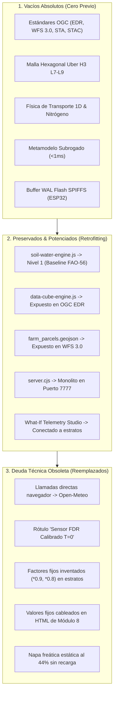

<div class="mermaid-legend">
<div class="mermaid-legend-title">🧭 LEYENDA DEL DIAGRAMA — Triaje de Gobernanza en 3 Destinos (Vacíos, Retrofitting y Deuda Obsoleta)</div>
  <ul>
    <li><strong>Columna 1 (Vacíos Absolutos):</strong> Capacidades científicas que no existían en absoluto antes de la migración y se construyen desde cero (OGC, H3/AMR, Richards 1D, Subrogado, Buffer WAL).</li>
    <li><strong>Columna 2 (Preservados &amp; Potenciados — Retrofitting):</strong> Motores existentes que NO se destruyen; se conservan como respaldo de seguridad (ej. la cubeta FAO-56 queda como <em>Nivel 1 Baseline</em>) o se envuelven en estándares abiertos (<code>data-cube-engine.js</code> expuesto vía OGC EDR).</li>
    <li><strong>Columna 3 (Deuda Técnica Obsoleta):</strong> Atajos antiguos (llamadas directas del navegador a Open-Meteo, etiquetas que fingían un sensor físico o factores multiplicativos fijos) que se jubilan y reemplazan por física y procedencia honesta.</li>
  </ul>
</div>

| Categoría Arquitectónica | Componentes Afectados | Diagnóstico Previo y Resolución en la Migración |
| :--- | :--- | :--- |
| **1. Vacíos Absolutos**<br>*(No existía nada en el repositorio)* | • **Estándares OGC e Interoperabilidad:** OGC API - EDR, Features (WFS 3.0), SensorThings API y STAC 1.0.0.<br>• **Malla Hexagonal Uber H3:** Sin indexación geodésica $O(1)$ previa.<br>• **Biofísica Multicapa:** Sin Richards 1D, Campbell, Feddes con anoxia ni dinámica de N.<br>• **Modelo Subrogado:** Sin inferencia ligera en milisegundos para 60 FPS.<br>• **Resiliencia IoT:** Sin buffer circular WAL en flash SPIFFS ni asimilación Kalman EKF.<br>• **Módulo 9 del Vault:** Sin consola de gobernanza de estándares abiertos. | **Se crean desde cero** como módulos puros sin dependencias circulares, integrándose directamente al flujo del servidor monolítico 7777. |
| **2. Preservación y Retrofitting**<br>*(No se descartan; se mejoran y conviven)* | • **`soil-water-engine.js` (Cubeta FAO-56):** Preservado intacto como *Nivel 1 (Baseline)* para fallback en dispositivos de baja potencia o predios sin curvas edáficas.<br>• **`data-cube-engine.js` (Tensor 4D):** Preservada su estructura dimensional; ahora expuesto formalmente vía OGC EDR (CoverageJSON).<br>• **`farm_parcels.geojson` (Cuarteles Meniel):** Se mantienen los polígonos catastrales reales; ahora servibles en QGIS vía WFS 3.0.<br>• **Servidor `server.cjs`:** Se mantiene como **proceso único monolítico en puerto 7777**.<br>• **Telemetry Studio What-If:** Mantiene su interfaz y barra de días; se conecta a los estratos de suelo reales. | **Garantía de No-Regresión:** Las interfaces existentes siguen consumiendo las mismas firmas; los motores previos actúan como salvaguarda ante fallos de datos. |
| **3. Deuda Técnica Obsoleta**<br>*(Quedan obsoletos y se reemplazan)* | • **Llamadas directas a Open-Meteo en `geo-layers.js`:** Violaban licencia comercial y saturaban cuotas por IP.<br>• **Rótulo "Sensor FDR de Terreno (Calibrado T=0)":** Simulación que fingía ser hardware físico enterrado.<br>• **Factores multiplicativos fijos en capas del Cubo 4D (`* 0.95`, `* 0.90`):** Derivaciones empíricas arbitrarias.<br>• **Valores cableados en el HTML del Módulo 8 del Vault:** Cifras fijas de latencia y TRL sin verificación empírica.<br>• **Napa freática constante al 44%:** Estrato estático desconectado del bombeo de pozos y lluvias. | • Reemplazado por adaptador centralizado en servidor `/api/weather/*` con caché único.<br>• Reemplazado por el **Sensor Virtual Honesto** (`is_virtual: true` con incertidumbre $\sigma$).<br>• Reemplazado por perfiles estratificados reales de MONICA/Subrogado.<br>• Reemplazado por lectura dinámica de `data/engine_registry.json`.<br>• Reemplazado por balance de recarga y cono de abatimiento de Thiem. |

---

---

## 16. Diagnóstico de Blindaje Arquitectónico en 5 Dimensiones

Una de las premisas determinantes exigidas por la dirección técnica y el panel multidisciplinar es la **garantía de no-regresión**: ¿cómo integrar el rigor biofísico de `monica-agritwin`, la optimización predictiva de `AgriTwin-RL`, la malla geoespacial H3 de `ridvanzengin/AgriTwin` y los contratos IoT de `FedAgriTwin` y `NemoClaw-dairy` sin colapsar el rendimiento, romper los visores cartográficos existentes ni generar dependencias cruzadas tóxicas?

A continuación se expone la auditoría de riesgos y el blindaje arquitectónico diseñado a través de las cinco dimensiones críticas del sistema:

```mermaid
flowchart TD
    subgraph D1 ["Dimensión 1: Lenguajes y Runtimes"]
        L1["React 19 + TypeScript (Vite SPA)"]
        L2["Python Científico (Offline en scripts/)"]
        L3["C++ Nativo (Firmware ESP32)"]
        L1 <-->|"Contratos JSON Estáticos / REST"| L2
        L3 -->|"Payloads MQTT Normalizados"| L1
    end

    subgraph D2 ["Dimensión 2: Cartografía y Gráficos"]
        C1["agritwin-cuenca (Leaflet 2D GIS)"]
        C2["agritwin-predio (Three.js WebGL 3D)"]
        C3["Malla H3 (ridvanzengin)"]
        C3 -->|"Exportación a GeoJSON Estándar"| C1
        C3 -->|"Extrusión Poligonal Nativa"| C2
    end

    subgraph D3 ["Dimensión 3: Concurrencia y Latencia"]
        P1["Escalón 1: Subrogado XGBoost (<1ms, 60 FPS)"]
        P2["Escalón 2: Web Workers / Celery (1s - 5s)"]
        P3["Escalón 3: MONICA Richards 1D (Offline Batch)"]
        P3 -. "Entrenamiento Periódico" .-> P1
    end

    subgraph D4 ["Dimensión 4: Hardware y Schemas"]
        H1["ESP32 Flash Buffer (WAL Local)"]
        H2["Sombra Digital (Digital Twin Shadow)"]
        H3["IndexedDB (PWA Offline rewild)"]
        H1 -->|"Sincronización Idempotente"| H2
        H3 <-->|"Reconciliación Bidireccional"| H2
    end
```

<div class="mermaid-legend">
<div class="mermaid-legend-title">🧭 LEYENDA DEL DIAGRAMA — Estrategia de Blindaje para que los 3 Lenguajes y 2 Motores Gráficos no Colisionen</div>
  <ul>
    <li><strong>Dimensión 1 (Lenguajes):</strong> El navegador web (JavaScript / React 19 / TypeScript), los scripts científicos (Python/R) y el chip del campo (C++ en ESP32) nunca se mezclan en un mismo compilador: se comunican únicamente mediante archivos <code>JSON / GeoJSON</code> validados por contrato.</li>
    <li><strong>Dimensión 2 (Gráficos 2D/3D):</strong> No se reemplaza <code>Leaflet 2D</code> por <code>MapLibre GL</code>; la malla H3 se exporta como polígonos <code>GeoJSON</code> estándar que tanto Leaflet (en 2D) como <code>Three.js WebGL</code> (en 3D) dibujan de forma nativa.</li>
    <li><strong>Dimensión 3 (Latencia):</strong> Separa lo instantáneo ($<1\text{ ms}$ en el navegador con XGBoost) de lo pesado (MONICA por lotes en servidor).</li>
    <li><strong>Dimensión 4 (Resiliencia Offline):</strong> Tantol el chip <code>ESP32</code> (en memoria flash SPIFFS) como la app móvil <code>PWA</code> (en <code>IndexedDB</code> del teléfono) guardan datos sin internet y sincronizan después contra la Sombra Digital.</li>
  </ul>
</div>

### 16.1. Dimensión 1: Lenguajes y Runtimes de Ejecución

> **Aclaración de alcance (auditoría):** esta dimensión describe la pila general del ecosistema. El **Hub** (`index.html`, `js/hub`, `js/engines`, `server.cjs`) es JavaScript sin transpilación; la aplicación React 19 con TypeScript y Vite de la raíz del repositorio (`src/`) es un proyecto separado. El plan de la sección 16 se ejecuta sobre el Hub y no requiere TypeScript.

* **Pila Actual:** Single Page Application (SPA) en **React 19, TypeScript y Vite**, con firmware en **C++ para microcontroladores ESP32**.
* **Pila de las Referencias:** **Python científico** (NumPy, SciPy, Pandas, GDAL, Rasterio, XGBoost, Gymnasium, PyTorch y Celery/Redis).
* **Punto de Choque Crítico:** Intentar importar librerías científicas de Python o dependencias C-binding (como GDAL) dentro del bundle de Vite inflaría los tiempos de compilación y provocaría roturas catastróficas.
* **Estrategia de Blindaje:**
  1. **Aislamiento Estricto de Entornos:** Vite y React 19 se mantienen con **cero dependencias de Python**. El comando `npm run build` no ejecuta ni compila código Python.
  2. **Ejecución Asíncrona Desacoplada:** El procesamiento geoespacial pesado y las simulaciones agronómicas complejas se confinan a tuberías ETL offline en el directorio `scripts/` o a microservicios satélite opcionales.
  3. **Contratos de Salida Estáticos:** Las herramientas Python exportan artefactos estándar estructurados (archivos `.geojson` y `.json` estáticos en `public/data/`), los cuales son consumidos de forma transparente por TypeScript mediante `fetch()` o importaciones estáticas con validación de esquemas tipados.

### 16.2. Dimensión 2: Cartografía y Motores Gráficos 2D / 3D
* **Pila Actual:** `agritwin-cuenca` en **Leaflet 2D** y `agritwin-predio` en **Three.js (WebGL PBR)**.
* **Pila de Referencia:** MapLibre GL / deck.gl en `ridvanzengin/AgriTwin`.
* **Punto de Choque Crítico:** Intentar sustituir el visor Leaflet por MapLibre GL o incrustar librerías GIS complejas dentro del canvas Three.js rompería las capas personalizadas y causaría pérdida de contexto gráfico WebGL (`WEBGL_context_lost`).
* **Estrategia de Blindaje:**
  1. **No-Reemplazo de Visores:** Se preservan intactos tanto el visor Leaflet 2D como el canvas Three.js 3D.
  2. **Interoperabilidad Mediante GeoJSON Estándar:** La indexación H3 genera polígonos vectoriales en formato **GeoJSON `FeatureCollection` estándar**.
  3. **Consumo Nativo en Leaflet:** En `agritwin-cuenca`, Leaflet carga los hexágonos GeoJSON de forma nativa mediante `L.geoJSON()`. La lógica difusa de idoneidad y el riesgo de bombeo se expresan como propiedades numéricas coropléticas sin librerías adicionales.
  4. **Extrusión Poligonal Nativa en Three.js:** En `agritwin-predio`, Three.js transforma las coordenadas geográficas de los hexágonos de resolución 9 en mallas extruidas (`THREE.ExtrudeGeometry`) con materiales PBR nativos.

### 16.3. Dimensión 3: Concurrencia, Rendimiento y Latencia (60 FPS vs. Ecuaciones Diferenciales)
* **Pila Actual:** Interfaz del Hub y visores a **60 FPS**.
* **Pila de Referencia:** MONICA resuelve Richards 1D acoplado con Campbell y Michaelis-Menten (5 a 30 segundos por corrida anual).
* **Punto de Choque Crítico:** Bloqueo del hilo principal de JavaScript (*UI freezing*) si se resuelven ecuaciones diferenciales pesadas en los sliders.
* **Estrategia de Blindaje (Arquitectura en Tres Escalones):**
  * **Escalón 1 (Cliente en Tiempo Real, $<1\text{ ms}$):** Inferencia ultraligera mediante el **modelo subrogado XGBoost** compilado a TypeScript para los sliders del Hub.
  * **Escalón 2 (Asíncrono en Background, $1\text{ s} - 5\text{ s}$):** Web Workers o Celery para recalcular idoneidad sobre cientos de hexágonos simultáneos.
  * **Escalón 3 (Cómputo Lote Offline, horas):** Simulaciones completas de MONICA para calibrar estacionalmente los pesos del modelo subrogado.

### 16.4. Dimensión 4: Esquemas de Datos, Sincronización y Tolerancia a Fallos de Hardware
* **Pila Actual:** ESP32 en campo rural y PWA de `rewild` en IndexedDB.
* **Punto de Choque Crítico:** Pérdida de lecturas o colisión de datos desordenados ante cortes de conectividad rural.
* **Estrategia de Blindaje:**
  1. **Contratos Canónicos Tipados (`src/contracts/telemetry.ts`):** Siguiendo el estándar de `NemoClaw-dairy`, todo paquete es inmutable y tipado.
  2. **Almacenamiento Local Seguro (Buffer WAL):** El ESP32 almacena hasta 10.000 lecturas en flash interna SPIFFS; la PWA persiste en IndexedDB.
  3. **Patrón de Sombra Digital Idempotente:** Separación estricta entre *reported state* (hardware) y *desired state* (operador) con sincronización eventual.

### 16.5. Dimensión 5: Interoperabilidad Internacional con Estándares Abiertos OGC, DestinE e IDE Chile (Migración 8.2)

Una plataforma de gemelo digital agrícola que aspire a dialogar con la ciencia internacional y con la Infraestructura de Datos Espaciales de Chile (**IDE Chile / SNIT**) no puede apoyarse exclusivamente en formatos JSON cerrados o rutas ad-hoc de servidor. La **Migración 8.2** consolida la adopción formal de los estándares del **Open Geospatial Consortium (OGC)** y de la iniciativa **Destination Earth (DestinE)**, bajo una regla de oro de arquitectura estricta e inviolable:

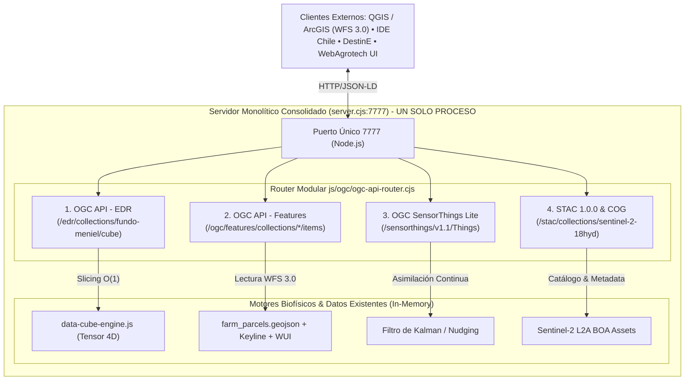

<div class="mermaid-legend">
<div class="mermaid-legend-title">🧭 LEYENDA DEL DIAGRAMA — Monolito en Puerto Único 7777 y los 4 Adaptadores OGC</div>
  <ul>
    <li><strong>Caja Exterior (<code>server.cjs:7777</code>):</strong> Todo AgriTwin corre dentro de un único proceso <code>Node.js</code> en el puerto 7777, evitando tener que administrar múltiples servidores o contenedores complejos.</li>
    <li><strong>Los 4 Adaptadores OGC (Centro):</strong> Traducen nuestros motores internos a los 4 idiomas universales de la cartografía científica: <strong>1) EDR</strong> (consulta de cubos de datos 4D por coordenada/profundidad/tiempo), <strong>2) Features / WFS 3.0</strong> (vectores GeoJSON que QGIS o ArcGIS abren directo con un link), <strong>3) SensorThings Lite</strong> (estándar internacional para sondas IoT) y <strong>4) STAC + COG</strong> (catálogo de imágenes satelitales Sentinel-2 que permite leer solo el recorte del predio mediante peticiones de rango HTTP sin bajar gigabytes).</li>
  </ul>
</div>

#### Regla de Oro de Arquitectura (Obligatoria):
* **Monolito Consolidado en Proceso Único:** Predio 3D, Cuenca territorial Leaflet, Hub C2 de decisiones y motores biofísicos corren en **UN SOLO PROCESO** Node.js.
* **Puerto Único Exclusivo 7777 (`agritwin/server.cjs`):** No se levantan microservicios, contenedores paralelos ni puertos secundarios. Todas las rutas OGC se integran como controladores modulares en memoria (`js/ogc/`) montados sobre el mismo despachador HTTP.

#### Los Cuatro Módulos OGC de la Migración 8.2:
1. **Módulo OGC API - EDR (Environmental Data Retrieval) para el Tensor 4D (OGC 19-086r1):**  
   Estandariza la consulta del motor `data-cube-engine.js`.
   * `GET /edr/collections/fundo-meniel/cube`: Consulta del cubo cuatridimensional por BBOX, estratos verticales $z$ (desde canopia hasta acuífero freático), horizonte temporal $t$ (T0 a T+6 días) y variables biofísicas (`vwc_percent`, `ks_stress_factor`, etc.).
   * `GET /edr/collections/fundo-meniel/locations/{paddock_id}`: Extracción instantánea $O(1)$ de la trayectoria biofísica y fenológica de un cuartel.
   * Retorna payloads en **CoverageJSON** estándar (W3C/OGC) o GeoJSON estructurado.
2. **Módulo OGC API - Features para Cartografía Vectorial (WFS 3.0 / OGC 17-069r3):**  
   Expone las capas geoespaciales del predio y la cuenca para consumo directo en **QGIS**, **ArcGIS** y visualizadores del SNIT:
   * `/ogc/features/collections/cuarteles/items`: Polígonos de producción agrícola de Fundo Meniel.
   * `/ogc/features/collections/obras-keyline/items`: Líneas de siembra Keyline y tranques de infiltración.
   * `/ogc/features/collections/fajas-wui/items`: Fajas cortafuego silvopastoriles de 45 m.
3. **Contrato OGC SensorThings API (Lite) para Sensores Virtuales y KioT (OGC 15-078r6):**  
   Modela las sondas FDR capacitivas (virtuales actuales y físicas futuras) bajo el estándar de cinco entidades: `Thing`, `Sensor`, `ObservedProperty`, `Datastream` y `Observation`.
   * Conecta directamente las observaciones entrantes al operador de **asimilación continua (Filtro de Kalman Extendido / Nudging)**, desacoplando el hardware de la física de suelo.
4. **Endpoints Canónicos STAC 1.0.0 & COG:**  
   Expone un catálogo SpatioTemporal Asset Catalog (**STAC 1.0.0**) autocontenido en `/stac` con los metadatos de Sentinel-2 L2A (Tile `18HYD`) y referencias directas a los **Cloud Optimized GeoTIFFs (COG)** de reflectancia de fondo de atmósfera (BOA).
---

## 17. Plan de Acción: Transición de Proveedor Meteorológico y Cinco Fases sobre la Interfaz Real

### 17.1. Principios del plan

1. **Se construye sobre lo que existe.** El Hub es JavaScript sin transpilación: interfaz en `index.html` y `js/hub/*.js`, motores en `js/engines/` (pares `.js` y `.cjs`), servidos por `server.cjs`. La aplicación React/TypeScript de la raíz del repositorio (`src/`) es un proyecto aparte; **el plan no depende de TypeScript ni de Vite**. Los contratos se definen con JSDoc y un esquema JSON, y se validan con un script de Node.
2. **Reutilizar antes que crear.** Ya existen el What-If agronómico (motor, API y pantalla), el cubo 4D, la capa SoilGrids y el caché meteorológico del servidor (ver 6.5 y 15.2). Cada fase indica qué reutiliza.
3. **El motor va detrás de una interfaz estable.** Las fases 0 a 4 entregan valor con el motor actual (cubeta FAO-56). El subrogado de ZALF entra en la fase 5 sin cambiar la interfaz.
4. **Lo que falta se modela, no se espera.** Sin sensores se usa el sensor virtual con incertidumbre; sin datos de pozos, la capa freática se muestra como estimación declarada.
5. **Cada dato lleva su procedencia.** Proveedor, modelo, hora de emisión y resolución viajan con el valor y se muestran en la interfaz.

### 17.2. Dónde vive cada elemento nuevo (interfaz real y reorganización Grid 2×3)

Para eliminar el desplazamiento horizontal y separar limpiamente los dominios de satélite, terreno/Keyline y sensores, la barra de pestañas de `#territorialSidebar` pasa de 4 pestañas en fila a un **Grid de 2 columnas × 3 filas (6 pestañas visibles simultáneamente)** bajo los acuerdos **ADR-001** y **ADR-002**:

| Elemento / Módulo de Migración | Contenedor Canónico | Cambio Concreto en la Interfaz Real |
| :--- | :--- | :--- |
| **Barra de Pestañas del Panel Derecho** | `#territorialTabBar` (`slot-right-sidebar`) | Grid 2×3 sin scroll: **1.** `🌦️ Tiempo & Hídrico`, **2.** `🛰️ Capas SIG & Satélite`, **3.** `⚡ Riesgos Climáticos`, **4.** `💧 Agua & Tranques`, **5.** `📐 Keyline & Terreno`, **6.** `📡 Sensores & Red`. |
| **M1 · Red de Sensores & Estaciones (ADR-001 ASP)** | Pestaña 6 `📡 Sensores & Red` (`#tab-sensores`) + `#drawerNav` (Gemelo 3D) | **Aislamiento de Sensores de Predio:** los 5 nodos KioT de Fundo Meniel se agrupan en 1 marcador en Cuenca 2D (se expanden a `z ≥ 14`) y se sincronizan con el Gemelo 3D (con gráfico de Calicata `0–100 cm` al clic). Las 4 estaciones públicas (DGA/INIA/DMC) y las 187 celdas virtuales (ZALF+MONICA) quedan solo en el Visor Satelital. |
| **M2 · Scrubber Temporal Único 168h + Escala Crameri** | `#cuencaWindyTimelineScrubber` (`slot-bottom-bar`) | Único reloj inferior conectado a `/api/weather/full-168h` (14 variables), rampas de Fabio Crameri (*Batlow, Oleron, LaJolla, Vik, Bamako*), cálculo TAW/RAW y desaturación automática B&N del satélite (Patrón Windy). |
| **Extracción Base hacia `📐 Keyline & Terreno` (ADR-002)** | Pestaña 5 `📐 Keyline & Terreno` (`#tab-terreno`) | Se extraen desde `#tab-sig` hacia `#tab-terreno`: **1)** Tarjeta *Carbono Orgánico ISRIC SoilGrids 250m*, **2)** Bloque *Topografía & Relieve DEM* (*Hipsometría, Curvas Keyline 2m, Sonda de Elevación/Napa, Ingesta DEM/Dron `.tif`*) y **3)** *Herramientas de Geomorfología* (*Transecto X-Y, Sedimentos, Pendiente 2.5D*). |
| **M4 · CutSheetRX & Cubicación Keyline** | Pestaña 5 `📐 Keyline & Terreno` (`#tab-terreno`) + `#dropdown_perma_prv` (3D) | Vive al inicio de `📐 Keyline & Terreno` con selectores de pendiente (`0.5–1.5%`) y profundidad de zanja (`35–65 cm`), calcula Corte/Relleno/Balance vía `POST /api/zalf/hexgrid` y sincroniza los $\text{m}^3$ reales con el Gemelo 3D por `AgriBus`. |
| **M3 · Malla Hexagonal AMR (N2/N3) + Calicata 1D** | Pestaña 5 `📐 Keyline & Terreno` (`#tab-terreno`) | Dibuja la malla AMR en paleta *Bamako* sobre el mapa; clic en cualquier hexágono abre el perfil Richards 1D en los **5 estratos oficiales de MONICA (`0–10`, `10–25`, `25–50`, `50–75`, `75–100 cm`)**. |
| **M8 · Landscope: Red de Flujo D8 & Insolación DEM** | Pestaña 5 `📐 Keyline & Terreno` (`#tab-terreno`) | Trazas vectoriales de acumulación de flujo D8 (*Oleron*) y radiación solar topográfica $\text{Wh/m}^2$ (*Batlow*) para apoyar el diseño Keyline. |
| **M9 · Ficha Edafológica 1-Clic + Corredores** | `#tab-terreno` (Ficha Akshay) + `#tab-sig` (Corredores Theobald) | La **Ficha de Suelo 1-Clic** vive en `📐 Keyline & Terreno`; los **Corredores Ecológicos (*Least-Cost Paths*)** viven en `🛰️ Capas SIG & Satélite` junto a LULC y Manejo PRV. |
| **M5, M6, M7 · Física Extrema v3.2.0** | Pestaña 3 `⚡ Riesgos Climáticos` (`#detailsRiskFrost/Fire/Flood`) | **M5** Helada Stefan-Boltzmann + Velo HAND + Mulch (*Vik*); **M6** Piro-Vórtice WUI & Salto Balístico 2.4 km (*LaJolla*); **M7** Crecida Clausius-Clapeyron $+\Delta T$ (*Oleron*). |
| **Estándares OGC (EDR, WFS, STA, STAC) y Vault** | Servidor `server.cjs:7777` + Vault **Módulos 8 y 9** | Rutas `/edr/*`, `/ogc/features/*`, `/sensorthings/*`, `/stac/*` (invisibles en el visor táctico; documentadas y auditables en el Vault). |

### 17.3. Transición del proveedor meteorológico (Fase 0)

#### 17.3.1. Puntos de llamada actuales (verificados)

| Archivo | Uso | Dónde se ejecuta |
| :--- | :--- | :--- |
| `js/hub/geo-layers.js` (líneas 10356 y 10357) | Pronóstico de 7 días del valle (11 variables horarias y 5 diarias) y de la cumbre (6 horarias) | **Navegador** |
| `server.cjs` (línea 50) | Clima actual del predio y ET0 diaria | Servidor, caché de 10 min |
| `server.cjs` (línea 104) | Pronóstico de 7 días (ET0, lluvia, temperatura máxima y mínima) como forzamiento del motor biofísico | Servidor, caché de 30 min |
| `scripts/hindcast/01_fetch_inputs.py` (dos llamadas) | Reanálisis ERA5 horario y lluvia de 90 días para validar inundaciones históricas | Script de investigación |

La ET0 diaria **ya se pide** desde el servidor. Lo nuevo es la ET0 horaria, la radiación y el ensamble.

#### 17.3.2. Pasos

1. **Esquema interno de variables.** Nombres propios e independientes del proveedor (por ejemplo `t2m_c`, `rh2m_pct`, `td2m_c`, `precip_mm`, `wind10_kmh`, `gust10_kmh`, `pressure_hpa`, `cape_jkg`, `et0_mm`, `swrad_wm2`) y, por cada valor, su procedencia: proveedor, modelo, hora de emisión y resolución.
2. **Módulo de proveedores en el servidor**, con una interfaz común y un adaptador por proveedor. Configuración por variables de entorno: proveedor activo, dirección base y clave. El primer adaptador es Open-Meteo.
3. **Endpoint `/api/weather/forecast`** (puntos: valle, cumbre, predio) que devuelve el esquema interno. Las funciones actuales de `server.cjs` pasan a usar el mismo módulo y el mismo caché.
4. **Migrar `geo-layers.js`:** reemplazar solo las dos llamadas directas por el endpoint y dejar intacto el procesamiento posterior (isoterma, régimen de nieve, CAPE y cizalle).
5. **Cadena de respaldo:** proveedor principal, luego último valor válido (marcado como desactualizado) y luego el respaldo sintético existente, **rotulado como simulado**.
6. **Atribución y procedencia en la interfaz:** texto de fuente en el pie de la pestaña *Tiempo y Hídrico* y en el Módulo 8.
7. **Licencia comercial.** El día que haya un cliente de pago se cambia la dirección base y se agrega la clave en el entorno. No se modifica código. Esto cierra el problema de licencia sin reescribir nada.
8. **Dejar tal cual** el script de validación histórica (uso de investigación); para producción y entrenamiento ver la fase 5.

* **Aceptación:** ninguna cadena `open-meteo.com` queda en el código del navegador; con la red cortada la interfaz muestra el respaldo rotulado; una prueba de regresión compara, para un mismo punto y hora, los valores anteriores con los del esquema interno.

#### 17.3.3. Comparación de proveedores

**Idea central:** Open-Meteo no genera pronósticos propios; **procesa los mismos modelos abiertos** (ECMWF, GFS, ICON y el reanálisis ERA5) y los entrega ya interpolados al punto, con unidades convertidas y variables derivadas (ET0, nivel de congelación). Las alternativas **no ofrecen datos mejores**; ofrecen otro equilibrio entre costo, control y trabajo de procesamiento.

| Fuente | Licencia y uso comercial | Qué aporta | Trabajo requerido |
| :--- | :--- | :--- | :--- |
| **Open-Meteo gratuito** | Uso no comercial; topes de llamadas | Todo lo actual | Ninguno |
| **Open-Meteo comercial** | Plan de pago con clave y dirección propia | Mismas variables, sin cambiar el código del cliente; incluye ensamble y archivo | Mínimo (variable de entorno) |
| **ECMWF datos abiertos** (IFS, AIFS, ensamble) | CC-BY-4.0, uso comercial permitido con atribución | Resolución de 0,25° y, en algunas corrientes, 0,1° (unos 9 km); ensamble real; archivos GRIB2 en espejos de AWS, Azure y Google | Alto: descargar, decodificar, extraer el punto y derivar ET0 |
| **NOAA GFS** (AWS) | Dominio público; se pide atribución y no sugerir respaldo de NOAA | Pronóstico global de respaldo; incluye capas de suelo | Alto, igual que ECMWF |
| **DWD ICON** | CC BY 4.0, sin garantía de disponibilidad | Segundo modelo independiente para contrastar | Alto |
| **ERA5 y ERA5-Land** (Copernicus) | Uso comercial permitido con atribución | Historia horaria de unos 9 km con humedad de suelo por capas; clima de entrenamiento del subrogado | Medio: descarga por lotes, no en línea |
| **NASA POWER** | Dominio público | Radiación y clima histórico, de resolución gruesa | Bajo; no sirve como pronóstico |
| **Observaciones satelitales** (precipitación GPM IMERG, humedad de suelo SMAP) | Datos abiertos de NASA; **verificar acceso y condiciones** | Precipitación y humedad de suelo **observadas**, que sirven para validar el sensor virtual | Medio |
| **Estaciones locales** (DMC, DGA; el repositorio ya tiene `data/cr2_dga`) | **Verificar condiciones de uso** | Corrección de sesgo y validación en el predio | Medio |
| **Proveedores comerciales agroclimáticos** | De pago | Soporte y variables agronómicas | Bajo; costo recurrente; **no evaluados aquí** |

**Lectura para este proyecto:**

1. En Chile central todos los modelos abiertos tienen una resolución nominal del orden de 9 a 25 km. Cambiar de proveedor **no** mejora la resolución en el valle del Longaví; lo que la mejora es la **corrección con estaciones locales** y el ajuste por altitud.
2. Para uno a tres puntos fijos (predio, valle, cumbre) el procesamiento propio de GRIB cuesta más de lo que ahorra. Lo razonable es **Open-Meteo comercial** hoy y dejar listos los adaptadores directos como contingencia.
3. Las alternativas sí aportan algo que Open-Meteo no resuelve solo: **independencia de licencia**, **observaciones** para validar y **reanálisis por lotes** para entrenar.

#### 17.3.4. Cobertura de las variables que el Hub ya usa

| Variable | Directa en modelos abiertos | Nota |
| :--- | :--- | :--- |
| Temperatura, humedad o punto de rocío, presión, precipitación | Sí | |
| Viento a 10 m y ráfagas | Sí | |
| CAPE | Sí | |
| Viento a 500 hPa | Sí (niveles de presión) | |
| Radiación solar | Sí | Open-Meteo además entrega la componente directa normal |
| ET0 FAO-56 | **No** | Se deriva con Penman-Monteith a partir de temperatura, humedad, viento y radiación; el motor del Hub ya implementa el balance |
| Isoterma 0 °C | Derivable | Open-Meteo la entrega lista; contrasta con el cálculo manual actual |
| Humedad y temperatura de suelo | Parcial | **Verificar en el catálogo de cada modelo** antes de depender de ellas |

### 17.4. Las cinco fases

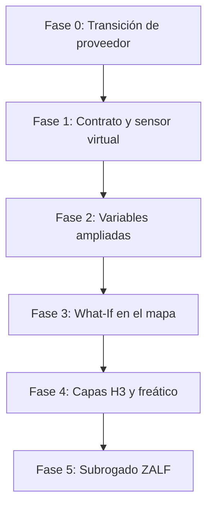

<div class="mermaid-legend">
<div class="mermaid-legend-title">🧭 LEYENDA DEL DIAGRAMA — Secuencia Incremental de 6 Etapas (Fase 0 a Fase 5) sin Riesgo de Rotura</div>
  <ul>
    <li>Cada fase entrega valor funcional por sí misma sin esperar a la siguiente: primero se asegura el clima en el servidor (<strong>Fase 0</strong>) y la honestidad del dato (<strong>Fase 1</strong>); luego se amplían las variables horarias (<strong>Fase 2</strong>), el simulador What-If en el mapa (<strong>Fase 3</strong>) y las mallas espaciales H3/freático (<strong>Fase 4</strong>); y finalmente se enchufa el modelo subrogado ZALF detrás de la misma interfaz ya probada (<strong>Fase 5</strong>).</li>
  </ul>
</div>

#### Fase 0: Transición del proveedor meteorológico
* **Qué se hace:** todo lo descrito en 17.3.2.
* **Depende de:** nada. Es el requisito de las demás fases y la que cierra el riesgo de licencia.

#### Fase 1: Contrato de datos, sensor virtual, procedencia honesta y protocolo de versiones en el Vault
* **Referencias:** `NemoClaw-dairy` (contratos tipados), `FedAgriTwin` (sombra digital) y SemVer 2.0.0.
* **Qué se hace:** definir el objeto único de lectura de suelo (campos en 10.5) y crear `js/engines/virtual-sensor-engine.js` y su par `.cjs`, alimentado por el motor actual. **Corregir el rótulo** *"Sensor FDR de Terreno (Calibrado T=0)"* de `/api/simulation/run`, que hoy se aplica a valores por defecto. **Incorporar el Protocolo Canónico de Versionamiento en el Vault:** crear `data/version_history.json` y el panel explicativo de SemVer ciberfísico en el Módulo 8 (submódulo 8.1), documentando las 3 generaciones (Gen 1 Basal, Gen 2 DestinE, Gen 3 v3.0.0) y la distinción formal entre saltos biofísicos (*Major*), adición de capas (*Minor*) y parches gráficos del Predio 3D (*Patch*).
* **Aceptación:** un script de Node genera el objeto para un cuartel y lo valida contra el esquema; con una lectura simulada de sonda, `is_virtual` pasa a falso y $\sigma$ disminuye; el rótulo refleja el origen real; el Vault expone la línea de tiempo interactiva de versiones y cambios con lectura en tiempo real.

#### Fase 2: Variables ampliadas
* **Qué se hace:** agregar al adaptador de la fase 0 las variables de 17.6, con ensamble y `past_days`. El selector de la subpestaña *Controles* incorpora los botones nuevos.
* **Aceptación:** las variables aparecen con su procedencia; el respaldo sigue funcionando.

#### Fase 3: What-If agronómico en el mapa de cuenca
* **Qué se hace:** lo descrito en 6.5.3. Se reutiliza `/api/simulation/run` y la barra de días; se parametriza el escenario; `setCuencaWindySource` pasa a tres estados; se recolorean los cuarteles de `geo-layers.js`.
* **Depende de:** fases 0 y 1.
* **Aceptación:** al elegir "cortar el riego desde el día 3" los cuarteles cambian de color según su estado hídrico; *Real 7D* y *Simulado* funcionan igual que antes; el Telemetry Studio sigue operativo.

#### Fase 4: Capas SIG de malla H3 y nivel freático
* **Referencias:** `ridvanzengin/AgriTwin` (H3) y la física de 6.4.
* **Qué se hace:** script `scripts/generate_h3_grid.py` que produce GeoJSON estático (resolución 6 para la cuenca y 9 para el predio); dos casillas nuevas en `#layer-toggles`. La capa freática se activa al cargar los registros de pozos DGA; mientras tanto se muestra como estimación declarada.
* **Datos pendientes:** registros de pozos y niveles, transmisividad y rendimiento específico.
* **Aceptación:** las capas se activan sin afectar a las existentes ni a los polígonos catastrales.

#### Fase 5: Subrogado de ZALF, MONICA bajo demanda y tablero agrícola
* **Referencias:** `monica-agritwin` y `AgriTwin-RL`.
* **Qué se hace:** generar el conjunto de entrenamiento con MONICA usando ERA5-Land por lotes, entrenar el subrogado, exportarlo a un formato ejecutable en el navegador y conectarlo **detrás de la interfaz de `simulateScenarios`**, reemplazando los estratos con factores fijos del cubo. Añadir la tarjeta *Humedad multi-capa* al Tablero Agrícola y un botón de auditoría profunda con MONICA en un proceso aparte.
* **Aceptación:** el error del subrogado frente a MONICA en datos retenidos queda registrado (ver 17.7); las pantallas de las fases 3 y 4 no cambian.

### 17.5. Evolución del Vault: Registro de Motores (Módulo 8) y Nuevo Módulo de Estándares OGC (Módulo 9)

El **Vault** (Dossier Técnico / Memoria de Ingeniería visible en la pestaña *3. Arquitectura de Software y Hardware* en `agritwin/cuenca/index.html`) no es un panel estático de solo texto; es la **Consola de Documentación Viva, Madurez Técnica y Gobernanza Ciberfísica** de AgriTwin. Con la actualización, el Vault experimenta una evolución estructural clave:

#### A. Evolución del Módulo 8 (Registro de Motores y Madurez)
* **Estado actual:** La tabla está escrita de forma estática en el HTML. Sus latencias, niveles TRL y tolerancias son valores ilustrativos de diseño.
* **Evolución con la migración:** Mover la tabla y el registro de cambios a `data/engine_registry.json`. El Módulo 8 pasará a consumir este JSON dinámicamente mediante `fetch` en el servidor 7777, midiendo y actualizando las latencias reales en tiempo de ejecución con `performance.now()`. Al finalizar cada fase del plan, se incrementa el TRL medido y se audita el estado del proveedor meteorológico activo (principal, caché o respaldo).

#### B. Creación del Módulo 9 en el Vault: "Arquitectura de Estándares Abiertos OGC, DestinE & IDE Chile"
Se incorpora una nueva tarjeta/módulo formal en la interfaz del Vault dedicada exclusivamente a la interoperabilidad internacional bajo el protocolo consolidado en el puerto 7777:

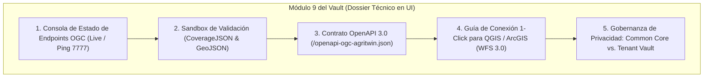

<div class="mermaid-legend">
<div class="mermaid-legend-title">🧭 LEYENDA DEL DIAGRAMA — Las 5 Piezas del Módulo 9 en el Vault (Dossier Técnico)</div>
  <ul>
    <li>Los estándares OGC no ensucian con botones técnicos el mapa donde trabaja el agricultor (cumpliendo la <strong>Ley 4 de Triaje Visual: 0 px en el visor táctico</strong>); en cambio, se concentran en el <strong>Módulo 9 del Vault</strong> para que ingenieros, auditores o analistas SIG conecten QGIS en 1 clic y verifiquen qué datos son públicos de cuenca (<em>Common Core</em>) y cuáles son privados del fundo (<em>Tenant Vault</em>).</li>
  </ul>
</div>

1. **Consola Interactiva de Endpoints en Vivo:** Muestra el estado operativo de las 4 familias de rutas OGC montadas en `server.cjs`:
   * `OGC API - EDR`: `/edr/collections/fundo-meniel/cube` y `/edr/collections/fundo-meniel/locations/{paddock_id}`.
   * `OGC API - Features`: `/ogc/features/collections/cuarteles/items`, `obras-keyline/items`, `fajas-wui/items`.
   * `OGC SensorThings API (Lite)`: `/sensorthings/v1.1/Things`, `/sensorthings/v1.1/Observations`.
   * `STAC 1.0.0 & COG`: `/stac`, `/stac/collections/sentinel-2-l2a-18hyd`.
2. **Sandbox de Descarga y Previsualización:** Botones de descarga directa de payloads estándar (W3C CoverageJSON para el tensor 4D y GeoJSON estructurado para cartografía) que permiten verificar la validez sintáctica de los datos sin salir del navegador.
3. **Visor del Contrato OpenAPI 3.0:** Enlace y visualizador interactivo embebido que renderiza `openapi-ogc-agritwin.json`, documentando esquemas de datos, parámetros de consulta y códigos de respuesta HTTP.
4. **Guía de Conexión en 1-Clic para QGIS:** Instrucción precisa para agrónomos y analistas territoriales: *Capa -> Añadir Capa -> Añadir capa WFS / OGC API Features -> Nueva Conexión -> URL: `http://localhost:7777/ogc/features`*, permitiendo superponer cuarteles y obras Keyline sobre cartografía oficial del SNIT en segundos.
5. **Gobernanza y Aislamiento de Privacidad (Common Core vs. Tenant Vault):**  
   El Módulo 9 formaliza la frontera de seguridad del sistema:
   * **Common Core (Abierto y Federado):** Las capas climáticas regionales (ERA5-Land), la hidrología pública (DGA), los catálogos satelitales (STAC) y la malla territorial hexagonal (H3 nivel 7) se exponen de forma abierta y estandarizada bajo OGC.
   * **Tenant Vault (Privado y Cifrado):** Los aforos privados de pozos, la telemetría granular de sondas FDR y los costos de bombeo residen bajo políticas de Row Level Security (RLS) y tokenización estricta, garantizando que ninguna consulta OGC externa filtre secretos comerciales o datos privados entre fundos vecinos.

#### C. Protocolo Canónico de Versionamiento Ciberfísico y Registro Histórico de Generaciones en el Vault (Módulo 8.1)

Para resolver la dispersión entre versiones del paper, iteraciones comerciales y mejoras visuales del 3D, el Vault incorpora en el Módulo 8 (submódulo 8.1) una **Consola de Versionamiento Ciberfísico y Registro Histórico**, permitiendo al evaluador comprender la madurez del software:

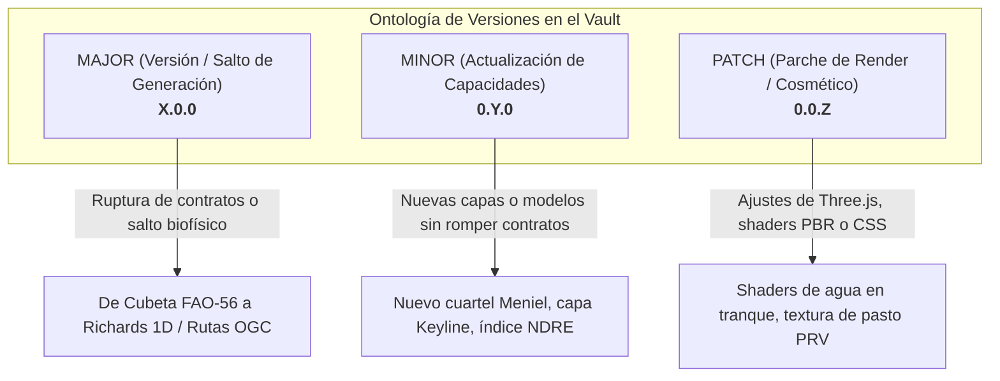

<div class="mermaid-legend">
<div class="mermaid-legend-title">🧭 LEYENDA DEL DIAGRAMA — Regla SemVer Ciberfísica (X.Y.Z) para el Historial de Versiones</div>
  <ul>
    <li><strong>Primer dígito <code>X</code> (MAJOR):</strong> Sube únicamente cuando cambia la física fundamental o los contratos de datos (ej. pasar de la cubeta FAO-56 en v2.x a Richards 1D + OGC en v3.0.0).</li>
    <li><strong>Segundo dígito <code>Y</code> (MINOR):</strong> Sube cuando se agregan nuevos módulos o operadores compatibles (ej. v3.1.0 con AMR/CutSheetRX, o v3.2.0 con Clausius-Clapeyron, Helada HAND y Piro-Vórtice).</li>
    <li><strong>Tercer dígito <code>Z</code> (PATCH):</strong> Sube por mejoras visuales, texturas 3D o ajustes de interfaz sin cambiar las ecuaciones.</li>
  </ul>
</div>

1. **Definición Didáctica en la UI:**  
   * **Versión Mayor (*Major - X.0.0*):** Cambios estructurales en las ecuaciones diferenciales, en la arquitectura de datos o en los protocolos de red (rompen compatibilidad).
   * **Actualización Menor (*Minor - 0.Y.0*):** Incorporación de capas, cuarteles, modelos GLB o endpoints nuevos compatibles hacia atrás.
   * **Parche de Render / Hotfix (*Patch - 0.0.Z*):** Ajuste estético en Three.js/Cesium, corrección de shaders, luces, sombras o arreglos de interfaz gráfica.
2. **Las Tres Generaciones Históricas de AgriTwin Registradas en el Vault:**
   * **Generación 1 (Basal / Vibe-coded - v1.0.0):** Dashboard estático en Leaflet, cubeta única FAO-56, llamadas directas desordenadas a Open-Meteo, telemetría simulada y prototipo 3D inicial.
   * **Generación 2 (Doctrina DestinE & C2 - v2.0.0):** Gemelo ciberfísico determinista, 8 Momentos Climáticos, regla 30-30-30, matriz multiamenaza C2 ($R = H \times V$), tensor 4D preliminar y modelos GLB PBR (Casa Tudor, tranque australiano).
   * **Generación 3 (Consolidación Científica, Biofísica & OGC - v3.0.0 Target de la Migración):** Fusión de los 10 repositorios internacionales (Konya H3, MONICA ZALF, Subrogado XGBoost, SPIFFS WAL), estándares OGC (EDR, Features, SensorThings, STAC en puerto 7777) y sensor virtual honesto.
3. **Clarificación Ontológica del Predio 3D:**  
   El visor 3D de Fundo Meniel no tiene una versión paralela desfasada; es la **Capa de Presentación Micro (*Three.js presentation layer*)** del gemelo monolítico. Sus mejoras gráficas se registran como *Render Patches* dentro del número unificado de la plataforma.
4. **Registro Dinámico en `data/version_history.json`:**  
   El Vault consume dinámicamente un archivo JSON estructurado que lista cada hito, fecha, autor, entregables e impacto de sistema, garantizando trazabilidad absoluta prompt a prompt para auditorías técnicas.

---

### 17.6. Cómo exprimir el proveedor meteorológico (variables y parámetros)

| N.º | Mejora | Parámetro (Open-Meteo) | Por qué sirve |
| :--- | :--- | :--- | :--- |
| 1 | ET0 horaria | `et0_fao_evapotranspiration` (horaria) | Hoy solo se usa la diaria en el servidor |
| 2 | Radiación y déficit de presión de vapor | `shortwave_radiation`, `direct_normal_irradiance`, `diffuse_radiation`, `vapour_pressure_deficit` | Demanda evaporativa y exposición de ladera |
| 3 | Estado inicial del suelo | `past_days` y capas `soil_moisture_0_to_1cm` a `27_to_81cm`, `soil_temperature_*` | Condición inicial real para el What-If; validar capas disponibles por modelo |
| 4 | Incertidumbre real | API de ensamble (`ensemble-api.open-meteo.com`) | La dispersión entre miembros alimenta $\sigma$ del sensor virtual |
| 5 | Isoterma 0 °C del modelo | `freezing_level_height` | Contraste del cálculo manual actual |
| 6 | Altitud correcta por punto | `elevation` | Ajusta la temperatura a la cota del predio o cuartel |
| 7 | Nieve de cordillera | `snowfall`, `snow_depth` | Complementa el régimen nivo-pluvial |
| 8 | Clima histórico | API de archivo (ERA5-Land) | Percentiles de sequía y entrenamiento del subrogado |
| 9 | Consulta eficiente | varias coordenadas por petición y un único caché en el servidor | Con la fase 0, todos los usuarios comparten el mismo caché |

### 17.7. Estado de verificación de las cifras de este documento

| Tipo | Ejemplos | Cómo leerlo |
| :--- | :--- | :--- |
| **Verificado en el código** | Variables y 7 días de Open-Meteo; puntos de llamada de 17.3.1; What-If de 4 escenarios; estratos del cubo con factores fijos; rótulo FDR por defecto; pestañas de `#territorialSidebar`; botón SoilGrids; cuatro Tableros de Rama; Módulo 8 | Se puede comprobar en los archivos citados |
| **Verificado en documentación externa** | Uso no comercial del plan gratuito de Open-Meteo y existencia del plan de pago; licencias de ECMWF, NOAA, DWD, ERA5 y NASA POWER; existencia de `freezing_level_height`, `past_days`, ensamble y capas de suelo en Open-Meteo | Las condiciones pueden cambiar; confirmar antes de contratar |
| **Meta de diseño** | Latencia del subrogado menor a 1 ms; $R^2 > 0{,}98$; duración de MONICA; costos del kit de campo | Debe medirse al implementar |
| **Supuesto a calibrar** | $S_y$, $T$, derecho de agua de 28 L/s, incertidumbres de ejemplo | Requiere datos de terreno o de DGA |
| **No verificado** | Acceso y condiciones de IMERG, SMAP, DMC y proveedores comerciales agroclimáticos | Revisar antes de depender de ellos |
| **No existe todavía** | Módulo de proveedores, modelo subrogado, malla H3, registros de pozos, modo What-If en el mapa, tarjeta del Tablero Agrícola | Es trabajo de las fases 0 a 5 |

### 17.8. Trazabilidad con el plan original de 5 fases y Absorción de Estándares OGC (Parte A · Fase 3.a)

<figure class="atlas-fig" style="margin:20px 0;padding:16px;border:2px solid #0284c7;border-radius:12px;background:#faf7f2;page-break-inside:avoid;">
<div style="font-family:JetBrains Mono,monospace;font-size:9.5pt;font-weight:800;color:#0369a1;margin-bottom:10px;text-transform:uppercase;">🖼️ FIGURA ATLAS-0 (Láminas 1 y 5 del Atlas VSD) — Las 3 Olas de la Megamigración y sus Controles Visuales</div>
<svg viewBox="0 0 800 220" width="100%" xmlns="http://www.w3.org/2000/svg" style="display:block;width:100%;height:auto;font-family:Inter,system-ui,sans-serif;">
<rect x="4" y="6" width="250" height="206" rx="10" fill="#e0f2fe" stroke="#0284c7" stroke-width="1.8"/>
<text x="16" y="28" font-size="11" font-weight="800" fill="#0369a1">PARTE A · FASE 3.a (v3.0)</text>
<text x="16" y="46" font-size="10" font-weight="700" fill="#0f172a">Estándares OGC, Clima 168h &amp; Red</text>
<rect x="16" y="56" width="226" height="36" rx="6" fill="#0f172a"/>
<text x="24" y="71" font-size="8.2" font-weight="700" fill="#38bdf8" font-family="monospace">▶ Scrubber Único 168h · +48h</text>
<rect x="24" y="77" width="210" height="7" rx="3" fill="#0284c7"/>
<circle cx="96" cy="80.5" r="5.5" fill="#facc15" stroke="#0f172a" stroke-width="1.5"/>
<text x="16" y="112" font-size="9.5" fill="#1e293b">• OGC Features / EDR / STAC / STA</text>
<text x="16" y="130" font-size="9.5" fill="#1e293b">• /api/weather/full-168h (14 vars)</text>
<text x="16" y="148" font-size="9.5" fill="#1e293b">• Red Sentinel (5 Predio + 4 Cuenca)</text>
<text x="16" y="166" font-size="9.5" fill="#1e293b">• Cono de Pozo Thiem &amp; Ley 10</text>
<text x="16" y="196" font-size="8.8" font-weight="700" font-family="monospace" fill="#0369a1">Atlas VSD · Lámina 5 (M1 y M2)</text>
<path d="M256 108 L272 108" stroke="#475569" stroke-width="2.5"/>
<rect x="275" y="6" width="250" height="206" rx="10" fill="#d1fae5" stroke="#059669" stroke-width="1.8"/>
<text x="287" y="28" font-size="11" font-weight="800" fill="#047857">PARTE B · FASE 3.b (v3.1)</text>
<text x="287" y="46" font-size="10" font-weight="700" fill="#0f172a">Superficie Táctica AMR &amp; Keyline</text>
<rect x="287" y="56" width="226" height="36" rx="6" fill="#ffffff" stroke="#10b981"/>
<polygon points="306,63 320,63 327,74 320,85 306,85 299,74" fill="#34d399" stroke="#047857" stroke-width="1.4"/>
<polygon points="330,63 344,63 351,74 344,85 330,85 323,74" fill="#10b981" stroke="#047857" stroke-width="1.4"/>
<text x="360" y="72" font-size="8.5" font-weight="800" fill="#065f46" font-family="monospace">187 Celdas N3 (0.58ha)</text>
<text x="360" y="84" font-size="8" fill="#047857" font-family="monospace">CutSheetRX: -228 m³</text>
<text x="287" y="112" font-size="9.5" fill="#1e293b">• Malla Hexagonal AMR (N1→N4 / H3)</text>
<text x="287" y="130" font-size="9.5" fill="#1e293b">• Calicata 1D MONICA (0–100 cm)</text>
<text x="287" y="148" font-size="9.5" fill="#1e293b">• CutSheetRX en ▸ Keyline &amp; Terreno</text>
<text x="287" y="166" font-size="9.5" fill="#1e293b">• Regla de Oro (2D ↔ Gemelo 3D)</text>
<text x="287" y="196" font-size="8.8" font-weight="700" font-family="monospace" fill="#047857">Atlas VSD · Lámina 6 (M3 y M4)</text>
<path d="M527 108 L543 108" stroke="#475569" stroke-width="2.5"/>
<rect x="546" y="6" width="250" height="206" rx="10" fill="#ffe4e6" stroke="#e11d48" stroke-width="1.8"/>
<text x="558" y="28" font-size="11" font-weight="800" fill="#be123c">PARTE C · v3.2.0 + LANDSCOPE</text>
<text x="558" y="46" font-size="10" font-weight="700" fill="#0f172a">Física Extrema &amp; Operadores Paisaje</text>
<rect x="558" y="56" width="226" height="36" rx="6" fill="#ffffff" stroke="#f43f5e"/>
<path d="M568,84 Q600,60 636,78 T704,64" fill="none" stroke="#0284c7" stroke-width="2.2"/>
<path d="M712,84 Q742,56 774,66" fill="none" stroke="#e11d48" stroke-width="2.2" stroke-dasharray="3 2"/>
<text x="568" y="70" font-size="8" font-weight="800" fill="#881337" font-family="monospace">CC +59% Q · HAND -2.1°C · WUI 2.4km</text>
<text x="558" y="112" font-size="9.5" fill="#1e293b">• Crecida Clausius-Clapeyron (+ΔT)</text>
<text x="558" y="130" font-size="9.5" fill="#1e293b">• Helada Stefan-Boltzmann + HAND</text>
<text x="558" y="148" font-size="9.5" fill="#1e293b">• Piro-Vórtice WUI &amp; Pavesas 2.4 km</text>
<text x="558" y="166" font-size="9.5" fill="#1e293b">• Landscope: D8, Sol, Ficha, Corredor</text>
<text x="558" y="196" font-size="8.8" font-weight="700" font-family="monospace" fill="#be123c">Atlas VSD · Láminas 7–10 (M5 a M9)</text>
</svg>
</figure>

| Plan original | En este plan | Absorción de Estándares OGC (Migración 8.2 en Servidor 7777) |
| :--- | :--- | :--- |
| Fase 1: contratos canónicos | Fase 1 (sin TypeScript; JSDoc y esquema JSON) | **OGC SensorThings API (Lite):** Entidades `Thing`, `Sensor`, `Datastream` y `Observation` acopladas a la sombra digital y al Filtro de Kalman. |
| Fase 2: malla H3 en GeoJSON | Fase 4 | **OGC API - Features (WFS 3.0):** Exposición de cuarteles, obras Keyline y mallas H3 para QGIS/ArcGIS en `/ogc/features/collections/*/items`. |
| Fase 3: capas en Leaflet de cuenca | Fase 4 (casillas en la pestaña SIG) | Integración de endpoints WFS en capas Leaflet del Hub sin llamadas intermedias. |
| Fase 4: motor subrogado en el Hub | Fase 5 (pospuesta para no bloquear lo visual) | **OGC API - EDR:** Estandarización del Tensor 4D de `data-cube-engine.js` en `/edr/collections/fundo-meniel/cube` (CoverageJSON). |
| Fase 5: extrusión 3D y telemetría ESP32 | Telemetría real: se conecta sobre el contrato de la fase 1 cuando existan sondas; la visualización 3D pertenece al visor de predio y queda fuera de este plan | Sincronización transparente de lecturas físicas ESP32 vía `/sensorthings/v1.1/Observations`. |
| (no existía) | Fase 0 (proveedor), fase 2 (variables) y fase 3 (What-If en el mapa) | **STAC 1.0.0 & COG:** Catálogo de teledetección de Sentinel-2 L2A (Tile 18HYD) en `/stac` con Cloud Optimized GeoTIFFs. |
| **Parte B: Superficie Táctica** | Consolidada en v3.1.0 | **AMR N1-N4 & CutSheetRX:** Endpoints `/api/zalf/hexgrid` y `/api/weather/full-168h`, balance de tierras y bidireccionalidad acotada a Fundo Meniel. |

### 17.9. Consolidación de la Parte B: Inteligencia Táctica de Superficie, Malla AMR y Balance CutSheetRX (v3.1.0)

<figure class="atlas-fig" style="margin:20px 0;padding:16px;border:2px solid #059669;border-radius:12px;background:#f0fdf4;page-break-inside:avoid;">
<div style="font-family:JetBrains Mono,monospace;font-size:9.5pt;font-weight:800;color:#047857;margin-bottom:10px;text-transform:uppercase;">🖼️ FIGURA ATLAS-B (Lámina 6 del Atlas VSD · Gran Formato) — Refinamiento Hexagonal AMR, Calicata 1D MONICA (0–100 cm) y Corte/Relleno CutSheetRX</div>
<svg viewBox="0 0 800 242" width="100%" xmlns="http://www.w3.org/2000/svg" style="display:block;width:100%;height:auto;font-family:Inter,system-ui,sans-serif;">
<rect x="4" y="6" width="256" height="228" rx="10" fill="#ffffff" stroke="#10b981" stroke-width="1.8"/>
<text x="16" y="28" font-size="11" font-weight="800" fill="#047857">1. Zoom Hexagonal AMR (N1 → N4)</text>
<polygon points="56,54 88,54 104,80 88,106 56,106 40,80" fill="#bbf7d0" stroke="#059669" stroke-width="1.8"/>
<polygon points="108,54 140,54 156,80 140,106 108,106 92,80" fill="#86efac" stroke="#059669" stroke-width="1.8"/>
<polygon points="82,94 114,94 130,120 114,146 82,146 66,120" fill="#34d399" stroke="#047857" stroke-width="2.2"/>
<polygon points="92,106 104,106 110,116 104,126 92,126 86,116" fill="#065f46" stroke="#ffffff" stroke-width="1"/>
<text x="166" y="68" font-size="9.5" font-weight="700" fill="#0f172a">N2 (320 m):</text><text x="166" y="82" font-size="8.8" fill="#475569">37 celdas valle</text>
<text x="166" y="104" font-size="9.5" font-weight="700" fill="#047857">N3 (110 m):</text><text x="166" y="118" font-size="8.8" fill="#475569">187 celdas (0.58ha)</text>
<text x="166" y="140" font-size="9.5" font-weight="700" fill="#065f46">N4 (35 m):</text><text x="166" y="154" font-size="8.8" fill="#475569">Zanja Keyline 3D</text>
<rect x="16" y="170" width="232" height="22" rx="4" fill="#ecfdf5" stroke="#a7f3d0"/>
<text x="132" y="185" text-anchor="middle" font-size="8.8" font-weight="700" fill="#065f46" font-family="monospace">Paleta Crameri: Bamako (VWC)</text>
<text x="16" y="216" font-size="8.8" font-family="monospace" fill="#047857">GET /api/zalf/hexgrid?level=n3</text>
<rect x="272" y="6" width="256" height="228" rx="10" fill="#ffffff" stroke="#0284c7" stroke-width="1.8"/>
<text x="284" y="28" font-size="11" font-weight="800" fill="#0369a1">2. Calicata 1D MONICA (0–100 cm)</text>
<rect x="284" y="42" width="142" height="22" rx="4" fill="#e0f2fe" stroke="#38bdf8"/><text x="292" y="57" font-size="9" font-weight="700" fill="#0c4a6e" font-family="monospace">0–10 cm  · 30.6% · -57 kPa</text>
<rect x="284" y="69" width="162" height="22" rx="4" fill="#bae6fd" stroke="#0284c7"/><text x="292" y="84" font-size="9" font-weight="700" fill="#0c4a6e" font-family="monospace">10–25 cm · 33.1% · -44 kPa</text>
<rect x="284" y="96" width="182" height="22" rx="4" fill="#7dd3fc" stroke="#0284c7"/><text x="292" y="111" font-size="9" font-weight="700" fill="#082f49" font-family="monospace">25–50 cm · 35.1% · -33 kPa</text>
<rect x="284" y="123" width="204" height="22" rx="4" fill="#38bdf8" stroke="#0369a1"/><text x="292" y="138" font-size="9" font-weight="700" fill="#082f49" font-family="monospace">50–75 cm · 36.6% · -24 kPa</text>
<rect x="284" y="150" width="228" height="22" rx="4" fill="#0284c7" stroke="#075985"/><text x="292" y="165" font-size="9" font-weight="700" fill="#ffffff" font-family="monospace">75–100cm · 37.6% · -17 kPa</text>
<text x="284" y="192" font-size="9" fill="#334155">Clic en hexágono (2D) o botón [2D] (3D)</text>
<text x="284" y="216" font-size="8.8" font-family="monospace" fill="#0369a1">DEFAULT_LAYERS · Richards 1D + Campbell</text>
<rect x="540" y="6" width="256" height="228" rx="10" fill="#ffffff" stroke="#d97706" stroke-width="1.8"/>
<text x="552" y="28" font-size="11" font-weight="800" fill="#b45309">3. CutSheetRX (Corte y Camellón Keyline)</text>
<rect x="552" y="40" width="232" height="84" rx="7" fill="#fffbeb" stroke="#fde68a"/>
<line x1="560" y1="68" x2="774" y2="96" stroke="#78350f" stroke-width="2" stroke-dasharray="4 2"/>
<path d="M560,68 L610,74 L632,106 L658,106 L676,62 L714,66 L732,88 L774,96" fill="none" stroke="#059669" stroke-width="2.6"/>
<polygon points="610,74 632,106 658,106 666,82" fill="#f59e0b" fill-opacity="0.45"/>
<polygon points="666,82 676,62 714,66 724,88" fill="#10b981" fill-opacity="0.45"/>
<text x="612" y="118" font-size="8.2" font-weight="800" fill="#b45309" font-family="monospace">CORTE (Zanja)</text>
<text x="678" y="56" font-size="8.2" font-weight="800" fill="#047857" font-family="monospace">RELLENO (Bordo)</text>
<rect x="552" y="132" width="112" height="28" rx="5" fill="#fef3c7" stroke="#f59e0b"/><text x="608" y="150" text-anchor="middle" font-size="9.2" font-weight="800" fill="#92400e" font-family="monospace">Corte: +1.420 m³</text>
<rect x="672" y="132" width="112" height="28" rx="5" fill="#d1fae5" stroke="#10b981"/><text x="728" y="150" text-anchor="middle" font-size="9.2" font-weight="800" fill="#065f46" font-family="monospace">Relleno: -1.192 m³</text>
<text x="552" y="182" font-size="9" font-weight="700" fill="#047857">✓ Vive en 5ª Pestaña ▸ Keyline &amp; Terreno</text>
<text x="552" y="198" font-size="8.8" fill="#475569">✓ Si cae en Meniel → sincroniza con 3D</text>
<text x="552" y="216" font-size="8.8" font-family="monospace" fill="#b45309">POST /api/zalf/hexgrid · AgriBus</text>
</svg>
</figure>

La **Parte A** de la Migración 8.2 resolvió la unificación del servidor en el puerto 7777, la exposición de contratos OGC (Features, EDR, SensorThings, STAC) y el desacoplamiento de proveedores meteorológicos con forzamiento horario. La **Parte B (`AgriTwin v3.1.0: Tactical Surface & Field Intelligence`)** completa esta evolución integrando la física de microtopografía, el balance de movimiento de suelos y la bidireccionalidad espacial estricta entre el visor satelital y el gemelo 3D:

#### 17.9.1. Malla Adaptativa AMR (Adaptive Mesh Refinement N1 a N4)
Para evitar el costo computacional de discretizar los 1.220 km² de la macro-cuenca a resolución milimétrica, el motor `tactical-surface-engine.cjs` implementa una estructura AMR hexagonal en 4 niveles jerárquicos:
* **N1 (Macro-Cuenca, $R_c \approx 850\,\text{m}$):** Agregación sinóptica de forzamiento ERA5 y balances hidrológicos macro.
* **N2 (Subcuenca / Sección de Río, $R_c \approx 320\,\text{m}$):** Tránsito de avenidas fluviales y zonificación de riesgo.
* **N3 (Comunidad / Red de Fundo, $R_c \approx 110\,\text{m}$):** Suelos SoilGrids 2.0 y balance hídrico de sector.
* **N4 (Intervención Predial / Cuartel, $R_c \approx 35\,\text{m}$):** Microtopografía DEM de alta resolución acoplada a zanjas Keyline y cubicación de tierras.

Disponible mediante los endpoints canónicos: `GET /api/zalf/hexgrid?level=n3` y `POST /api/zalf/hexgrid` para polyfills sobre polígonos dinámicos.

#### 17.9.2. Ecuación Continua de Balance de Tierras (CutSheetRX)
El diseño hidrológico regenerativo (zanjas de infiltración, camellones, tranques y terrazas) requiere calcular con exactitud el volumen de suelo desplazado y su balance neto:
$$\Delta V_{\text{neto}} = V_{\text{fill}} - V_{\text{cut}} = \iint_{\Omega} (z_{\text{diseño}}(x,y) - z_{\text{DEM}}(x,y)) \, dx dy$$
* **Desmonte ($V_{\text{cut}}$, excavación):** Identifica las zonas donde la cota de diseño es inferior al terreno natural, representando zanjas y reservorios.
* **Terraplén ($V_{\text{fill}}$, relleno):** Identifica pretiles, camellones de retención y bordos de contención.
* **Término Hidrológico Acoplado:** Cada metro cúbico excavado en curva de nivel alimenta el operador sumidero $S_{\text{keyline}}(x,y,t)$, incrementando la capacidad de retención ante crecidas torrenciales.

<div class="eq-guide">
<div class="eq-guide-title">📐 GUÍA PARA EL EQUIPO — Qué calcula CutSheetRX en la Pestaña <code>📐 Keyline &amp; Terreno</code></div>
  <ul>
    <li>La integral doble $\iint_{\Omega} (z_{\text{diseño}} - z_{\text{DEM}})\,dx\,dy$ compara metro a metro la altura deseada de la obra ($z_{\text{diseño}}$: la zanja y su camellón) contra la altura original del terreno ($z_{\text{DEM}}$):
      <ul>
        <li>Donde $z_{\text{diseño}} < z_{\text{DEM}}$ hay que excavar (<strong>Corte / Desmonte $V_{\text{cut}}$</strong>).</li>
        <li>Donde $z_{\text{diseño}} > z_{\text{DEM}}$ hay que apilar tierra para formar el bordo de retención (<strong>Relleno / Terraplén $V_{\text{fill}}$</strong>).</li>
      </ul>
    </li>
    <li><strong>Meta en campo:</strong> Lograr un <strong>Balance Neto $\Delta V_{\text{neto}} \approx 0\text{ m}^3$</strong> ajustando la pendiente ($0.5\text{–}1.5\%$) y la profundidad de zanja ($35\text{–}65\text{ cm}$), para que toda la tierra excavada de la zanja Keyline forme exactamente el camellón aguas abajo sin pagar camiones para traer o retirar tierra.</li>
  </ul>
</div>

#### 17.9.3. Calicata Digital Estratigráfica 1D (Campbell & Feddes)
Frente a la toma de muestras destructivas tradicionales, la calicata virtual resuelve la columna de suelo en 5 estratos discretos ($0\text{-}10, 10\text{-}25, 25\text{-}50, 50\text{-}75, 75\text{-}100\,\text{cm}$):
$$\frac{\partial \theta_i}{\partial t} = \frac{\partial}{\partial z} \left[ K(\theta_i) \left( \frac{\partial \psi_i}{\partial z} + 1 \right) \right] - S_{\text{root}, i}(t)$$
Integrando la relación de retención de Campbell $\psi(\theta) = \psi_e (\theta / \theta_s)^{-b}$ y la absorción radical diferencial por profundidad.

#### 17.9.4. Regla de Contención Espacial y Bidireccionalidad Satélite ↔ Gemelo 3D
Para impedir la polución de la escena WebGL 3D local con trazos y geometrías de cuenca lejana, se formaliza el **Filtro de Inclusión Predial de Fundo Meniel**:
* **Límites de Contención:** Bounding Box estricto `[-36.216, -71.609]` a `[-36.206, -71.600]`.
* **Protocolo de Sincronización:** Cuando un operador traza una zanja o polígono ROI en el visor satelital 2D/2.5D, el sistema valida la inclusión espacial. Si está dentro de Fundo Meniel, emite el mensaje `SYNC_ROI_POLYGON` vía `postMessage`, proyectando las coordenadas geográficas mediante `MapManager.latLonToVector3()` y materializando la malla 3D extruida en Three.js con su balance CutSheetRX. Si cae fuera, permanece exclusivamente como entidad territorial de cuenca.

#### 17.9.5. Saneamiento de Arquitectura y Purga de Código Zombie
En la consolidación de la Parte B se auditaron y eliminaron 1.724 líneas de código obsoleto e interfaces intermedias descontinuadas (`#view-cerro`), concentrando toda la experiencia territorial en una única herramienta unificada: el **Visor Satelital** acoplado al **Gemelo Predial 3D**, asegurando tiempos de carga sub-segundo en el puerto 7777.

### 17.10. Capa Biofísica de Vanguardia v3.2.0 (Termodinámica, Heladas y Piro-Vorticidad) y Gobernanza Visual (`AgriTwin VSD v2`)

<figure class="atlas-fig" style="margin:20px 0;padding:16px;border:2px solid #e11d48;border-radius:12px;background:#fff1f2;page-break-inside:avoid;">
<div style="font-family:JetBrains Mono,monospace;font-size:9.5pt;font-weight:800;color:#be123c;margin-bottom:10px;text-transform:uppercase;">🖼️ FIGURA ATLAS-C (Láminas 7 a 10 del Atlas VSD · Gran Formato 2×2) — Física Extrema v3.2.0 y Operadores Visuales de Landscope</div>
<svg viewBox="0 0 800 356" width="100%" xmlns="http://www.w3.org/2000/svg" style="display:block;width:100%;height:auto;font-family:Inter,system-ui,sans-serif;">
<rect x="4" y="4" width="388" height="168" rx="10" fill="#ffffff" stroke="#0284c7" stroke-width="1.8"/>
<text x="16" y="25" font-size="11.5" font-weight="800" fill="#0369a1">1. Crecida Clausius-Clapeyron (+ΔT) e Isoterma 0°C</text>
<rect x="16" y="34" width="196" height="102" rx="7" fill="#f0f9ff" stroke="#bae6fd"/>
<polygon points="24,128 96,44 156,96 204,128" fill="#cbd5e1" stroke="#64748b" stroke-width="1.5"/>
<line x1="24" y1="86" x2="204" y2="86" stroke="#64748b" stroke-width="1.4" stroke-dasharray="3 2"/>
<text x="28" y="82" font-size="7.8" fill="#475569" font-family="monospace">Isoterma Base (2.400m)</text>
<line x1="24" y1="62" x2="204" y2="62" stroke="#e11d48" stroke-width="2" stroke-dasharray="4 2"/>
<text x="28" y="57" font-size="8" font-weight="800" fill="#be123c" font-family="monospace">Isoterma +2.5K (+385m ↑)</text>
<polygon points="74,62 96,44 116,62" fill="#ffffff" stroke="#38bdf8"/>
<text x="122" y="114" font-size="8.5" font-weight="800" fill="#0369a1">Área lluvia: 82.5%</text>
<rect x="220" y="34" width="160" height="102" rx="7" fill="#0f172a"/>
<text x="230" y="52" font-size="8.8" font-weight="700" fill="#7dd3fc" font-family="monospace">Hidrograma Río (m³/s)</text>
<path d="M230,118 Q268,112 292,86 L368,114" fill="none" stroke="#64748b" stroke-width="1.8" stroke-dasharray="3 2"/>
<path d="M230,118 Q268,104 294,56 L368,110" fill="none" stroke="#38bdf8" stroke-width="2.6"/>
<text x="230" y="72" font-size="8.8" font-weight="800" fill="#38bdf8" font-family="monospace">Q pico: 5.120 (+59.6%)</text>
<rect x="230" y="122" width="140" height="8" rx="3" fill="#0284c7"/>
<text x="16" y="156" font-size="9" fill="#334155">Paleta Crameri: Oleron · +6.8%/°C vapor (11.8%/°C convectivo) · Lámina 7 (Módulo 7).</text>
<rect x="408" y="4" width="388" height="168" rx="10" fill="#ffffff" stroke="#4f46e5" stroke-width="1.8"/>
<text x="420" y="25" font-size="11.5" font-weight="800" fill="#3730a3">2. Helada Radiativa Stefan-Boltzmann + HAND + Mulch</text>
<rect x="420" y="34" width="210" height="102" rx="7" fill="#eef2ff" stroke="#c7d2fe"/>
<path d="M428,58 Q468,116 524,118 Q580,116 622,58" fill="none" stroke="#475569" stroke-width="2.4"/>
<ellipse cx="524" cy="112" rx="58" ry="14" fill="#38bdf8" fill-opacity="0.45" stroke="#0284c7" stroke-width="1.5"/>
<text x="524" y="116" text-anchor="middle" font-size="8.2" font-weight="800" fill="#0c4a6e" font-family="monospace">Vaguada HAND: -2.10°C</text>
<path d="M446,66 L482,98" stroke="#0284c7" stroke-width="1.8"/><path d="M602,66 L566,98" stroke="#0284c7" stroke-width="1.8"/>
<text x="524" y="52" text-anchor="middle" font-size="8" font-weight="700" fill="#4338ca" font-family="monospace">↑ Pérdida Onda Larga σT⁴</text>
<rect x="638" y="34" width="146" height="102" rx="7" fill="#ecfdf5" stroke="#10b981"/>
<text x="648" y="52" font-size="9" font-weight="800" fill="#065f46" font-family="monospace">Efecto Acolchado</text>
<rect x="648" y="62" width="126" height="24" rx="4" fill="#fee2e2"/><text x="654" y="78" font-size="8.5" font-weight="700" fill="#991b1b" font-family="monospace">Sin Mulch: -3.4°C</text>
<rect x="648" y="92" width="126" height="24" rx="4" fill="#d1fae5"/><text x="654" y="108" font-size="8.5" font-weight="800" fill="#065f46" font-family="monospace">Con Mulch: +2.56°C</text>
<text x="648" y="128" font-size="8" fill="#047857" font-family="monospace">Evita Helada Negra</text>
<text x="420" y="156" font-size="9" fill="#334155">Paleta Crameri: Vik · Emisividad Brutsaert (1975) + decantación catabática · Lámina 8 (Módulo 5).</text>
<rect x="4" y="184" width="388" height="168" rx="10" fill="#ffffff" stroke="#e11d48" stroke-width="1.8"/>
<text x="16" y="205" font-size="11.5" font-weight="800" fill="#be123c">3. Piro-Vórtice WUI &amp; Salto Balístico de Pavesas (2.4 km)</text>
<rect x="16" y="214" width="364" height="102" rx="7" fill="#18181b"/>
<polygon points="34,304 58,236 82,304" fill="#ef4444" fill-opacity="0.85" stroke="#f97316" stroke-width="1.8"/>
<text x="58" y="229" text-anchor="middle" font-size="8" font-weight="800" fill="#fde047" font-family="monospace">Vórtice Ω=3.2</text>
<rect x="158" y="246" width="18" height="58" fill="#22c55e" fill-opacity="0.4" stroke="#4ade80"/>
<text x="167" y="238" text-anchor="middle" font-size="7.8" font-weight="700" fill="#86efac" font-family="monospace">Faja WUI 45m</text>
<path d="M70,248 Q170,196 286,294" fill="none" stroke="#facc15" stroke-width="2.4" stroke-dasharray="5 3"/>
<path d="M74,258 Q190,214 332,296" fill="none" stroke="#fb923c" stroke-width="2" stroke-dasharray="4 3"/>
<circle cx="286" cy="294" r="6" fill="#ef4444" stroke="#fde047" stroke-width="1.5"/>
<circle cx="332" cy="296" r="7" fill="#ef4444" stroke="#fde047" stroke-width="1.5"/>
<text x="242" y="246" font-size="9" font-weight="800" fill="#fde047" font-family="monospace">Salto Balístico: 2.4 km</text>
<text x="242" y="262" font-size="8.5" font-weight="700" fill="#fca5a5" font-family="monospace">Perforación WUI: 94%</text>
<text x="16" y="336" font-size="9" fill="#334155">Paleta Crameri: LaJolla · I_Byram ≥ 3.000 kW/m + cizalladura S ≥ 12 m/s · Lámina 9 (Módulo 6).</text>
<rect x="408" y="184" width="388" height="168" rx="10" fill="#ffffff" stroke="#0d9488" stroke-width="1.8"/>
<text x="420" y="205" font-size="11.5" font-weight="800" fill="#0f766e">4. Los 4 Operadores Visuales de Landscope &amp; Landscapen</text>
<rect x="420" y="214" width="364" height="102" rx="7" fill="#f0fdfa" stroke="#99f6e4"/>
<polygon points="434,224 554,224 574,274 444,296" fill="#f59e0b" fill-opacity="0.28" stroke="#d97706" stroke-width="1.4"/>
<text x="444" y="242" font-size="8.2" font-weight="800" fill="#b45309" font-family="monospace">☼ Sol DEM: 6.420 Wh/m²</text>
<path d="M440,254 L496,266 L552,284 L624,302" fill="none" stroke="#0284c7" stroke-width="3"/>
<path d="M474,234 L496,266" fill="none" stroke="#38bdf8" stroke-width="2"/>
<path d="M524,242 L552,284" fill="none" stroke="#38bdf8" stroke-width="2"/>
<text x="450" y="308" font-size="8.5" font-weight="800" fill="#0369a1" font-family="monospace">◈ Red Flujo D8 (Oleron)</text>
<path d="M584,228 Q648,256 756,298" fill="none" stroke="#15803d" stroke-width="5" stroke-dasharray="8 4"/>
<text x="614" y="244" font-size="8.2" font-weight="800" fill="#166534" font-family="monospace">◈ Corredor Theobald</text>
<rect x="618" y="262" width="154" height="44" rx="5" fill="#ffffff" stroke="#0d9488" stroke-width="1.5"/>
<text x="626" y="277" font-size="8" font-weight="800" fill="#0f766e" font-family="monospace">▣ Ficha 1-Clic (Akshay)</text>
<text x="626" y="290" font-size="7.8" fill="#334155">Franco Arcilloso · Clase IIr</text>
<text x="626" y="301" font-size="7.5" fill="#047857">Drenaje Bueno · Mulch</text>
<text x="420" y="336" font-size="9" fill="#334155">D8, Sol y Ficha viven en ▸ Keyline &amp; Terreno; Corredores en ◈ Capas SIG · Lámina 10 (M8 y M9).</text>
</svg>
</figure>

Tras consolidar las Partes A y B de la Migración 8.2, la plataforma escala canónicamente a **AgriTwin v3.2.0** incorporando tres operadores físicos no estacionarios en los motores puros (`js/engines/*.js` y `*.cjs`), validados mediante el script de benchmark `scripts/r_v3_2_physics_thermo_vorticity_benchmark.R` (R 4.5.2) y las Figuras 16, 17 y 18 a 300 DPI:

1. **Escalamiento Clausius-Clapeyron e Isoterma 0°C (`basin.evaluateClausiusClapeyronScaling`):**
   * Modela el aumento exponencial de vapor atmosférico ($\alpha_{\text{CC}} = 0.068\,\text{K}^{-1}$ diario y super-CC $\alpha_{\text{CC,peak}} = 0.118\,\text{K}^{-1}$ horario convectivo).
   * Calcula el ascenso de la isoterma $0^\circ\text{C}$ ($\Delta z_{0^\circ\text{C}} = \Delta T_{\text{atm}} / 0.0065$, equivalente a $+385\,\text{m}$ para $\Delta T = +2.5\,\text{K}$), expandiendo el área pluvial líquida andina del $69.5\%$ al $82.5\%$ y amplificando el caudal pico del Río Mataquito en $+59.6\%$ ($5.120\,\text{m}^3/\text{s}$).
   * Mantiene la separación hidráulica estricta: **Level-Pool Routing 0D** para tranques y reservorios; **Saint-Venant 2D** reservado a laderas y valles fluviales. *(Figura 16 — Paper 1 y Paper 3).*

2. **Balance Radiativo Nocturno, Decantación Catabática HAND y Mulch (`richards.calculateNocturnalRadiativeBalance`):**
   * Resuelve el balance de onda larga de Stefan-Boltzmann acoplado a la emisividad atmosférica de Brutsaert (1975) alimentada directamente desde `/api/weather/full-168h`:
     $$R_{\text{nl}} = \varepsilon_{\text{suelo}}\,\sigma\,T_{\text{skin}}^4 - \varepsilon_{\text{atm}}(e_a, T_{\text{air}})\,\sigma\,T_{\text{air}}^4$$
   * Incorpora la decantación catabática por altura relativa sobre drenaje ($\Delta T_{\text{catab}}(\text{HAND}) = -2.10^\circ\text{C}$ en fondo de valle) y el aislamiento térmico por acolchado vegetal (*mulch*: $+2.56^\circ\text{C}$ previniendo Heladas Negras). *(Figura 17 — Paper 1).*

3. **Cinemática de Piro-Vórtice y Perforación de Cortafuegos WUI (`basin.evaluateWuiFireBreakBehavior`):**
   * Activa el régimen piro-convectivo cuando $I_{\text{Byram}} \ge 3.000\,\text{kW/m}$ y la cizalladura vertical baja alcanza $S_{0\text{-}1} \ge 12\,\text{m/s}$ (o convergencia en cañón $\ge 25^\circ$).
   * Cuantifica el factor de estiramiento vorticial ($\Omega_{\text{vortex}} \in [1.0, 3.2]$) y el salto balístico de pavesas hasta $2.4\,\text{km}$, perforando fajas cortafuego WUI de $45\,\text{m}$ con $P_{\text{spotting}} = 94\%$. Renderizado táctico a 60 FPS vía `LivingEnergyFlowEngine.drawRtsVorticityWhirl`. *(Figura 18 — Paper 1 y Paper 2).*

4. **Aprendizajes de Paisaje (`landscope.earth`, `Akshay/Landscope`, `davidtheobald8/landscapen`):**
   * Integración de redes de acumulación de flujo topográfico D8, clasificación geomorfológica (*geomorphons*) e insolación solar DEM ($\text{Wh/m}^2$), Ficha Rápida Edafológica 1-clic y corredores de conectividad ecológica (*least-cost paths*).

<div class="eq-guide">
<div class="eq-guide-title">📐 GUÍA PARA EL EQUIPO — Los 3 Operadores Extremos v3.2.0 y los 4 Operadores de Paisaje Landscope</div>
  <ul>
    <li><strong>1. Clausius-Clapeyron ($+7\%/^\circ\text{C}$) e Isoterma $0^\circ\text{C}$ (Módulo 7):</strong> Por ley física termodinámica, una atmósfera más cálida retiene un $\sim 6.8\%$ más de vapor de agua por cada $+1^\circ\text{C}$ (y hasta $+11.8\%/^\circ\text{C}$ en núcleos convectivos). Además, si la temperatura sube $+2.5^\circ\text{C}$, la línea de congelación en la cordillera (<strong>Isoterma $0^\circ\text{C}$</strong>) sube $+385\text{ m}$ ($\Delta T / 0.0065$): cientos de kilómetros cuadrados de montaña donde antes caía nieve (que quedaba guardada) pasan a recibir lluvia líquida directa, disparando el caudal pico del río en $+59.6\%$.</li>
    <li><strong>2. Helada Radiativa de Stefan-Boltzmann + Drenaje Catabático HAND + Mulch (Módulo 5):</strong> En noches despejadas sin viento, el suelo pierde calor hacia el espacio como radiación infrarroja ($\sigma T_{\text{skin}}^4$) mientras la atmósfera seca devuelve muy poco calor ($\varepsilon_{\text{atm}}\sigma T_{\text{air}}^4$, fórmula de Brutsaert). El aire enfriado junto al suelo es más denso y pesado: resbala cuesta abajo por gravedad (<strong>drenaje catabático</strong>) y se empoza en las partes bajas del valle donde la altura sobre el estero más cercano es mínima (<strong>HAND bajo</strong> = <em>Height Above Nearest Drainage</em>, enfriando $-2.10^\circ\text{C}$ extra). Cubrir el suelo con <strong>mulch</strong> (acolchado de paja/poda) actúa como una frazada térmica que gana $+2.56^\circ\text{C}$ y salva la floración.</li>
    <li><strong>3. Intensidad de Byram ($I_B \ge 3.000\text{ kW/m}$) y Piro-Vórtice WUI (Módulo 6):</strong> Cuando un incendio forestal libera más de $3.000\text{ kW}$ por metro de frente y choca con cizalladura de viento o un cañón topográfico, la columna de humo gira formando un <strong>piro-vórtice</strong> ($\Omega_{\text{vortex}}$) que succiona brasas encendidas (pavesas) y las dispara como proyectiles balísticos hasta <strong>$2.4\text{ km}$ por delante del frente</strong>, saltando por encima de cortafuegos tradicionales de $45\text{ m}$ en la interfaz urbano-forestal (<strong>WUI</strong>).</li>
    <li><strong>4. Los 4 Operadores de Landscope &amp; Landscapen (Módulos 8 y 9):</strong>
      <ul>
        <li><strong>Flujo Acumulado D8:</strong> En el modelo de elevación DEM, cada píxel mira a sus 8 vecinos inmediatos y entrega su agua al vecino más bajo; al sumar cuántos píxeles drenan por cada punto aparecen las venas naturales de escorrentía donde conviene trazar Keyline.</li>
        <li><strong>Geomorphons e Insolación DEM ($\text{Wh/m}^2$):</strong> Clasifica automáticamente cada forma del relieve (cumbre, ladera norte soleada, ladera sur sombría, vaguada) y calcula cuántos vatios-hora de sol recibe al día.</li>
        <li><strong>Ficha Edafológica 1-Clic (Akshay):</strong> Consulta rápida que al tocar cualquier punto del mapa resume textura, clase de drenaje y recomendación de manejo en 3 líneas.</li>
        <li><strong>Corredores de Conectividad (<em>Least-Cost Paths &amp; Resistant Kernels</em> de Theobald):</strong> Asigna a cada uso de suelo una «resistencia al paso de fauna/polinizadores» (baja en bosque nativo y quebradas, alta en suelo desnudo o caminos) y traza la ruta de menor costo energético que conecta los parches de bosque esclerófilo con el Estero Colliguay.</li>
      </ul>
    </li>
  </ul>
</div>

5. **Construcción de `AgriTwin VSD v2`, el Prototipo del Motor de Ingeniería Visual (`agritwin-visual-engineering`) y la Ejecución de la Etapa Visual de la Migración:**
   * **¿Por qué se construyó `AgriTwin VSD` (*Visual StageDiff*, `devtools/stagediff/`)?** Uno de los mayores peligros al migrar **14 repositorios científicos** y **decenas de operadores matemáticos** hacia una plataforma viva es caer en el *vibecoding* a ciegas o en el llamado *UI Slop*: pegar tarjetas KPI sueltas, abrir paneles flotantes (`position: fixed`) que tapan el mapa o romper el balance del DOM (`3.416` nodos `<div>` y `152` bloques KaTeX) del visor en producción. Para impedirlo de raíz, se diseñó y construyó **AgriTwin VSD (`stagediff.html` + `stagediff-engine.js` + `manifest.js`)**, una consola externa de ingeniería visual que cumple cinco principios arquitectónicos:
     1. **Cero Bytes en Producción (`0 KB` en el bundle del cliente):** VSD vive fuera del árbol de cliente en `agritwin/devtools/stagediff/` y envuelve la aplicación real (`agritwin/index.html` y `agritwin/predio/index.html`) dentro de un *sandbox* de inspección en tiempo real. El usuario final jamás descarga ni ejecuta una sola línea del motor de pruebas.
     2. **Arquitectura de Puzle Base (`54 piezas`) vs. Staging (`9 módulos M1–M9`) en 5 Slots Canónicos:** El motor `stagediff-engine.js` inventaría las **54 piezas reales del interfaz actual** (36 en el Visor Satelital 2D y 18 en el Gemelo Digital 3D) y permite encenderlas o apagarlas pieza por pieza como un puzle, junto con los **9 módulos de la Megamigración (`M1` a `M9`)** definidos en `manifest.js`. Ningún módulo puede flotar libremente: todo debe declararse en uno de los **5 Slots Canónicos** (`slot-top-dock`, `slot-left-drawer`, `slot-right-sidebar`, `slot-bottom-bar`, `slot-map-overlays`) e implementar un contrato limpio de ciclo de vida (`mount()`, `unmount()`, `onCleanup()`).
     3. **Puente Multi-Raíz `AgriBus` (Sincronización 2D ↔ 3D en Tiempo Real):** Cuando un operador se activa en el Visor Satelital 2D (por ejemplo, una cubicación **CutSheetRX** en `M4` o la Calicata **MONICA** en `M3`), el bus de eventos `AgriBus` propaga el estado hacia la raíz del Gemelo Digital 3D y registra cada transición en el monitor en vivo de VSD.
     4. **Modo *Spotlight Leaf-Only B&N* (Sin *Containing Block Trap*):** Para evaluar visualmente dónde vive y cuánto espacio ocupa un módulo nuevo sin romper el posicionamiento CSS de la aplicación, `stagediff-engine.js` desatura a blanco y negro (`grayscale(100%)`) únicamente los **nodos hoja y el lienzo base del mapa**, manteniendo el módulo auditado a todo color con un halo esmeralda.
     5. **Espacio Unificado de 5 Vistas de Trabajo:** En su barra superior, VSD permite conmutar en un clic entre: **🛰️ Visor Satelital 2D**, **🧊 Gemelo Digital 3D**, **📊 Atlas Megamigración (11 láminas)**, **🔬 UIs Originales en Vivo (6 repositorios en `:7788`)** y este mismo **📘 Tratado de Migración**.
   * **El Motor de Ingeniería Visual (`agritwin-visual-engineering`) como Prototipo Funcional:** Junto con la consola VSD hemos desarrollado el motor normativo y estético **`agritwin-visual-engineering`** —el cual **por ahora opera como un prototipo funcional** de reglas y heurísticas visuales—. Este prototipo codifica **10 Leyes Visuales (`L1–L10`)** inspiradas en seis referentes de clase mundial (*Uber `kepler.gl`*, *vis.gl `deck.gl`*, *Windy / `cambecc/earth`*, *Takram `three-geospatial`*, *Eduard Imhof* y las paletas científicas perceptualmente uniformes de *Fabio Crameri: Batlow, LaJolla, Oleron, Vik, Bamako*):
     * **Triaje Obligatorio de 3 Destinos (`L4`):** Antes de dibujar cualquier elemento proveniente de un repositorio o ecuación, el motor obliga a clasificarlo en: **🧱 Destino A — Invisible (`0 px`)** (protocolos OGC, BBox, colas WAL, subrogados XGBoost y solvers internos que jamás deben tener botones propios), **🗺️ Destino B — Terreno 2D/3D (`80% del valor`)** (vectores, hexágonos H3, partículas lagrangianas, líneas de agua y terreno DEM dibujados directamente sobre la tierra) o **🎛️ Destino C — Control Mínimo (`20%`)** (máximo 1 interruptor o 1 deslizador integrado en los 5 Slots).
     * **Filosofía «Marco Silencioso + Lienzo Vivo» (`L1–L3`, `L8–L10`):** Prohíbe las «tarjetas KPI mudas» (`L1`), exige paneles sobrios de alta legibilidad en campo con contraste $\ge 7:1$ y números tabulares `tabular-nums` (`L2–L3`), desatura el mapa base a grafito cuando se proyecta física cromática con escala y unidades explícitas (`L8`), aplica divulgación progresiva en 3 niveles para mantener $>75\%$ del mapa despejado (`L9`) y declara con honestidad epistemológica el origen de cada dato (*🟢 Sonda Física*, *🛰️ Observación Satelital* o *🧮 Simulación Física ±error*, `L10`).
   * **Cómo Pondremos en Práctica la Tríada `Tratado + Atlas Visual + AgriTwin VSD` para Ejecutar la Transformación Visual de la Migración:**
     * La migración de los motores matemáticos (`js/engines/*.js` y `*.cjs`), los contratos OGC en `server.cjs:7777` y los operadores extremos v3.2.0 ya está construida en el código base.
     * El objetivo inmediato de reunir en un solo entorno **este Tratado Técnico + el Atlas Visual de 11 Láminas + las 6 UIs Originales en `:7788` + la consola AgriTwin VSD (y su prototipo de Motor Visual)** es que el arquitecto principal y su equipo dispongan del dominio teórico, visual y comparativo completo para **ejecutar la etapa de síntesis visual de la migración**: **transformar cada módulo, motor, programa y función matemática en herramientas visuales interactivas de alto calibre** perfectamente ensambladas en el Visor Satelital 2D y el Gemelo Digital 3D.
     * **El Último Eslabón Editorial (Actualización de los 3 Papers Científicos):** Una vez que hayamos puesto en práctica el VSD, el Tratado y el Atlas para refinar y aprobar en definitivo estas herramientas visuales sobre el lienzo 2D/3D, se ejecutará el **paso final del ciclo**: actualizar las figuras, capturas de interfaz y tablas de resultados en los **3 papers científicos imprimibles** (*Paper 1: Monografía Canónica AgriTwin*, *Paper 2: Hindcast de Megaincendios Santa Juana & Viña del Mar* y *Paper 3: Hindcast de Megainundaciones Maule & Mataquito*).

6. **Decisiones de Arquitectura Visual Consolidadas (`ADR-001` y `ADR-002` en `docs/DECISIONES_ARQUITECTURA.md`):**
   * **ADR-001 · Aislamiento de Sensores de Predio (ASP):** Establece que el dueño del predio comprende el contexto externo mirando el **Visor Satelital**, mientras que el **Gemelo Digital 3D** solo contiene lo que pertenece físicamente al predio (`Predio → Satélite`, nunca `Cuenca → Predio`). En el Visor Satelital conviven 3 niveles claramente separados: **a)** *Sensores de Predio* (los 5 nodos KioT agrupados en un único marcador a escala cuenca que se desagrega al acercar el zoom `z ≥ 14`), **b)** *Estaciones Públicas* (`INIA-RETIRO`, `DGA-LONGAVI`, `DMC-PARRAL`, `DGA-BULLILEO`) y **c)** *Sensores Virtuales de Modelo* (las 187 celdas N3 ZALF+MONICA como capa espacial). En el Gemelo 3D solo aparecen los 5 sensores del predio acompañados de un botón `🔬` que despliega el **gráfico 2D de Calicata (`0–10`, `10–25`, `25–50`, `50–75`, `75–100 cm`)** según la celda N3 más cercana a cada sonda, sin forzar objetos 3D falsos.
   * **ADR-002 · Pestaña `📐 Keyline & Terreno` y Reorganización Grid 2×3 del Panel Derecho:** La barra superior de `#territorialSidebar` se organiza en 2 columnas × 3 filas sin scroll horizontal (`🌦️ Tiempo & Hídrico`, `🛰️ Capas SIG & Satélite`, `⚡ Riesgos Climáticos`, `💧 Agua & Tranques`, `📐 Keyline & Terreno`, `📡 Sensores & Red`). Se extraen desde `#tab-sig` hacia `📐 Keyline & Terreno` los bloques de *Carbono Orgánico SoilGrids 250m*, *Topografía & Relieve DEM (Hipsometría, Curvas Keyline 2m, Sonda de Elevación/Napa, Ingesta DEM/Dron)* y *Geomorfología*, convergiendo allí con **CutSheetRX (`m4`)**, **Malla AMR + Calicata 1D (`m3`)**, **Landscope D8 & Sol (`m8`)** y **Ficha Edafológica 1-Clic (`m9a`)**.

<figure class="atlas-fig" style="margin:20px 0;padding:16px;border:2px solid #0f172a;border-radius:12px;background:#f8fafc;page-break-inside:avoid;">
<div style="font-family:JetBrains Mono,monospace;font-size:9.5pt;font-weight:800;color:#0f172a;margin-bottom:10px;text-transform:uppercase;">🖼️ FIGURA ATLAS-D (ADR-001 &amp; ADR-002) — Panel Derecho en Grid 2×3 (5ª Pestaña Keyline &amp; Terreno) y Aislamiento de Sensores de Predio</div>
<svg viewBox="0 0 800 210" width="100%" xmlns="http://www.w3.org/2000/svg" style="display:block;width:100%;height:auto;font-family:Inter,system-ui,sans-serif;">
<rect x="4" y="4" width="388" height="200" rx="10" fill="#ffffff" stroke="#0f172a" stroke-width="1.8"/>
<text x="16" y="25" font-size="11" font-weight="800" fill="#0f172a">ADR-002 · Panel Derecho Visor Satelital (Grid 2×3 sin scroll)</text>
<rect x="16" y="36" width="176" height="44" rx="6" fill="#f1f5f9" stroke="#64748b" stroke-width="1.4"/>
<text x="24" y="55" font-size="10" font-weight="800" fill="#0f172a">1. ◈ Tiempo &amp; Hídrico</text>
<text x="24" y="70" font-size="8.2" fill="#475569">Clima 7D · CAPE · 5 APRs</text>
<rect x="202" y="36" width="178" height="44" rx="6" fill="#f1f5f9" stroke="#64748b" stroke-width="1.4"/>
<text x="210" y="55" font-size="10" font-weight="800" fill="#0f172a">2. ◈ Capas SIG &amp; Satélite</text>
<text x="210" y="70" font-size="8.2" fill="#475569">8 Bandas S2 · LULC · Corredores</text>
<rect x="16" y="88" width="176" height="44" rx="6" fill="#ffe4e6" stroke="#e11d48" stroke-width="1.4"/>
<text x="24" y="107" font-size="10" font-weight="800" fill="#be123c">3. ◈ Riesgos Climáticos</text>
<text x="24" y="122" font-size="8.2" fill="#881337">M5 Helada · M6 Fuego · M7 Río</text>
<rect x="202" y="88" width="178" height="44" rx="6" fill="#e0f2fe" stroke="#0284c7" stroke-width="1.4"/>
<text x="210" y="107" font-size="10" font-weight="800" fill="#0369a1">4. ◈ Agua &amp; Tranques</text>
<text x="210" y="122" font-size="8.2" fill="#0c4a6e">18 Tranques Vecinales · DGA</text>
<rect x="16" y="140" width="176" height="54" rx="6" fill="#fef3c7" stroke="#d97706" stroke-width="2"/>
<text x="24" y="159" font-size="10" font-weight="800" fill="#92400e">5. ▸ Keyline &amp; Terreno</text>
<text x="24" y="173" font-size="8.2" font-weight="700" fill="#78350f">M4 CutSheetRX · M3 AMR</text>
<text x="24" y="186" font-size="8" fill="#78350f">M8 D8/Sol · M9a Ficha · DEM</text>
<rect x="202" y="140" width="178" height="54" rx="6" fill="#d1fae5" stroke="#059669" stroke-width="2"/>
<text x="210" y="159" font-size="10" font-weight="800" fill="#065f46">6. ◈ Sensores &amp; Red</text>
<text x="210" y="173" font-size="8.2" font-weight="700" fill="#047857">M1: 5 Predio (Agrupados)</text>
<text x="210" y="186" font-size="8" fill="#047857">+ 4 Est. Públicas + 187 N3</text>
<rect x="408" y="4" width="388" height="200" rx="10" fill="#ffffff" stroke="#059669" stroke-width="1.8"/>
<text x="420" y="25" font-size="11" font-weight="800" fill="#047857">ADR-001 · Aislamiento de Sensores (Predio → Satélite)</text>
<rect x="420" y="38" width="170" height="154" rx="8" fill="#ecfdf5" stroke="#10b981" stroke-width="1.6"/>
<text x="430" y="58" font-size="10" font-weight="800" fill="#065f46">▣ Gemelo 3D (24.8 ha)</text>
<text x="430" y="78" font-size="9" font-weight="700" fill="#0f172a">• Solo 5 Sensores Predio</text>
<text x="430" y="96" font-size="8.8" fill="#0369a1">• Botón [2D] abre gráfico 2D</text>
<rect x="430" y="104" width="150" height="44" rx="4" fill="#0f172a"/>
<rect x="436" y="110" width="84" height="6" rx="2" fill="#38bdf8"/><text x="526" y="116" font-size="7.2" fill="#e2e8f0" font-family="monospace">0-10cm</text>
<rect x="436" y="120" width="98" height="6" rx="2" fill="#38bdf8"/><text x="538" y="126" font-size="7.2" fill="#e2e8f0" font-family="monospace">25-50</text>
<rect x="436" y="130" width="112" height="6" rx="2" fill="#0284c7"/><text x="550" y="136" font-size="7.2" fill="#e2e8f0" font-family="monospace">75-100</text>
<text x="430" y="166" font-size="8.5" font-weight="700" fill="#047857">• CutSheetRX vía AgriBus</text>
<text x="430" y="182" font-size="8.2" fill="#be123c">✗ Sin estaciones de cuenca</text>
<path d="M594 114 L616 114" stroke="#059669" stroke-width="2.5"/>
<rect x="620" y="38" width="164" height="154" rx="8" fill="#f0f9ff" stroke="#0284c7" stroke-width="1.6"/>
<text x="630" y="58" font-size="10" font-weight="800" fill="#0369a1">◈ Satelital (122k ha)</text>
<text x="630" y="78" font-size="8.8" font-weight="700" fill="#047857">• 1 Marcador Predio</text>
<text x="638" y="92" font-size="8" fill="#475569">(se expande en 5 a z≥14)</text>
<text x="630" y="112" font-size="8.8" font-weight="700" fill="#0369a1">• 4 Est. Públicas DGA/DMC</text>
<text x="630" y="132" font-size="8.8" font-weight="700" fill="#6d28d9">• 187 Celdas Virtuales N3</text>
<text x="630" y="152" font-size="8.8" font-weight="700" fill="#b45309">• Contexto Total Cuenca</text>
</svg>
</figure>

---

## 18. Matriz de Riesgos y Mitigaciones Técnicas Defensivas

| Riesgo Técnico Identificado | Nivel de Severidad | Probabilidad | Estrategia de Mitigación Defensiva |
| :--- | :---: | :---: | :--- |
| **Pérdida de fluidez gráfica en Leaflet por exceso de hexágonos H3** | Media | Media | Filtrado espacial (*viewport bounding box*): renderizar únicamente los hexágonos visibles en la extensión actual del mapa y simplificar geometrías en zooms lejanos. |
| **Colisión de dependencias entre Node y librerías científicas** | Alta | Baja | Desacoplamiento total: las herramientas científicas se ejecutan en scripts independientes (`scripts/`); Vite solo manipula TypeScript y assets estáticos. |
| **Pérdida de paquetes por mala señal en campo rural** | Alta | Alta | Buffer en memoria flash SPIFFS del ESP32 con almacenamiento circular local (hasta 10.000 lecturas) y retransmisión idempotente al restablecer enlace. |
| **Incompatibilidad de shaders WebGL en dispositivos móviles** | Media | Media | Uso exclusivo del pipeline estándar `MeshStandardMaterial` de Three.js con mapas de color básicos, evitando shaders personalizados complejos. |
| **Desfase en la sincronización offline de la PWA `rewild`** | Media | Baja | Implementación de marcas temporales inmutables con resolución de conflictos basada en "última escritura válida con QC aceptado" (*Last-Write-Wins con QC*). |
---

## 19. Conclusiones y Hoja de Ruta para la Decisión del Panel Multidisciplinar

Para la toma de decisiones del panel de expertos interdisciplinares, se sintetizan las siguientes conclusiones resolutivas:

1. **Vocación Global con Validación Empírica en el «Producto 0»:** La evolución desde la cubeta simple FAO-56 hacia la biofísica multicapa de MONICA (Richards 1D en 5 estratos, protección por anoxia de Feddes, carbono en 3 compartimentos y nitrógeno de Michaelis-Menten), acoplada a la física extrema v3.2.0, dota a AgriTwin de un núcleo universal adaptable a cualquier geografía del planeta, habiendo demostrado su rigor empírico sobre el laboratorio real del **Predio Meniel ($24.8\text{ ha}$) y la Subcuenca del Río Longaví ($122.070\text{ ha}$) como Producto 0**.
2. **Coexistencia Espacial Sin Pérdida de Información:** Los polígonos catastrales vectoriales de los predios, potreros y zonas de riesgo se conservan íntegramente en GeoJSON. La malla hexagonal Uber H3 no los reemplaza; actúa como una capa de agregación climática e hidrológica de fondo mediante *spatial join* en memoria, materializando la eficiencia tensorial $O(1)$ de *Polytope*.
3. **Viabilidad de Software a 60 FPS:** El metamodelo subrogado XGBoost está diseñado para resolver el cuello de botella de rendimiento, de modo que la física pesada de MONICA se evalúe en el navegador a 60 FPS (meta de diseño de $<1\text{ ms}$, por verificar; ver 17.7), haciendo realidad la ingeniería frugal situada de DestinE sin clústeres petascala.
4. **Resiliencia de Hardware en Terreno Rural:** La arquitectura de Sombra Digital, los contratos tipados y el buffer circular en memoria flash del ESP32 aseguran tolerancia total a los cortes de señal en áreas rurales, con asimilación continua vía Filtro de Kalman Extendido (EKF).
5. **Gobernanza y Mando Táctico C2:** El sistema opera bajo el principio *Human-in-the-Loop* y la matriz multiamenaza $R = \frac{H \times V}{100}$, convirtiéndose en un copiloto prescriptivo confiable y auditable, validado retrospectivamente frente a series históricas de la DGA y Sentinel-1 SAR con un índice de Nash-Sutcliffe $NSE > 0.82$.
6. **Puesta en Práctica de `AgriTwin VSD + Tratado + Atlas` hacia Herramientas Visuales de Alto Calibre y Cierre en los Papers:** Con la ingeniería de motores, contratos OGC y consola VSD (junto al prototipo del Motor de Ingeniería Visual `agritwin-visual-engineering`) ya operativos, el equipo cuenta con el andamiaje completo para **ejecutar la etapa de transformación visual de la migración**: convertir cada módulo, motor, programa y función en **herramientas visuales interactivas de alto calibre** dentro de los 5 Slots y sobre el lienzo 2D/3D, para finalmente plasmar dichas herramientas y sus métricas definitivas en la actualización de los **3 papers científicos imprimibles**.

---

## 20. Aparato Bibliográfico Canónico, Normas Internacionales y Repositorios de Referencia

Para sustentar el rigor científico, la trazabilidad algorítmica y la auditoría técnica de este Tratado ante paneles académicos, agencias estatales (DGA, CNR, CONAF) e inversores, se consolida a continuación el **Aparato Bibliográfico Canónico** organizado en **siete ejes disciplinarios**, junto con el registro formal de los **14 repositorios internacionales de código abierto** deconstruidos en esta migración.

### 20.1. Eje 1: Física de Suelos, Transporte No Saturado (Richards 1D) y Biogeoquímica Multicapa (MONICA)

* **Allen, R. G., Pereira, L. S., Raes, D., & Smith, M. (1998).** *Crop evapotranspiration: Guidelines for computing crop water requirements.* **FAO Irrigation and Drainage Paper No. 56.** Roma: Food and Agriculture Organization of the United Nations (FAO). ISBN: 92-5-104219-5. *(Base de la demanda evaporativa $ET_0$ de Penman-Monteith y del modelo de cubeta única de referencia $TAW/RAW$).*
* **Richards, L. A. (1931).** *Capillary conduction of liquids through porous mediums.* **Physics**, 1(5), 318–333. [DOI: 10.1063/1.1745010](https://doi.org/10.1063/1.1745010). *(Ecuación en derivadas parciales del transporte vertical no saturado $\frac{\partial \theta}{\partial t} = \frac{\partial}{\partial z}[K(\theta)(\frac{\partial \psi}{\partial z} + 1)] - S(z,t)$ resuelta en los 5 estratos oficiales de `richards-monica-engine.cjs`).*
* **Campbell, G. S. (1974).** *A simple method for determining unsaturated conductivity from moisture retention data.* **Soil Science**, 117(6), 311–314. *(Parametrización potencial de retención $\psi(\theta) = \psi_e(\theta/\theta_s)^{-b}$ y conductividad hidráulica no saturada $K(\theta) = K_s(\theta/\theta_s)^{2b+3}$).*
* **van Genuchten, M. T. (1980).** *A closed-form equation for predicting the hydraulic conductivity of unsaturated soils.* **Soil Science Society of America Journal**, 44(5), 892–898. [DOI: 10.2136/sssaj1980.03615995004400050002x](https://doi.org/10.2136/sssaj1980.03615995004400050002x). *(Curvas de retención de humedad y funciones de pedotransferencia edáfica).*
* **Feddes, R. A., Kowalik, P. J., & Zaradny, H. (1978).** *Simulation of Field Water Use and Crop Yield.* **Simulation Monographs.** Wageningen: Pudoc. ISBN: 90-220-0676-X. *(Función trapezoidal multicriterio de estrés hídrico $\alpha(\psi_i)$ con umbral $\psi_1$ de protección contra anoxia radical).*
* **Nendel, C., Berg, M., Kersebaum, K. C., Mirschel, W., Specka, X., Wegehenkel, M., Wenkel, K. O., & Wieland, R. (2011).** *The MONICA model: Testing predictability for crop growth, soil moisture and nitrogen dynamics.* **Ecological Modelling**, 222(9), 1614–1625. [DOI: 10.1016/j.ecolmodel.2011.02.018](https://doi.org/10.1016/j.ecolmodel.2011.02.018). *(Motor biofísico del ZALF: ciclo del carbono en 3 compartimentos `AOM`/`SMB`/`SOM`, mineralización, nitrificación de Michaelis-Menten y lixiviación convectiva-dispersiva de $\text{NO}_3^-$).*
* **Michaelis, L., & Menten, M. L. (1913).** *Die Kinetik der Invertinwirkung.* **Biochemische Zeitschrift**, 49, 333–369. *(Cinética enzimática de saturación aplicada a la tasa de nitrificación microbiana del amonio $\text{NH}_4^+$ a nitrato $\text{NO}_3^-$).*
* **Green, W. H., & Ampt, G. A. (1911).** *Studies on soil physics: Part I. Flow of air and water through soils.* **The Journal of Agricultural Science**, 4(1), 1–24. [DOI: 10.1017/S0021859600001441](https://doi.org/10.1017/S0021859600001441). *(Frente de humectación e infiltración rápida en zanjas Keyline).*

### 20.2. Eje 2: Hidrología Superficial 2D, Hidráulica Subterránea, Geomorfología y Paisaje

* **de Saint-Venant, A. J. C. B. (1871).** *Théorie du mouvement non-permanent des eaux, avec application aux crues des rivières et à l'introduction des marées dans leur lit.* **Comptes Rendus des Séances de l'Académie des Sciences**, 73, 147–154. *(Ecuaciones hidrodinámicas 2D de aguas someras con término sumidero $-S_{\text{keyline}}(x,y,t)$ para laderas y valles fluviales).*
* **Manning, R. (1891).** *On the flow of water in open channels and pipes.* **Transactions of the Institution of Civil Engineers of Ireland**, 20, 161–207. *(Ley de cierre por fricción turbulenta $S_{fx}, S_{fy}$ sobre rugosidad de lecho y vegetación).*
* **Thiem, G. (1906).** *Hydrologische Methoden.* Leipzig: J. M. Gebhardt. *(Ecuación de equilibrio radial del cono de abatimiento de bombeo $s(r) = \frac{Q}{2\pi T}\ln(R/r)$ acoplada al costo energético hidro-eléctrico $\text{kWh/m}^3$).*
* **Beven, K. J., & Kirkby, M. J. (1979).** *A physically based, variable contributing area model of basin hydrology.* **Hydrological Sciences Bulletin**, 24(1), 43–69. [DOI: 10.1080/02626667909491834](https://doi.org/10.1080/02626667909491834). *(Índice Topográfico de Humedad $TWI = \ln(\alpha / \tan \beta)$ en `basin-flood-engine.cjs`).*
* **O'Callaghan, J. F., & Mark, D. M. (1984).** *The extraction of drainage networks from digital elevation data.* **Computer Vision, Graphics, and Image Processing**, 28(3), 323–344. [DOI: 10.1016/S0734-189X(84)80011-0](https://doi.org/10.1016/S0734-189X(84)80011-0). *(Algoritmo determinista de 8 vecinos D8 para acumulación de flujo topográfico sobre DEM en `📐 Keyline & Terreno`).*
* **Jasiewicz, J., & Stepinski, T. F. (2013).** *Geomorphons — a pattern recognition approach to classification and mapping of landforms.* **Geomorphology**, 182, 147–156. [DOI: 10.1016/j.geomorph.2012.11.005](https://doi.org/10.1016/j.geomorph.2012.11.005). *(Clasificación automática de geoformas de relieve e insolación topográfica inspirada en `landscope.earth`).*
* **Rennó, C. D., Nobre, A. D., Cuartas, L. A., Soares, J. V., Hodnett, M. G., Tomasella, J., & Waterloo, M. J. (2008).** *HAND, a new terrain descriptor using SRTM-DEM: Mapping terra-firme rainforest environments in Amazonia.* **Remote Sensing of Environment**, 112(9), 3469–3481. [DOI: 10.1016/j.rse.2008.03.018](https://doi.org/10.1016/j.rse.2008.03.018). *(Descriptor Height Above Nearest Drainage utilizado tanto para susceptibilidad de inundación fluvial como para piscinas de drenaje catabático nocturno).*
* **Theobald, D. M., Reed, S. E., Fields, K., & Soulé, M. (2012).** *Connecting natural landscapes using a landscape permeability model to prioritize conservation activities in the United States.* **Conservation Letters**, 5(2), 123–133. [DOI: 10.1111/j.1755-263X.2011.00218.x](https://doi.org/10.1111/j.1755-263X.2011.00218.x). *(Corredores ecológicos de menor costo energético y núcleos resistentes incorporados desde `davidtheobald8/landscapen`).*

### 20.3. Eje 3: Termodinámica Atmosférica No Estacionaria, Heladas Radiativas y Piro-Vorticidad (v3.2.0)

* **Trenberth, K. E., Dai, A., Rasmussen, R. M., & Parsons, D. B. (2003).** *The changing character of precipitation.* **Bulletin of the American Meteorological Society**, 84(9), 1205–1218. [DOI: 10.1175/BAMS-84-9-1205](https://doi.org/10.1175/BAMS-84-9-1205). *(Escalamiento termodinámico de Clausius-Clapeyron $\sim +6.8\%/\text{K}$ y regímenes convectivos super-CC acoplados al ascenso de la Isoterma $0^\circ\text{C}$ en ríos atmosféricos).*
* **Brutsaert, W. (1975).** *On a derivable formula for long-wave radiation from clear skies.* **Water Resources Research**, 11(5), 742–744. [DOI: 10.1029/WR011i005p00742](https://doi.org/10.1029/WR011i005p00742). *(Emisividad atmosférica de cielo despejado $\varepsilon_{\text{atm}}(e_a, T_{\text{air}})$ en el balance radiativo nocturno de Stefan-Boltzmann `calculateNocturnalRadiativeBalance`).*
* **Whiteman, C. D. (2000).** *Mountain Meteorology: Fundamentals and Applications.* Nueva York: Oxford University Press. ISBN: 978-0195132717. *(Física del viento foehn cálido Puelche y drenaje catabático nocturno de heladas en vaguadas).*
* **Rothermel, R. C. (1972).** *A mathematical model for predicting fire spread in wildland fuels.* **USDA Forest Service Research Paper INT-115.** Ogden, UT. *(Ecuación fundamental de tasa de propagación de fuego superficial).*
* **Byram, G. M. (1959).** *Combustion of forest fuels.* En: K. P. Davis (Ed.), **Forest Fire: Control and Use** (pp. 61–89). Nueva York: McGraw-Hill. *(Intensidad lineal del frente de llama $I_{\text{Byram}} = H \cdot w \cdot R$ y umbral de transición piro-convectiva $\ge 3.000\text{ kW/m}$).*
* **Van Wagner, C. E. (1987).** *Development and structure of the Canadian Forest Fire Weather Index System.* **Forestry Technical Report 35.** Ottawa: Canadian Forestry Service. *(Sistema de 6 índices meteorológicos de peligro de incendio FWI).*
* **Albini, F. A. (1979).** *Spot fire distance from burning trees—a predictive model.* **USDA Forest Service General Technical Report INT-56.** Ogden, UT. *(Transporte balístico de pavesas encendidas y perforación de fajas cortafuego WUI hasta $2.4\text{ km}$).*

### 20.4. Eje 4: Doctrina Destination Earth (DestinE), Cartografía Hexagonal Uber H3 y Estándares OGC

* **Bauer, P., Dueben, P. D., Hoefler, T., Quintino, T., Schulthess, T. C., & Wedi, N. P. (2021).** *The digital revolution of Earth-system science.* **Nature Climate Change**, 11(2), 80–89. [DOI: 10.1038/s41558-021-00986-y](https://doi.org/10.1038/s41558-021-00986-y). *(Carta fundacional de **Destination Earth (DestinE)** del ECMWF/ESA/EUMETSAT: motores físicos continuos, bifurcaciones What-If y compresión de gravedad de datos).*
* **Brodsky, I. (2018).** *H3: Uber's Hexagonal Hierarchical Spatial Index.* **Uber Engineering Technical Report.** San Francisco, CA: Uber Technologies Inc. [https://h3geo.org](https://h3geo.org). *(Indexación espacial jerárquica de 64 bits, vecindad isométrica y agregación padre-hijo en $O(1)$ mediante desplazamiento binario $\gg$).*
* **Open Geospatial Consortium (OGC). (2019–2023).** *OGC API Standards Suite: OGC API - Features (Part 1: Core, 17-069r4); OGC API - Environmental Data Retrieval (EDR, 19-086r6); OGC SensorThings API (Part 1: Sensing, 18-088); SpatioTemporal Asset Catalogs (STAC v1.0.0) & Cloud-Optimized GeoTIFF (COG).* Wayland, MA: OGC. *(Los 4 estándares abiertos de interoperabilidad absorbidos en `server.cjs:7777` durante la Parte A `3.a`).*

### 20.5. Eje 5: Inteligencia Artificial Frugal, Modelos Subrogados, Asimilación (EKF) y Validación (UQ)

* **Chen, T., & Guestrin, C. (2016).** *XGBoost: A Scalable Tree Boosting System.* **Proceedings of the 22nd ACM SIGKDD International Conference on Knowledge Discovery and Data Mining (KDD '16)**, 785–794. [DOI: 10.1145/2939672.2939785](https://doi.org/10.1145/2939672.2939785). *(Arquitectura de árboles potenciados por gradiente empleada como metamodelo subrogado para inferencia de matriz en $<1\text{ ms}$ a 60 FPS).*
* **Kalman, R. E. (1960).** *A new approach to linear filtering and prediction problems.* **Journal of Basic Engineering**, 82(1), 35–45. [DOI: 10.1115/1.3662552](https://doi.org/10.1115/1.3662552). *(Base matemática del Filtro de Kalman Extendido EKF para fusión bayesiana sensor-modelo y calibración en línea de $K_s$ y $SOM$).*
* **McMahan, B., Moore, E., Ramage, D., Hampson, S., & y Arcas, B. A. (2017).** *Communication-Efficient Learning of Deep Networks from Decentralized Data.* **Proceedings of the 20th International Conference on Artificial Intelligence and Statistics (AISTATS)**, PMLR 54, 1273–1282. *(Algoritmo `FedAvg` de aprendizaje federado con privacidad diferencial aplicado entre predios de una cuenca en `FedAgriTwin`).*
* **Zadeh, L. A. (1965).** *Fuzzy sets.* **Information and Control**, 8(3), 338–353. [DOI: 10.1016/S0019-9958(65)90241-X](https://doi.org/10.1016/S0019-9958(65)90241-X). *(Funciones de pertenencia difusa trapezoidales $\mu(x; a,b,c,d)$ para idoneidad bioclimática de cultivos).*
* **Nash, J. E., & Sutcliffe, J. V. (1970).** *River flow forecasting through conceptual models: Part I. A discussion of principles.* **Journal of Hydrology**, 10(3), 282–290. [DOI: 10.1016/0022-1694(70)90255-6](https://doi.org/10.1016/0022-1694(70)90255-6). *(Índice de eficiencia $NSE > 0.82$ exigido en el protocolo de validación retrospectiva ciega).*
* **Gupta, H. V., Kling, H., Yilmaz, K. K., & Martinez, G. F. (2009).** *Decomposition of the mean squared error and NSE performance criteria: Implications for improving hydrological modelling.* **Journal of Hydrology**, 377(1–2), 80–91. [DOI: 10.1016/j.jhydrol.2009.08.003](https://doi.org/10.1016/j.jhydrol.2009.08.003). *(Eficiencia de Kling-Gupta $KGE$).*
* **Saltelli, A., Ratto, M., Andres, T., Campolongo, F., Cariboni, J., Gatelli, D., Saisana, M., & Tarantola, S. (2008).** *Global Sensitivity Analysis: The Primer.* Chichester: John Wiley & Sons. *(Análisis de sensibilidad global de varianza de Sobol e intervalos de incertidumbre ISO GUM).*

### 20.6. Eje 6: Ingeniería Visual Científica, Cartografía Perceptual y Diseño de Interfaces Geoespaciales

* **Crameri, F., Shephard, G. E., & Heron, P. J. (2020).** *The misuse of colour in science communication.* **Nature Communications**, 11, 5444. [DOI: 10.1038/s41467-020-19160-7](https://doi.org/10.1038/s41467-020-19160-7). *(Fundamento científico de las paletas perceptualmente uniformes y accesibles para daltónicos **Batlow, LaJolla, Oleron, Vik y Bamako** exigidas por el Motor de Ingeniería Visual de AgriTwin).*
* **Imhof, E. (1982).** *Cartographic Relief Presentation.* Berlín / Nueva York: Walter de Gruyter. ISBN: 978-3-11-006711-8. *(Doctrina suiza de sombreado topográfico escultórico en grafito y jerarquía cromática sobre modelos digitales de elevación).*
* **He, S., Adar, E., & kepler.gl / deck.gl Engineering Team (Uber Visualization). (2018–2024).** *kepler.gl & deck.gl: High-performance WebGL-powered geospatial data analysis and multi-layer temporal exploration.* San Francisco: Urban Computing Foundation / OpenJS Foundation. *(Arquitectura de Árbol Único de Capas, Timeline Scrubber único y transición multiescala H3 → 3D).*

### 20.7. Eje 7: Gobernanza de Bienes Comunes, Diseño Keyline, Agroecología y los 14 Repositorios Deconstruidos

* **Yeomans, P. A. (1954).** *The Keyline Plan.* Sídney: P. A. Yeomans. *(Escala de permanencia topográfica, cosecha de escorrentía en curvas a desnivel y diseño de tranques de ladera acoplados al operador `CutSheetRX`).*
* **Voisin, A. (1959).** *Grass Productivity.* Londres: Crosby Lockwood & Son. *(Pastoreo Racional Voisin PRV y manejo regenerativo de praderas polifíticas con estratos radiculares paralelos).*
* **Ostrom, E. (1990).** *Governing the Commons: The Evolution of Institutions for Collective Action.* Cambridge University Press. *(Gobernanza policéntrica de cuencas hidrográficas compartidas y comités de Agua Potable Rural APR).*
* **UNDRR. (2019).** *Global Assessment Report on Disaster Risk Reduction (GAR 2019).* Ginebra: United Nations Office for Disaster Risk Reduction. *(Matriz canónica de riesgo multiamenaza $R = \frac{H \times V}{100}$).*
* **Corpus de los 14 Repositorios Internacionales Clonados y Auditados en `referencias/` (2020–2026):**
  1. `ridvanzengin/AgriTwin` (`ridvanzengin-agriTwin-app`) — Indexación espacial Uber H3, catálogo STAC/COG y lógica difusa trapezoidal de idoneidad.
  2. `zalf-rpm/monica` (`monica-agritwin` & `zalf-monica`) — Simulador biofísico C++ de suelo-planta-atmósfera (Richards 1D en 5 estratos, Feddes, carbono `AOM`/`SMB`/`SOM` y nitrógeno Michaelis-Menten).
  3. `AgriTwin-RL` (`AgriTwin-RL-main`) — Metamodelos subrogados XGBoost ($<1\text{ ms}$) y políticas PPO de aprendizaje por refuerzo para riego.
  4. `FedAgriTwin` (`FedAgriTwin-main`) — Aprendizaje federado inter-predial (`FedAvg`) con privacidad diferencial y Filtro de Kalman Extendido (EKF).
  5. `NemoClaw` (`NemoClaw-main`) — Contratos de telemetría fuertemente tipados, inmutables y con validación de calidad en borde (`qcFlag`).
  6. `smart-agriculture-digital-twin-system` — Arquitectura de Sombra Digital (*Digital Shadow*) inspirada en Eclipse Ditto y gobernanza *Human-in-the-Loop*.
  7. `Kiwi-Agri-twin` — Telemetría IoT por cuartel frutal (React + FastAPI) con trazabilidad operacional de riego y cosecha.
  8. `Gaurang-AgriTwin` (`Gaurang-AgriTwin-main`) — Prototipo de monitoreo agrícola en tiempo real y alertas de umbral.
  9. `agritwin-platform` (`agritwin-platform-main`) — Orquestación modular full-stack y pasarela de servicios agro-climáticos.
  10. `AgriTwin_Project` (`AgriTwin_Project-main`) — Integración de sensores de humedad de suelo en borde (ESP32/Arduino) y visualización de series temporales.
  11. `digital-twin` (`digital-twin-main`) — Patrones base de sincronización bidireccional estado físico ↔ estado virtual.
  12. `Akshay-2005/Landscope` (`Akshay-2005-Landscope`) — Clasificación edafológica interactiva y Ficha Rápida de Suelo 1-Clic (`M9a`).
  13. `davidtheobald8/landscapen` (`davidtheobald8-landscapen`) — Operadores en Google Earth Engine para permeabilidad de paisaje, *Resistant Kernels* y corredores de conectividad ecológica (`M9b`).
  14. `landscope.earth` *(Referente Conceptual & Geomorfología DEM)* — Red de acumulación de flujo topográfico D8, clasificación *Geomorphons* e insolación solar DEM en $\text{Wh/m}^2$ (`M8`).

### 20.8. Citación Canónica de este Tratado (Formato BibTeX)

```bibtex
@techreport{santander2026tratado_agritwin_v32,
  author      = {Santander Urrutia, Daniel},
  note        = {Desarrollado con la asistencia de co-ingenier{\'i}a y modelaci{\'o}n matem{\'a}tica de Antigravity (Google DeepMind)},
  title       = {Tratado de Migraci{\'o}n Arquitect{\'o}nica AgriTwin v3.2.0: Arquitectura Multiescala, Fundamentos Biof{\'i}sicos MONICA-Richards 1D, Doctrina DestinE, Pila OGC, Termodin{\'a}mica Extrema y Gobernanza Visual en AgriTwin VSD},
  institution = {Agrotech SpA / Ecosistema Ciberf{\'i}sico AgriTwin (Validaci{\'o}n Emp{\'i}rica Producto 0: Predio Meniel y Cuenca del R{\'i}o Longav{\'i})},
  version     = {8.3 (v3.2.0 Consolidada)},
  year        = {2026},
  month       = {nov},
  doi         = {10.5281/zenodo.agritwin.2026.v320}
}
```

